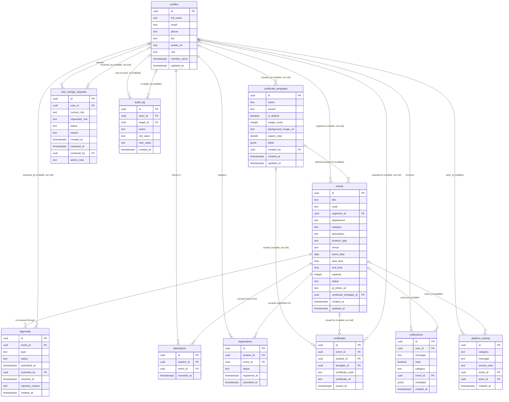
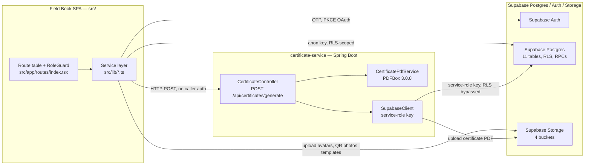
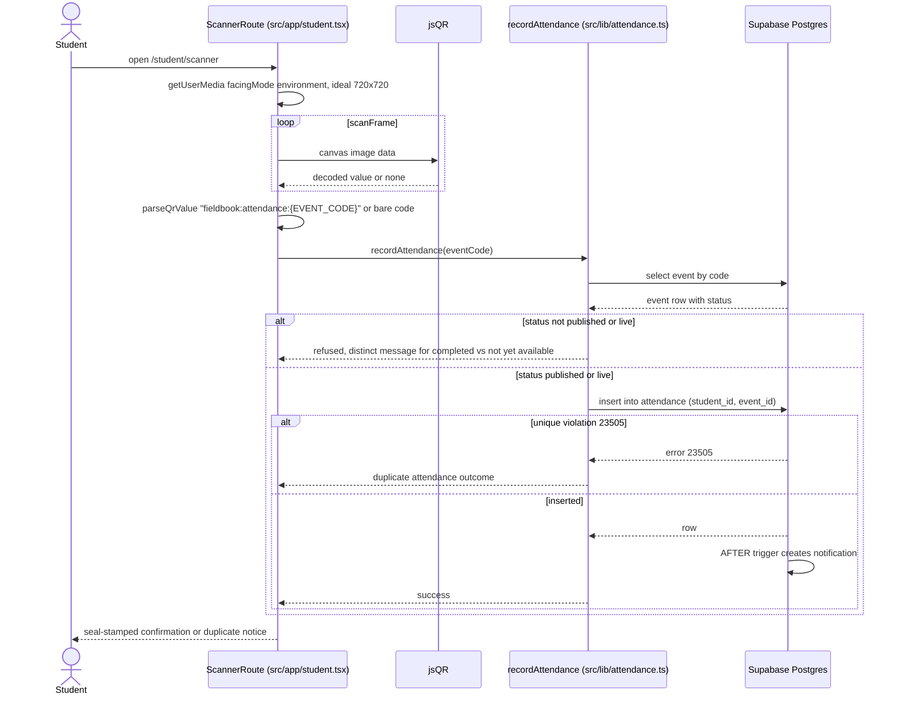
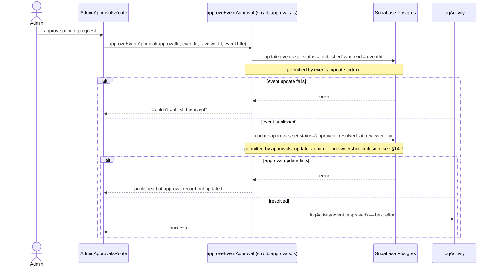

# Design Document

## Overview

This design specifies how **Field Book SRS v2.0** is constructed. The deliverable is a document, not software: one Markdown master at `docs/srs/field-book-srs-v2.0.md` with every image asset under `docs/srs/assets/`, spanning 38–42 rendered pages across 21 numbered sections, front matter, and a Requires-Confirmation appendix (Requirement 13.4, Requirement 7.1, Requirement 7.8).

Two SQL artifacts are also *specified* here — the corrective forward migrations required by Requirements 18 and 19. This design states their DDL, their verification procedure, and their rollback. It does not create them. Creating and applying them is gated on the user's recorded confirmation (Requirements 18.10 and 19.11).

`docs/` exists and holds only `MIGRATION_GUIDE.md`; `docs/srs/` does not yet exist and is created by the authoring activity. Both Available_Screenshots (`fieldbook-homepage.png`, `fieldbook-login-mobile-390.png`) sit at the repository root and are copied — not moved — into `docs/srs/assets/`, so no existing repository reference to them breaks (Requirement 13.2).

### Design goals

1. **Nothing in the document is unfalsifiable.** Every factual statement resolves to a repository path, to SRS_v1, or to a Requires_Confirmation_Marker. The design therefore treats *citation resolution* and *identifier consistency* as mechanical gates rather than review opinions (Requirements 1, 2, 3).
2. **Authoring is mechanical, not creative.** Section 3 of this design fixes, per SRS_v2 section, the subsections, the real named objects, the artifacts carried, and the requirement identifiers satisfied. An author working from that plan makes wording choices only.
3. **Maturity is never implied.** Every requirement, workflow, and module carries one of exactly three Implementation_Status values, stated identically in three places: the section, the Implementation_Status_Table, and the RTM row (Requirement 17.19). The design makes that three-way agreement a checked invariant rather than a discipline.
4. **The two known defects are documented as defects.** The organizer self-publish path and the missing admin self-approval guard are described in the present tense as current behaviour, classified `Partially Implemented`, and paired with a specified correction (Requirements 16.6, 16.7, 17.13).

### Constraints that shape the design

| Constraint | Source | Consequence for the design |
|---|---|---|
| Repository outranks SRS_v1 wherever both address a subject | Requirement 1.1 | SRS_v1 wording is quoted only from the user-supplied attachment; every conflict becomes an Appendix A row plus a revision-history row |
| Reference_SRS supplies structure only | Requirement 1.3, 1.4 | The 21-section order and Page_Budget come from it; a banned-lexicon scan (`expense`, `claim`, `reimbursement`, `voucher`) proves no content did |
| Exactly 13 figures, 30 screenshot rows, 22 listings | Requirements 8.1, 9.1, 10.1–10.3 | Fixed inventories; the design allocates every one to a section and a source |
| No frontend test runner exists | `package.json` declares no vitest, jest, playwright, or testing-library | Every Execution_Status_Column cell is the literal `Not executed` (Requirement 12.7) |
| Page band 38–42 | Requirement 7.2, 7.8 | Appendix B's 42.0-page allocation is at the ceiling, so any overrun must be paid for by deletion, not by margin changes |
| Existing migrations are immutable | Requirements 18.4, 19.5 | Corrections are new files sorting after `20260907120000` |

### Traceability approach

Traceability runs in one direction and is checked in both:

```
requirement identifier ──► SRS_v2 section (defining statement + Implementation_Status)
                      ──► Implementation_Status_Table row
                      ──► RTM row (section, module path, route, test case ids, Implementation_Status)
                      ──► ≥1 Test_Case_Table row
                      ──► ≥1 Evidence_Citation  ──► repository file at pinned revision 3cc14af
```

Every arrow is a total map. The forward direction is authored; the reverse direction is verified by the checks in the Correctness Properties section, which is what makes the 84-identifier set maintainable by hand.

---

## Architecture

### Document architecture

The master is a single Markdown file. Heading levels carry document structure and are the anchor for every automated check, so their use is fixed:

| Level | Use | Example |
|---|---|---|
| `#` | Document title only, once | `# Field Book — Software Requirements Specification v2.0` |
| `##` | Front-matter blocks, the 21 numbered sections, each appendix | `## 8. Database Requirements` |
| `###` | Numbered subsections | `### 8.3 events` |
| `####` | Requirement blocks, policy blocks, use cases, test-case groups | `#### REQ-36 — Capacity-safe registration` |
| `#####` | Reserved; unused, so a level-5 heading is a lint error | — |

Section headings are `## <n>. <Title>` where `<n>` and `<Title>` are copied verbatim from the Appendix B table. That literal coupling is what allows the heading-order check to compare the delivered heading sequence against Appendix B row order (Requirement 7.1).

**Front matter**, ahead of section 1, in this order:

1. Title page block — document title, `Version 2.0`, issue date, the three author names (Prince, Nandini Mehta, Mahi Agrawal), and `Poornima Institute of Engineering & Technology, Jaipur` (Requirement 7.5).
2. Revision history table — two rows, v1.0 and v2.0, each with version, date, authors, and change summary; the v2.0 row lists every Legacy_Requirement_ID whose wording was corrected, or states that none changed (Requirement 7.6).
3. Table of contents — one row per Appendix B row, with section number, title, and start page (Requirement 7.7).
4. Reading conventions block — the Implementation_Status vocabulary and its three definitions verbatim from Requirement 17.1, the Evidence_Citation form, and the Requires_Confirmation_Marker form. Placing the vocabulary here, once, is what lets sections 3–21 use the labels without redefining them (Requirement 7.4).

**Appendices**, after section 21, in this order: Appendix RC (the RC_Register), then the supporting registers that Appendix B's final row absorbs — Identifier_Continuity_Table, Coverage_Checklist_Table, screenshot inventory, listing inventory. The RC_Register is the appendix that Appendix B's last row names, so it is always first among appendices.

### Asset layout and filename scheme

```
docs/
  srs/
    field-book-srs-v2.0.md
    assets/
      screenshot-D01-pricing-1440.png
      screenshot-D05-login-1440.png
      screenshot-A01-landing-1440.png          # copy of fieldbook-homepage.png
      screenshot-A02-login-mobile-390.png      # copy of fieldbook-login-mobile-390.png
      figure-C06-er-diagram.svg                # only if Mermaid does not render
      figure-C07-class-diagram.svg
```

Screenshot filename grammar: `screenshot-<row-id>-<slug>-<width>.png`, where `<row-id>` is the Appendix D identifier with its hyphen removed (`D-01` → `D01`, `Available-1` → `A01`), `<slug>` is a lowercase hyphenated route slug, and `<width>` is the capture viewport width in pixels. The width in the filename and the intrinsic pixel width of the file must agree, which turns Requirement 9.3 into a check that reads the PNG header rather than a claim (see Property 12).

Diagram export filename grammar: `figure-<figure-id>-<slug>.svg`, `<figure-id>` being the Appendix C identifier with the dot removed (`C.6` → `C06`). Exports exist only for figures that the Markdown renderer fails on; the Mermaid source stays in the master either way (Requirement 13.7).

Every reference is relative from the master: ``. No absolute path, no external URL (Requirement 13.3).

### Numbered_Artifact identifier allocation

Identifier form is `<Type> <section>.<sequence>` with `Type ∈ {Figure, Table, Screenshot, Listing}` (Requirement 6.1). The four types number **independently within each section**, each starting at 1 and incrementing by exactly 1 in order of first appearance (Requirement 6.2). So section 8 may hold `Table 8.1 … Table 8.14` and `Listing 8.1` simultaneously without collision.

Allocation rule that keeps sequences contiguous under editing: an artifact's sequence number is assigned only when the section is otherwise complete, in a single left-to-right pass over the finished section body. Draft text refers to artifacts by a stable slug (`{{er-diagram}}`) which the numbering pass rewrites. This is the design decision that prevents the renumbering churn Requirement 6.3 exists to catch.

Planned allocation, by section and type:

| § | Figures | Tables | Screenshots | Listings |
|---|---|---|---|---|
| 1 | — | 1 (definitions) | — | — |
| 2 | — | 2 (user classes; operating environment) | — | — |
| 3 | — | 2 (role matrix; permission grid) | — | — |
| 4 | 1 (tier overview, reused from C.1 by reference) | 1 (tier interfaces) | — | — |
| 5 | — | 4 (frontend modules; service-layer modules; certificate-service packages; database objects) | — | — |
| 6 | — | 2 (functional requirement index; **Implementation_Status_Table**) | — | — |
| 7 | — | 2 (NFR index; **unmeasured-figure table** per Requirement 15.6) | — | — |
| 8 | — | 14 (11 table definitions + policy set + functions/views + buckets) | — | — |
| 9 | — | 3 (screen index; input-field validation grid; screenshot metadata) | 30 | — |
| 10 | 13 (C.1–C.13) | — | — | — |
| 11 | — | 1 (workflow index with Implementation_Status) | — | — |
| 12 | — | 1 (use-case index) | — | — |
| 13 | — | 2 (validation rules by layer; HTTP error contract) | — | — |
| 14 | — | 3 (auth model; key privilege comparison; defect register) | — | — |
| 15 | — | — | — | 22 |
| 16 | — | 2 (existing gates; **Test_Case_Table**) | — | — |
| 17 | — | 2 (client/browser minimums; runtime and build versions) | — | — |
| 18 | — | 1 (limitations with impact and citation) | — | — |
| 19 | — | 1 (future enhancements with rationale) | — | — |
| 20 | — | — | — | — |
| 21 | — | 1 (**RTM**) | — | — |
| RC | — | 1 (**RC_Register**) + 4 (continuity, coverage checklist, screenshot inventory, listing inventory) | — | — |

Totals: 13 Figures, 51 Tables, 30 Screenshots, 22 Listings. Every one needs a caption of 3–25 words beginning with its identifier, ≥2 sentences and ≥30 words of explanatory prose within one page, and ≥1 verbatim body-prose reference (Requirements 6.4, 6.5, 6.9). Section 20 (Conclusion) deliberately carries no artifact, because Requirement 5.20 forbids it introducing any new fact.

### Evidence_Citation placement

Form: `` `path/from/repo/root.ext` `` optionally followed by ` lines <start>–<end>` or ` — symbol <name>`. Line ranges are mandatory where the cited file exceeds 100 lines (Requirement 1.5). Placement rules:

- **First occurrence within the section wins.** The first statement in a section describing a given database object, route, endpoint, or configuration value carries the citation; later statements in the same section about the same object do not repeat it. This keeps section 8 readable and satisfies Requirement 1.5 literally ("at its first occurrence within the section").
- **Table form.** Where a table's rows each describe a distinct object, the citation lives in a dedicated final column named `Evidence`. Prose citations are inline, in parentheses, after the terminating punctuation.
- **SRS_v1-sourced statements** carry the literal marker `(SRS_v1)` in place of a path and never carry a repository path (Requirement 1.11).
- **Planned items** carry either a citation to the file whose content demonstrates the absence — for certificate verification that is `src/app/routes/index.tsx`, which declares no matching route — or the explicit sentence "No Repository artifact exists for this capability." (Requirement 17.6).

### Implementation_Status label placement

The label appears in exactly four kinds of location, and nowhere else:

1. On each requirement block in section 6, as the first line of the block: `**Implementation_Status:** Implemented`.
2. On each of the eight workflow subsections in section 11 and each module subsection in section 5, in the same position.
3. In the Implementation_Status_Table, section 6, as `Table 6.2`.
4. In the RTM's `Implementation_Status` column, section 21.

`Table 6.2 — Implementation_Status_Table` shape (Requirement 17.7):

| Column | Content |
|---|---|
| Requirement | The identifier, e.g. `REQ-36`, `BR-9`, `TBD-5` |
| Series | `Legacy` or `New` |
| Subject | The capability in ≤10 words |
| Implementation_Status | One of the three values |
| Rule | The assignment rule that produced the value: `R1`, `R2`, `R3`, or `R4` |

followed immediately by a count block, presented as rows of the same table so it remains one artifact:

| | |
|---|---|
| `Implemented` | *n* |
| `Partially Implemented` | *n* |
| `Planned` | *n* |
| **Total** | 84 |

The total equals the row count, which equals the RTM row count, which equals the requirement-identifier count (41 legacy + 43 new — see C2.2). Three numbers that must agree — checked by Property 8.

### Three architectural tiers described by the document

For section 4, the tiers and their interfaces are fixed as follows (Requirement 4.6). This is the subject matter of the document, distinct from the document architecture above.

| Tier | Repository root | Responsibilities | Interfaces exposed |
|---|---|---|---|
| React single-page application | `src/` | Routing and role guards, session handling, QR decode, all read/write against PostgREST and Storage under the anonymous key | Browser UI; calls Supabase JS client; calls `POST /api/certificates/generate` |
| Supabase platform | `supabase/migrations/` defines the schema | 11 application tables, 37+ RLS policies, helper functions, SECURITY DEFINER RPCs, triggers, 2 views, 4 storage buckets, Auth | PostgREST over HTTPS; Storage HTTP API; Auth endpoints |
| `certificate-service` Spring Boot module | `certificate-service/` | Template fetch, PDF render with embedded fonts, Storage upload, `certificates` row insert under the service-role key | `POST /api/certificates/generate`; `GET /actuator/health` |

---

## Components and Interfaces

The document is built by eight components. Each is specified below with its inputs, its output into the master, and the requirements it discharges.

### C1. Section-by-section content plan

Legend for the Artifacts column: `F`=Figure, `T`=Table, `S`=Screenshot, `L`=Listing.

#### Front matter — 2.0 pages

Subsections: title page; revision history; table of contents; reading conventions.

Content: the four blocks listed under *Front matter* above. The revision-history v2.0 change summary names the six SRS_v1 corrections that change a Legacy_Requirement_ID's wording — the verification route (A1.1, A1.10), the three phantom `certificates` columns (A1.2, A1.3, A1.4), the event status enumeration (A1.5), the two table names (A3.2, A3.3), the Spring Boot major version (A3.1), and the two enforceability claims (A3.6, A3.7). Reading conventions state the Implementation_Status definitions verbatim.

Artifacts: `T` revision history, `T` table of contents. Requirements: 7.5, 7.6, 7.7, 17.1, 17.2.

#### 1. Introduction — 2.0 pages

Subsections: 1.1 Purpose · 1.2 Scope · 1.3 Objectives · 1.4 Problem statement · 1.5 Definitions · 1.6 References · 1.7 Document overview.

Content. Purpose: Field Book is a campus event platform that issues verifiable participation records. Scope includes: event lifecycle from draft through admin approval to published/live/completed; student registration with capacity enforcement; QR attendance capture; certificate generation with embedded fonts; role-upgrade requests; notifications; an admin audit trail. Scope excludes (each with evidence): public certificate verification (`src/app/routes/index.tsx` declares no verification route), payment processing, offline attendance capture, email delivery of certificates, and multi-campus tenancy. Objectives, numbered, ≥3: (1) replace paper attendance with a QR-captured record that is unique per student per event; (2) issue a certificate whose provenance is a database row rather than a file; (3) confine every role's data access to database-enforced policy rather than UI convention. Definitions: the glossary terms this document uses, plus the three Implementation_Status values. References: SRS_v1 (attachment), the repository at revision `3cc14af`, IEEE 830-1998 as the structural model.

Artifacts: `T 1.1` definitions. Requirements: 5.1, 5.25, 17.1.

#### 2. Overall Description — 2.0 pages

Subsections: 2.1 Product perspective · 2.2 Product functions · 2.3 User classes · 2.4 Operating environment · 2.5 Design constraints · 2.6 Assumptions and dependencies.

Content. Product perspective: the three tiers of the table above, with `Figure 10.1` cross-referenced rather than duplicated. Product functions: eleven, one per functional cluster — authentication, profile, event authoring, approval, registration, attendance, certificate issuance, templates, notifications, role change, audit. User classes: student, organizer, admin, drawn from the `profiles.role` CHECK constraint (`supabase/migrations/20260815120000_initial_schema.sql`), plus the unauthenticated visitor who reaches only the eight public routes. Operating environment: Vercel-hosted SPA, Supabase-hosted Postgres, Render-hosted Spring Boot container; PostgreSQL major version unverifiable → RC entry (Appendix F RC-04). Design constraints: the anonymous key operates under RLS, the service-role key bypasses it, and the certificate endpoint authenticates no caller. Assumptions: a Supabase project exists with Auth email OTP and Google OAuth enabled — the second is unverifiable from the repository (RC-06).

Artifacts: `T 2.1` user classes, `T 2.2` operating environment. Requirements: 5.2, 4.6, 4.7. RC first occurrence: RC-04, then RC-06.

#### 3. User Roles and Permissions — 1.5 pages

Subsections: 3.1 Role definitions · 3.2 Permission grid · 3.3 Guard behaviour · 3.4 Role acquisition and change.

Content. Exactly three rows in the permission grid — student, organizer, admin (Requirement 5.3) — with one column per permission-bearing capability, each granted cell carrying evidence. Columns, derived from the 37 policies plus the RPC grants: read published events; read own draft events; insert event as draft; update own event; delete own draft event; set event status to published; read all profiles; read own profile; read organizer directory; read event attendee names; insert attendance; insert registration; cancel registration; read own certificates; read own event's certificates; insert certificate; insert/update certificate template; read notifications; submit role-change request; resolve role-change request; read audit log; insert audit row; read platform activity.

Two cells are the document's honesty test. `set event status to published` is granted to admin (`events_update_admin`) and, as current behaviour, reachable by organizer via `events_update_own_organizer`, which carries `with check (organizer_id = auth.uid())` and no status restriction. That cell reads `Reachable — defect, see §14.6` and is not marked as a granted capability. `resolve role-change request` for a request about oneself reads `Not prevented — defect, see §14.7`.

Guard behaviour: `RoleGuard` wraps `/student`, `/organizer` (`allow="org"`), `/admin`; `AuthRouteGuard` wraps `/profile`; the catch-all `*` renders the landing page rather than a not-found page (`src/app/routes/index.tsx`).

Artifacts: `T 3.1` role definitions, `T 3.2` permission grid. Requirements: 5.3, 16.6, 16.7.

#### 4. System Architecture — 2.0 pages

Subsections: 4.1 Tier decomposition · 4.2 Interfaces and data-flow direction · 4.3 Trust boundaries · 4.4 Data-access paths · 4.5 Deployment topology.

Content. The tier table above, expanded. Interfaces with direction: browser → PostgREST (read/write, anonymous key, RLS-scoped); browser → Storage (upload avatars, QR photos, templates); browser → `POST /api/certificates/generate` (write-triggering, unauthenticated); certificate-service → PostgREST (read `certificate_templates`, insert `certificates`, service-role key, RLS bypassed); certificate-service → Storage (upload to `certificates`); GitHub Actions → Render deploy hook and → `/actuator/health`. Trust boundaries: two — the browser/Supabase boundary where RLS is the control, and the certificate-service/Supabase boundary where no control exists. Data-access paths: the three RPC paths that exist because no direct policy suffices — `event_attendees` (organizer reads attendee names; no organizer select policy on `profiles`), `register_for_event` (row lock for capacity), `approve_role_change_request` / `reject_role_change_request`.

Artifacts: `T 4.1` tier interfaces with direction and evidence. Requirements: 4.6, 4.7, 5.6, 16.2. RC first occurrence: RC-07 (production frontend origin: `README.md` says `field-book-delta.vercel.app`, `render.yaml` sets `https://field-book.vercel.app`).

#### 5. Module Descriptions — 2.0 pages

Subsections: 5.1 Frontend route modules · 5.2 Frontend service layer · 5.3 certificate-service packages · 5.4 Database objects as modules.

Content. Each module subsection states responsibility, inputs, outputs, dependencies, repository path, and Implementation_Status (Requirements 5.7, 17.3). Route modules: `PublicRoutes`, `MarketingRoutes`, `LoginRoute`, `AuthCallbackRoute`, `ResetCallbackRoute`, `ProfileRoute`, `StudentRoutes`, `OrganizerRoutes`, `AdminRoutes`, `RoleGuard`, `AuthRouteGuard`, `AdminUiContext`, `ErrorBoundary`. Service layer: `src/lib/supabaseClient.ts`, `auth.ts`, `events.ts`, `approvals.ts`, `attendance.ts`, `registrations.ts`, `certificates.ts`, `roleRequests.ts`, `activity.ts`. certificate-service packages: `controller`, `dto`, `service`, `supabase`, `config`, `exception`, `model`. Database objects: the 11 tables, the helper functions `current_profile_role` / `is_admin` / `is_organizer`, the RPCs, the two views, the four buckets.

`src/lib/approvals.ts` carries a documentation note. Its doc comment on `submitEventApproval` states that "the events_insert_organizer / events_update_own_organizer RLS policies don't allow organizers to set status to anything but 'draft' themselves." That is true of `events_insert_organizer` and false of `events_update_own_organizer`. The module description records the discrepancy and cross-references §14.6, classifying the module `Implemented` (its behaviour is correct — it never writes `published` outside the admin path) while flagging the comment as inaccurate.

Artifacts: `T 5.1`–`T 5.4`. Requirements: 5.7, 17.3, 17.4, 17.5.

#### 6. Functional Requirements — 4.0 pages

Subsections: 6.1 Requirement format · 6.2 Legacy requirements REQ-1…REQ-32 · 6.3 Business rules BR-1…BR-6 · 6.4 Open items TBD-1…TBD-3 · 6.5 New requirements REQ-33…REQ-60 · 6.6 New business rules BR-7…BR-15 · 6.7 New open items TBD-4…TBD-8 · 6.8 Implementation_Status_Table.

Content: 84 requirement blocks, each with identifier, statement, acting role, data object, Implementation_Status, evidence or absence statement, and — for `Planned` items — a cross-reference to §19 (Requirement 17.11). The full identifier model is in component C2.

Artifacts: `T 6.1` functional requirement index, `T 6.2` Implementation_Status_Table. Requirements: 4.1, 4.3, 4.4, 5.4, 17.3–17.11.

#### 7. Non-Functional Requirements — 1.5 pages

Subsections: 7.1 Performance · 7.2 Reliability and availability · 7.3 Security posture summary · 7.4 Maintainability · 7.5 Portability · 7.6 Accessibility intent · 7.7 Unmeasured figures.

Content. `T 7.2` is the Requirement 15.6 table, six rows: FCP 1.5 s, QR decode < 250 ms, check-in < 2 s, PDF generation < 8 s, availability 99.0 %, WCAG 2.1 AA. Columns: figure as published in SRS_v1 · status `Unmeasured` · measurement method · RC identifier. Measurement methods state the observed quantity, ≥10 observations, the reported statistic, and the environment (Requirement 15.3); the availability method states window, sampling interval, unavailable-sample definition, and the arithmetic (Requirement 15.4). The section states that the repository contains no benchmark artifact, no accessibility tooling, and no availability series, and that `.github/workflows/keep-alive.yml` issues a health request every 10 minutes and retains no result (Requirement 15.5). Full accessibility conformance validation requires manual testing with assistive technologies and expert review; neither was performed (Requirement 15.1).

Artifacts: `T 7.1` NFR index, `T 7.2` unmeasured figures. Requirements: 5.5, 15.1–15.8. RC first occurrence: RC-11, RC-12.

#### 8. Database Requirements — 4.0 pages

Subsections: 8.1 Overview and migration order · 8.2 `profiles` · 8.3 `events` · 8.4 `approvals` · 8.5 `certificate_templates` · 8.6 `certificates` · 8.7 `notifications` · 8.8 `audit_log` · 8.9 `role_change_requests` · 8.10 `platform_activity` · 8.11 `attendance` · 8.12 `registrations` · 8.13 Functions and triggers · 8.14 Views · 8.15 Storage buckets · 8.16 Row-level security policy catalogue.

Per-table content is fully determined. Each of 8.2–8.12 carries one Table artifact with columns: column name · type · nullability · default · constraint · notes. The facts to transcribe:

- **8.2 `profiles`** — `id uuid PK → auth.users(id) on delete cascade`; `full_name text not null`; `email text not null unique`; `phone text`; `bio text`; `avatar_url text`; `role text not null check (role in ('student','organizer','admin'))`; `member_since timestamptz not null default now()`; `updated_at timestamptz not null default now()`. Index `idx_profiles_role`. The prose must state that the timestamp column is `member_since`, not `created_at`.
- **8.3 `events`** — `id uuid PK default gen_random_uuid()`; `title text not null`; `code text not null unique`; `organizer_id uuid → profiles(id) on delete set null`; `department text`; `category text`; `description text`; `location_type text not null default 'in-person' check in ('in-person','online','hybrid')`; `venue text`; `event_date date not null`; `start_time time`; `end_time time`; `capacity integer not null default 0 check (capacity >= 0)`; `status text not null default 'draft' check (status in ('draft','published','live','completed'))`; `qr_photo_url text`; `created_at`; `updated_at`; plus `certificate_template_id uuid → certificate_templates(id) on delete set null` added by `20260907120000_events_certificate_template.sql`. Indexes on `organizer_id`, `status`, `event_date`. The status enumeration has exactly four values; `pending_review` and `cancelled` do not exist (Appendix A1.5).
- **8.4 `approvals`** — `event_id uuid not null → events(id) on delete cascade`; `type text not null default 'new_event' check in ('new_event','recurring','capacity_change','edit')`; `status text not null default 'pending' check in ('pending','approved','rejected')`; `submitted_at`; `reviewed_by uuid → profiles(id) on delete set null`; `resolved_at timestamptz`; `rejection_reason text`; `created_at`.
- **8.5 `certificate_templates`** — `name text not null`; `accent text`; `is_default boolean not null default false`; `usage_count integer not null default 0`; `background_image_url text`; `aspect_ratio double precision`; `fields jsonb not null default '[]' check (jsonb_typeof(fields) = 'array')`; `created_by uuid → profiles(id) on delete set null`. Consumed directly by certificate-service over PostgREST.
- **8.6 `certificates`** — `event_id uuid → events(id) on delete set null`; `student_id uuid → profiles(id) on delete set null`; `template_id uuid → certificate_templates(id) on delete set null`; `certificate_code text not null unique`; `issued_at`; `certificate_url text` added by `20260816160000_certificate_url.sql`. All three foreign keys are nullable. There is no `attendance_id`, no `sha256_hash`, and no `pdf_storage_path`; the prose states each absence with the Appendix A finding reference.
- **8.7 `notifications`** — initial `user_id uuid not null → profiles(id) on delete cascade`, `message text not null`, `read boolean not null default false`, `created_at`; extended by `20260821120000_notifications_events.sql` with `category` (CHECK over six values), `event_id`, `metadata`, the `notifications_dedupe_unique` partial index, the `create_notification` chokepoint that is deliberately not granted to `authenticated`, and three AFTER triggers on `registrations`, `attendance`, and `certificates`.
- **8.8 `audit_log`** — `actor_id uuid → profiles(id) on delete set null`; `target_id uuid → profiles(id) on delete set null`; `action text not null`; `old_value text`; `new_value text`; `created_at timestamptz not null default now()`. Append-only *solely* because no UPDATE policy and no DELETE policy exist; no constraint, trigger, or privilege revocation enforces it (Requirement 16.5).
- **8.9 `role_change_requests`** — `user_id uuid not null → profiles(id) on delete cascade`; `"current_role" text not null check in ('student','organizer','admin')`, quoted because `CURRENT_ROLE` is a reserved keyword; `requested_role text not null check in (...)`; `constraint role_change_requests_role_differs check (requested_role <> "current_role")`; `status text not null default 'pending' check in ('pending','approved','rejected')`; `reason text`; `created_at`; `reviewed_at`; `reviewed_by uuid → profiles(id) on delete set null`; `admin_note text`. Partial unique index `idx_role_change_requests_one_pending_per_user on (user_id) where status = 'pending'`. `'admin'` is an allowed `requested_role`, which the prose states plainly because it is what makes §14.7 material.
- **8.10 `platform_activity`** — `category text not null` (free text, deliberately not a CHECK); `message text not null`; `accent_color text not null default '#1E1B16'`; `event_id uuid → events(id) on delete set null`; `actor_id uuid → profiles(id) on delete set null`; `created_at`. Index `idx_platform_activity_created_at`. Admin-only select and insert.
- **8.11 `attendance`** — `student_id uuid not null → profiles(id) on delete cascade`; `event_id uuid not null → events(id) on delete cascade`; `recorded_at timestamptz not null default now()`; `constraint attendance_student_event_unique unique (student_id, event_id)`. SRS_v1 states the constraint as `(event_id, student_id)`; the declared order differs and the constraint is equivalent (A3.9).
- **8.12 `registrations`** — same `(student_id, event_id)` shape, `constraint registrations_student_event_unique`; `status text not null default 'registered' check in ('registered','cancelled')`; `registered_at`; `cancelled_at`. Cancellation is a status flip, not a delete. Indexes `idx_registrations_student`, `idx_registrations_event`. Neither `attendance` nor `registrations` references the other.

8.13 states `current_profile_role()` (sql, stable, SECURITY DEFINER, `set search_path = public`), `is_admin()` and `is_organizer()` (sql, stable, **not** SECURITY DEFINER, `set search_path = public`), all three granted to `authenticated`; `handle_new_user` on `auth.users` AFTER INSERT (not on `public.profiles` — A3.5); `set_updated_at`; `register_for_event`; `cancel_registration`; `event_attendees`; `create_notification`; `approve_role_change_request`; `reject_role_change_request`. 8.14 states `organizer_directory` (distinct `id`, `full_name`, `avatar_url` for organizers holding a non-draft event) and `event_certificate_recipients` (`id`, `full_name`, `event_id`, scoped by `e.organizer_id = auth.uid()`), both granted to `authenticated` and revoked from `anon`, neither exposing email, phone, or bio. 8.16 is the policy catalogue: 37 policies across the six original tables — profiles 6, events 9, approvals 6, certificate_templates 4, certificates 6, notifications 6 — every one scoped `to authenticated`, nothing granted to `anon`; plus the policies added by the later migrations for `attendance`, `registrations`, `audit_log`, `role_change_requests`, `platform_activity`, and storage objects.

Verbatim SQL requirement (5.8) is met by the eight `supabase/migrations/` listings, which live in section 15 and are cross-referenced from here rather than duplicated (Requirement 7.4).

Artifacts: `T 8.1`–`T 8.14`. Requirements: 2.2, 5.8, 16.1, 16.5.

#### 9. User Interface Requirements — 3.0 pages

Subsections: 9.1 Screen inventory and route resolution · 9.2 Public screens · 9.3 Student screens · 9.4 Organizer screens · 9.5 Admin screens · 9.6 Input-field validation grid · 9.7 Screenshot metadata.

Content. A "major screen" is a screen rendered by a route declared in `src/app/routes/index.tsx` (Requirement 5.9). The enumerated leaf route set, read from that file, is:

`/` · `/pricing` · `/campuses` · `/signup` · `/forgot` · `/login` · `/auth/callback` · `/auth/reset-callback` · `/profile` · `/student/dashboard` · `/student/explore` · `/student/explore/:eventId` · `/student/events` · `/student/scanner` · `/student/scanner/:eventId` · `/student/certificates` · `/student/notifications` · `/organizer/dashboard` · `/organizer/events` · `/organizer/events/create` · `/organizer/qr` · `/organizer/attendees` · `/organizer/attendees/:eventId` · `/organizer/analytics` · `/organizer/certificates` · `/admin/dashboard` · `/admin/approvals` · `/admin/users` · `/admin/role-requests` · `/admin/templates` · `/admin/analytics` · `/admin/settings` · `/admin/notifications`

That is **33 leaf paths excluding the catch-all `*`**, of which two (`/student/scanner/:eventId`, `/organizer/attendees/:eventId`) are parameterised variants rendering the same component as a sibling path, giving **31 distinct screens**. Three layout paths (`/student`, `/organizer`, `/admin`) render `RoleGuard` and no screen. Requirement 11.6 and Appendix A2.19 both state 25 routes; the route table does not bear that number out. §9.1 states the enumerated set and the count 33, records the discrepancy against the stated 25, and the RTM screen column resolves against the enumerated set rather than against the count. A new RC entry carries the discrepancy for the user to settle.

Per screen: purpose, functionality, and for each input field the accepted format or range and the rejection behaviour. The validation grid draws real rules — six-digit OTP with distinct expired-code and rate-limit handling (`src/lib/auth.ts`); event `capacity >= 0` and the four-value status enum; `location_type` three-value enum; QR payload `fieldbook:attendance:{EVENT_CODE}` with a bare-event-code fallback; the `@NotBlank` set on `CertificateRequest` (`studentName`, `eventTitle`, `templateId`, `certificateCode`) with `eventId` and `studentId` nullable.

Artifacts: `T 9.1`–`T 9.3`, `S 9.1`–`S 9.30`. Requirements: 5.9, 6.11, 9.1–9.9.

#### 10. System Diagrams — 3.0 pages

Subsections: 10.1 Diagram conventions · 10.2 Architecture and context · 10.3 Data flow · 10.4 Use cases · 10.5 Data model · 10.6 Classes · 10.7 Sequences · 10.8 Activities · 10.9 Deployment.

Content: `Figure 10.1` … `Figure 10.13`, mapping one-to-one onto Appendix C's `C.1`–`C.13`. Full specification in component C3. 10.1 states the conventions: dashed border plus the label `(Planned)` marks any element representing a `Planned` capability, and each such figure's caption names the element, its Implementation_Status, and the visual treatment (Requirement 17.15).

Artifacts: `F 10.1`–`F 10.13`. Requirements: 5.10, 8.1–8.10, 13.5, 13.6, 17.14, 17.15.

#### 11. Detailed Workflows — 2.5 pages

Subsections, one per mandated workflow (Requirement 5.11), each stating initiating actor, trigger, ordered steps, terminal outcome, failure paths, and Implementation_Status: 11.1 Registration and login · 11.2 Event creation · 11.3 Event approval · 11.4 QR attendance capture · 11.5 Duplicate attendance prevention · 11.6 Certificate generation · 11.7 Certificate verification · 11.8 Role upgrade.

Content anchors. 11.1: signup writes a profile via the `on_auth_user_created` trigger on `auth.users`; six-digit email OTP; Google OAuth with PKCE and in-library code exchange (`src/lib/supabaseClient.ts`, `src/lib/auth.ts`); recovery via `resetPasswordForEmail` with `redirectTo` `/auth/reset-callback`, expiry held by the Supabase project (RC-05). 11.2: organizer inserts with `status = 'draft'` forced by `events_insert_organizer`, then `submitEventApproval` inserts an `approvals` row. 11.3: admin calls `approveEventApproval`, which updates `events.status` to `published` first and the `approvals` row second, under `events_update_admin` and `approvals_update_admin`; failure between the two writes leaves a published event with a pending approval, which the document states as a known non-atomicity. 11.4: payload `fieldbook:attendance:{EVENT_CODE}`, camera constraints `width/height ideal 720` with `facingMode: "environment"`, jsQR on canvas image data, image-upload decode with `inversionAttempts: "attemptBoth"`, manual code entry fallback; attendance refused unless event status is `published` or `live`. 11.5: the insert violates `attendance_student_event_unique`, Postgres returns `23505`, and `recordAttendance` maps it to a duplicate outcome. 11.6: client calls `POST /api/certificates/generate`; the service fetches the template, downloads the background, stamps three fields, uploads the PDF, inserts the `certificates` row under the service-role key, returns `{"certificateUrl": ...}`; a 60-second client timeout with one retry covers Render cold starts. 11.7: **`Planned`** — stated in future voice only, with `src/app/routes/index.tsx` cited as the artifact demonstrating the absence, plus entries in §18 and §19 (Requirements 5.22, 5.26, 17.12). 11.8: student submits a `role_change_requests` row, blocked by the partial unique index if one is pending; an admin resolves it through the SECURITY DEFINER RPC, which updates request, profile role, and audit log in one call.

Artifacts: `T 11.1` workflow index with Implementation_Status. Requirements: 5.11, 5.22, 5.26, 17.3, 17.10, 17.12. RC first occurrence: RC-05.

#### 12. Detailed Use Cases — 2.0 pages

One use case per actor-visible capability in `Figure 10.5`, each with identifier `UC-<n>`, primary actor, preconditions, main flow, alternate flows, postconditions (Requirement 5.12). The set is fixed by the use-case diagram, so C3's element list for C.5 is also the section-12 index: UC-1 Sign up with OTP · UC-2 Sign in with Google · UC-3 Recover password · UC-4 Edit profile · UC-5 Browse published events · UC-6 View event detail · UC-7 Register for event · UC-8 Cancel registration · UC-9 Capture attendance by QR · UC-10 Enter attendance code manually · UC-11 View own certificates · UC-12 View notifications · UC-13 Create event draft · UC-14 Submit event for approval · UC-15 Display event QR · UC-16 View attendees · UC-17 View organizer analytics · UC-18 Issue certificates for an event · UC-19 Review event approvals · UC-20 Manage users · UC-21 Resolve role-change requests · UC-22 Manage certificate templates · UC-23 View platform activity · UC-24 Request role upgrade.

Artifacts: `T 12.1` use-case index. Requirements: 5.12.

#### 13. Validation and Error Handling — 1.0 page

Subsections: 13.1 Client-side validation · 13.2 Database-enforced constraints · 13.3 HTTP error contract · 13.4 Retained versus discarded input.

Content. Per rule: validated input, accepted values, observable rejection behaviour, whether submitted data is retained or discarded, enforcing layer (Requirement 5.13). The HTTP contract from `ValidationExceptionHandler`: `MethodArgumentNotValidException` → **400** with `{"error":"Validation failed","fields":{...}}`; `TemplateNotFoundException` → **404** `{"error":"Template not found","message":...}`; `SupabaseIntegrationException` → **502** `{"error":"Supabase integration failure",...}`, logged at error; `IllegalStateException` → **422** `{"error":"Certificate cannot be generated",...}`, logged at warn. Success is **200** with `{"certificateUrl": ...}`. The 422 path's concrete trigger is a template whose `background_image_url` is null or blank, raised in `CertificateController.generate`.

Artifacts: `T 13.1` validation rules by layer, `T 13.2` HTTP error contract. Requirements: 2.3, 5.13.

#### 14. Security Requirements — 2.0 pages

Subsections: 14.1 Authentication · 14.2 Authorization model · 14.3 Row-level security catalogue summary · 14.4 Key privilege boundary · 14.5 Cross-origin policy · 14.6 Defect: event publication gate · 14.7 Defect: admin self-approval · 14.8 Audit trail · 14.9 Weakness register.

Content. 14.3 summarises the 37 policies with name, operation, and `using` / `with check` expression, citing `supabase/migrations/20260816120000_rls_policies.sql` (Requirement 16.1); the nine `events` policies are quoted in full because §14.6 turns on their exact text. 14.4: the anonymous key operates under RLS; the service-role key bypasses it; no database-level control constrains a service-role holder (Requirement 16.2). It also states that `POST /api/certificates/generate` validates no caller identity, session, or role, executes while holding the service-role key, and therefore lets any caller who reaches it cause certificate issuance without authentication (Requirement 16.3). 14.5: the allow-list seeded with `http://localhost:5173`, extended by `FRONTEND_ORIGIN`, admitting wildcard patterns from `FRONTEND_ORIGIN_PATTERN`, and permitting all origins for GET `/actuator/**` (Requirement 16.4).

14.6 states: `events_update_own_organizer` is declared `using (organizer_id = auth.uid()) with check (organizer_id = auth.uid())` with no restriction on `status`; an organizer therefore can set an owned event to `published` by direct update; the approval gate is enforced only by application code in `src/lib/approvals.ts`; the control is `Partially Implemented`; Requirement 18 states the intended behaviour and the correction; the corrective migration filename is `20260908120000_events_status_publication_gate.sql`. It adds the **documentation defect** separately from the behavioural one: the doc comment in `src/lib/approvals.ts` asserts the policies forbid an organizer setting any status other than `draft`, and the inline comment in `20260817120000_role_change_requests.sql` on `role_change_requests_update_admin` asserts that "self-approval is impossible regardless of client code". Both comments promise guarantees their implementations do not deliver. That is a distinct finding: the behaviour is wrong *and* the code documentation records it as right.

14.7 states: `approve_role_change_request` checks `public.is_admin()` and performs no comparison of `v_request.user_id` against `auth.uid()`; the function therefore permits an admin to approve a request concerning that same admin; the control is `Partially Implemented`; the correction is `20260908130000_role_change_self_approval_guard.sql`. It records the Requirement 19.4 assessment: `approvals_update_admin` is declared `using (is_admin()) with check (is_admin())` with no ownership exclusion, and because `events_insert_admin` permits an admin to create an event at any status with any `organizer_id`, an admin can own an event and resolve its own approval record. That is stated as a defect and corrected in the same migration.

14.8: `audit_log` accepts inserts and rejects updates and deletes; the rejection arises solely from the absence of any update or delete policy; no check constraint, trigger, or privilege revocation enforces it; `audit_log_insert_admin` additionally requires `actor_id` to match the calling session (Requirement 16.5).

Artifacts: `T 14.1` authentication methods, `T 14.2` key privilege comparison, `T 14.3` defect register. Requirements: 5.14, 16.1–16.10, 17.13, 18.3, 18.6, 18.7, 19.3, 19.4, 19.7, 19.8. RC first occurrence: RC-09, RC-10 (both `Refuted`, so no inline marker — recorded as decision rows only).

#### 15. Code Listings — 2.0 pages

Three tier headings matching Appendix E's grouping, 22 listings numbered `Listing 15.1` … `Listing 15.22` (Requirement 10.8). Full extraction plan in component C5.

Artifacts: `L 15.1`–`L 15.22`. Requirements: 5.15, 10.1–10.10.

#### 16. Testing Requirements — 1.5 pages

Subsections: 16.1 Strategy · 16.2 Existing gates · 16.3 Test cases · 16.4 Reporting note.

Content. 16.2 states that `npm run typecheck` runs `tsc -b --force` and that `.github/workflows/frontend-typecheck.yml` gates it, described as an available capability with no execution outcome (Requirement 12.5); that `certificate-service` declares JUnit support through `spring-boot-starter-test` with no test count or outcome (Requirement 12.6); and that the repository declares no automated frontend test runner, naming vitest, jest, playwright, and testing-library as the absent declarations (Requirement 12.7) — confirmed against `package.json`, whose `devDependencies` are `@tailwindcss/vite`, `@types/node`, `@types/react-dom`, `@vitejs/plugin-react`, `tailwindcss`, `typescript`, `vite`. 16.4 is the Requirement 12.10 note: the document reports test intent only, reports no execution results, and every Execution_Status_Column value holds as of the document version date.

Artifacts: `T 16.1` existing gates, `T 16.2` Test_Case_Table. Requirements: 5.16, 12.1–12.10.

#### 17. Hardware and Software Requirements — 0.5 pages

Content. Minimum client hardware for camera-based capture: a device with a rear-facing camera satisfying `facingMode: "environment"` and a viewport ≥ 390 px. Supported browsers: those supporting `getUserMedia`, ES2020 modules, and the Vite 6 output target. Versions transcribed from `package.json` (`typescript ^7.0.2`, `vite 6.3.5`, `react`/`react-dom` 18.3.1 as peer dependencies, `@supabase/supabase-js 2.112.3`, `jsqr ^1.4.0`, `motion 12.23.24`, `react-router 7.13.0`, `tailwindcss 4.1.12`), from `certificate-service/pom.xml` (`spring-boot-starter-parent` 4.1.0 — **not** Spring Boot 3 as SRS_v1 states; `java.version` 17; PDFBox 3.0.8), and from `certificate-service/Dockerfile`.

Artifacts: `T 17.1` client and browser minimums, `T 17.2` runtime and build versions. Requirements: 5.17, A3.1.

#### 18. Limitations — 0.5 pages

One table; per row: identifier, limitation, impact on system use, evidence, enforcement layer, RC identifier where one exists (Requirements 5.18, 16.9). Rows include: no caller authentication on the certificate endpoint; service-role key unconstrained by any database control; organizer self-publish reachable; admin self-approval not prevented; admin resolution of an own-event approval not prevented; certificate verification absent; no database link between attendance and certificate issuance; audit-log append-only by policy absence only; no accessibility tooling; no performance benchmark harness; no availability measurement series (the last three as three separate entries per Requirement 15.8); no frontend automated test runner; residual mock data in the organizer attendee screen; the two-write non-atomicity in `approveEventApproval`; the Storage-upload/row-insert non-atomicity in `CertificateController.generate`; the `README.md` / `render.yaml` origin disagreement.

Artifacts: `T 18.1` limitations. Requirements: 5.18, 15.8, 16.9.

#### 19. Future Enhancements — 0.5 pages

One row per enhancement with rationale, including every A.1 finding — public certificate verification, a certificate integrity hash, a database-level attendance-to-certificate link, the `pending_review` and `cancelled` lifecycle states, and the measured performance and accessibility programmes (Requirement 5.19). Every `Planned` requirement identifier in §6 cross-references here (Requirement 17.11).

Artifacts: `T 19.1` future enhancements. Requirements: 4.8, 4.9, 5.19, 17.11.

#### 20. Conclusion — 0.5 pages

Prose only, introducing no fact absent from §1–§19 and carrying no artifact and no new citation (Requirement 5.20).

Requirements: 5.20, 7.4.

#### 21. Requirement Traceability Matrix — 1.5 pages

One table, 84 rows. Full construction in component C6.

Artifacts: `T 21.1` RTM. Requirements: 5.21, 11.1–11.10, 17.8, 17.9.

#### Appendix RC — 0.5 pages

The RC_Register plus the four supporting registers. Register columns per Requirement 3.3: identifier · statement · section numbers of every inline occurrence · reason the repository does not substantiate it · confirming party · status · decision and date. Rows carried forward from Appendix F keep their identifiers and statuses; new rows continue from RC-13.

Artifacts: `T RC.1` register, `T RC.2` Identifier_Continuity_Table, `T RC.3` Coverage_Checklist_Table (exactly 21 rows), `T RC.4` screenshot inventory, `T RC.5` listing inventory. Requirements: 3.2, 3.3, 3.5, 4.2, 5.23, 9.1, 10.4.

### C2. Requirement identifier model

#### C2.1 Identifier_Continuity_Table design

Purpose: evidence that each of the 41 Legacy_Requirement_IDs is bound in SRS_v2 to the same capability, acting role, and data object it addressed in SRS_v1 (Requirement 4.2).

| Column | Content | Filled from |
|---|---|---|
| Identifier | `REQ-1` … `REQ-32`, `BR-1` … `BR-6`, `TBD-1` … `TBD-3` | Fixed |
| SRS_v1 subject | The capability, acting role, and data object as SRS_v1 states them | SRS_v1 attachment |
| SRS_v1 wording recovery | `Verbatim` · `Subject only` · `Not recoverable` | Author judgement at transcription |
| SRS_v2 subject | The same three elements as SRS_v2 states them | This design + repository |
| Binding | `Unchanged` · `Clause corrected` · `Retained, unimplemented` | Derived |
| Correction | The contradicted clause and its replacement, empty where `Unchanged` | Appendix A |
| Evidence | Repository path substantiating the correction, or `(SRS_v1)` | Appendix A |
| Implementation_Status | One of the three values | Rule set C2.4 |

**Recovery rule.** SRS_v1's requirement statements are recoverable from the user-supplied attachment, which Requirement 1.10 makes the authoritative rendering. Where a statement's exact wording cannot be read from the attachment, the row records `Not recoverable` in the recovery column, states the subject at the granularity that *is* recoverable, and carries a Requires_Confirmation_Marker naming the author team as the confirming party. **The Author_Process does not reconstruct v1 wording by inference.** This design cannot pre-fill the SRS_v1 subject column because the attachment is not a repository file; it fixes the table shape and the transcription discipline instead.

**Anchor set.** Nine legacy subjects are independently substantiated by Appendix A and can be cross-checked against the attachment rather than taken on trust: the verification route (A1.1, A1.10), the three phantom `certificates` columns (A1.2–A1.4), the event lifecycle enumeration (A1.5), the password-reset expiry (A1.6), the four performance figures (A1.7), the availability figure (A1.8), the accessibility conformance claim (A1.9), the attendance unique constraint (A3.9), and the two enforceability claims (A3.6, A3.7). Any disagreement between the attachment and this anchor set is a transcription error to be resolved before the continuity table is treated as complete.

#### C2.2 New_Requirement_ID allocation

28 new functional requirements, `REQ-33` … `REQ-60`, contiguous with no skipped value (Requirement 4.3). Nineteen of the twenty Appendix A.2 capabilities become requirements; A2.20 (residual mock data in the organizer attendee screen) is a defect rather than a capability and becomes `TBD-4` plus a limitations row.

| ID | Title | Source | Status |
|---|---|---|---|
| REQ-33 | Role-change request submission with one pending request per user | A2.1 | Implemented |
| REQ-34 | Atomic admin resolution of a role-change request across request, profile role, and audit log | A2.1 | Partially Implemented |
| REQ-35 | Event registration recording intent to attend | A2.2 | Implemented |
| REQ-36 | Capacity-safe registration under a locked event row | A2.2 | Implemented |
| REQ-37 | Registration cancellation as a status flip preserving history | A2.2 | Implemented |
| REQ-38 | Active registration counts exposed for capacity display | A2.2 | Implemented |
| REQ-39 | Server-side notification generation by AFTER triggers on registrations, attendance, and certificates | A2.3 | Implemented |
| REQ-40 | Notification categorisation and event linkage metadata | A2.3 | Implemented |
| REQ-41 | Notification deduplication by partial unique index | A2.3 | Implemented |
| REQ-42 | Admin platform activity feed | A2.4 | Implemented |
| REQ-43 | Organizer retrieval of attendee names through a definer-rights function | A2.5 | Implemented |
| REQ-44 | Per-event default certificate template selection | A2.6 | Implemented |
| REQ-45 | Non-sensitive profile exposure through two restricted views | A2.7 | Implemented |
| REQ-46 | Storage buckets with per-bucket size limits and MIME allow-lists | A2.8 | Implemented |
| REQ-47 | Storage object select policies enabling upsert visibility | A2.9 | Implemented |
| REQ-48 | Role resolution helpers and automatic profile creation on sign-up | A2.10 | Implemented |
| REQ-49 | Certificate issuance through the certificate-service generate endpoint | A2.11 | Partially Implemented |
| REQ-50 | Cold-start resilient certificate requests with timeout and single retry | A2.13 | Implemented |
| REQ-51 | Scheduled health pinging of the certificate service | A2.12 | Implemented |
| REQ-52 | Cross-origin access control for the certificate service | A2.14 | Implemented |
| REQ-53 | Embedded-font and seal-faithful certificate rendering | A2.15 | Implemented |
| REQ-54 | QR payload format with camera, image-upload, and manual-code decode paths | A2.16 | Implemented |
| REQ-55 | Attendance capture gated on event status | A2.17 | Partially Implemented |
| REQ-56 | Continuous integration workflows for deploy, type check, and health ping | A2.18 | Implemented |
| REQ-57 | Route surface with role-guarded segments and a landing-page catch-all | A2.19 | Implemented |
| REQ-58 | Event publication gate enforced at the database layer | Requirement 18 | Partially Implemented |
| REQ-59 | Prohibition on admin self-approval of role-change requests | Requirement 19 | Partially Implemented |
| REQ-60 | Ownership exclusion on admin resolution of event approvals | Requirement 19.4 | Planned |

Ten new business rules, `BR-7` … `BR-16`, contiguous:

| ID | Rule | Evidence | Status |
|---|---|---|---|
| BR-7 | One attendance record per student per event | `attendance_student_event_unique` | Implemented |
| BR-8 | One pending role-change request per user | `idx_role_change_requests_one_pending_per_user` | Implemented |
| BR-9 | A role-change request must name a role different from the current role | `role_change_requests_role_differs` | Implemented |
| BR-10 | Registration is refused when active registrations reach capacity | `register_for_event` | Implemented |
| BR-11 | An event is created as `draft` and only an admin-driven approval publishes it | `events_insert_organizer`, `src/lib/approvals.ts` | Partially Implemented |
| BR-12 | Certificate codes are unique platform-wide | `certificates.certificate_code unique` | Implemented |
| BR-13 | Event codes are unique platform-wide | `events.code unique` | Implemented |
| BR-14 | Profile email addresses are unique | `profiles.email unique` | Implemented |
| BR-15 | No admin may resolve a role-change request or an event approval concerning that same admin | Requirement 19 | Partially Implemented |
| BR-16 | One registration row per student per event, re-registration reusing that row | `registrations_student_event_unique` | Implemented |

Five new open items, `TBD-4` … `TBD-8`, contiguous:

| ID | Open item | Why open |
|---|---|---|
| TBD-4 | Residual mock data in the organizer attendee screen must be replaced with live data | A2.20 |
| TBD-5 | Which production frontend origin is authoritative | `README.md` and `render.yaml` disagree (A3.8, RC-07) |
| TBD-6 | No automated frontend test runner is declared | `package.json` |
| TBD-7 | No database-level link ties certificate issuance to an attendance record | A1.4 |
| TBD-8 | Two multi-write paths are not atomic: event publish plus approval resolve, and Storage upload plus certificates insert | `src/lib/approvals.ts`, `CertificateController.generate` |

**Identifier census.** 41 legacy + 28 new REQ + 10 new BR + 5 new TBD = **84 requirement identifiers**. That number is the row count of the Implementation_Status_Table, the row count of the RTM, and the total in the status count block.

#### C2.3 Requirements 18 and 19 identifier coverage

Requirements 18 and 19 are requirements *of this spec*, not of SRS_v2. Their subject matter enters SRS_v2 as `REQ-58`, `REQ-59`, `REQ-60`, and `BR-15`, each carrying `Partially Implemented` or `Planned` and each cross-referencing §14.6 or §14.7 and §19. No SRS_v2 requirement is stated in the implemented voice for either intended behaviour while the corrective migrations are unapplied (Requirements 18.7, 19.8).

#### C2.4 Implementation_Status assignment rules

Every one of the 84 identifiers gets its value from exactly one of four rules, and the rule identifier is recorded in the Implementation_Status_Table so the assignment is auditable rather than asserted.

- **R1 → `Implemented`.** Every clause of the requirement statement has at least one Evidence_Citation, and no repository content contradicts any clause.
- **R2 → `Partially Implemented`.** At least one clause is cited, and at least one clause is either uncited or enforced at a layer weaker than the statement claims. "Weaker layer" covers three concrete cases: the statement claims database enforcement and only application code enforces it (`REQ-58`, `BR-11`); the statement claims a guarantee and only a partial check exists (`REQ-59`, `REQ-34`, `BR-15`); the statement carries a numeric target and no measurement exists (the performance and availability NFRs).
- **R3 → `Planned`.** No clause has a citation. Every A.1 finding lands here, as does `REQ-60`, where nothing at all excludes an admin from resolving an approval for an event that admin owns.
- **R4 → mandated value.** Where Requirement 17.13 fixes the value, that value governs and the rule column records `R4`. This applies to the event publication gate and the prohibition on admin self-approval, both `Partially Implemented` while their migrations are unapplied.

Applied outcomes worth stating explicitly:

- Legacy identifiers whose subject is certificate verification: `Planned` by R3, and by the direct mandate of Requirement 17.12.
- Legacy identifiers whose subject is a phantom `certificates` column, the `pending_review` or `cancelled` status, or the `orgs.social` verification endpoint: `Planned` by R3, with the clause corrected per Requirement 4.5 and the capability moved to §19.
- Legacy identifiers carrying the four performance figures, the availability figure, or the accessibility conformance claim: `Partially Implemented` by R2 — the underlying capability exists and is cited, the numeric target is unmeasured. They are not `Planned`, because that would misdescribe a shipped feature, and not `Implemented`, because the target is unsubstantiated.
- `REQ-49`: `Partially Implemented` by R2 — issuance works end to end and is cited, but the endpoint authenticates no caller, so the implied "issuance is restricted to authorised callers" clause is unenforced.
- `REQ-55`: `Partially Implemented` by R2 — the status gate exists in `src/app/student.tsx` at the client layer only; no policy on `attendance` restricts inserts by event status.

### C3. Diagram specifications

Thirteen figures, `Figure 10.1` … `Figure 10.13`, corresponding to `C.1` … `C.13`. Planned elements are drawn with a dashed border and the suffix ` (Planned)` in the node label; every caption containing such a node names the element, states `Planned`, and states the visual treatment (Requirements 17.14, 17.15). Only two figures contain a planned element: `C.4` and `C.5`, both for certificate verification.

| Fig | Family | Mermaid type | Elements | Edges | Justifying source |
|---|---|---|---|---|---|
| 10.1 | System architecture | `flowchart` | Browser SPA; 9 service-layer modules; Supabase Auth, Postgres, Storage; certificate-service controller/service/supabase packages | SPA→Auth, SPA→PostgREST, SPA→Storage, SPA→generate endpoint, service→PostgREST, service→Storage | `src/`, `certificate-service/`, `supabase/migrations/` |
| 10.2 | Context | `flowchart` | Student, Organizer, Admin; Supabase Auth, Supabase Postgres, Supabase Storage, Google OAuth, Render, Vercel | Each actor→Field Book; Field Book→each of the six systems | `src/lib/supabaseClient.ts`, `render.yaml`, `vercel.json`, `.github/workflows/` |
| 10.3 | DFD level 0 | `flowchart` | One process "Field Book"; three external actors; four data stores: Postgres tables, Storage buckets, Auth users, Notification feed | Actor→process (requests), process→store (writes), store→process (reads) | Migration set |
| 10.4 | DFD level 1 | `flowchart` | Eight processes: authenticate, manage event, approve event, record attendance, register, issue certificate, request role change, notify. Plus `verify certificate (Planned)` dashed | Process→store edges per real table access; the planned process has a dashed edge to `certificates` | `src/lib/*`, migration set, `src/app/routes/index.tsx` |
| 10.5 | Use case | `flowchart` (substitution declared) | Three actors; UC-1…UC-24 from §12; `UC verify certificate (Planned)` dashed | Actor→use case association per role guard | `src/app/routes/index.tsx` |
| 10.6 | ER | `erDiagram` | All 11 tables | 20 declared foreign-key relationships, cardinalities from FK nullability | All 16 migrations |
| 10.7 | Class | `classDiagram` | `CertificateController`, `CertificateRequest`, `CertificateResponse`, `CertificateTemplate`, `CertificatePdfService`, `CertificateStorageService`, `CertificateTemplateService`, `SupabaseClient`, `SupabaseConfig`, `SupabaseProperties`, `WebConfig`, `ValidationExceptionHandler`, `TemplateNotFoundException`, `SupabaseIntegrationException`, `DotEnvEnvironmentPostProcessor`; plus exported types from `src/lib/`: `AppRole`, `EventStatus`, `LocationType`, `AdminApproval`, `ApprovalType`, `ApprovalStatus`, `SubmitApprovalResult`, `ListApprovalsResult`, `ResolveApprovalResult` | Constructor dependencies and DTO usage only | `certificate-service/src/main/java/`, `src/lib/` |
| 10.8 | Sequence — QR attendance | `sequenceDiagram` | Student, Scanner screen, jsQR, `recordAttendance`, PostgREST, `attendance` | See skeleton | `src/app/student.tsx`, `src/lib/attendance.ts` |
| 10.9 | Sequence — certificate generation | `sequenceDiagram` | Student/Organizer, `generateCertificateWithRetry`, CertificateController, template service, PDF service, Storage, PostgREST | See skeleton | `src/lib/certificates.ts`, `CertificateController.java` |
| 10.10 | Sequence — event approval | `sequenceDiagram` | Admin, Approvals screen, `approveEventApproval`, PostgREST (`events`), PostgREST (`approvals`), `logActivity` | See skeleton | `src/lib/approvals.ts` |
| 10.11 | Activity — role upgrade | `flowchart` (substitution declared) | Submit request → partial-index check → pending → admin resolve → `is_admin()` gate → update request → update profile role → insert audit row; rejection branch | Decision diamonds at the index check and the admin gate | `supabase/migrations/20260817120000_role_change_requests.sql` |
| 10.12 | Activity — registration with capacity | `flowchart` (substitution declared) | Request registration → lock event row → count active registrations → compare with `capacity` → insert or reuse row → return outcome; refusal branch at capacity | Decision diamond at the capacity comparison | `register_for_event` in `20260820120000_registrations.sql` |
| 10.13 | Deployment | `flowchart` | Vercel host, Render host, Supabase project, GitHub Actions runner; env var **names** only: `FRONTEND_ORIGIN`, `FRONTEND_ORIGIN_PATTERN`, `SUPABASE_URL`, `SUPABASE_SERVICE_ROLE_KEY`, `VITE_SUPABASE_URL`, `VITE_SUPABASE_ANON_KEY` | Deploy-hook edge, health-ping edge, browser→Vercel, browser→Render | `vercel.json`, `render.yaml`, `certificate-service/Dockerfile`, `.github/workflows/` |

Cross-figure label identity (Requirement 8.8) is enforced by a fixed label lexicon used in every figure and in body prose: `Student`, `Organizer`, `Admin`, `Field Book SPA`, `Supabase Auth`, `Supabase Postgres`, `Supabase Storage`, `Google OAuth`, `Render`, `Vercel`, `certificate-service`, and the table names exactly as declared.

#### C3.1 ER diagram skeleton — Figure 10.6

Cardinality derivation: a `not null` foreign key gives mandatory participation on the child side (`||--o{`); a nullable foreign key gives optional participation (`|o--o{`). Every relationship below is a declared foreign key; no inferred relationship appears.



Caption must state that `attendance` and `registrations` share the `(student_id, event_id)` shape and that neither references the other, and that `certificates` carries no reference to `attendance` (A1.4). Mermaid renders `double` and `jsonb` as opaque type tokens, which is acceptable because the authoritative types are transcribed in `Table 8.5` and `Table 8.7`.

#### C3.2 Architecture skeleton — Figure 10.1



#### C3.3 Sequence skeletons — Figures 10.8, 10.9, 10.10



```mermaid
sequenceDiagram
    actor Actor as Student or Organizer
    participant Client as generateCertificateWithRetry (src/lib/certificates.ts)
    participant Ctrl as CertificateController
    participant Tpl as CertificateTemplateService
    participant Pdf as CertificatePdfService
    participant Store as Supabase Storage
    participant PG as Supabase Postgres

    Actor->>Client: request certificate
    Client->>Ctrl: POST /api/certificates/generate (60 s timeout, 1 retry on transient 502)
    Ctrl->>Tpl: fetchTemplate(templateId)
    Tpl->>PG: select certificate_templates row (service-role key)
    alt template missing
        PG-->>Tpl: no row
        Tpl-->>Ctrl: TemplateNotFoundException
        Ctrl-->>Client: 404 Template not found
    else template found
        PG-->>Tpl: background_image_url, aspect_ratio, fields
        Ctrl->>Ctrl: background_image_url null or blank -> IllegalStateException -> 422
        Ctrl->>Store: downloadBytes(background_image_url)
        Ctrl->>Pdf: render(template, background, studentName, eventTitle, certificateCode)
        Pdf-->>Ctrl: pdfBytes
        Ctrl->>Store: uploadCertificate(pdfBytes, certificateCode)
        Store-->>Ctrl: publicUrl
        Ctrl->>PG: insert certificates row (event_id, student_id, template_id, certificate_code, certificate_url)
        alt insert fails
            PG-->>Ctrl: error
            Ctrl-->>Client: 502 Supabase integration failure (PDF already stored)
        else inserted
            PG->>PG: AFTER trigger creates notification
            Ctrl-->>Client: 200 {"certificateUrl": ...}
        end
    end
    Client-->>Actor: certificate link or error state
```



The certificate-approval sequence caption must state the non-atomicity: the two writes are separate PostgREST calls with no wrapping transaction, so a failure between them leaves a published event with a pending approval.

### C4. Screenshot capture harness

#### C4.1 Harness

The application runs locally with `npm run dev`, served at `http://localhost:5173`, started manually by the user in a terminal rather than by the Author_Process, because a dev server is a long-running process. Playwright drives the browser. Default viewport width 1440 px; rows marked mobile are captured at 390 px (Requirement 9.3). Output is lossless PNG written directly into `docs/srs/assets/` under the filename grammar fixed above. Exactly one Appendix D row is captured per Playwright navigation, and the capture step records route, role, viewport width, and capture date into the Appendix D row at the moment of capture, so the metadata cannot drift from the image.

Capture order is grouped by session to minimise sign-in churn: unauthenticated rows first (D-01 … D-05 plus the two Available rows), then the student session (D-06 … D-15), then organizer (D-16 … D-22), then admin (D-23 … D-28).

#### C4.2 Documentation_Account strategy and the role bootstrap problem

Three accounts are needed: `docs-student@…`, `docs-organizer@…`, `docs-admin@…`. Their credentials never appear in SRS_v2 (Requirement 9.7), and every captured screen shows only these accounts' data, which is what satisfies the PII exclusion without post-hoc redaction (Requirement 9.6).

There is a sequencing problem that the design must solve rather than assume away:

1. Sign-up creates a profile through `handle_new_user`, which writes `public.profiles` with the default role. The account therefore starts as a student.
2. `profiles_update_own` does not permit an account to change its own `role`, so no account can promote itself.
3. `role_change_requests` is the sanctioned promotion path, but resolving a request requires a caller satisfying `is_admin()`.
4. There is consequently no in-application path from a fresh database to a first admin.

**Bootstrap procedure — local only, never against a production or shared database.** The first admin is created out of band, by one of two means, both requiring privileges the application never holds:

- *Preferred.* Against the local Supabase instance, execute a one-off statement as the database owner or under the service-role key: `update public.profiles set role = 'admin' where email = '<docs-admin address>';`. This runs outside RLS and is the only step that does.
- *Alternative.* Seed the account through the Supabase Auth Admin API and then apply the same update.

Once one admin exists, the organizer account is promoted through the real product path — the account submits a role-change request, the admin resolves it via `approve_role_change_request` — which has the side benefit of producing genuine data for D-26 (`/admin/role-requests`) rather than seeded data.

This procedure is stated in the design and in the Author_Process log; **it is not stated in SRS_v2 as a system capability**, because it is not one. SRS_v2's §3.4 states plainly that the repository provides no path from an empty database to a first admin and that the first admin must be provisioned outside the application. That is a real limitation and earns a limitations row.

#### C4.3 Data preconditions per screen

`supabase/migrations/20260819110000_seed_demo_data.sql` supplies most of what the admin and organizer screens need, and its guards are `where not exists (select 1 … where id = v.column1)`, so it is idempotent. What it provides: five events (four `draft`, one `published` — *Environmental Policy Symposium*, code `ENV-POL-2026-DEMO`, capacity 100, date 2026-09-14), five approvals (three pending, one approved, one rejected), and ten `platform_activity` rows.

One caveat the design must record: the seed hard-codes three organizer profile UUIDs and one admin reviewer UUID that were created through the Auth Admin API *before* the migration ran. `events.organizer_id` and `approvals.reviewed_by` are real foreign keys into `profiles`, which itself references `auth.users`. On a database where those four auth users do not exist, the seed's inserts fail on the foreign key rather than being skipped. Capturing D-16 … D-28 therefore requires either a database that already carries those users or their recreation with the same UUIDs through the Auth Admin API.

| Screen group | Precondition | How it is met |
|---|---|---|
| D-01 … D-05 | none | Public routes |
| D-06 | signed-in account with a profile | Any Documentation_Account |
| D-07, D-08, D-10 | ≥1 event with status `published`, `live`, or `completed` | Seed's `ENV-POL-2026-DEMO` |
| D-09 | a published event id for `/student/explore/:eventId` | Seed event `11111111-1111-4111-8111-111111111104` |
| D-11 | camera permission granted, or the manual-entry panel visible | Playwright grants `camera`; fall back to the manual-code panel, which is the same screen |
| **D-12** scan success | a `published` or `live` event and no existing `attendance` row for the student | Enter `ENV-POL-2026-DEMO` through the manual-code fallback as `docs-student`. Client gating passes because the event is `published`; the insert succeeds; the success state renders. No image manipulation, no fabricated data |
| **D-13** duplicate | the same student already has an `attendance` row for that event | Repeat the D-12 action immediately. The insert violates `attendance_student_event_unique`, Postgres returns `23505`, and the duplicate state renders. D-12 and D-13 are therefore two frames of one deterministic two-step interaction |
| D-14 | ≥1 `certificates` row for the student | Issue one through `POST /api/certificates/generate` against a template with a `background_image_url`; if no such template exists locally, D-14 becomes an RC entry rather than a fabricated image |
| D-15 | ≥1 `notifications` row | Produced automatically by the AFTER trigger fired during D-12 |
| D-16 … D-22 | organizer role plus ≥1 owned event | Promoted organizer account plus one event it creates as `draft` |
| D-23, D-24, D-28 | admin role plus pending approvals plus activity rows | Seed data |
| D-25 | admin role plus ≥3 profiles | The three Documentation_Accounts |
| D-26 | ≥1 role-change request in each of pending/approved/rejected | Produced by the C4.2 promotion plus one additional request left pending |
| D-27 | ≥1 `certificate_templates` row | Insert one as admin through `/admin/templates`; the screen is capturable while empty, and the empty state is documented as such if no template can be created |

#### C4.4 Redaction, failure path, and Appendix D shape

Redaction applies only where a screen unavoidably shows data that is not a Documentation_Account's: cover the region with an opaque block, no other edit. Permitted post-capture operations are cropping, scaling, and opaque redaction — nothing else (Requirements 9.6, 9.8). The seed data's organizer names (Prof. Linda Okonkwo, Dr. Yusuf Amara, Dr. Mei-Ling Zhao) are fictional seed values rather than real people, so they need no redaction; the design records that judgement rather than leaving it implicit.

Failure path (Requirement 9.5): if a screen fails to render its documented content within 30 seconds on two successive navigations because the role or the data is unavailable, the screenshot is omitted, the Appendix D row is marked `Not captured`, a new RC entry names the screen, the blocking precondition, and the party who can supply it, and **no placeholder image and no dangling image reference is left in the master.** The likely candidates are D-14 (needs a template with a background image) and D-27 (needs template creation to succeed).

Appendix D row columns: row id · screen name · route path as declared in the route table · role required (`student` · `organizer` · `admin` · `any signed-in user` · `none`) · data precondition · viewport width · image file name · capture date · SRS_v2 section that displays it · captured or `Not captured` · RC identifier where not captured (Requirements 9.1, 9.2, 9.4).

### C5. Code-listing extraction plan

Pinned revision: **`3cc14af`**, recorded once in the listing inventory and used for every listing (Requirement 10.4). Redaction tokens, applied uniformly (Requirement 10.6):

| Secret class | Token |
|---|---|
| Supabase URL / project ref | `<SUPABASE_URL>` |
| Anonymous key | `<SUPABASE_ANON_KEY>` |
| Service-role key | `<SUPABASE_SERVICE_ROLE_KEY>` |
| Render deploy hook URL | `<RENDER_DEPLOY_HOOK_URL>` |
| Any other credential literal | `<REDACTED>` |

Elision rule: any source file over 60 lines yields a listing of 10–60 lines, each omission marked with a single `…` line and every omitted range stated as first and last line number in the caption (Requirement 10.5). Every listing in the plan below is drawn from a file over 60 lines except where noted, so elision is the norm rather than the exception.

| # | Tier | File | Symbol / region | Approx. lines | Elide | Redact | Implements |
|---|---|---|---|---|---|---|---|
| 15.1 | React/TS | `src/lib/supabaseClient.ts` | `createClient` call with `flowType: "pkce"`, `detectSessionInUrl` | whole file or top block | if >60 | `<SUPABASE_URL>`, `<SUPABASE_ANON_KEY>` if literals appear | REQ-2 class (auth session), REQ-48 |
| 15.2 | React/TS | `src/lib/auth.ts` | `signUpWithProfile`, `verifySignupOtp` | two contiguous regions | yes | none | OTP signup requirement, REQ-48 |
| 15.3 | React/TS | `src/app/student.tsx` | `parseQrValue` and the `scanFrame` loop | two regions | yes | none | REQ-54, REQ-55 |
| 15.4 | React/TS | `src/lib/attendance.ts` | `recordAttendance` including the `23505` branch | one region | yes | none | BR-7, REQ-55 |
| 15.5 | React/TS | `src/lib/certificates.ts` | `generateCertificateWithRetry` with timeout and retry predicate | one region | yes | none | REQ-49, REQ-50 |
| 15.6 | React/TS | `src/app/routes/index.tsx` | The `<Routes>` block with the three `RoleGuard` layout routes | lines ≈ 58–107 of 112 | yes | none | REQ-57 |
| 15.7 | React/TS | `src/lib/registrations.ts` | The `register_for_event` and `cancel_registration` RPC calls | one region | yes | none | REQ-35, REQ-36, REQ-37, BR-10, BR-16 |
| 15.8 | SQL | `supabase/migrations/20260815120000_initial_schema.sql` | `create table public.profiles` and `create table public.events` with their CHECK constraints | two regions | yes | none | REQ-1 class, BR-13, BR-14 |
| 15.9 | SQL | `supabase/migrations/20260816120000_rls_policies.sql` | `current_profile_role`, `is_admin`, `is_organizer`, the nine `events` policies, the six `certificates` policies | three regions | yes | none | REQ-58, BR-11, and the §14.3 catalogue |
| 15.10 | SQL | `supabase/migrations/20260816140000_profile_creation_trigger.sql` | `handle_new_user` and `on_auth_user_created` | whole file if ≤60 lines | if >60 | none | REQ-48 |
| 15.11 | SQL | `supabase/migrations/20260819120000_attendance.sql` | The table with `attendance_student_event_unique`, plus its policies | lines 6–15 plus policy block | yes | none | BR-7 |
| 15.12 | SQL | `supabase/migrations/20260820120000_registrations.sql` | `register_for_event` including the `for update` row lock | one region | yes | none | REQ-36, BR-10 |
| 15.13 | SQL | `supabase/migrations/20260817120000_role_change_requests.sql` | `approve_role_change_request` in full, plus `idx_role_change_requests_one_pending_per_user` | two regions | yes | none | REQ-33, REQ-34, REQ-59, BR-8, BR-9 |
| 15.14 | SQL | `supabase/migrations/20260821120000_notifications_events.sql` | `create_notification` and the certificates AFTER trigger | two regions | yes | none | REQ-39, REQ-40, REQ-41 |
| 15.15 | SQL | `supabase/migrations/20260822120000_event_attendees_rpc.sql` | `event_attendees` with its in-body authorization check | one region | yes | none | REQ-43 |
| 15.16 | Java | `.../controller/CertificateController.java` | `generate` method including the `IllegalStateException` guard | lines ≈ 71–98 of 98 | yes (drops imports and constructor) | none | REQ-49, REQ-53 |
| 15.17 | Java | `.../dto/CertificateRequest.java` | The whole record with its four `@NotBlank` annotations | 39 lines, no elision | no | none | REQ-49, validation grid §13.1 |
| 15.18 | Java | `.../controller/ValidationExceptionHandler.java` | All four `@ExceptionHandler` methods | lines ≈ 25–64 of 64 | yes (drops imports) | none | §13.3 error contract |
| 15.19 | Java | `.../config/WebConfig.java` | The CORS registration including `FRONTEND_ORIGIN_PATTERN` and the `/actuator/**` mapping | one region | yes | none | REQ-52 |
| 15.20 | Java | `.../service/CertificatePdfService.java` | Field stamping and the percentage-to-point mapping | one region | yes | none | REQ-53 |
| 15.21 | Java | `.../supabase/SupabaseClient.java` | `fetchTemplate`-equivalent and `insertCertificateRecord` | two regions | yes | `<SUPABASE_SERVICE_ROLE_KEY>` if any header literal appears | REQ-49 |
| 15.22 | Java | `certificate-service/pom.xml` | The `spring-boot-starter-parent` 4.1.0 coordinates, `java.version` 17, PDFBox 3.0.8, `spring-boot-starter-test` | one region | yes | none | §17 versions, A3.1 correction |

Tier counts: 7 React/TS (15.1–15.7), 8 SQL (15.8–15.15), 7 Java (15.16–15.22) — matching Requirements 10.1–10.3, each within its tier drawn from a distinct file.

Two departures from Appendix E, both stated in the listing inventory so the change is visible:

1. Appendix E's `E3.7` pairs `pom.xml` with `Dockerfile` in one entry. Requirement 10.3 requires seven listings each from a *distinct* Java source file, and neither `pom.xml` nor `Dockerfile` is a Java source file. The design resolves this by keeping `pom.xml` as `Listing 15.22` under the Java tier heading — it is the file that declares the Java tier — and by transcribing the `Dockerfile` content into `Table 17.2` rather than as a listing. If the user prefers strict adherence to `certificate-service/src/main/java/` for all seven, `Listing 15.22` is replaced by `.../config/SupabaseConfig.java` and the version facts move entirely into `Table 17.2`. Flagged for decision.
2. `.env.local` at the repository root and under `certificate-service/` are excluded entirely and are never cited (Requirement 10.9).

### C6. RTM construction

`Table 21.1`, 84 rows, one per requirement identifier. Columns:

| Column | Content | Resolution rule |
|---|---|---|
| Requirement | The identifier | Must match the Implementation_Status_Table row key exactly |
| Design section | SRS_v2 section number, e.g. `8.11` | Must resolve to an existing heading |
| Module | Repository-relative path with forward slashes, or `No module` | Path must exist at revision `3cc14af` (Requirement 11.5) |
| Screen | A route path from the §9.1 enumerated set, or `No screen` | Requirement 11.6, resolved against the enumerated set |
| Test case | One or more `TC-<n>` identifiers, comma-separated | Each must match exactly one Test_Case_Table row (Requirements 11.7, 11.8) |
| Status | `Implemented` · `Partially Implemented` · `Planned` · `Unimplemented` where Requirement 11.9 applies | `No module` ⇒ `Unimplemented` |
| Implementation_Status | The value from `Table 6.2` | Must equal it exactly; `Unimplemented` ⇒ `Planned` (Requirements 17.8, 17.9) |
| Documenting section | Present only where the status is `Unimplemented`, naming the section that documents the absence | Requirement 11.9 |

Module-to-path resolution uses a fixed mapping so the same requirement never resolves two ways: database requirements resolve to the declaring migration file; frontend behaviour resolves to the `src/lib/*.ts` service module where the logic lives, or to the `src/app/*.tsx` screen where it does not; API behaviour resolves to the Java class; CI behaviour resolves to the workflow file. Where a requirement spans tiers, the module cell names the enforcing tier's path, not all of them, because the RTM is a resolution index rather than a second architecture section.

Screen-to-route resolution maps each requirement to the single route where the capability is exercised. Requirements with no user-facing surface — every `BR-*`, the audit trail, the storage bucket configuration, the CI workflows — take the literal `No screen` (Requirement 11.3). The literal spelling matters: `No screen` and `No module`, capital N, no trailing period.

Test-case resolution: every functional requirement carries ≥1 `TC-<n>`; business rules and open items may share a test case with the requirement they constrain, but no row is left empty (Requirements 11.2, 12.8).

Worked rows:

| Requirement | Design section | Module | Screen | Test case | Status | Implementation_Status | Documenting section |
|---|---|---|---|---|---|---|---|
| BR-7 | 8.11 | `supabase/migrations/20260819120000_attendance.sql` | No screen | TC-03 | Implemented | Implemented | — |
| REQ-58 | 14.6 | `supabase/migrations/20260816120000_rls_policies.sql` | `/organizer/events` | TC-14, TC-15 | Partially Implemented | Partially Implemented | — |
| REQ-60 | 14.7 | No module | No screen | TC-17 | Unimplemented | Planned | 14.7, 19 |

The `REQ-58` row is the pattern for a partially implemented requirement: the module cell names the file whose policy provides the *substantiated* part (ownership scoping), the screen names where an organizer would exercise it, and two test cases cover the current behaviour and the intended behaviour. The `REQ-60` row is the pattern for a planned requirement: `No module`, therefore `Unimplemented`, therefore `Planned`, with §14.7 and §19 named as the sections documenting the absence.

### C7. Corrective migration design

Both migrations are **specified here and created only after the user's dated confirmation is recorded** (Requirements 18.10, 19.11). Neither alters the text of any migration already present (Requirements 18.4, 19.5). Filenames sort after the current latest, `20260907120000_events_certificate_template.sql`.

#### C7.1 Migration A — event publication gate

**File:** `supabase/migrations/20260908120000_events_status_publication_gate.sql`

**The RLS constraint that shapes the design.** A policy cannot express "status must not change." In PostgreSQL, an `UPDATE` policy's `USING` expression is evaluated against the **existing** row and its `WITH CHECK` expression against the **new** row. Neither expression can see both versions, and no `OLD`/`NEW` reference is available inside a policy. So a transition rule of the form `OLD.status = NEW.status` is inexpressible in RLS. Two designs remain:

*Design (a) — pin the organizer's permitted new-status set.* Replace `events_update_own_organizer` with a policy whose `USING` keeps the ownership test and whose `WITH CHECK` requires ownership **and** `status = 'draft'`.

```sql
drop policy if exists "events_update_own_organizer" on public.events;

create policy "events_update_own_organizer" on public.events
for update to authenticated
using (organizer_id = auth.uid())
with check (organizer_id = auth.uid() and status = 'draft');
```

*Design (b) — a `BEFORE UPDATE` trigger comparing `OLD.status` with `NEW.status`, raising unless the actor satisfies `is_admin()`.*

```sql
create or replace function public.enforce_event_status_transition()
returns trigger language plpgsql security invoker
set search_path = public as $$
begin
  if new.status is distinct from old.status and not public.is_admin() then
    raise exception 'Only an admin may change an event''s status.'
      using errcode = '42501';
  end if;
  return new;
end;
$$;

create trigger events_status_transition_guard
before update on public.events
for each row execute function public.enforce_event_status_transition();
```

**Chosen: design (a).** Reasons, in order of weight:

1. It keeps the control in the same mechanism as the other 37 policies, so §14.3's policy catalogue stays the single place a reader looks to learn who can write what. Design (b) splits authorization across two mechanisms, and a trigger is invisible to anyone auditing policies.
2. Requirement 18.1 permits the update only where the actor satisfies `is_admin()` or where the approval function acts under an admin-initiated call. Design (a) delivers that directly: `events_update_admin` continues to permit any status, and the organizer's `WITH CHECK` admits only `draft`.
3. Design (b) fires on *every* event update, including admin updates and the approval path, adding a per-row function call to the hottest write path in the schema for a rule that a policy already expresses.
4. Design (a) is a single reversible DDL statement. Design (b) leaves a function and a trigger behind.

**Stated consequence of design (a), which the design does not paper over.** Because `WITH CHECK` sees only the new row, pinning `status = 'draft'` means an organizer cannot set `live` or `completed` either, and cannot update *any* column on an event that is already `published`, `live`, or `completed` — since any such update would present a new row whose `status` is not `draft`. The repository shows no organizer code path that sets `live` or `completed`: the only writes of `status: "published"` are in `src/lib/approvals.ts` (`approveEventApproval`, ≈ line 200) under `events_update_admin`, and organizers write only `status: "draft"` at creation time in `src/app/organizer.tsx` (≈ lines 1111 and 1151). So this regresses nothing that ships today. It does, however, narrow a capability that Requirement 18.5 asks to be preserved — the ability to update every non-`status` column of an owned event — for events that have left `draft`.

The design therefore states the restriction explicitly as a decision with its consequence: **an organizer may set `status` only to `draft`, and may update an owned event only while it is in `draft`.** If post-approval editing of a published event by its organizer is wanted, design (a) must be extended to a two-policy split:

```sql
-- variant: organizer may edit a draft freely, and may edit a non-draft event
-- only while leaving status at its current value — expressed as two policies
-- whose WITH CHECK pins the permitted target status per lifecycle stage.
create policy "events_update_own_organizer_draft" on public.events
for update to authenticated
using (organizer_id = auth.uid() and status = 'draft')
with check (organizer_id = auth.uid() and status = 'draft');

create policy "events_update_own_organizer_live" on public.events
for update to authenticated
using (organizer_id = auth.uid() and status in ('published','live'))
with check (organizer_id = auth.uid() and status in ('published','live'));
```

The variant permits an organizer to move an owned event between `published` and `live` — which the repository shows no code doing — so it trades a narrower edit restriction for a wider status permission. The plain single-policy form is chosen as the default and the variant is offered for the user's decision. Either way, the migration must be preceded by the confirmation Requirement 18.10 demands.

**Verification (Requirement 18.8), run against a local database after application:**

| Check | Actor | Action | Expected |
|---|---|---|---|
| A-V1 | organizer, owner | `update events set status='published' where id=<own draft>` | rejected, permission error |
| A-V2 | organizer, owner | `update events set status='live'` / `'completed'` | rejected |
| A-V3 | organizer, owner | `update events set title=…, venue=…, capacity=… where id=<own draft>` | succeeds for every non-`status` column |
| A-V4 | organizer, non-owner | any update | rejected, as before |
| A-V5 | admin | `update events set status='published'` | succeeds under `events_update_admin` |
| A-V6 | admin, through the app | `approveEventApproval` end to end | event becomes `published`, approval becomes `approved`, activity row written |
| A-V7 | organizer, through the app | create event, submit for approval | event inserted as `draft`, `approvals` row inserted |

A-V6 is the regression test that matters: the admin approval path in `src/lib/approvals.ts` runs under `events_update_admin`, which this migration does not touch, so it must continue to publish. If any check fails, Requirement 18.9 applies: the migration is treated as failed, a further corrective migration restores the regressed capability, and the intended behaviour is not recorded as implemented.

**Rollback:**

```sql
drop policy if exists "events_update_own_organizer" on public.events;

create policy "events_update_own_organizer" on public.events
for update to authenticated
using (organizer_id = auth.uid())
with check (organizer_id = auth.uid());
```

Delivered as a separate file, `20260908120001_events_status_publication_gate_rollback.sql`, held unapplied. Rolling back restores the defect, which is why the rollback file carries a header comment saying so.

#### C7.2 Migration B — admin self-approval guard

**File:** `supabase/migrations/20260908130000_role_change_self_approval_guard.sql`

`approve_role_change_request(p_request_id uuid, p_admin_note text default null)` is `plpgsql`, `SECURITY DEFINER`, `set search_path = public`, returns `public.role_change_requests`, and is granted to `authenticated`. Its current body runs in this order: (1) `is_admin()` gate raising `42501`; (2) `select … for update` into `v_request`; (3) null check raising `P0002`; (4) already-resolved check raising `22023`; (5) update the request to `approved` with `reviewed_at`, `reviewed_by`, `admin_note`; (6) update `public.profiles.role` to `v_request.requested_role`; (7) insert the `audit_log` row. No step compares `v_request.user_id` with `auth.uid()`.

The correction is a `CREATE OR REPLACE FUNCTION` that reproduces the existing body verbatim and inserts one guard **after step 2 and before step 4** — after the row exists so the message can be specific, before the resolved check so the self-approval error takes precedence over "already resolved":

```sql
create or replace function public.approve_role_change_request(
  p_request_id uuid,
  p_admin_note text default null
) returns public.role_change_requests
language plpgsql
security definer
set search_path = public
as $$
declare
  v_request public.role_change_requests;
begin
  if not public.is_admin() then
    raise exception 'Only admins can approve role change requests.'
      using errcode = '42501';
  end if;

  select * into v_request
  from public.role_change_requests
  where id = p_request_id
  for update;

  if v_request is null then
    raise exception 'Role change request % was not found.', p_request_id
      using errcode = 'P0002';
  end if;

  -- Corrective guard (Requirement 19.1, 19.2): an admin may not approve a
  -- request concerning that same admin. Distinct SQLSTATE so callers can
  -- tell this apart from 42501 / P0002 / 22023.
  if v_request.user_id = auth.uid() then
    raise exception 'An admin cannot approve a role change request about themselves.'
      using errcode = 'P0001';
  end if;

  if v_request.status <> 'pending' then
    raise exception 'This request has already been resolved.'
      using errcode = '22023';
  end if;

  -- steps 5, 6, 7 reproduced verbatim from
  -- supabase/migrations/20260817120000_role_change_requests.sql
  ...
end;
$$;
```

**Error-code choice.** `P0001` is `raise_exception`, the plpgsql default, and is distinguishable from all three codes the function already uses — `42501` (insufficient privilege), `P0002` (no data found), `22023` (invalid parameter value) — satisfying Requirement 19.2. If the project prefers a code that cannot collide with an unrelated bare `raise`, `P0003` is available and equally distinguishable; the design records `P0001` as the default and the alternative as a one-token change. The choice must be reflected in whatever client code surfaces the message; today `src/lib/roleRequests.ts` surfaces the message text rather than branching on the code, so no client change is required.

**Does `reject_role_change_request` need the same guard? No, and the design states why rather than leaving it as an omission.** Rejection is not a privilege escalation: it leaves `profiles.role` unchanged and cannot grant the caller anything. An admin rejecting their own request removes a pending row that only they could have created, which is self-limiting rather than self-serving. Requirement 19.6 also explicitly requires that the ability to *reject any* role-change request be preserved, and adding a self-guard to the reject path would violate that requirement. The function is left untouched, and §14.7 states the asymmetry and its reason so a later reader does not read the gap as an oversight.

**`approvals_update_admin` assessment (Requirement 19.4).** The policy is `using (is_admin()) with check (is_admin())`, with no ownership exclusion. `events_insert_admin` is `with check (is_admin())` with no constraint on `organizer_id` or `status`, so an admin can own an event. Consequently an admin can resolve the approval record for an event that admin owns. That is the same class of defect as the self-approval gap and the same correction is warranted, so it is included in Migration B:

```sql
drop policy if exists "approvals_update_admin" on public.approvals;

create policy "approvals_update_admin" on public.approvals
for update to authenticated
using (
  public.is_admin()
  and not exists (
    select 1 from public.events e
    where e.id = approvals.event_id
      and e.organizer_id = auth.uid()
  )
)
with check (
  public.is_admin()
  and not exists (
    select 1 from public.events e
    where e.id = approvals.event_id
      and e.organizer_id = auth.uid()
  )
);
```

Here the two-version problem does not arise: `event_id` is not the column being changed, so evaluating the same ownership exclusion in both `USING` and `WITH CHECK` is coherent. Note the consequence, which §14.7 must state: an admin who owns an event can no longer resolve that event's approval at all, so a second admin is required. On a single-admin deployment that blocks the flow — which is the intended trade and the reason the requirement exists, but it needs to be said out loud rather than discovered.

**Verification (Requirement 19.9):**

| Check | Actor | Action | Expected |
|---|---|---|---|
| B-V1 | admin | `approve_role_change_request` on a request whose `user_id` = caller | rejected with `P0001`; request `status` still `pending`; subject's `profiles.role` unchanged; no new `audit_log` row |
| B-V2 | admin | same call on a request whose `user_id` ≠ caller | approves; `profiles.role` updated to `requested_role`; `audit_log` row written |
| B-V3 | admin | `reject_role_change_request` on any request, including own | succeeds |
| B-V4 | admin | `select * from role_change_requests` | returns every row |
| B-V5 | non-admin | `approve_role_change_request` | rejected with `42501` — unchanged |
| B-V6 | admin | approve a non-existent request id | rejected with `P0002` — unchanged |
| B-V7 | admin | approve an already-resolved request | rejected with `22023` — unchanged |
| B-V8 | admin, not the event owner | resolve an approval | succeeds |
| B-V9 | admin who owns the event | resolve that event's approval | rejected by policy (zero rows updated, surfaced as an error by `approveEventApproval`) |

B-V5 through B-V7 together with B-V1 establish Requirement 19.2's distinguishability: four scenarios, four distinct SQLSTATE values. If any check fails, Requirement 19.10 applies exactly as 18.9 does for Migration A.

**Rollback:** `20260908130001_role_change_self_approval_guard_rollback.sql`, held unapplied, containing a `CREATE OR REPLACE` that restores the function without the guard and a `DROP`/`CREATE` restoring `approvals_update_admin` to `using (is_admin()) with check (is_admin())`. Its header states that applying it reinstates both defects.

#### C7.3 Confirmation gate

Both migrations change live authorization. Neither is created or executed until the user's explicit confirmation is recorded with its date (Requirements 18.10, 19.11). The confirmation record lives in the Author_Process log and is reproduced in §14.6 and §14.7 once it exists. Until then SRS_v2 describes both behaviours as current defects, classifies both controls `Partially Implemented`, and states neither intended behaviour in the implemented voice.

### C8. Authoring and verification workflow

**Section authoring order.** Not document order. Sections are authored in dependency order so that no section is written against facts a later section might change:

1. §8 Database Requirements — the fact base everything else cites.
2. §4, §5 Architecture and Modules — depend on §8's object names.
3. §3 Roles and Permissions — depends on §8's policy catalogue.
4. §14 Security — depends on §3 and §8; establishes the two defect statements.
5. §13 Validation, §17 Versions — independent transcription.
6. §11 Workflows, §12 Use Cases — depend on §4, §5, §8, §14.
7. §9 UI Requirements — depends on §11; triggers the C4 capture run.
8. §10 Diagrams — depends on §8, §11, §12; label lexicon fixed first.
9. §15 Listings — depends on the C5 plan and the pinned revision.
10. §6, §7 Requirements — depend on everything above, since each requirement's Implementation_Status is derived from the evidence gathered in §3–§15.
11. §16 Testing, §18 Limitations, §19 Future Enhancements — depend on §6.
12. §21 RTM, §20 Conclusion, front matter, Appendix RC — last, because they index everything else.
13. Numbering pass, then the gates below.

**Gates.** Each is a named check with a pass condition; a section is not complete until its gates pass.

| Gate | Requirement | Scope | Pass condition |
|---|---|---|---|
| G1 Evidence check | 2.9 | Per section | Every factual statement checked against the file its citation names; unsubstantiated statements deleted or marked |
| G2 Artifact completeness | 6.10 | Per section | Every artifact has an identifier, a 3–25-word caption, ≥2 sentences and ≥30 words of prose, and ≥1 verbatim body reference |
| G3 Status agreement | 17.18, 17.19 | Per section, then document-wide | Every requirement, workflow, and module carries a status; the section value, the `Table 6.2` value, and the RTM value are identical |
| G4 Citation resolution | 1.8, 6.8, 10.10 | Document-wide | Zero unresolved paths, zero invalid line ranges |
| G5 Screenshot reconciliation | 9.9 | After §9 | Every Appendix D row resolves to one Screenshot or one RC entry; Screenshot count equals the count of rows not marked `Not captured` |
| G6 Listing integrity | 10.10 | After §15 | All 22 listings diff clean against revision `3cc14af`; zero credential literals; tier counts 7/8/7 |
| G7 Vocabulary | 1.4, 12.9, 17.2 | Document-wide | Zero Reference_SRS domain terms; zero test-outcome claims; zero maturity labels outside the three values |
| G8 Page budget | 7.3, 7.9 | Before delivery | Per-section length within 80–125 % of its allocation; total within 38–42 pages |
| G9 Register closure | 3.5 | Before delivery | Every inline marker resolves to exactly one register row; every unresolved register row has ≥1 inline occurrence |

**Page-count measurement.** Requirement 7.8 counts pages "in the delivered output format." The delivered format is Markdown, which has no intrinsic pagination, so the design fixes a measurement procedure and states it in the front matter: render the master to PDF at A4, 2 cm margins, 11 pt body, 1.15 line spacing, with Mermaid figures rendered at their natural size capped to the text width; count the resulting pages. Those five settings are the ones Requirement 7.9 forbids changing to hit the band, so recording them up front is what makes the prohibition enforceable. Per-section page counts come from the same render, measured between section headings. If the total falls outside 38–42, the remedy order is: delete duplicated content first (Requirement 7.4 already forbids it, so any duplication found is a defect), then add content sourced from SRS_v1 or the repository, then update the Page_Budget to match — never adjust the five layout settings.

---

## Data Models

The document is backed by nine structured registers. Each is a Numbered_Artifact of type Table; each has a defined key; and the invariants in the next section are stated over these keys.

| Register | Location | Key | Columns |
|---|---|---|---|
| Implementation_Status_Table | `Table 6.2` | Requirement identifier | Requirement · Series · Subject · Implementation_Status · Rule |
| RTM | `Table 21.1` | Requirement identifier | Requirement · Design section · Module · Screen · Test case · Status · Implementation_Status · Documenting section |
| Identifier_Continuity_Table | `Table RC.2` | Legacy identifier | Identifier · SRS_v1 subject · Wording recovery · SRS_v2 subject · Binding · Correction · Evidence · Implementation_Status |
| Coverage_Checklist_Table | `Table RC.3` | Content area (21 rows) | Content area · SRS_v2 section number |
| RC_Register | `Table RC.1` | `RC-nn` | Identifier · Statement · Inline section numbers · Reason · Confirming party · Status · Decision and date |
| Screenshot inventory | `Table RC.4` | Row id | Row id · Screen · Route · Role · Data precondition · Viewport · File name · Capture date · Displaying section · Captured flag · RC identifier |
| Listing inventory | `Table RC.5` | Listing number | Number · Tier · Path · Reproduced range · Omitted ranges · Redaction tokens used · Requirement identifiers · Revision |
| Test_Case_Table | `Table 16.2` | `TC-<n>` | Identifier · Objective · Preconditions · Steps · Expected result · Requirement identifiers · Execution_Status |
| Unmeasured-figure table | `Table 7.2` | Figure name | Figure as published in SRS_v1 · Status `Unmeasured` · Measurement method · RC identifier |

Cross-register keys that must agree:

```
Implementation_Status_Table.Requirement  ==  RTM.Requirement                (set equality, 84 elements)
RTM.Implementation_Status                ==  Implementation_Status_Table.Implementation_Status  (per key)
RTM.Test case                            ⊆   Test_Case_Table.Identifier      (total map)
RTM.Module                               ⊆   {paths existing at 3cc14af} ∪ {"No module"}
RTM.Screen                               ⊆   {33 enumerated route paths} ∪ {"No screen"}
Identifier_Continuity_Table.Identifier   ==  {REQ-1..32, BR-1..6, TBD-1..3}  (41 elements)
inline RC markers                        ↔   RC_Register.Identifier          (bijection over unresolved entries)
Screenshot artifacts in §9               ==  Screenshot inventory rows with Captured = yes
```

### RC_Register numbering decision

Requirement 3.2 assigns `RC-nn` sequentially from `01` in ascending order of first inline occurrence. Appendix F of the requirements document already fixes twelve identifiers, `RC-01` … `RC-12`, six of which are `Open` and will carry inline markers in SRS_v2 (`RC-04`, `RC-05`, `RC-06`, `RC-07`, `RC-11`, `RC-12`). Those six do not occur in the document in numeric order: `RC-04` and `RC-07` both belong in §2 and §4, while `RC-05` and `RC-06` belong in §11.

Two designs were considered:

- **Renumber for order.** Assign `RC-01` upward strictly by first inline occurrence inside SRS_v2, and carry the Appendix F identifier as a separate `Appendix F origin` column. Fully satisfies Requirement 3.2 but breaks the identifier continuity of an already-approved register, so any conversation referring to "RC-07" becomes ambiguous.
- **Preserve continuity.** Keep `RC-01` … `RC-12` with their Appendix F meanings and statuses, and allocate `RC-13` upward, in first-occurrence order, to entries first introduced in SRS_v2.

**Chosen: preserve continuity**, with the deviation stated in the register's own header note — that rows `RC-01` through `RC-12` are numbered by their Appendix F allocation rather than by first inline occurrence, and that `RC-13` onward follow first-occurrence order. This is a deliberate, recorded deviation from Requirement 3.2 rather than an oversight, and it is flagged for the user's decision; reverting to strict ordering is a mechanical renumber if the user prefers it.

New entries anticipated, allocated in first-occurrence order:

| ID | Statement requiring confirmation | First occurrence | Confirming party |
|---|---|---|---|
| RC-13 | The route count: the route table declares 33 leaf paths excluding the catch-all, while Requirement 11.6 and Appendix A2.19 state 25 | §9.1 | User |
| RC-14 | Whether an organizer is intended to set `status` to `live` or `completed`, which Migration A's chosen form forbids | §14.6 | User |
| RC-15 | Whether a second admin exists, since Migration B's `approvals_update_admin` correction requires one for an admin-owned event | §14.7 | User |
| RC-16 | Whether the three demo organizer auth users and the demo admin reviewer exist in the database used for screenshot capture | §9.7 | Holder of the Supabase project configuration |
| RC-17 | Any Legacy_Requirement_ID whose SRS_v1 wording cannot be recovered from the attachment | Appendix RC | Author team |

`RC-17` is allocated conditionally: if every legacy wording is recoverable, the entry is not created and no identifier is skipped, because `RC-17` would be the last allocated number.

---

## Correctness Properties

*A property is a characteristic or behavior that should hold true across all valid executions of a system — essentially, a formal statement about what the system should do. Properties serve as the bridge between human-readable specifications and machine-verifiable correctness guarantees.*

The deliverable is a document plus two SQL migrations, so quantification is over document elements and over database actors rather than over randomly generated values. Properties 1–14 are checked by deterministic scans over the delivered master and its assets; properties 15–18 are checked against a local database after the corrective migrations are applied. Generator-driven property-based testing with a PBT library does not apply here: there is no pure function under test, the repository declares no frontend test runner, and the input space of each property below is a finite enumeration read out of the delivered artifacts. Each property names its checking method for that reason.

### Property 1: Every Evidence_Citation resolves

*For any* citation appearing anywhere in SRS_v2 — in body prose, in a table's `Evidence` column, in a figure caption, or in a listing caption — the cited path resolves to a file present in the repository at revision `3cc14af`, any stated line range exists within that file, the path is repository-relative with forward slashes and no drive letter or absolute prefix, and where the cited file exceeds 100 lines the citation carries a line range or a symbol name.

**Checking method:** extract every backticked path-shaped token plus its optional range suffix; resolve each against the working tree at the pinned revision; assert existence, range validity, grammar, and the >100-line rule. Expected failures: zero.

**Validates: Requirements 1.5, 1.6, 1.8, 6.7, 6.8, 10.10**

### Property 2: Numbered_Artifact identifiers are unique and contiguous per section and type

*For any* SRS_v2 section and *any* one of the four artifact types, the sequence numbers used by that (section, type) pair form a contiguous integer run starting at 1 with no gap and no repetition; and *for any* two artifacts in SRS_v2, their identifiers differ.

**Checking method:** parse all identifiers of the form `<Type> <section>.<sequence>`; group by (section, type); assert the sorted sequence equals `1..n`; assert global identifier uniqueness.

**Validates: Requirements 6.1, 6.2, 6.3**

### Property 3: Every Numbered_Artifact is captioned, explained, and referenced

*For any* Numbered_Artifact in SRS_v2, a caption exists that begins with the artifact identifier and contains a descriptive phrase of 3 to 25 words; explanatory prose of at least 2 sentences and at least 30 words exists in the same section within one page; and the identifier appears verbatim at least once in body prose outside the caption.

**Checking method:** for each artifact, regex the caption and count its words; count sentences and words in the adjacent prose block; count verbatim identifier occurrences outside the caption. All four conditions must hold.

**Validates: Requirements 6.4, 6.5, 6.9, 6.10**

### Property 4: Implementation_Status is identical in all three statements of it

*For any* requirement identifier stated in SRS_v2, the Implementation_Status value on its defining block in the body, the value in its Implementation_Status_Table row, and the value in its RTM row are all equal; and the three per-value counts in the Implementation_Status_Table sum to the table's row count, which equals the RTM's row count, which equals 84.

**Checking method:** build three maps keyed by identifier from the three locations; assert pairwise equality of all three maps and equality of their key sets; sum and compare the counts.

**Validates: Requirements 17.3, 17.7, 17.8, 17.18, 17.19**

### Property 5: No Listing contains a credential

*For any* Listing in SRS_v2, its body contains no JWT-shaped token, no `service_role` or `sb_` key literal, no Supabase project-reference host, no deploy-hook URL, and no other credential literal; and no Listing cites `.env.local` at the repository root or under `certificate-service/`.

**Checking method:** pattern scan every fenced listing body for the credential patterns; assert zero matches; assert no listing caption cites either excluded file. This property is checked before any commit that adds a listing, because a leak is unrecoverable after publication.

**Validates: Requirements 10.6, 10.9**

### Property 6: Every inline Requires_Confirmation_Marker resolves to exactly one register row

*For any* inline occurrence of the literal text `[Requires Confirmation]` in SRS_v2, it is immediately followed by an identifier of the form `RC-nn` that matches exactly one row of the RC_Register; and *for any* RC_Register row whose status is `Open`, its identifier appears in at least one inline marker; and *for any* RC_Register row whose status is `Confirmed` or `Refuted`, its identifier appears in no inline marker.

**Checking method:** build the inline-marker list and the register key set; assert the marker→row map is total and single-valued; assert the `Open` rows and the inline identifiers cover each other; assert the resolved rows are disjoint from the inline set.

**Validates: Requirements 3.1, 3.2, 3.5, 3.6**

### Property 7: Zero Reference_SRS domain vocabulary

*For any* whole-word token in SRS_v2, the token is not a member of the Reference_SRS domain lexicon — `expense`, `expenses`, `claim`, `claims`, `reimbursement`, `reimbursements`, `voucher`, `vouchers` — under case-insensitive comparison.

**Checking method:** whole-word case-insensitive scan of the delivered master and every caption. Expected count: zero. Note that `claim` is the term most likely to leak through ordinary English usage, so the check runs on every save rather than once at the end.

**Validates: Requirements 1.4**

### Property 8: Every requirement identifier is bound exactly once and appears in exactly one RTM row

*For any* requirement identifier in the union of the 41 Legacy_Requirement_IDs and the 43 New_Requirement_IDs, the identifier appears on exactly one defining requirement statement in §6 and on exactly one RTM row; and no Legacy_Requirement_ID is applied to a requirement introduced in SRS_v2; and each new series is contiguous from its floor — REQ from 33, BR from 7, TBD from 4.

**Checking method:** count defining occurrences and RTM rows per identifier and assert both equal 1; assert the legacy set and the new set are disjoint by construction; assert each series' sorted values form a contiguous run from the stated floor.

**Validates: Requirements 4.1, 4.3, 4.4, 11.1**

### Property 9: Every RTM cell resolves

*For any* RTM row, every cell is non-empty; the design-section cell names an existing SRS_v2 heading; the module cell is either a path existing at revision `3cc14af` or the literal `No module`; the screen cell is either one of the 33 enumerated route paths or the literal `No screen`; every test-case identifier in the cell matches exactly one Test_Case_Table row; and where the module cell holds `No module`, the status cell holds `Unimplemented`, the Implementation_Status cell holds `Planned`, and the documenting-section cell is non-empty.

**Checking method:** per-row cell assertions plus three containment checks against the heading set, the filesystem, and the enumerated route set; plus the two implications.

**Validates: Requirements 11.2, 11.3, 11.4, 11.5, 11.6, 11.7, 11.9, 17.9**

### Property 10: No planned capability is stated in the implemented voice

*For any* sentence in SRS_v2 that names a capability carrying the Implementation_Status value `Planned` — certificate verification foremost among them — the sentence contains none of the verbs *provides, supports, allows, displays, generates, verifies, enforces, returns* applied to that capability as its subject, and contains a future or conditional construction such as *is planned to*, *would*, or *will*; and the item's defining block carries a cross-reference to the Future Enhancements section.

**Checking method:** for each `Planned` item, collect every sentence mentioning it; scan for the eight banned verbs in subject position and for a future-voice token; assert the cross-reference. This is the property that keeps the document honest about the verification workflow, which is the single capability most likely to be overclaimed.

**Validates: Requirements 5.22, 5.26, 17.10, 17.11, 17.12, 17.17**

### Property 11: Every documented database, API, and screen object exists

*For any* table, column, constraint, index, policy, function, trigger, view, or bucket named in §8 or §14, the name occurs in at least one file under `supabase/migrations/`; *for any* endpoint path, request field, or HTTP status code named in §13, it occurs in the controller, DTO, or exception-handler sources; *for any* route path named in §9 or in an RTM screen cell, it occurs in `src/app/routes/index.tsx`; and the six SRS_v1 phantom identifiers — `sha256_hash`, `pdf_storage_path`, `attendance_id`, `pending_review`, `attendances`, `audit_logs` — occur nowhere except in the gap-analysis discussion that records their absence.

**Checking method:** extract identifier sets from the named sections; assert containment in the corresponding source sets; assert the phantom set appears only inside the correction passages.

**Validates: Requirements 2.2, 2.3, 5.9**

### Property 12: Every image asset is relative, resolvable, and captured at its stated width

*For any* image reference in SRS_v2, the reference is relative to the master's location, resolves to a file under `docs/srs/assets/`, is not an absolute path and not an external URL, corresponds to exactly one screenshot-inventory row, and has an intrinsic pixel width equal to the viewport width stated in that row; and *for any* inventory row marked `Not captured`, no image reference exists for it and an RC identifier is present in the row.

**Checking method:** parse image references; resolve each; read each PNG's intrinsic width from its header and compare with the row; assert the not-captured branch leaves no dangling reference.

**Validates: Requirements 9.3, 9.4, 9.5, 9.9, 13.2, 13.3**

### Property 13: Every test case is structurally complete and reports no outcome

*For any* row of the Test_Case_Table, the identifier is unique, the objective spans 1 to 2 sentences, at least 1 precondition is stated, the steps number between 2 and 10, exactly 1 expected result is stated, at least 1 referenced requirement identifier resolves, and the Execution_Status cell holds the literal `Not executed`; and *for any* functional requirement in SRS_v2, at least one test case references it; and the table holds at least 15 rows.

**Checking method:** per-row structural assertions with the two counting bands; build the requirement→test-case map and assert no functional requirement maps to the empty set; assert the row-count floor; assert every status cell is the exact literal.

**Validates: Requirements 12.1, 12.2, 12.3, 12.7, 12.8, 12.9**

### Property 14: Every unmeasured figure is labelled unmeasured in place

*For any* occurrence in SRS_v2 of one of the six carried-forward figures — first contentful paint 1.5 s, QR decode 250 ms, check-in 2 s, PDF generation 8 s, availability 99.0 %, WCAG 2.1 AA — the numeric value is reproduced unchanged, the token `Unmeasured` or `unmeasured` occurs within the same sentence or the same table row, no verb asserting measurement, achievement, testing, or conformance attaches to the figure, and the row of `Table 7.2` carrying the figure states a measurement method.

**Checking method:** locate every occurrence of the six figures; assert value preservation, local `unmeasured` co-occurrence, absence of the banned verbs within the sentence, and the presence of the method in `Table 7.2`.

**Validates: Requirements 2.6, 15.2, 15.3, 15.4, 15.6, 15.7**

### Property 15: Only an admin may set an event's status to a non-draft value

*For any* actor role in {organizer, admin}, *any* ownership relation in {owner, non-owner}, and *any* target value in the four-element `events.status` enumeration, an `UPDATE` of `public.events.status` succeeds if and only if the actor satisfies `public.is_admin()`, or the actor owns the row and the target value is `draft`.

**Checking method:** after Migration A is applied to a local database, sweep the 16-cell (role × ownership × target) matrix and compare the observed permitted/rejected outcome against the stated predicate.

**Validates: Requirements 18.1, 18.2**

### Property 16: Migration A regresses no existing capability

*For any* column of `public.events` other than `status`, an organizer holding the organizer role can still update that column on an owned `draft` event; and the admin approval path in `src/lib/approvals.ts` still transitions an event to `published` and its approval row to `approved`; and an organizer can still insert an event with `status = 'draft'` and insert its `approvals` row.

**Checking method:** column-wise update sweep as the organizer account, then the end-to-end approval flow through the application as the admin account, then the create-and-submit flow as the organizer account. Each must succeed.

**Validates: Requirements 18.5, 18.8, 18.9**

### Property 17: Self-approval is rejected and leaves no trace, while cross-subject approval still works

*For any* pending `role_change_requests` row, a call to `public.approve_role_change_request` by an admin caller is rejected when the row's `user_id` equals `auth.uid()` — leaving the row's `status`, the subject's `profiles.role`, and the `public.audit_log` row set all unchanged — and succeeds when the row's `user_id` differs from `auth.uid()`, updating the row, the subject's role, and the audit log.

**Checking method:** after Migration B, iterate over request rows spanning the `(current_role, requested_role)` pairs the CHECK constraints permit, in both the self-subject and cross-subject configurations; snapshot the three state components before and after each call and compare.

**Validates: Requirements 19.1, 19.6, 19.9**

### Property 18: The four rejection paths carry four distinct error codes

*For any* two of the four rejection scenarios — caller not an admin, request identifier absent, request already resolved, request subject equals caller — the SQLSTATE values raised differ.

**Checking method:** trigger all four paths and assert the collected SQLSTATE set has cardinality 4, containing `42501`, `P0002`, `22023`, and the newly chosen code.

**Validates: Requirements 19.2**

### Property 19: Existing migration files are unchanged and corrective files sort last

*For any* file under `supabase/migrations/` present before this work, its content is byte-identical afterwards; and *for any* corrective migration file added, its filename timestamp sorts after `20260907120000`.

**Checking method:** `git diff --name-status` over `supabase/migrations/` must report additions only; sort the resulting filename list and assert the new files occupy the tail.

**Validates: Requirements 18.4, 19.5**

### Properties deliberately not stated

Four obligations are not expressible as checkable properties and are handled as recorded manual gates instead, because asserting them mechanically would be a false guarantee:

- **Quotation fidelity to the SRS_v1 attachment.** The attachment is not a repository file, so no automated comparison is possible. Gate G1 covers it by human comparison at transcription time.
- **Absence of real-person PII inside a raster image.** Not decidable by scanning. Covered by the Documentation_Account strategy and a per-image review checklist.
- **Image provenance.** That an image came from a live capture rather than a synthesis cannot be read from the file. The surrogate — a bijection between references and inventory rows carrying capture dates — is Property 12; provenance itself is a process guarantee.
- **The per-section self-check having been performed.** Gates G1–G3 are process obligations whose only observable trace is the absence of the violations the other properties detect.

---

## Error Handling

The failure modes here are authoring and verification failures, not runtime exceptions. Each has a defined response, and in every case the response is to remove the unsupported content rather than to soften it.

| Failure | Detection | Response | Requirement |
|---|---|---|---|
| A citation does not resolve | Property 1 / gate G4 | Correct the citation, or delete the statement it supports. Never submit with an unresolved citation | 1.8 |
| A statement has no substantiating source | Gate G1 | Delete it, or retain it with a Requires_Confirmation_Marker plus a register row naming a permitted confirming party | 1.7, 3.1 |
| A mandated content area has no repository artifact | Gate G1 | Retain the section, state within it that the repository substantiates no content for the area, add a register row naming the area and the missing artifact. Do not substitute a description of unimplemented behaviour | 2.10, 5.24 |
| SRS_v1 contradicts the repository | During transcription | Adopt the repository content, add an Appendix A conflict row, add a revision-history row stating the identifier, the v1 wording, the v2 wording, and the evidence. No Requires_Confirmation_Marker — a contradiction is resolved, not open | 1.2, 3.8, 4.5 |
| SRS_v1 states a provider-held value | During transcription | Classify unverifiable, add a register row naming the holding location, keep it out of the conflict table | 1.9, 3.4 |
| A screen will not render within 30 s on two attempts | Capture run | Omit the screenshot, mark the inventory row `Not captured`, add a register row naming the screen, the blocking precondition, and the party who can supply it, leave no placeholder and no dangling reference | 9.5 |
| A Mermaid figure does not render in the delivered format | Requirement 13.5 pre-check across all 13 | Export that figure to `docs/srs/assets/figure-Cnn-slug.svg`, reference it relatively, retain the Mermaid source in the master, state the image format in the caption, record the per-figure result in the RC-03 row | 8.9, 13.6, 13.7 |
| An artifact identifier collides or a sequence has a gap | Property 2 | Renumber the affected artifacts and update every body-prose reference before submission | 6.3 |
| A listing's line range is wrong | Property 1 / gate G6 | Correct the range, or withhold the listing and record the unresolved-citation error identifying the listing number and cited path, retaining the other listings unchanged | 10.10 |
| A credential appears in a listing | Property 5 | Replace with the fixed token before the text ever reaches the master. If it has already been committed, the commit is the incident, not the document | 10.6 |
| The three Implementation_Status statements disagree | Property 4 / gate G3 | Bring all three into agreement with the value the item's own evidence substantiates — not with whichever appears most often | 17.19 |
| A test case has no execution record but a cell claims an outcome | Property 13 / gate G7 | Replace the cell with the literal `Not executed` | 12.3, 12.9 |
| Delivered page count falls outside 38–42 | Gate G8 | Remove duplicated content, then add content sourced from SRS_v1 or the repository, then update the Page_Budget. Never change page size, margins, body font size, or line spacing | 7.9 |
| A corrective migration verification check fails | C7 verification tables | Treat the migration as failed, specify a further corrective migration restoring the regressed capability, and do not record the intended behaviour as implemented | 18.9, 19.10 |
| A corrective migration would run without recorded confirmation | Before execution | Do not execute. Obtain and record the confirmation with its date first | 18.10, 19.11 |

Two failure modes deserve their own note because the natural instinct is wrong:

**A weakness statement that reads harshly.** Requirement 16.10 forbids adding a qualifier that reduces a weakness's stated severity unless an Evidence_Citation substantiates the qualifier. So "the endpoint authenticates no caller, though in practice it is only reachable from the frontend" is not permitted — nothing substantiates the reachability claim, and `WebConfig` admits wildcard origin patterns. The statement stands unqualified.

**A defect that the code comments deny.** Two comments in the repository assert guarantees the code does not deliver: `src/lib/approvals.ts` states the policies forbid an organizer setting any status other than `draft`, and `20260817120000_role_change_requests.sql` states self-approval is impossible regardless of client code. The response is not to reconcile the document with the comments but to record the comments as a separate documentation defect alongside the behavioural one, in §14.6 and §14.7. A comment is not evidence.

---

## Testing Strategy

### Applicability

The deliverable is a document. Its testing strategy is the gate set of C8 plus the checks that discharge Properties 1–14, all of which are deterministic scans over the delivered master, its assets, and the repository at revision `3cc14af`. No property-based testing library is introduced: there is no pure function under test, the repository declares no frontend test runner, and every property's input space is a finite enumeration read out of the delivered artifacts rather than a generated one. Properties 15–19 are database behaviour checks run manually against a local Supabase instance after the corrective migrations are applied, and only after the confirmation gate.

The Test_Case_Table in §16 is a different artifact with a different purpose: it specifies test *intent* for the Field Book system that SRS_v2 documents. Every one of its Execution_Status cells is the literal `Not executed`, because the repository declares no frontend runner and the author has executed nothing (Requirements 12.3, 12.7, 12.10).

### Test_Case_Table shape

Columns: `TC-<n>` · Objective (1–2 sentences) · Preconditions (≥1) · Steps (2–10, numbered) · Expected result (exactly 1) · Requirements covered (≥1 resolving identifier) · Execution_Status (`Not executed`).

### Test case set

Seventeen cases, covering at least one per functional requirement cluster and every capability the parent brief named.

| TC | Objective | Precondition | Steps (abbrev.) | Expected result | Covers |
|---|---|---|---|---|---|
| TC-01 | Verify six-digit email OTP signup creates a profile | No account for the address | 1 submit signup form · 2 receive code · 3 enter code · 4 read `profiles` | A `profiles` row exists with the submitted `full_name` and `email`, role `student` | Legacy signup REQ, REQ-48 |
| TC-02 | Verify Google OAuth PKCE sign-in completes | Google provider enabled | 1 choose Google · 2 complete consent · 3 land on `/auth/callback` · 4 read session | A session exists and `/auth/callback` redirects to the role home | Legacy OAuth REQ |
| TC-03 | Verify duplicate attendance is rejected | Student has one `attendance` row for the event | 1 open `/student/scanner` · 2 enter the event code · 3 submit · 4 observe | Insert violates `attendance_student_event_unique`, Postgres returns `23505`, the duplicate state renders, and no second row exists | BR-7, REQ-55 |
| TC-04 | Verify a client insert into `certificates` is denied | Signed in as student | 1 attempt `insert into certificates` through PostgREST · 2 observe | Insert denied by row-level security; the only insert policy is admin-scoped | Legacy certificate REQ, A4.3 |
| TC-05 | Verify one pending role-change request per user | One pending request exists for the user | 1 submit a second request · 2 observe | Insert violates `idx_role_change_requests_one_pending_per_user`; exactly one pending row remains | BR-8, REQ-33 |
| TC-06 | Verify a role-change request naming the current role is rejected | Signed in, role known | 1 submit a request whose `requested_role` equals `current_role` · 2 observe | `role_change_requests_role_differs` rejects the insert | BR-9 |
| TC-07 | Verify capacity-safe registration refuses at capacity | Event with `capacity = n` and n active registrations | 1 register as an additional student · 2 observe | `register_for_event` refuses; active registration count stays n | BR-10, REQ-36 |
| TC-08 | Verify cancellation is a status flip, not a delete | Student has a `registered` row | 1 cancel · 2 read the row | Row persists with `status = 'cancelled'` and a `cancelled_at` value | REQ-37, BR-16 |
| TC-09 | Verify the 400 mapping | Service reachable | 1 POST `/api/certificates/generate` omitting `certificateCode` · 2 observe | 400 with `{"error":"Validation failed","fields":{...}}` | REQ-49, §13.3 |
| TC-10 | Verify the 404 mapping | Service reachable | 1 POST with a `templateId` that does not exist · 2 observe | 404 with `{"error":"Template not found",...}` | REQ-49, §13.3 |
| TC-11 | Verify the 422 mapping | A template row with a null or blank `background_image_url` | 1 POST naming that template · 2 observe | 422 with `{"error":"Certificate cannot be generated",...}` | REQ-49, §13.3 |
| TC-12 | Verify the 502 mapping | Supabase unreachable or the record insert failing | 1 POST a valid request · 2 observe | 502 with `{"error":"Supabase integration failure",...}`; the PDF may still exist in Storage | REQ-49, TBD-8 |
| TC-13 | Verify the audit log rejects update and delete | An `audit_log` row exists, signed in as admin | 1 attempt an update · 2 attempt a delete · 3 read the row | Both denied; the row is unchanged. Denial arises from the absence of update and delete policies, not from a constraint or trigger | Legacy audit REQ, §14.8 |
| TC-14 | Record the current organizer self-publish behaviour | Organizer owns a `draft` event; Migration A unapplied | 1 `update events set status='published'` on the owned row · 2 read the row | The update succeeds — the documented defect. This case exists to record present behaviour, not to endorse it | REQ-58, BR-11, §14.6 |
| TC-15 | Verify the intended publication gate after Migration A | Migration A applied and confirmed | 1 as organizer, set an owned event to `published` · 2 as organizer, update `title` on an owned `draft` · 3 as admin, set the event to `published` | Step 1 rejected with a permission error; step 2 succeeds; step 3 succeeds | REQ-58, Property 15, Property 16 |
| TC-16 | Verify the self-approval guard after Migration B | Migration B applied; a pending request whose `user_id` is the calling admin | 1 call `approve_role_change_request` on the own request · 2 read the request, the profile role, and the audit log · 3 call it on another user's request | Step 1 rejected with a code distinct from `42501`, `P0002`, and `22023`, with all three state components unchanged; step 3 approves and updates role and audit log | REQ-59, BR-15, Properties 17 and 18 |
| TC-17 | Verify the approvals ownership exclusion after Migration B | Migration B applied; an admin who owns an event with a pending approval | 1 as that admin, resolve the approval · 2 as a second admin, resolve it | Step 1 rejected; step 2 succeeds | REQ-60, §14.7 |

TC-14 is the case that makes the document trustworthy: it states current behaviour as a passing-by-defect outcome rather than omitting it, and TC-15 states the intended behaviour separately. Both carry `Not executed`.

### Existing gates documented, not claimed

`npm run typecheck` runs `tsc -b --force`; `.github/workflows/frontend-typecheck.yml` gates it. `certificate-service` declares `spring-boot-starter-test`. `package.json` declares no vitest, jest, playwright, or testing-library. Each of those is stated in §16.2 as an available capability with no execution outcome attached (Requirements 12.5, 12.6, 12.7).

---

## Open Items

Six Appendix F entries remain `Open` and are carried into SRS_v2 unchanged. The design accommodates each without inventing a value.

| ID | Open item | How the design accommodates it |
|---|---|---|
| RC-04 | PostgreSQL major version | §2.4 states the operating environment without naming a major version, notes that no migration or configuration file pins one, and carries the marker at its first occurrence. Nothing else in the document depends on the version: no documented behaviour is version-conditional, and `Table 17.2` lists only versions the repository declares |
| RC-05 | Password-reset link validity period | §11.1 describes the recovery workflow through `resetPasswordForEmail` with its `redirectTo` of `/auth/reset-callback` and stops there. The expiry is stated as a Supabase project setting with the marker; no duration appears anywhere, including in `Table 13.1` |
| RC-06 | Whether email confirmation is enabled | §2.6 records it as an assumption with the marker. §11.1 documents both branches that `signUpWithProfile` implements, which is what the code substantiates, and asserts neither as the live configuration |
| RC-07 | Which production frontend origin is live | §4.5 states both values as declared — `field-book-delta.vercel.app` in `README.md`, `https://field-book.vercel.app` in `render.yaml` — states that they disagree, states that cross-origin access from the README origin succeeds only through the `https://*.vercel.app` pattern in `WebConfig`, and carries the marker. `Figure 10.13` labels the hosts by role rather than by hostname, so the diagram does not have to pick a winner. Also carried as `TBD-5` |
| RC-11 | Accessibility conformance level actually achieved | §7.6 states the SRS_v1 assertion as design intent, labels it unvalidated, carries the marker, and states that full validation requires manual assistive-technology testing and expert review, neither performed. `Table 7.2` carries the row. §18 carries the tooling-absence limitation |
| RC-12 | Whether any SRS_v1 performance figure was measured | `Table 7.2` carries all four figures as unmeasured targets with measurement methods, each row referencing this entry. No figure is restated as achieved anywhere, which Property 14 checks |

Five new entries are anticipated, `RC-13` … `RC-17`, specified in the Data Models section. `RC-13` (the 33-versus-25 route count), `RC-14` (whether an organizer may set `live` or `completed`), and `RC-15` (whether a second admin exists) are the three that most directly affect decisions the user needs to make, because each one changes either a stated count, the chosen policy form, or the operational viability of a correction.

Two decisions are flagged for the user rather than settled unilaterally, both recorded above at their point of use: the RC_Register numbering deviation, and whether `Listing 15.22` should be `certificate-service/pom.xml` or a seventh Java source file under `certificate-service/src/main/java/`.
