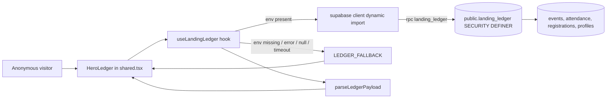

# Design Document

## Overview

The landing page ledger card (`HeroLedger` in `src/app/shared.tsx`, rendered from `src/app/organizer.tsx`) shows hard-coded attendees. This design replaces them with live data from one new Postgres function, `public.landing_ledger()`. The function is `SECURITY DEFINER`, granted to `anon`, and returns a single masked `jsonb` payload. RLS on `profiles`, `events`, `attendance`, and `registrations` is not touched.

The frontend adds one pure module (`src/lib/landingLedger.ts`) for types, parsing, and formatting, and one hook (`useLandingLedger`) that calls the RPC with an 8 second timeout and falls back to the existing sample data. `HeroLedger` keeps its current markup and Design_System classes. It changes only in where its data comes from, a loading state, and a responsive 3-column grid at 640 px and wider.

Key decisions:

- **One RPC, one `jsonb` result.** Returns `null` when there is nothing to show. The client does one round trip and never sees raw table rows.
- **Masking happens in SQL.** Emails, full names, and full UUIDs never leave the database.
- **Dynamic import of the Supabase client.** `src/lib/supabaseClient.ts` throws at module load when env vars are missing. The hook checks the env vars first and only then imports the client, so a missing config yields Fallback_Data (Req 6.6) instead of a crashed page.
- **Fallback is the existing sample data**, moved into a constant in `landingLedger.ts` so the component has one render path.

## Architecture



Files:

| File | Change |
|---|---|
| `supabase/migrations/20260908120000_landing_ledger_rpc.sql` | New migration (timestamp is later than `20260907120000`) |
| `src/lib/landingLedger.ts` | New: types, `LEDGER_FALLBACK`, `parseLedgerPayload`, `formatLedgerTime`, `fetchLandingLedger` |
| `src/lib/useLandingLedger.ts` | New: hook returning `{ status, data }` |
| `src/app/shared.tsx` | `HeroLedger` consumes the hook; loading state; responsive grid |

`HeroLedger` is used in `organizer.tsx` only. Its props stay empty, so no call site changes.

## Components and Interfaces

### Database: `public.landing_ledger()`

Signature:

```sql
create or replace function public.landing_ledger()
returns jsonb
language sql
stable
security definer
set search_path = public
```

Return shape (`null` when no event has attendance):

```json
{
  "ledger_id": "FB-2026-7F2A",
  "title": "Environmental Policy Symposium",
  "event_date": "2026-11-14",
  "venue": "Whitman Hall, Rm 204",
  "code": "ENV-POL-2026",
  "rows": [
    { "display_name": "Prince N.", "masked_id": "PN-7F2A", "checked_in": true,  "checked_in_at": "2026-11-14T09:02:11+00:00" },
    { "display_name": "Aisha T.",  "masked_id": "AT-2246", "checked_in": false, "checked_in_at": null }
  ]
}
```

SQL outline (migration body):

```sql
create or replace function public.landing_ledger()
returns jsonb
language sql
stable
security definer
set search_path = public
as $$
  with featured as (
    -- Event holding the most recent attendance row.
    select e.id, e.title, e.event_date, e.venue, e.code
      from public.events e
      join public.attendance a on a.event_id = e.id
     group by e.id
     order by max(a.recorded_at) desc
     limit 1
  ),
  pinned as (
    -- Owner lookup lives in SQL only. The email literal is filled in at
    -- implementation time from the owner's profile.
    select p.id
      from public.profiles p
     where lower(p.full_name) = 'prince naruka'
        or lower(p.email)     = lower('narukaprince489@gmail.com')
     limit 1
  ),
  participants as (
    -- Checked in (attendance wins over registration; each student once).
    select a.student_id, true as checked_in, a.recorded_at as checked_in_at
      from public.attendance a
      join featured f on f.id = a.event_id
    union all
    -- Registered but not checked in.
    select r.student_id, false, null::timestamptz
      from public.registrations r
      join featured f on f.id = r.event_id
     where r.status = 'registered'
       and not exists (
         select 1 from public.attendance a2
          where a2.event_id = r.event_id and a2.student_id = r.student_id)
  ),
  named as (
    select
      pa.checked_in,
      pa.checked_in_at,
      (pa.student_id = (select id from pinned)) as is_pinned,
      -- Display_Name: "First L." or the single word as-is.
      case when array_length(w.words, 1) = 1 then w.words[1]
           else w.words[1] || ' ' || upper(left(w.words[array_length(w.words, 1)], 1)) || '.'
      end as display_name,
      -- Masked_ID: up to 3 uppercase initials + '-' + last 4 of the UUID.
      (select upper(string_agg(left(x, 1), '' order by ord))
         from unnest(w.words[1:3]) with ordinality as t(x, ord))
        || '-' || upper(right(replace(pa.student_id::text, '-', ''), 4)) as masked_id
      from participants pa
      join public.profiles p on p.id = pa.student_id
      cross join lateral (
        select regexp_split_to_array(btrim(p.full_name), '\s+') as words
      ) w
  ),
  selected as (
    -- Selection: the pinned student is guaranteed a slot, then checked-in
    -- by recency, then registered. Hard cap of 5.
    select * from named
     order by is_pinned desc, checked_in desc, checked_in_at desc nulls last, display_name
     limit 5
  )
  select jsonb_build_object(
           'ledger_id',  'FB-' || to_char(f.event_date, 'YYYY') || '-'
                           || upper(right(replace(f.id::text, '-', ''), 4)),
           'title',      f.title,
           'event_date', f.event_date,
           'venue',      f.venue,
           'code',       f.code,
           'rows', coalesce((
             -- Display order: checked-in group first, pinned first inside a group.
             select jsonb_agg(jsonb_build_object(
                      'display_name',  s.display_name,
                      'masked_id',     s.masked_id,
                      'checked_in',    s.checked_in,
                      'checked_in_at', s.checked_in_at)
                    order by s.checked_in desc, s.is_pinned desc,
                             s.checked_in_at desc nulls last, s.display_name)
               from selected s), '[]'::jsonb))
    from featured f;               -- zero featured rows => SQL NULL
$$;

revoke all on function public.landing_ledger() from public;
grant execute on function public.landing_ledger() to anon, authenticated;
```

Notes on the outline:

- A profile with a blank `full_name` would produce an empty word array. The implementation filters those profiles out in `named` (`btrim(p.full_name) <> ''`).
- `attendance` is unique per `(student_id, event_id)` and `registrations` is unique per `(student_id, event_id)`, so the `not exists` branch is what guarantees a student appears once (Req 3.7).
- The pinned student is only considered when they are a participant of the Featured_Event. See "Interpretation of Requirement 4" below.
- Only `events.title/event_date/venue/code`, a derived id, masked names, status, and timestamp are in the payload. No email, no full name, no full UUID (Req 1.6, 1.7).
- The `revoke ... from public` plus explicit `grant` follows the pattern in `20260822120000_event_attendees_rpc.sql`, widened to `anon` as Req 1.2 requires.

### Ledger ID format

`FB-<YYYY>-<XXXX>` where `YYYY` is the year of `events.event_date` and `XXXX` is the last 4 hex characters of `events.id` in uppercase. It is deterministic for a given event, contains no secret (4 hex chars of an event id), and matches the visual shape of the existing `#FB-2024-0891`. The card prints it with a leading `#`.

### Masked ID format

Up to 3 uppercase initials from the name words, a hyphen, then the last 4 uppercase hex characters of the profile UUID. Example: "Prince Naruka" with a UUID ending in `7f2a` becomes `PN-7F2A`. The `PNA-7F2A` example in the requirements glossary implies a third letter; with this rule a third initial appears only when the name has a third word. If a different rule is wanted, only the `masked_id` expression changes.

### Interpretation of Requirement 4

Requirement 4.1 says the pinned student is included "where the Pinned_Student has a profile". Showing them as attending an event they have no registration or attendance for would put a false record on a card labelled as a ledger. This design includes the pinned student only when they are a participant (checked in or registered) of the Featured_Event, and gives them a guaranteed slot and first place in their group when they are. If the owner wants to appear regardless, that needs a separate decision, since it means fabricating a row. Flagged for review.

### Frontend module: `src/lib/landingLedger.ts`

```ts
export interface LedgerRow {
  displayName: string;
  maskedId: string;
  checkedIn: boolean;
  /** ISO timestamp, null for registered-only rows. */
  checkedInAt: string | null;
}

export interface LedgerData {
  ledgerId: string;      // "FB-2026-7F2A"
  title: string;
  eventDate: string;     // "YYYY-MM-DD"
  venue: string | null;
  code: string;
  rows: LedgerRow[];     // order is display order; length <= 5
}

/** Raw jsonb as returned by the RPC. */
export interface LedgerPayload {
  ledger_id: string;
  title: string;
  event_date: string;
  venue: string | null;
  code: string;
  rows: Array<{
    display_name: string;
    masked_id: string;
    checked_in: boolean;
    checked_in_at: string | null;
  }>;
}

export const LEDGER_FALLBACK: LedgerData; // the five sample attendees and header now in HeroLedger

/** Returns null for null/empty/malformed payloads. Keeps row order. */
export function parseLedgerPayload(raw: unknown): LedgerData | null;

/** "09:02" in the visitor's local time, or "—" when null/invalid. */
export function formatLedgerTime(iso: string | null): string;

/** "Nov 14, 2024" from "YYYY-MM-DD" without timezone drift. */
export function formatLedgerDate(isoDate: string): string;

/** Calls the RPC with an 8 s timeout. Resolves LedgerData | null, rejects on error. */
export function fetchLandingLedger(): Promise<LedgerData | null>;
```

`fetchLandingLedger` checks `import.meta.env.VITE_SUPABASE_URL` and `VITE_SUPABASE_ANON_KEY`. If either is missing it rejects with a config error. Otherwise it does `const { supabase } = await import("./supabaseClient")` and calls `supabase.rpc("landing_ledger").abortSignal(controller.signal)`, where `controller` aborts after 8000 ms. An RPC `error` is thrown.

### Hook: `src/lib/useLandingLedger.ts`

```ts
export type LedgerStatus = "loading" | "live" | "fallback";

export interface UseLandingLedger {
  status: LedgerStatus;
  data: LedgerData;   // always renderable: live data or LEDGER_FALLBACK
}

export function useLandingLedger(): UseLandingLedger;
```

Behavior: starts at `{ status: "loading", data: LEDGER_FALLBACK }`. On mount it calls `fetchLandingLedger()`. A non-null result sets `live`. A null result sets `fallback`. A rejection calls `console.error("[landing-ledger]", err)` and sets `fallback`. An `ignore` flag set in the effect cleanup prevents state updates after unmount.

### Component: `HeroLedger`

The component keeps the existing outer card, header bar, event info block, column head, rows, and footer. Changes:

- Header ID text, title, date, venue, and footer `code` come from `data`.
- Rows map `data.rows`, keyed by `maskedId` plus index. Order is not changed.
- Verified rows keep the green dot, mono time, and `Check` icon. Pending rows keep the divider-colored dot, `—` time, and hollow circle.
- Grid classes change from `grid-cols-[1fr,auto,auto]` to a stacked layout below 640 px and `sm:grid-cols-[1fr_auto_auto]` at 640 px and wider, applied to both the column head and each row so columns align (Req 7). The `sm` breakpoint is 640 px in Tailwind 4.
- Rows use the standard mount motion from the Design_System (`opacity 0 -> 1`, `y: 8 -> 0`, `0.25s easeOut`, stagger `index * 0.07`), as list items.
- The footer Seal stays as is, one per card.

## Data Models

No new tables, columns, or policies. The RPC reads these existing columns:

| Table | Columns used |
|---|---|
| `events` | `id`, `title`, `code`, `venue`, `event_date` |
| `attendance` | `event_id`, `student_id`, `recorded_at` |
| `registrations` | `event_id`, `student_id`, `status` |
| `profiles` | `id`, `full_name`, `email` (lookup of the pinned student only; never returned) |

## States

| State | Trigger | Rendering |
|---|---|---|
| `loading` | Mount until the RPC settles | Same card chrome. The header values and five rows are replaced by placeholder bars: `bg-[#DCD4C2]` blocks at the same heights as real text, no shimmer, no pulse, no gradient. Footer and Seal render normally. |
| `live` | RPC returned a payload | Live header and rows |
| `fallback: error` | RPC error, timeout (8 s), or abort | Fallback_Data. One `console.error`. No visible error text. |
| `fallback: empty` | RPC returned `null` | Fallback_Data |
| `fallback: no config` | Missing `VITE_SUPABASE_*` | Fallback_Data, console error from the config rejection |

The loading placeholders use only Divider color from the palette. The fade-in on swap uses the standard mount motion, so there is no layout jump beyond the five-row height, which matches the fallback.

## Error Handling

- RPC errors, network failures, malformed payloads (`parseLedgerPayload` returns `null`), and timeouts all end in Fallback_Data. The visitor never sees an error message.
- Errors are logged once to the console with a `[landing-ledger]` prefix.
- A late response after the 8 s abort is ignored because the request is aborted and the effect has settled.
- The RPC cannot leak data by error: it takes no arguments, so there is no injection surface, and it returns only the masked fields.
- Anonymous abuse surface: the function is cheap (one indexed aggregate over `attendance` plus a bounded join). If load becomes a concern, add a short cache at the CDN or a materialized view later. Out of scope here.

## Correctness Properties

_A property is a characteristic or behavior that should hold true across all valid executions of a system, essentially a formal statement about what the system should do. Properties bridge human-readable specifications and machine-verifiable correctness guarantees._

Reflection: the prework produced candidates for the payload whitelist (1.6), no sensitive data (1.7), Ledger_ID (2.3), row cap (3.1, 4.3), group ordering (3.2), recency ordering (3.3), fill (3.4), masking shapes (3.5), uniqueness (3.7), pinned inclusion and position (4.1, 4.2), and order preservation (5.5). 3.1, 3.4, and 4.3 are merged into one selection property. 3.2, 3.3, and 4.2 are merged into one ordering property. 1.6 and 1.7 are merged into one privacy property. 4.1 stays separate because it is about guaranteed inclusion.

The selection and ordering properties are tested against a pure TypeScript reference model of the SQL selection rules (`selectLedgerRows` in test code), and the same scenarios are run against the real RPC as integration examples. The reference model is a test oracle, not shipped code.

### Property 1: Payload parsing preserves order and content

For any valid `LedgerPayload`, `parseLedgerPayload` returns a `LedgerData` whose rows are in the same order and count as the payload rows, with each row's name, masked ID, check-in flag, and timestamp equal to the source values.

**Validates: Requirements 5.2, 5.5**

### Property 2: Invalid payloads parse to null

For any value that is `null`, not an object, missing required fields, or has a non-array `rows`, `parseLedgerPayload` returns `null`, so the card shows Fallback_Data.

**Validates: Requirements 6.2, 6.3**

### Property 3: Display name format

For any full name containing at least two non-empty words, the Display_Name is the first word, a space, the uppercase first letter of the last word, and a period. For any single-word name, the Display_Name equals that word with no initial.

**Validates: Requirements 3.5, 3.6**

### Property 4: Masked ID format

For any full name and UUID, the Masked_ID matches `^[A-Z]{1,3}-[0-9A-F]{4}$`, ends with the last 4 hex characters of the UUID in uppercase, and starts with the uppercase first letters of the first (up to 3) name words.

**Validates: Requirements 3.5**

### Property 5: Payload never exposes sensitive fields

For any set of profiles (full name, email, UUID) and any attendance state, the serialized RPC payload has exactly the keys `ledger_id`, `title`, `event_date`, `venue`, `code`, `rows`; each row has exactly `display_name`, `masked_id`, `checked_in`, `checked_in_at`; and the serialization contains no profile email, no full name of two or more words, and no full UUID.

**Validates: Requirements 1.6, 1.7**

### Property 6: Ledger ID format and determinism

For any event id and event date, the Ledger_ID matches `^FB-\d{4}-[0-9A-F]{4}$`, the year equals the event date's year, the suffix equals the last 4 hex characters of the event id in uppercase, and computing it twice gives the same value.

**Validates: Requirements 2.3**

### Property 7: Row selection cap, uniqueness, and fill

For any set of checked-in and registered students for the Featured_Event, with or without overlap and with or without a pinned student, the selected rows number `min(5, distinct participants)`, contain no student twice, and a student who is both registered and checked in appears only as checked in.

**Validates: Requirements 3.1, 3.4, 3.7, 4.3**

### Property 8: Row ordering

For any selected rows, no registered row precedes a checked-in row; checked-in rows after the pinned student are in descending `checked_in_at` order; and when the pinned student is a participant they are first in their status group.

**Validates: Requirements 3.2, 3.3, 4.2**

### Property 9: Pinned student is never dropped

For any participant set where the pinned student is a participant, the selected rows include the pinned student regardless of how many other checked-in attendees exist. When the pinned student is not a participant or has no profile, the rows are the same as selection without any pin.

**Validates: Requirements 4.1, 4.6**

### Property 10: Time formatting is total

For any string or `null` passed to `formatLedgerTime`, the result is either `HH:mm` (two digits, colon, two digits) for a valid ISO timestamp, or `—` for `null` or an invalid value. It never throws.

**Validates: Requirements 5.2**

## Testing Strategy

The repo has no test runner today. This feature adds `vitest` and `fast-check` as pinned devDependencies and a `test` script (`vitest --run`). Version pins are chosen at install time. The pure logic lives in `src/lib/landingLedger.ts` so it can be tested without a browser.

Dual approach:

- **Property tests** (fast-check, at least 100 runs each) cover Properties 1 to 10. Each test carries a tag comment: `Feature: landing-ledger-live-data, Property N: <title>`. Properties 3 to 9 test SQL-mirrored rules through the reference model (TS functions in the test file that implement the same rules as the SQL). Property 5 additionally runs on the real RPC output in the integration step.
- **Unit and component tests** (vitest, jsdom, `@testing-library/react` only if added; otherwise render-to-string checks):
  - Header renders title, date, venue, code, Ledger_ID (5.1).
  - Verified and pending rows render the correct indicators (5.3, 5.4).
  - Loading placeholders render while the promise is pending (6.1).
  - Error, `null`, and missing env each yield Fallback_Data (6.2, 6.3, 6.6), with `console.error` called once on error and nothing visible (6.5).
  - Timeout at 8000 ms using fake timers (6.4).
  - A grep-based check that `src/` contains no reference to the pinned student's name (4.5).
- **Database integration tests** against local Supabase (`supabase start`) with seeded data, run as SQL scripts or a small script using the anon key:
  - Function is `SECURITY DEFINER` with `search_path` set, and `anon` has `EXECUTE` (1.1, 1.2).
  - `pg_policies` is unchanged before and after the migration (1.3).
  - Latest-attendance event is chosen (2.1, 2.2). No attendance yields `null` (2.4).
  - Pinned lookup by name and by email (4.4).
  - `anon` direct `select` on `profiles` and `attendance` still returns zero rows.
- **Property-based testing is not used** for the SQL grant and RLS checks, the CSS grid, the design-system rules, or the motion config. Those are smoke tests and Playwright checks.
- **Playwright MCP** on `http://localhost:5173`: the card loads, header and rows render, the console shows no unexpected errors, a 1280 px viewport shows a 3-column aligned grid (7.1, 7.3), a 375 px viewport stacks the row columns (7.2), and the fallback appears when the RPC request is blocked. A grep of the changed code for `shadow`, `blur`, `gradient` confirms 8.2.
- **Build checks**: `tsc` with zero errors and `vite build` success.
