# Field Book — Software Requirements Specification v2.0

## Title Page

**Field Book — Software Requirements Specification**

**Version 2.0**

**Issue date:** 14 September 2026

**Authors:** Prince · Nandini Mehta · Mahi Agrawal

**Institution:** Poornima Institute of Engineering & Technology, Jaipur

**Supersedes:** Field Book Software Requirements Specification v1.0, 10 September 2026

## Revision History

**Table FM.1 — Revision history for Field Book SRS versions 1.0 and 2.0 (Requirement 7.6).**

| Version | Issue date | Authors | Summary of changes |
|---|---|---|---|
| 1.0 | 10 September 2026 | Prince, Nandini Mehta, Mahi Agrawal | Original baseline. Thirteen pages in IEEE 830-1998 structure. Established the requirement identifier series REQ-1 … REQ-32, BR-1 … BR-6 and TBD-1 … TBD-3. |
| 2.0 | 14 September 2026 | Prince, Nandini Mehta, Mahi Agrawal | Expanded to twenty-one numbered sections against the repository at revision `3cc14af`. Corrected wording in the clauses covering: the public certificate verification route, now recorded as absent and reclassified `Planned` (gap findings A1.1 and A1.10); the three `certificates` columns `sha256_hash`, `pdf_storage_path` and `attendance_id`, none of which exist (A1.2, A1.3, A1.4); the `events.status` enumeration, which admits exactly `draft`, `published`, `live`, `completed` (A1.5); the table names `attendance` and `audit_log`, both singular (A3.2, A3.3); the Spring Boot major version, declared as `spring-boot-starter-parent` 4.1.0 rather than 3 (A3.1); the camera capture constraint, which requests 720 × 720 rather than 1280 × 720 (A3.4); the profile-creation trigger, which fires on `auth.users` rather than `public.profiles` (A3.5); and the two enforceability claims covering admin-gated publication (A3.6) and the prohibition on admin self-approval (A3.7), both of which are restated as application-layer conventions and classified `Partially Implemented`. **Identifier binding not recoverable:** SRS_v1's own numbering is not reconstructible from the specification documents that govern this upgrade, so this row lists each corrected clause by its gap-analysis finding identifier rather than asserting a Legacy_Requirement_ID for it. The Legacy_Requirement_ID bound to each corrected clause is established in the Identifier_Continuity_Table from the supplied SRS v1.0 attachment; until that binding is recorded there, no REQ, BR or TBD number is claimed here. |

The v2.0 row of Table FM.1 lists ten corrected clause groups, spanning the thirteen gap-analysis findings A1.1, A1.2, A1.3, A1.4, A1.5, A1.10, A3.1, A3.2, A3.3, A3.4, A3.5, A3.6 and A3.7. Each correction adopts the repository content over the v1.0 wording, in line with the source precedence rule this document follows. The corrections are stated here in summary only; the substantiating evidence for each sits in the section that documents the affected object.

## Table of Contents

**Table FM.2 — Section index with page-budget rows and render-time page numbers (Requirement 7.7).**

| § | Section title | Page |
|---|---|---|
| — | Title page, revision history, table of contents | — |
| 1 | Introduction — purpose, scope, objectives, problem statement, definitions, references, overview | — |
| 2 | Overall Description — product perspective, product functions, user classes, operating environment, design constraints, assumptions and dependencies | — |
| 3 | User Roles and Permissions — role matrix, permission grid, guard behaviour | — |
| 4 | System Architecture — three-tier decomposition, trust boundaries, data-access paths | — |
| 5 | Module Descriptions — frontend route modules, service-layer modules, certificate-service packages, database objects | — |
| 6 | Functional Requirements — REQ-1 to REQ-32 carried forward, plus new identifiers from REQ-33, each carrying an Implementation_Status value, plus the Implementation_Status_Table | — |
| 7 | Non-Functional Requirements — performance targets, reliability, maintainability, portability, accessibility intent | — |
| 8 | Database Requirements — eleven tables, columns, keys, constraints, indexes, policies, triggers, functions, views, buckets, selected SQL | — |
| 9 | User Interface Requirements — every major screen with purpose, functionality, validation, and screenshot | — |
| 10 | System Diagrams — the ten diagram families in Appendix C | — |
| 11 | Detailed Workflows — the eight mandated workflows | — |
| 12 | Detailed Use Cases — use case specifications with actors, preconditions, main flow, alternate flows | — |
| 13 | Validation and Error Handling — client validation, database constraints, HTTP error contract | — |
| 14 | Security Requirements — authentication, authorization, row-level security, key separation, CORS, audit trail, the two documented defects with their intended behaviour and corrective migrations | — |
| 15 | Code Listings — the three tiers, per Appendix E | — |
| 16 | Testing Requirements — strategy, existing gates, test-case tables | — |
| 17 | Hardware and Software Requirements | — |
| 18 | Limitations | — |
| 19 | Future Enhancements | — |
| 20 | Conclusion | — |
| 21 | Requirement Traceability Matrix | — |
| RC | Appendix RC — Requires-Confirmation register | — |

**Note on pagination.** The page column of Table FM.2 is deliberately unpopulated. A page number is only knowable once the master is rendered under the settings frozen in the reading-conventions block below, because pagination depends on figure heights and table widths that Markdown does not fix. The column is filled at render time from the rendered output, and the per-section page counts used to check the page budget are measured between section headings in that same render.

## Reading Conventions

This block defines, once, the five conventions that sections 1 through 21 rely on. No later section redefines them.

**Implementation_Status.** Every functional requirement, workflow and module in this document carries exactly one of three values, reproduced here with the spelling and capitalisation used everywhere else in the document:

- `Implemented` means the Repository substantiates the whole of the described capability.
- `Partially Implemented` means the Repository substantiates some but not all of the described capability, or enforces the capability at a weaker layer than the requirement states.
- `Planned` means the Repository substantiates none of the described capability.

A capability carrying `Planned` is written only in the future or conditional voice. A capability carrying `Partially Implemented` is accompanied by a statement of which part is substantiated, which part is not, and the layer at which the substantiated part is enforced.

**Evidence_Citation.** A factual statement about a database object, route, endpoint, screen, workflow or configuration value carries a repository-relative path in backticks, written with forward slashes and no drive letter or absolute prefix — for example `` `supabase/migrations/20260819120000_attendance.sql` ``. Where the cited file exceeds 100 lines, the citation adds a line range or a symbol name, written as `` `src/lib/auth.ts` lines 133–158 `` or `` `src/app/routes/index.tsx` — symbol AnimatedRoutes ``. A citation is attached at the first occurrence of a subject within a section; later statements in that same section about the same object do not repeat it. A statement drawn from SRS v1.0 rather than from the repository carries the literal marker `(SRS_v1)` in place of a path, and never carries a repository path.

**Requires_Confirmation_Marker.** A statement the repository can neither substantiate nor contradict carries the literal text `[Requires Confirmation]` immediately after its terminating punctuation, followed by the identifier of the register entry that covers it, written as `RC-nn` with a two-digit zero-padded number. Every such identifier resolves to exactly one row of the register in Appendix RC.

**Artifact captions.** Every figure, table, screenshot and listing carries an identifier of the form `<Type> <section>.<sequence>`, a caption beginning with that identifier, and explanatory prose in the same section. Where an artifact substantiates a mandated content area, its caption names the governing requirement in the form `Requirement <number>`, referring to the numbered requirements of the specification that governs this upgrade. Front-matter tables use the section token `FM`, since they precede section 1.

**Pinned repository revision.** Every Evidence_Citation, every code listing and every schema statement in this document resolves against the Field Book repository at revision **`3cc14af`**, confirmed at authoring time by `git rev-parse --short HEAD`. This is the same revision named in the governing design document, so no discrepancy arises. A statement that does not hold at `3cc14af` is a defect in this document, not a change in the system.

**Frozen render settings.** The page count of this document is measured by rendering the master to PDF at A4 page size, 2 cm margins, 11 pt body text, 1.15 line spacing, with Mermaid figures rendered at their natural size capped to the text width. **These five settings are frozen and must not be adjusted to bring the page count inside its target band.** If the rendered count falls outside the band, the count is corrected by removing duplicated content or by adding content sourced from SRS v1.0 or the repository — never by changing page size, margins, body font size, line spacing or figure scaling.

---

## 1. Introduction — purpose, scope, objectives, problem statement, definitions, references, overview

### 1.1 Purpose

This document specifies the Field Book platform: a campus event system that records who attended which event and issues a participation certificate whose provenance is a database row rather than a loose file. It is written for four readers. A reviewer uses it to judge whether the delivered system matches its specification. A developer joining the project uses it to locate the module that owns a behaviour. An examiner uses it to trace a requirement from its statement through its module and screen to its test case. A maintainer uses it to learn which parts of the system are enforced by the database and which rest on application convention.

The document describes the system as it exists in the repository at revision `3cc14af`. Where version 1.0 of this specification and the repository disagree about the same subject, the repository governs and the disagreement is recorded rather than smoothed over. Where a statement can be traced to neither, it is either omitted or carried with a `[Requires Confirmation]` marker and a register entry naming the party who can settle it. Nothing in this document describes intended behaviour in the implemented voice.

### 1.2 Scope

Field Book covers the lifecycle of a campus event and the participation record that follows from it.

**Included in scope.**

1. **Event lifecycle** from `draft`, through an admin approval record, to `published`, `live` and `completed`. The status enumeration admits exactly those four values (`supabase/migrations/20260815120000_initial_schema.sql`), and an approval record is the artifact that carries a submission through review (`supabase/migrations/20260816120000_rls_policies.sql`).
2. **Authentication and profile management** by email and six-digit one-time code, by password, and by Google OAuth under the PKCE flow (`src/lib/auth.ts` lines 133–195 and lines 305–310, `src/lib/supabaseClient.ts`).
3. **Student registration with capacity enforcement**, performed by a database function that locks the event row before counting active registrations (`supabase/migrations/20260820120000_registrations.sql` — symbol `register_for_event`).
4. **QR attendance capture**, decoding a payload of the form `fieldbook:attendance:{EVENT_CODE}` from a camera stream or an uploaded image, with a manual code-entry fallback (`src/app/student.tsx` — symbol `parseQrValue`).
5. **Duplicate attendance prevention**, by a unique constraint on the attendance table rather than by a client check (`supabase/migrations/20260819120000_attendance.sql`).
6. **Certificate generation** as a rendered PDF with embedded subsetted fonts, uploaded to object storage and recorded as a row (`certificate-service/src/main/java/com/fieldbook/certificateservice/service/CertificatePdfService.java`).
7. **Certificate templates** with positioned fields held as JSON, authored by an admin and consumed by the certificate service (`supabase/migrations/20260815120000_initial_schema.sql`).
8. **Role-upgrade requests**, limited to one pending request per user by a partial unique index (`supabase/migrations/20260817120000_role_change_requests.sql`).
9. **Notifications**, generated server-side by triggers on registration, attendance and certificate rows (`supabase/migrations/20260821120000_notifications_events.sql`).
10. **An administrative audit trail**, append-only in effect, plus a display-only platform activity feed (`supabase/migrations/20260816150000_audit_log.sql`, `supabase/migrations/20260819100000_platform_activity.sql`).

**Excluded from scope.** Each exclusion below is a capability the repository does not provide, with the artifact that shows the absence.

1. **Public certificate verification.** No route serves a verification workflow. The route table declares its leaf paths and a catch-all that renders the landing page, and none of them matches a verification path (`src/app/routes/index.tsx` — symbol `AnimatedRoutes`). This capability is classified `Planned`; it is discussed in the future or conditional voice only, and is stated as a future enhancement rather than as a feature of the present system.
2. **Payment processing.** No payment table, no payment endpoint and no payment dependency is declared. The migration set declares eleven application tables, none of which models a transaction, and the frontend dependency list declares no payment client (`supabase/migrations/`, `package.json`).
3. **Offline attendance capture.** Attendance recording issues a database insert at the moment of the scan and has no queue, no local store and no service worker to hold a scan taken without connectivity (`src/lib/attendance.ts` — symbol `recordAttendance`).
4. **Email delivery of certificates.** The certificate service uploads the rendered PDF to storage and inserts a row; it declares no mail transport and no outbound message (`certificate-service/src/main/java/com/fieldbook/certificateservice/service/CertificateStorageService.java`, `certificate-service/pom.xml`).
5. **Multi-campus tenancy.** No tenant, campus or institution column appears on any table, and no policy scopes a row by institution (`supabase/migrations/20260815120000_initial_schema.sql`, `supabase/migrations/20260816120000_rls_policies.sql`). The marketing route `/campuses` is a static page, not a tenancy boundary.

### 1.3 Objectives

1. **Replace paper attendance with a record that is unique per student per event.** Uniqueness is a database constraint rather than a UI rule, so a second scan of the same code by the same student cannot produce a second row.
2. **Issue a certificate whose provenance is a database row rather than a file.** A certificate exists because a row exists, carries a unique code, and points at a stored artifact; the file is the rendering of the record, not the record itself.
3. **Confine each role's data access to database-enforced policy rather than UI convention.** Route guards decide what a signed-in user can navigate to; row-level security decides what that user can read and write. The second is the control that matters, and this document reports honestly where the two diverge.
4. **Make the enforcement layer of every control visible.** For each control the document states whether it is enforced by a database policy, by a database function, by application code, or not at all — because a control enforced only in the client is a convention, not a guarantee.

### 1.4 Problem statement

Campus events are organised by many people, reviewed by a few, and attended by many more, and the record of who attended has historically been a signature sheet. A signature sheet is easy to forge, easy to lose, and impossible to query. When a participation certificate is later issued from that sheet, the certificate inherits every weakness of its source: nothing ties the certificate to an attendance event, nothing prevents a second certificate for the same participation, and nothing lets a third party check that the certificate corresponds to a real record.

Field Book addresses the capture and issuance halves of that problem. Attendance is captured by scanning an event-specific code, and the capture is constrained by a unique index so the same student cannot be recorded twice for the same event. Certificates are issued by a service that renders a document from a template and simultaneously writes a row carrying a unique certificate code.

The third half — letting a third party check a certificate — is not solved by the present system. There is no verification route, so a certificate code held by a recipient cannot presently be checked against the record it names. Separately, the repository imposes no database-level link between a certificate and an attendance record: the `certificates` table declares no reference to `attendance` (`supabase/migrations/20260815120000_initial_schema.sql`). Both gaps are documented as limitations rather than described as solved.

### 1.5 Definitions

**Table 1.1 — Terms and status values used throughout this specification (Requirement 5.1).**

| Term | Definition |
|---|---|
| Student | A profile whose `role` column holds `student`. The default role assigned to a new account. |
| Organizer | A profile whose `role` column holds `organizer`. Authors events and reads the rosters of events it owns. |
| Admin | A profile whose `role` column holds `admin`. Reviews approvals, resolves role-change requests, and authors certificate templates. |
| Unauthenticated visitor | A browser session with no Supabase session. Reaches the eight public route paths only, and reads no application table. |
| Event | A row of `public.events`, carrying a unique `code`, a `capacity`, and a `status` drawn from four values. |
| Registration | A row of `public.registrations` recording intent to attend. Distinct from attendance; cancellation is a status change, not a deletion. |
| Attendance | A row of `public.attendance` recording that a student was present at an event. One row per student and event. |
| Certificate | A row of `public.certificates` carrying a unique `certificate_code` and, once rendered, a `certificate_url`. |
| Certificate template | A row of `public.certificate_templates` carrying a JSON array of positioned fields, consumed by the certificate service. |
| Role-change request | A row of `public.role_change_requests` asking that a profile's role be changed. At most one pending row per user. |
| Row-level security | The PostgreSQL mechanism by which a policy attached to a table decides, per row and per operation, whether the calling identity may proceed. |
| Anonymous key | The Supabase API key the browser holds. Its requests are subject to row-level security. |
| Service-role key | The Supabase API key the certificate service holds. Its requests bypass row-level security. |
| Evidence_Citation | A repository-relative path attached to a factual statement, identifying the file that substantiates it. |
| `Implemented` | The repository substantiates the whole of the described capability. |
| `Partially Implemented` | The repository substantiates some but not all of the described capability, or enforces it at a weaker layer than the requirement states. |
| `Planned` | The repository substantiates none of the described capability. |

Table 1.1 fixes the vocabulary the rest of the document uses without redefinition. The three role terms are not editorial labels: each is the literal value admitted by the `role` check constraint on `public.profiles` (`supabase/migrations/20260815120000_initial_schema.sql`), which is why the permission grid in section 3 has exactly three role rows. The reader should conclude that every role, object and status word in this document has a corresponding declaration in the repository, and that the three status values are the only maturity labels used anywhere in the document.

### 1.6 References

1. **Field Book Software Requirements Specification, version 1.0**, 10 September 2026, Prince, Nandini Mehta and Mahi Agrawal, Poornima Institute of Engineering & Technology, Jaipur. Supplied as a document attachment to the authoring activity rather than stored in the repository. Authoritative for the wording of the identifier series REQ-1 … REQ-32, BR-1 … BR-6 and TBD-1 … TBD-3. (SRS_v1)
2. **The Field Book repository at revision `3cc14af`**, comprising `src/`, `certificate-service/`, `supabase/migrations/`, `.github/workflows/`, and the root-level configuration and documentation files. Authoritative for every statement of system fact in this document, and higher in precedence than reference 1 wherever both address the same subject.
3. **IEEE 830-1998**, *IEEE Recommended Practice for Software Requirements Specifications*. Used as the structural model for section ordering and heading depth. No content is drawn from it.

### 1.7 Document overview

Sections 1 and 2 establish scope, vocabulary and the system's shape. Section 3 states what each role may do and, where the database permits more than the intended design, says so. Sections 4 and 5 decompose the system into three tiers and then into modules, each module carrying a repository path and a status value. Section 6 states the functional requirements, carrying forward every identifier published in version 1.0 and allocating new identifiers above the highest legacy value in each series; it closes with the table that lists every identifier against its status. Section 7 states the non-functional requirements and separates targets from measurements. Section 8 documents the schema table by table. Section 9 covers each screen the route table renders. Section 10 carries the diagram set. Sections 11 and 12 give the workflows and use cases. Section 13 covers validation and error handling. Section 14 states the security posture, including two documented defects and the corrections specified for them. Section 15 reproduces code from all three tiers. Section 16 states test intent without reporting results. Sections 17 through 20 cover the runtime environment, the limitations, the future enhancements and the conclusion. Section 21 is the traceability matrix, and Appendix RC consolidates every unverifiable statement.

---

## 2. Overall Description — product perspective, product functions, user classes, operating environment, design constraints, assumptions and dependencies

### 2.1 Product perspective

Field Book is a three-tier system, and the boundary between the tiers is also the boundary of trust.

The **first tier** is a React single-page application rooted at `src/`. It owns routing, role guards, session handling and QR decoding, and it performs every ordinary read and write directly against the Supabase PostgREST and Storage HTTP interfaces using the anonymous key. There is no application server between the browser and the database for these operations; the database's own policies are what stand between a request and a row.

The **second tier** is the Supabase platform. Its schema is defined entirely by the migration files under `supabase/migrations/`, applied in ascending filename order. It provides eleven application tables, the row-level security policy set that governs them, helper functions, `SECURITY DEFINER` remote procedures, triggers, two supplementary views and four storage buckets, alongside the hosted authentication service.

The **third tier** is the `certificate-service` Spring Boot module rooted at `certificate-service/`. It exposes one functional endpoint, `POST /api/certificates/generate`, plus a health endpoint at `GET /actuator/health` used by the keep-alive workflow. It fetches a template, renders a PDF with embedded subsetted fonts, uploads the artifact to storage, and inserts the certificate row — all while holding the service-role key, which bypasses row-level security entirely.

The tier composition and the direction of every interface between tiers are drawn in `Figure 10.1`; this section cross-references that figure rather than duplicating it, and section 4 expands each interface with its evidence.

### 2.2 Product functions

The system provides eleven functional clusters. Each is stated here in one line and specified in section 6.

1. **Authentication** — sign-up with a six-digit email code, password sign-in, Google OAuth under PKCE, password reset by emailed link (`src/lib/auth.ts`).
2. **Profile** — read and update of the caller's own profile row, including avatar upload (`src/lib/auth.ts` lines 76–88, `src/lib/storage.ts`).
3. **Event authoring** — creation of an event as a draft and editing of an owned event (`src/lib/events.ts`).
4. **Approval** — submission of an event for review and admin resolution of the approval record (`src/lib/approvals.ts`).
5. **Registration** — capacity-checked registration and cancellation through database functions (`src/lib/registrations.ts`).
6. **Attendance** — QR capture and insertion of one attendance row per student and event (`src/lib/attendance.ts`).
7. **Certificate issuance** — a rendered PDF and its recording row, produced by the certificate service (`src/lib/certificates.ts`).
8. **Templates** — admin authoring of certificate templates with positioned fields (`src/app/admin/templates.tsx`).
9. **Notifications** — trigger-generated messages with a category, deduplicated by a partial index (`supabase/migrations/20260821120000_notifications_events.sql`).
10. **Role change** — submission and admin resolution of role-upgrade requests (`src/lib/roleRequests.ts`).
11. **Audit** — an admin-readable trail plus a display-only platform activity feed (`src/lib/users.ts` — symbol `logRoleChange`, `src/lib/activity.ts`).

### 2.3 User classes

**Table 2.1 — User classes with their route reach and data scope (Requirement 5.2).**

| User class | Basis in the repository | Routes reachable | Data scope |
|---|---|---|---|
| Unauthenticated visitor | Absence of a Supabase session; the guard components redirect | The eight public paths `/`, `/pricing`, `/campuses`, `/signup`, `/forgot`, `/login`, `/auth/callback`, `/auth/reset-callback` | None. Every table policy is granted `to authenticated`, and both supplementary views revoke all privileges from `anon` |
| Student | `role = 'student'` in the check constraint on `public.profiles` | The public paths, `/profile`, and the `/student` subtree behind `RoleGuard allow="student"` | Own profile, own attendance, own registrations, own certificates, own notifications, and events whose status is not `draft` |
| Organizer | `role = 'organizer'` | The public paths, `/profile`, and the `/organizer` subtree behind `RoleGuard allow="org"` | The above, plus owned events including drafts, approval records for owned events, rosters for owned events, and attendee names through one database function |
| Admin | `role = 'admin'` | The public paths, `/profile`, and the `/admin` subtree behind `RoleGuard allow="admin"` | Every event, profile, approval, certificate, template, notification, role-change request, audit row and platform activity row |

Table 2.1 draws its three signed-in classes from the `role` check constraint on `public.profiles` and its fourth class from the absence of a session (`supabase/migrations/20260815120000_initial_schema.sql`, `src/app/routes/RoleGuard.tsx`). The reader should conclude two things. First, the unauthenticated visitor is a genuine user class with a real route surface but no data surface at all, because every policy in the set is granted to the `authenticated` role. Second, route reach and data scope are separate mechanisms — the guards in Table 2.1's third column are client-side, while the fourth column is enforced in the database — which is the distinction section 3.2 makes precise.

### 2.4 Operating environment

**Table 2.2 — Hosted operating environment per tier, with evidence (Requirement 5.2).**

| Element | Value | Evidence |
|---|---|---|
| Frontend host | Vercel, serving the built single-page application with a rewrite of all paths to the application entry point | `vercel.json` |
| Frontend build | Vite 6.3.5 with the React plugin; TypeScript project build via `tsc -b --force` | `package.json` |
| Frontend client | Supabase JS client 2.112.3, configured with `flowType: "pkce"` | `package.json`, `src/lib/supabaseClient.ts` |
| Database platform | Supabase-hosted PostgreSQL, schema defined by sixteen migration files | `supabase/migrations/` |
| PostgreSQL major version | Not declared anywhere in the repository. No migration and no configuration file pins a major version. [Requires Confirmation] RC-04 | Repository-wide: no version pin |
| Certificate service host | Render, region `oregon`, plan `free`, built from a Docker image, health-checked at `/actuator/health` | `render.yaml` |
| Certificate service runtime | Spring Boot parent 4.1.0 with `java.version` 17; Apache PDFBox 3.0.8 | `certificate-service/pom.xml` |
| Certificate service port | `8081`, set as an environment variable in the Render blueprint | `render.yaml` |
| Keep-alive | A scheduled workflow issuing a health request every ten minutes, retaining no result | `.github/workflows/keep-alive.yml` |

Table 2.2 records the environment each tier runs in, and is the first place in this document where a value cannot be settled from the repository. The PostgreSQL major version is genuinely absent: no migration declares a version, no configuration file pins one, and the hosted platform holds the value outside version control, so the statement carries a marker and appears in the register as RC-04 with the Supabase project dashboard named as its confirming party. The reader should conclude that every other row of Table 2.2 is a declared value in a named file, and that the version row is the sole environmental fact this document cannot check.

The free Render plan is load-bearing for the client's behaviour rather than an incidental detail. Free-tier instances sleep after a period of inactivity, which is why the keep-alive workflow exists and why the certificate client carries a sixty-second timeout, one automatic retry and a distinct "waking" state (`src/lib/certificates.ts` — symbol `generateCertificateWithRetry`).

### 2.5 Design constraints

1. **The browser holds a key that is subject to policy; the certificate service holds one that is not.** The anonymous key used by the single-page application operates under row-level security, so a mistake in the client cannot read a row that no policy grants. The service-role key used by `certificate-service` bypasses row-level security, so no database control constrains an actor holding it (`certificate-service/src/main/java/com/fieldbook/certificateservice/supabase/SupabaseClient.java`).
2. **The certificate endpoint authenticates no caller.** `POST /api/certificates/generate` validates no caller identity, no caller session and no caller role, and executes while holding the service-role key. Any caller able to reach the endpoint can therefore cause certificate issuance without authenticating (`certificate-service/src/main/java/com/fieldbook/certificateservice/controller/CertificateController.java`, `certificate-service/README.md`). Section 14 states this as a security weakness and section 18 records it as a limitation.
3. **There is no application server for ordinary operations.** Because the browser talks to PostgREST directly, any rule not expressed as a policy, constraint, index or function is a client-side convention. This constraint is why section 3.2 distinguishes a granted capability from a reachable one.
4. **Storage writes are constrained per bucket.** Four buckets exist, each with a size limit and a MIME allow-list, and object access is governed by policies on `storage.objects` (`supabase/migrations/20260816170000_storage_buckets.sql`, `supabase/migrations/20260818090000_storage_objects_select_policies.sql`).
5. **Existing migrations are immutable.** A change to database behaviour is expressed as a new migration file whose timestamp sorts after every file already present, never as an edit to an applied migration. The two corrections specified in section 14 follow this rule.
6. **The frontend has no automated test runner.** `package.json` declares no test script and no test framework, so every test case in section 16 is stated as intent and carries the execution status `Not executed` (`package.json`).

### 2.6 Assumptions and dependencies

The system assumes a provisioned Supabase project whose schema is the result of applying all sixteen migration files in ascending filename order. Nothing in the repository creates that project, so a deployment against an unmigrated database is outside the behaviour this document describes.

It assumes the project's authentication settings permit both email sign-up with a six-digit code and Google OAuth. The first is exercised directly by `verifySignupOtp`, which calls `verifyOtp` with `type: "signup"`, and the second by `signInWithGoogle` (`src/lib/auth.ts` lines 175–180, 305–310). Whether email confirmation is enabled on the project cannot be determined from the repository, because `signUpWithProfile` branches on both outcomes and returns either `success` or `confirmation_required` depending on whether a session was issued. [Requires Confirmation] RC-06 The Supabase project dashboard holds that setting, and it appears in the register accordingly.

It assumes the certificate service can reach the Supabase REST and Storage endpoints with a service-role key supplied through environment variables that the Render blueprint provisions as unsynchronised secrets (`render.yaml`). It assumes the frontend origin appears in the service's cross-origin allow-list, which is seeded with `http://localhost:5173` and extended by the `FRONTEND_ORIGIN` value and the `FRONTEND_ORIGIN_PATTERN` wildcard (`certificate-service/src/main/java/com/fieldbook/certificateservice/config/WebConfig.java`).

Its external dependencies are the Supabase platform for authentication, database and storage; Google as the OAuth provider; Vercel as the frontend host; Render as the certificate-service host; and GitHub Actions for the deploy, type-check and keep-alive workflows (`.github/workflows/`). Every one of these is a hosted service whose configuration lives outside the repository, which is why the register in Appendix RC names a project or deployment dashboard as the confirming party for several statements.

---

## 3. User Roles and Permissions — role matrix, permission grid, guard behaviour

### 3.1 Role definitions

The system has exactly three roles, because the check constraint on `public.profiles.role` admits exactly three values: `student`, `organizer` and `admin` (`supabase/migrations/20260815120000_initial_schema.sql`). No fourth role exists in the database, and no code path writes a value outside that set.

**Table 3.1 — The three roles, their assignment path and their acquisition route (Requirement 5.3).**

| Role | Assigned by | Self-selectable at sign-up | Primary responsibilities |
|---|---|---|---|
| `student` | The `handle_new_user` trigger, as the default for a new account | Yes | Browse non-draft events, register, attend by scanning, collect certificates |
| `organizer` | Chosen at sign-up, or granted by an admin resolving a role-change request | Yes | Author events as drafts, submit them for approval, read rosters for owned events |
| `admin` | Granted by an admin resolving a role-change request, or provisioned outside the application | No | Resolve approvals and role-change requests, author certificate templates, read the audit trail |

Table 3.1 separates how a role is assigned from what it is for. The sign-up path is deliberately narrower than the database: the frontend type `SignupRole` is declared as `Extract<AppRole, "student" | "organizer">`, so the client cannot even ask for `admin` at sign-up (`src/lib/auth.ts` — symbol `SignupRole`). The reader should conclude that `admin` is never self-assigned through the sign-up screen, and that the only in-application path to it is an existing admin resolving a request — a fact that section 3.4 shows has a consequence for an empty database.

### 3.2 Permission grid

The grid below has exactly three rows, one per role, and one column per permission-bearing capability. A cell names the database object that grants the capability, which is the evidence for that cell. To keep the grid readable, the declaring file is abbreviated by the token in each cell, and the tokens resolve as follows: **M1** = `supabase/migrations/20260815120000_initial_schema.sql`; **M2** = `supabase/migrations/20260816120000_rls_policies.sql`; **M3** = `supabase/migrations/20260816150000_audit_log.sql`; **M4** = `supabase/migrations/20260817120000_role_change_requests.sql`; **M5** = `supabase/migrations/20260819100000_platform_activity.sql`; **M6** = `supabase/migrations/20260819120000_attendance.sql`; **M7** = `supabase/migrations/20260820120000_registrations.sql`; **M8** = `supabase/migrations/20260822120000_event_attendees_rpc.sql`. A dash means no policy or function grants the capability to that role.

**Table 3.2 — Permission grid: three roles against twenty-three capabilities, with the granting database object (Requirement 5.3).**

| Capability | student | organizer | admin |
|---|---|---|---|
| Read published events | `events_select_public` (M2) | `events_select_public` (M2) | `events_select_admin` (M2) |
| Read own draft events | — | `events_select_own_organizer` (M2) | `events_select_admin` (M2) |
| Insert event as draft | — | `events_insert_organizer` (M2) | `events_insert_admin` (M2) |
| Update own event | — | `events_update_own_organizer` (M2) | `events_update_admin` (M2) |
| Delete own draft event | — | `events_delete_own_draft` (M2) | `events_delete_admin` (M2) |
| Set event status to published | — | Reachable — defect, see §14.6 | `events_update_admin` (M2) |
| Read all profiles | — | — | `profiles_select_admin` (M2) |
| Read own profile | `profiles_select_own` (M2) | `profiles_select_own` (M2) | `profiles_select_own` (M2) |
| Read organizer directory | `organizer_directory` view (M2) | `organizer_directory` view (M2) | `organizer_directory` view (M2) |
| Read event attendee names | — | `event_attendees` function (M8) | `profiles_select_admin` (M2) |
| Insert attendance | `attendance_insert_own` (M6) | Identity-scoped (M6) | Identity-scoped (M6) |
| Insert registration | `register_for_event`, `registrations_insert_own` (M7) | Identity-scoped (M7) | Identity-scoped (M7) |
| Cancel registration | `cancel_registration`, `registrations_update_own` (M7) | Identity-scoped (M7) | Identity-scoped (M7) |
| Read own certificates | `certificates_select_own_student` (M2) | Identity-scoped (M2) | `certificates_select_admin` (M2) |
| Read own event's certificates | — | `certificates_select_own_organizer` (M2) | `certificates_select_admin` (M2) |
| Insert certificate | — | — | `certificates_insert_admin` (M2) |
| Insert or update certificate template | — | — | `certificate_templates_insert_admin`, `certificate_templates_update_admin` (M2) |
| Read notifications | `notifications_select_own` (M2) | `notifications_select_own` (M2) | `notifications_select_admin` (M2) |
| Submit role-change request | `role_change_requests_insert_own` (M4) | `role_change_requests_insert_own` (M4) | `role_change_requests_insert_own` (M4) |
| Resolve role-change request | — | — | `approve_role_change_request`, `reject_role_change_request` (M4); for a request about oneself: Not prevented — defect, see §14.7 |
| Read audit log | — | — | `audit_log_select_admin` (M3) |
| Insert audit row | — | — | `audit_log_insert_admin` (M3), constrained to `actor_id = auth.uid()` |
| Read platform activity | — | — | `platform_activity_select_admin` (M5) |

Table 3.2 is the document's central statement of authorization, and three of its features need reading carefully. First, the cells marked **Identity-scoped** name a policy that keys on `auth.uid()` and not on role: `attendance_insert_own`, `registrations_insert_own`, `registrations_update_own`, `certificates_select_own_student`, `profiles_select_own`, `notifications_select_own` and `role_change_requests_insert_own` all test identity, so any authenticated caller holds them for rows that are their own, regardless of role. In practice a non-student does not reach the screens that exercise them, because the route guards of section 3.3 stand in the way — but that is a client-side barrier, not a database one, and this document does not present a route guard as an authorization control.

Second, the policy named `events_select_public` is granted `to authenticated`, not to `anon`. An unauthenticated visitor therefore reads no events at all despite the policy's name, which is why Table 2.1 gives that class an empty data scope.

Third, two cells are stated as defects rather than as grants. **Set event status to published** is not granted to the organizer role, but it is reachable by it: `events_update_own_organizer` carries `using (organizer_id = auth.uid())` and `with check (organizer_id = auth.uid())` with no restriction on the `status` column, so an organizer holding an owned event can move it to `published` by direct update without any admin action. The intended design is that only admin approval publishes an event, so the cell reads `Reachable — defect, see §14.6` and is not counted as a granted capability. **Resolve role-change request** is granted to admin, but the function performs no comparison between the request subject and the calling identity, so it does not prevent an admin from approving a request concerning that same admin; that portion of the cell reads `Not prevented — defect, see §14.7`. Both controls are classified `Partially Implemented`, and section 14 states the intended behaviour together with the correction specified for each.

### 3.3 Guard behaviour

Route-level access is decided by two components, and neither is an authorization control in the database sense.

`RoleGuard` is used as a layout route at three paths: `/student` with `allow="student"`, `/organizer` with `allow="org"`, and `/admin` with `allow="admin"`. It renders the nested outlet when the signed-in profile's role matches, redirects a caller with no resolved role to `/login` carrying the attempted location in navigation state, and redirects a caller holding a different role to that role's own home, resolved by `roleHome` (`src/app/routes/index.tsx` — symbol `AnimatedRoutes`, `src/app/routes/RoleGuard.tsx`, `src/lib/screenPaths.ts` — symbol `roleHome`). Note the token asymmetry that matters when reading the route table: the organizer subtree is guarded by the string `org`, not `organizer`, even though the database value is `organizer`.

`AuthRouteGuard` is used as a layout route at one path, `/profile`, and admits any signed-in user irrespective of role (`src/app/routes/AuthRouteGuard.tsx`).

The catch-all route `*` renders the landing page rather than a not-found page. An unrecognised path therefore produces the marketing landing screen and an HTTP-200-equivalent client render, not a 404 (`src/app/routes/index.tsx` — symbol `AnimatedRoutes`). This is a deliberate declaration in the route table, and it is worth stating plainly because it means an unauthorised or mistyped deep link is indistinguishable to the user from a visit to the site root.

### 3.4 Role acquisition and change

A new account becomes a `student` by trigger: `handle_new_user` fires after insert on `auth.users` and writes the corresponding `public.profiles` row (`supabase/migrations/20260816140000_profile_creation_trigger.sql`). A sign-up may nominate `organizer` instead, and the frontend type system restricts the nomination to `student` or `organizer`.

Beyond sign-up, a role changes by one path only: a user submits a row to `public.role_change_requests`, and an admin resolves it by calling `approve_role_change_request` or `reject_role_change_request`. A partial unique index limits a user to one pending request at a time, and a check constraint requires the requested role to differ from the current one. The requested role may be `admin`, which is what makes the missing self-approval guard material rather than theoretical (`supabase/migrations/20260817120000_role_change_requests.sql`).

**The repository provides no path from an empty database to a first admin.** Sign-up cannot select `admin`; the only function that writes `admin` into a profile requires the caller to satisfy `is_admin()`; and no migration seeds an admin profile as part of the schema. The consequence is stated plainly here rather than left to inference: the first admin must be provisioned outside the application, by direct database access to `public.profiles` or by an equivalent privileged operation, before any role-change request can be resolved. This is a deployment prerequisite of the system as it stands, not a defect in a code path, and section 18 records it as a limitation.

---

## 4. System Architecture — three-tier decomposition, trust boundaries, data-access paths

### 4.1 Tier decomposition

The system decomposes into exactly three tiers, and each has a distinct repository root, a distinct set of responsibilities, and a distinct credential.

**Tier 1 — React single-page application, rooted at `src/`.** It owns the route table and its guards, session handling, the QR decode loop, and every ordinary read and write against the database and object storage. It holds the anonymous key, so each of its requests is evaluated against the row-level security policy set. Its dependency surface is declared in `package.json`: React with Vite and TypeScript, Tailwind CSS, the Supabase JS client, `jsqr` for QR decoding, `react-router` for routing.

**Tier 2 — the Supabase platform, whose schema is defined by `supabase/migrations/`.** It owns eleven application tables, the policy set that governs them, three role helper functions, the `SECURITY DEFINER` remote procedures, the triggers that generate notifications and profiles, two supplementary views, and four storage buckets. It also provides the hosted authentication service that issues the sessions Tier 1 consumes. This tier is the only place in the system where an authorization decision is enforced rather than merely applied.

**Tier 3 — the `certificate-service` Spring Boot module, rooted at `certificate-service/`.** It owns template retrieval, PDF rendering with embedded subsetted fonts, the upload of the rendered artifact to the `certificates` bucket, and the insertion of the certificate row. It holds the service-role key, so its requests bypass the policy set entirely. Its declared build is `spring-boot-starter-parent` 4.1.0 with `java.version` 17 and Apache PDFBox 3.0.8 (`certificate-service/pom.xml`).

### 4.2 Interfaces and data-flow direction

**Table 4.1 — Interfaces between tiers, with direction, credential and evidence (Requirement 5.6).**

| Interface | Direction | Credential | Evidence |
|---|---|---|---|
| Browser → Supabase PostgREST | Read and write; responses scoped by row-level security | Anonymous key | `src/lib/supabaseClient.ts` |
| Browser → Supabase Auth | Write (sign-up, sign-in, OTP verify, OAuth start, password reset), then read of the issued session | Anonymous key | `src/lib/auth.ts` lines 133–235 and lines 305–310 |
| Browser → Supabase Storage | Write; uploads to the `avatars`, `qr-photos` and `certificate-templates` buckets | Anonymous key | `src/lib/storage.ts` |
| Browser → `POST /api/certificates/generate` | Write-triggering request; no caller identity, session or role is validated | None | `src/lib/certificates.ts` — symbol `generateCertificate` |
| certificate-service → Supabase PostgREST | Read of `certificate_templates`, insert into `certificates`; row-level security bypassed | Service-role key | `certificate-service/src/main/java/com/fieldbook/certificateservice/supabase/SupabaseClient.java` |
| certificate-service → Supabase Storage | Write; upload of the rendered PDF to the `certificates` bucket | Service-role key | `certificate-service/src/main/java/com/fieldbook/certificateservice/service/CertificateStorageService.java` |
| GitHub Actions → Render deploy hook | Write; triggers a redeploy of the certificate service | Repository secret | `.github/workflows/deploy.yml` |
| GitHub Actions → `GET /actuator/health` | Read; a ten-minute health request whose result is not retained | None | `.github/workflows/keep-alive.yml` |

Table 4.1 states each interface once, with the direction of data flow and the credential the caller presents. Two rows deserve the reader's attention. The browser-to-certificate-service row carries no credential at all, which is the interface that section 14 identifies as the system's principal exposure. The two certificate-service rows carry the service-role key, which means the policy set documented in section 8 has no effect on them; the reader should conclude that Tier 3's correctness is entirely a property of its own code, since the database will not stop it doing anything.

### 4.3 Trust boundaries

There are two trust boundaries in the system, and they are not symmetrical.

**Boundary 1 — browser to Supabase.** The control is row-level security. The browser is treated as hostile: it holds a key that is published to every client, so every restriction that matters is expressed as a policy attached to a table, evaluated per row and per operation against `auth.uid()` and the role helper functions. A compromised or modified client cannot read a row that no policy grants it. This is the boundary the system defends properly, with the two exceptions catalogued in section 3.2 and specified in section 14.

**Boundary 2 — certificate-service to Supabase.** There is no control. The service holds the service-role key, which bypasses row-level security by design, and no database-level mechanism constrains an actor holding that key. Because the service's own endpoint validates no caller, the boundary is effectively open to anyone who can reach the endpoint: a caller crossing boundary 1 with no credentials can cause a write that boundary 2 will not question. Section 14 states this as a security weakness with its evidence, and section 18 records it as a limitation.

### 4.4 Data-access paths

Most reads and writes go directly to PostgREST, because a policy exists that expresses the rule. Three operations do not, and each has a specific reason.

1. **`event_attendees(p_event_id)`** exists because no organizer select policy exists on `public.profiles`. An organizer can read attendance rows for an owned event, but those rows carry only identifiers; the names live in `profiles`, which the organizer cannot read. The function is `SECURITY DEFINER` and performs the ownership check inside its own body, so it returns attendee names for an owned event and nothing otherwise (`supabase/migrations/20260822120000_event_attendees_rpc.sql`). This is the only path by which an organizer obtains attendee names.
2. **`register_for_event(p_event_id)`** exists because capacity is a cross-row condition that a `with check` expression cannot express safely. The function locks the event row before counting active registrations, so two concurrent registrations against the last remaining place cannot both succeed. A direct client insert against `registrations` remains possible and is subject to `registrations_insert_own` and the unique constraint, but it does not perform the capacity check, which is why the client calls the function (`supabase/migrations/20260820120000_registrations.sql`).
3. **`approve_role_change_request` and `reject_role_change_request`** exist because resolving a request must update three tables atomically: the request's status, the subject's `profiles.role`, and the audit trail. Expressing that as three client writes would allow a partial resolution, so the work is done in one `SECURITY DEFINER` function that verifies `is_admin()` first (`supabase/migrations/20260817120000_role_change_requests.sql`). The comparison this function does *not* make is the subject of section 14.7.

A fourth function, `cancel_registration`, is used for symmetry with registration: cancellation is a status change on the registration row rather than a deletion, and no delete policy exists on the table.

### 4.5 Deployment topology

The frontend is deployed to Vercel from the repository, with all paths rewritten to the application entry point so client-side routing resolves deep links (`vercel.json`). The certificate service is deployed to Render as a Docker web service named `fieldbook-certificate-service`, built from `./certificate-service/Dockerfile` with `./certificate-service` as its build context, in region `oregon` on the `free` plan, health-checked at `/actuator/health` and listening on port `8081` (`render.yaml`). Three GitHub Actions workflows support the deployment: a deploy workflow that calls the Render deploy hook, a frontend type-check workflow, and the ten-minute keep-alive workflow (`.github/workflows/`).

**The repository declares two different production frontend origins, and they disagree.** `README.md` names `field-book-delta.vercel.app` as the deployed frontend. `render.yaml` sets the certificate service's `FRONTEND_ORIGIN` to `https://field-book.vercel.app`. These are different hosts, so a browser served from the README origin is not matched by the explicit allow-list entry; cross-origin access from that origin succeeds only through the wildcard pattern `https://*.vercel.app` supplied as `FRONTEND_ORIGIN_PATTERN`. Which origin is actually live cannot be determined from the repository, since both declarations are equally present and neither is derived from the other. [Requires Confirmation] RC-07

The practical consequence is worth stating: as configured, the wildcard pattern is what makes the deployment work, and it admits every `*.vercel.app` origin — including preview deployments and any other project on the same domain — to an endpoint that authenticates no caller. Section 14 states the cross-origin model in full.

---

## 5. Module Descriptions — frontend route modules, service-layer modules, certificate-service packages, database objects

Each module below states its responsibility, its inputs, its outputs, its dependencies, its repository path and exactly one Implementation_Status value. A module classified `Partially Implemented` is accompanied by a statement of what is substantiated, what is not, and the enforcing layer.

### 5.1 Frontend route modules

**Table 5.1 — Frontend route and guard modules with responsibility, inputs, outputs and status (Requirement 5.7).**

| Module | Path | Responsibility | Inputs | Outputs | Dependencies | Status |
|---|---|---|---|---|---|---|
| `AnimatedRoutes` | `src/app/routes/index.tsx` | Declares the whole route table, wraps it in the admin UI provider, an error boundary and a pathname-keyed transition | Current location | Rendered route element | `react-router`, every route module below | `Implemented` |
| `PublicRoutes` | `src/app/routes/PublicRoutes.tsx` | Renders the landing, sign-up and password-forgot screens | None | Public screens | `src/app/shared.tsx` | `Implemented` |
| `MarketingRoutes` | `src/app/routes/MarketingRoutes.tsx` | Renders the `/pricing` and `/campuses` static screens | None | Marketing screens | `src/app/pricing.tsx`, `src/app/campuses.tsx` | `Implemented` |
| `LoginRoute` | `src/app/routes/LoginRoute.tsx` | Renders role selection and sign-in | Form input | Session, or an error message | `src/lib/auth.ts` | `Implemented` |
| `AuthCallbackRoute` | `src/app/routes/AuthCallbackRoute.tsx` | Completes the OAuth code exchange and routes to the role home | URL parameters | Redirect | `src/lib/auth.ts`, `src/lib/screenPaths.ts` | `Implemented` |
| `ResetCallbackRoute` | `src/app/routes/ResetCallbackRoute.tsx` | Completes a password recovery link and takes the new password | Recovery token, form input | Updated password | `src/lib/auth.ts` — symbol `updatePassword` | `Implemented` |
| `ProfileRoute` | `src/app/routes/ProfileRoute.tsx` | Renders the profile screen for any signed-in role | Session, profile row | Profile updates | `src/app/profile.tsx` | `Implemented` |
| `StudentRoutes` | `src/app/routes/StudentRoutes.tsx` | Renders the eight student screens including the scanner and its parameterised variant | Session, route parameters | Student screens | `src/app/student.tsx`, `src/lib/` | `Implemented` |
| `OrganizerRoutes` | `src/app/routes/OrganizerRoutes.tsx` | Renders the eight organizer screens including the roster and its parameterised variant | Session, route parameters | Organizer screens | `src/app/organizer.tsx`, `src/lib/` | `Partially Implemented` |
| `AdminRoutes` | `src/app/routes/AdminRoutes.tsx` | Renders the eight admin screens | Session | Admin screens | `src/app/admin/*.tsx` | `Implemented` |
| `RoleGuard` | `src/app/routes/RoleGuard.tsx` | Layout route admitting one role and redirecting others to their role home | Session, profile role, `allow` prop | Outlet or redirect | `src/lib/AuthContext.tsx`, `src/lib/screenPaths.ts` | `Implemented` |
| `AuthRouteGuard` | `src/app/routes/AuthRouteGuard.tsx` | Layout route admitting any signed-in user | Session | Outlet or redirect | `src/lib/AuthContext.tsx` | `Implemented` |
| `AdminUiProvider` | `src/app/routes/AdminUiContext.tsx` | Holds admin cross-screen state outside the pathname-keyed remount | Admin screen events | Shared admin UI state | React context | `Implemented` |
| `ErrorBoundary` | `src/app/shared.tsx` | Catches a render error per route and presents a recoverable state | Thrown error | Fallback UI | React | `Implemented` |

Table 5.1 lists the thirteen route and guard modules the route table composes, plus the route table itself. One module is not fully implemented. `OrganizerRoutes` renders `OrgAttendeesScreen`, which resolves a real roster from the database when one exists but falls back to a hard-coded demonstration array when it does not: the displayed attendees are `hasRealAttendees ? realAttendees! : (ATTENDEES_BY_EVENT[eventId] ?? ATTENDEES_BY_EVENT["oe4"])`, and the screen's default `eventId` prop is the demonstration identifier `"oe4"` (`src/app/organizer.tsx` — symbol `OrgAttendeesScreen`, lines 3928–3991). What is substantiated is the real-data path, which queries the database through the attendance service layer; what is not substantiated is that the screen shows only real data, because a seeded array remains in the module and is displayed when the query returns nothing. The fallback is enforced at the application-code layer and has no database component. The reader should conclude that this one screen can display data that does not exist in the database, and section 18 records that as a limitation.

### 5.2 Frontend service layer

**Table 5.2 — Service-layer modules mediating every database and service call (Requirement 5.7).**

| Module | Path | Responsibility | Inputs | Outputs | Dependencies | Status |
|---|---|---|---|---|---|---|
| Supabase client | `src/lib/supabaseClient.ts` | Constructs the single client with `flowType: "pkce"` and URL session detection | Project URL, anonymous key | Configured client | `@supabase/supabase-js` | `Implemented` |
| Auth | `src/lib/auth.ts` | Sign-up with profile, OTP verify and resend, sign-in, Google OAuth, password reset and update, session probe | Credentials, OTP token, redirect origin | Discriminated result objects, session | Supabase client | `Implemented` |
| Events | `src/lib/events.ts` | Public, organizer and single-event reads; event code generation; display formatting | Event identifiers, organizer identifier | `EventRow` and card projections | Supabase client | `Implemented` |
| Approvals | `src/lib/approvals.ts` | Submits an approval record, lists the review queue, approves or rejects an event approval | Event identifier, approval identifier, reviewer identifier | Discriminated result objects | Supabase client, `src/lib/events.ts` | `Implemented` |
| Attendance | `src/lib/attendance.ts` | Records attendance, probes for an existing record, lists own attendance and event attendees | Student and event identifiers | Result objects, attendee lists | Supabase client, `event_attendees` function | `Implemented` |
| Registrations | `src/lib/registrations.ts` | Calls the registration and cancellation functions, lists own registrations, reads active counts | Event identifiers, student identifier | Result objects, count map | Supabase client, registration functions | `Implemented` |
| Certificates | `src/lib/certificates.ts` | Calls the certificate service with a sixty-second timeout, one retry and a waking callback; generates certificate codes | Generation parameters | Certificate URL or error | `fetch`, certificate-service endpoint | `Implemented` |
| Role requests | `src/lib/roleRequests.ts` | Creates a request, lists own and all requests, approves or rejects through the functions | Role values, request identifier, admin note | Result objects | Supabase client, role-change functions | `Implemented` |
| Activity | `src/lib/activity.ts` | Reads and writes the display-only platform activity feed | Category, message, limit | Activity rows | Supabase client | `Implemented` |

Table 5.2 covers the nine modules through which the application reaches the database and the certificate service; the layer also contains `src/lib/notifications.ts`, `src/lib/users.ts`, `src/lib/storage.ts`, `src/lib/studentCertificates.ts`, `src/lib/certificateTemplates.ts`, `src/lib/screenPaths.ts` and `src/lib/AuthContext.tsx`, each following the same discriminated-result convention and each classified `Implemented`. The convention itself is the layer's defining property: a call returns `{ status: "success", ... }` or `{ status: "error", message }` rather than throwing, so a screen renders a message instead of unmounting.

**A documentation discrepancy in `src/lib/approvals.ts`.** The doc comment on `submitEventApproval` states that "the `events_insert_organizer` / `events_update_own_organizer` RLS policies don't allow organizers to set status to anything but `'draft'` themselves" (`src/lib/approvals.ts` lines 19–21). That is true of `events_insert_organizer`, which carries `and status = 'draft'` in its `with check` expression, and false of `events_update_own_organizer`, which restricts only `organizer_id` and says nothing about `status`. The module is nonetheless classified `Implemented`, because its behaviour is correct: it never writes `published` outside the admin path, and `approveEventApproval` is the only function in the layer that sets that value. The inaccuracy is in the comment, not in the code, and it is recorded here because a reader who trusted the comment would conclude the publication gate is enforced by the database when section 14.6 shows it is not.

### 5.3 certificate-service packages

**Table 5.3 — Java packages of the certificate service, with responsibility and status (Requirement 5.7).**

| Package | Path under `certificate-service/src/main/java/com/fieldbook/certificateservice/` | Responsibility | Inputs | Outputs | Status |
|---|---|---|---|---|---|
| `controller` | `controller/` | Exposes `POST /api/certificates/generate`, orders the generation flow, and maps failures to status codes | Validated request body | Certificate response, or an error status | `Implemented` |
| `dto` | `dto/` | Declares the request and response records and their bean-validation constraints | JSON body | Typed records | `Implemented` |
| `service` | `service/` | Renders the PDF, embeds subsetted fonts, draws the seal, maps template field percentages to points, uploads the artifact | Template, field values | Rendered PDF, storage URL | `Implemented` |
| `supabase` | `supabase/` | Fetches the template over PostgREST and inserts the certificate row, holding the service-role key | Template identifier, certificate fields | Template model, inserted row | `Implemented` |
| `config` | `config/` | Binds Supabase properties, loads a local environment file, and declares the cross-origin allow-list and patterns | Environment variables | Configured beans | `Implemented` |
| `exception` | `exception/` | Declares the template-not-found and Supabase-integration exception types the handler maps | Failure conditions | Typed exceptions | `Implemented` |
| `model` | `model/` | Declares the template and template-field models the renderer consumes | Template JSON | Typed models | `Implemented` |

Table 5.3 shows a conventional layered Spring Boot decomposition in which the `supabase` package is the only outbound integration point and the `config` package is where every externally held value enters the module. The reader should conclude that the service has no persistence of its own and no session concept: it is a stateless renderer that reads one row, writes one file and writes one row, and the absence of any authentication concern from this table is a fact about the module rather than an omission from the table.

### 5.4 Database objects as modules

**Table 5.4 — Database objects grouped as modules, with responsibility and status (Requirement 5.7).**

| Object group | Declaring migration | Responsibility | Status |
|---|---|---|---|
| Eleven application tables — `profiles`, `events`, `approvals`, `certificate_templates`, `certificates`, `notifications`, `audit_log`, `role_change_requests`, `platform_activity`, `attendance`, `registrations` | `supabase/migrations/20260815120000_initial_schema.sql` and eight later migrations | Hold every persistent application fact, with keys, defaults and check constraints | `Implemented` |
| Role helper functions — `current_profile_role`, `is_admin`, `is_organizer` | `supabase/migrations/20260816120000_rls_policies.sql` | Resolve the calling identity's role for use inside policy expressions | `Implemented` |
| `events` policy set — nine policies across select, insert, update and delete | `supabase/migrations/20260816120000_rls_policies.sql` | Scope event access by ownership, status and role | `Partially Implemented` |
| `role_change_requests` resolution functions — `approve_role_change_request`, `reject_role_change_request` | `supabase/migrations/20260817120000_role_change_requests.sql` | Resolve a request and update the request, the profile role and the audit trail atomically | `Partially Implemented` |
| Capacity functions — `register_for_event`, `cancel_registration` | `supabase/migrations/20260820120000_registrations.sql` | Register with a row lock against capacity, and cancel by status change | `Implemented` |
| Roster function — `event_attendees` | `supabase/migrations/20260822120000_event_attendees_rpc.sql` | Return attendee names for an event the caller owns, checking ownership in the function body | `Implemented` |
| Notification generation — `create_notification` plus three after-insert triggers | `supabase/migrations/20260821120000_notifications_events.sql` | Generate deduplicated notifications from registration, attendance and certificate rows | `Implemented` |
| Profile provisioning — `handle_new_user` trigger on `auth.users` | `supabase/migrations/20260816140000_profile_creation_trigger.sql` | Create the `public.profiles` row for a new authentication user | `Implemented` |
| Supplementary views — `organizer_directory`, `event_certificate_recipients` | `supabase/migrations/20260816120000_rls_policies.sql` | Expose only `id`, `full_name` and `avatar_url`, granted to `authenticated` and revoked from `anon` | `Implemented` |
| Storage buckets and object policies — `certificates`, `certificate-templates`, `qr-photos`, `avatars` | `supabase/migrations/20260816170000_storage_buckets.sql`, `supabase/migrations/20260818090000_storage_objects_select_policies.sql` | Hold uploaded artifacts under per-bucket size limits and MIME allow-lists | `Implemented` |

Table 5.4 treats the database as a set of modules rather than as a single store, because that is how responsibility is actually divided: a policy set, a function and a trigger are each an independently testable unit with its own inputs and outputs. Two groups carry `Partially Implemented`, and both are the defects section 3.2 flagged. For the `events` policy set, what is substantiated is that insertion forces `status = 'draft'` and that admin updates are gated by `is_admin()`; what is not substantiated is that publication requires admin action, because `events_update_own_organizer` places no restriction on `status`. The publication gate is therefore enforced at the application-code layer only. For the resolution functions, what is substantiated is that the caller must satisfy `is_admin()` and that the three writes happen atomically; what is not substantiated is that an admin cannot resolve a request about that same admin, because no comparison between the request subject and the calling identity is performed. That prohibition is unenforced at every layer. Section 14 states both defects with their intended behaviour and the corrective migration specified for each.

---

## 6. Functional Requirements — REQ-1 to REQ-32 carried forward, plus new identifiers from REQ-33, each carrying an Implementation_Status value, plus the Implementation_Status_Table

### 6.1 Requirement format

Every requirement in this section is a block of four elements followed by its evidence. The first line of the block is always its **Implementation_Status**, so a reader scanning the section never has to read a statement before learning whether the repository substantiates it. The remaining elements are the acting role, the data object the requirement writes or reads, and the statement itself. The statement is written in the shall-voice only where the status is `Implemented` or `Partially Implemented`; a `Planned` statement is written in the future or conditional voice, is excluded from the implemented set, and carries a cross-reference to section 19.

Each block closes with either an **Evidence_Citation** — a repository path, a named database object, or a section of this document that carries the path — or an explicit statement that no repository content substantiates the clause. No block closes with silence. Where a v1.0 clause is contradicted by the repository, the identifier is retained, the clause is corrected in place, and the correction is recorded again in `Table 6.3` so that the two statements can be compared side by side. Migration files are cited by their position in the ascending order established in section 8.1 together with their filename, for example migration 12 (`20260819120000_attendance.sql`).

Status values are assigned by exactly one of four rules, and the rule identifier is recorded for every identifier in `Table 6.2`. **R1** yields `Implemented`: every clause has at least one Evidence_Citation and no repository content contradicts any clause. **R2** yields `Partially Implemented`: at least one clause is cited and at least one clause is uncited, contradicted, or enforced at a layer weaker than the statement claims. **R3** yields `Planned`: no clause has a citation. **R4** is a mandated value that governs regardless of the evidence pattern, and it applies to exactly two subjects — the event publication gate and the prohibition on admin self-approval — for as long as their corrective migrations remain unapplied.

**Table 6.1 — Functional requirement index: identifier series, ranges, counts and the subsection that specifies each (Requirement 4.3).**

| Series | Range | Count | Specified in | Origin |
|---|---|---|---|---|
| Legacy functional requirements | `REQ-1` … `REQ-32` | 32 | 6.2 | SRS v1.0 |
| Legacy business rules | `BR-1` … `BR-6` | 6 | 6.3 | SRS v1.0 |
| Legacy open items | `TBD-1` … `TBD-3` | 3 | 6.4 | SRS v1.0 |
| New functional requirements | `REQ-33` … `REQ-60` | 28 | 6.5 | Repository at `3cc14af` |
| New business rules | `BR-7` … `BR-16` | 10 | 6.6 | Repository at `3cc14af` |
| New open items | `TBD-4` … `TBD-8` | 5 | 6.7 | Repository at `3cc14af` |
| **Total** | — | **84** | 6.8 | — |

Table 6.1 fixes the identifier space of this document. Each new series begins one above the highest value version 1.0 published in that series, so no legacy identifier is reused for a new subject and no value is skipped inside a range. The reader should conclude that the eighty-four rows of `Table 6.2` and the eighty-four rows of the traceability matrix in section 21 enumerate the same set, and that the forty-one legacy rows of `Table 6.3` are a subset of it rather than a parallel list.

### 6.2 Legacy functional requirements REQ-1 … REQ-32

The thirty-two identifiers below are carried forward from version 1.0 with their numbering intact. Twenty are substantiated in every clause, eleven carry at least one clause that the repository weakens or contradicts, and one is carried with no implementation at all. Every correction made to a v1.0 clause is stated in the block that makes it and repeated in `Table 6.3`.

**REQ-1 — Account registration by email address and password.**
**Implementation_Status:** `Implemented` (R1)
*Acting role:* unauthenticated visitor. *Data object:* `auth.users`, `public.profiles`. The system shall allow a visitor to register using an email address and password. *Evidence_Citation:* `src/lib/auth.ts` — symbol `signUpWithProfile`, which creates the authentication user and passes `full_name` and the chosen role as sign-up metadata; the path is specified step by step in section 11.1.

**REQ-2 — Six-digit email code, with activation withheld until verification.**
**Implementation_Status:** `Implemented` (R1)
*Acting role:* unauthenticated visitor. *Data object:* `auth.users`. The system shall send a six-digit one-time code to the registering address and shall not activate the account until that code is verified. *Evidence_Citation:* `src/lib/auth.ts` — symbol `verifySignupOtp`, which submits the code with `type: "signup"`; a correct code confirms the address and returns an active session, so no separate sign-in call follows (section 11.1).

**REQ-3 — Google OAuth sign-in without duplicate accounts for registered addresses.**
**Implementation_Status:** `Partially Implemented` (R2)
*Acting role:* unauthenticated visitor. *Data object:* `auth.users`, `public.profiles`. The system shall allow a visitor to sign in using Google OAuth. *Evidence_Citation:* `src/lib/auth.ts` — symbol `signInWithGoogle`, calling `signInWithOAuth` with `redirectTo` set to `/auth/callback`, under a client configured `flowType: "pkce"` and `detectSessionInUrl: true` (section 11.1). **Clause corrected:** the further v1.0 clause that no duplicate account is created for an already-registered address is not substantiated by any repository file. Identity linking is performed inside the hosted authentication project, whose settings appear in no repository file; the only related repository guarantee is the platform-wide uniqueness of `profiles.email` (section 8.2, BR-14), which constrains the profile row rather than the authentication identity.

**REQ-4 — Password reset by single-use link.**
**Implementation_Status:** `Partially Implemented` (R2)
*Acting role:* any registered user. *Data object:* `auth.users`. The system shall allow a user to request a password reset delivered as a single-use link. *Evidence_Citation:* `src/lib/auth.ts` — symbols `requestPasswordReset` and `updatePassword`; the link's code is exchanged for a temporary recovery session at `/auth/reset-callback` (section 11.1). **Clause corrected:** version 1.0 stated an expiry of fifteen minutes. That period is held by the hosted authentication project's own configuration and appears in no repository file, so this document states no duration for it — see section 11.1 and **[Requires Confirmation] RC-05**.

**REQ-5 — Automatic profile creation by database trigger on user creation.**
**Implementation_Status:** `Implemented` (R1)
*Acting role:* the database, acting with definer rights. *Data object:* `public.profiles`, keyed from `auth.users`. On successful creation of an authentication user the system shall execute a database trigger that creates the corresponding profile record in `public.profiles`. *Evidence_Citation:* migration 4 (`20260816140000_profile_creation_trigger.sql`) — function `handle_new_user` and trigger `on_auth_user_created`. **Clause corrected:** version 1.0 placed the trigger on `public.profiles`. **The trigger is declared AFTER INSERT on `auth.users`, and `public.profiles` is its target rather than its source**; a trigger on the target table could not create the row it is meant to create. The corrected reading is the one used in section 3.4 and Table 8.12.

**REQ-6 — Session persistence across browser restarts with automatic token refresh.**
**Implementation_Status:** `Implemented` (R1)
*Acting role:* any authenticated user. *Data object:* the client-held session. The system shall persist sessions across browser restarts and shall refresh access tokens automatically before expiry. *Evidence_Citation:* `src/lib/supabaseClient.ts`, where the single client is constructed with `persistSession: true` and `autoRefreshToken: true` (section 11.1).

**REQ-7 — Event creation saved in draft status.**
**Implementation_Status:** `Implemented` (R1)
*Acting role:* organizer. *Data object:* `public.events`. The system shall allow an organizer to create a new event, saved in `draft` status. *Evidence_Citation:* policy `events_insert_organizer`, whose `with check` expression carries `and status = 'draft'` alongside the `is_organizer()` term, so an insert naming any other status is refused with no row written (Table 8.14, section 11.2).

**REQ-8 — Approval request created on submission for review.**
**Implementation_Status:** `Implemented` (R1)
*Acting role:* organizer. *Data object:* `public.approvals`. The system shall create an approval request when an organizer submits an event for review. *Evidence_Citation:* `src/lib/approvals.ts` — symbol `submitEventApproval`, which writes one `pending` approval row referencing the event (section 11.2).

**REQ-9 — Admin resolution of a pending event approval.**
**Implementation_Status:** `Implemented` (R1)
*Acting role:* admin. *Data object:* `public.approvals`, `public.events`. The system shall allow an admin to approve or reject a pending event approval request. *Evidence_Citation:* policy `approvals_update_admin` gated on `public.is_admin()` (Table 8.14); `src/lib/approvals.ts` — symbols `approveEventApproval` and `rejectEventApproval` (section 11.3).

**REQ-10 — Publication only upon explicit admin approval.**
**Implementation_Status:** `Partially Implemented` (R4)
*Acting role:* admin. *Data object:* `public.events`. The system shall change an event's status to `published` only upon explicit admin approval. *Evidence_Citation:* `src/lib/approvals.ts` — symbol `approveEventApproval`, the only function in the service layer that writes `published`. **Clause corrected as to enforcement layer:** the gate is enforced by application code alone. **`events_update_own_organizer` carries `using (organizer_id = auth.uid())` and `with check (organizer_id = auth.uid())` with no condition on the `status` column**, so an organizer holding an owned event can move it to `published` by direct update without any admin action. Section 14.6 states the defect, the intended behaviour and the corrective migration; the identifier is held at `Partially Implemented` while that migration is unapplied.

**REQ-11 — Catalog visibility restricted to approved events.**
**Implementation_Status:** `Partially Implemented` (R2)
*Acting role:* student; unauthenticated visitor. *Data object:* `public.events`. The system shall restrict the student-facing catalog to events the approval path has released. *Evidence_Citation:* policy `events_select_public`, whose `using` expression is `status in ('published', 'live', 'completed')` (Table 8.14, section 9). **Clause corrected twice.** First, the readable set is three statuses, not the single `published` status version 1.0 named, because a live or completed event remains visible. Second, the policy is granted `to authenticated` rather than to `anon`, so **an unauthenticated visitor reads no events at all despite the policy's name** — the point Table 2.1 records as an empty public data scope.

**REQ-12 — Roster visibility limited to the owning organizer and admins.**
**Implementation_Status:** `Implemented` (R1)
*Acting role:* organizer, admin. *Data object:* `public.attendance`, `public.profiles`. The system shall restrict attendee roster visibility to the organizer who owns the event and to admins. *Evidence_Citation:* migration 15 (`20260822120000_event_attendees_rpc.sql`) — function `event_attendees`, which carries an in-body authorization check rather than relying on the caller; the supporting select policies on `attendance` are catalogued in Table 8.14 and the retrieval path in section 5.2.

**REQ-13 — Per-event QR payload.**
**Implementation_Status:** `Partially Implemented` (R2)
*Acting role:* organizer, as the party displaying the code. *Data object:* `public.events` — column `code`. The system shall generate a unique per-event QR payload of the form `fieldbook:attendance:{EVENT_CODE}`. *Evidence_Citation:* `src/lib/events.ts` for code generation; `events.code unique` for platform-wide uniqueness (BR-13, section 8.3); `src/app/student.tsx` — symbol `parseQrValue` for the accepted shape; section 12, UC-15 for the display path. **Clause corrected:** version 1.0 described the payload as a *unique cryptographic token*. **It is an event code embedded in a fixed string prefix, not a cryptographic token**: it carries no signature, no nonce and no expiry, a bare event code is accepted as a decode fallback, and possession of the code is therefore sufficient to attempt a check-in. Uniqueness is substantiated; the cryptographic property is not, and no repository content provides it.

**REQ-14 — Real-time QR decode from the device camera stream.**
**Implementation_Status:** `Implemented` (R1)
*Acting role:* student. *Data object:* none written; the decoded value is transient. The system shall decode event QR codes in real time from the device camera stream using the jsQR library. *Evidence_Citation:* `src/app/student.tsx`, where each animation frame is drawn to a canvas and the pixel buffer is passed to jsQR; the dependency is declared as `jsqr` at `^1.4.0` (Table 17.2), and the loop is specified in section 11.4.

**REQ-15 — Event-status gate on attendance capture.**
**Implementation_Status:** `Partially Implemented` (R2)
*Acting role:* student. *Data object:* `public.attendance`, `public.events`. The system shall verify that the scanned event has been released before recording attendance. *Evidence_Citation:* `src/app/student.tsx`, which refuses an event outside `published` or `live` before any insert is attempted (section 11.4). **Clause corrected as to enforcement layer:** the gate is client-only. **No policy on `attendance` conditions an insert on the status of the referenced event: `attendance_insert_own` tests `student_id = auth.uid()` and nothing else** (Table 8.14). A caller issuing a direct PostgREST insert with the anonymous key can therefore record attendance at an event still in `draft` or already `completed`, as section 11.4 and weakness SEC-6 in section 14.9 both record.

**REQ-16 — Unique attendance record per student per event.**
**Implementation_Status:** `Implemented` (R1)
*Acting role:* the database. *Data object:* `public.attendance`. The system shall enforce a database unique constraint preventing a second attendance record for the same student and event. *Evidence_Citation:* migration 12 (`20260819120000_attendance.sql`) — `attendance_student_event_unique unique (student_id, event_id)`; a second insert for the pair raises SQLSTATE `23505`, which the attendance service maps to a duplicate outcome (section 11.5). **Clause corrected as to column order:** version 1.0 stated the pair as `(event_id, student_id)`. **The declared order is `(student_id, event_id)`. A unique constraint is order-independent in effect, so the guarantee is identical and only the declaration differs**; the order does determine the backing index, which is why migration 12 adds a separate `idx_attendance_event`.

**REQ-17 — Immediate visual confirmation on a valid scan.**
**Implementation_Status:** `Implemented` (R1)
*Acting role:* student. *Data object:* none; the confirmation is a rendered state. The system shall return visual confirmation to the student immediately upon scan validation. *Evidence_Citation:* the scanner success and duplicate states enumerated as D-12 and D-13 in Table 9.3, driven by the discriminated result the attendance service returns rather than by an exception (`src/lib/attendance.ts`, section 11.4).

**REQ-18 — Certificate issuance conditional on a verified attendance record.**
**Implementation_Status:** `Planned` (R3)
*Acting role:* student, with the certificate service as the writing party. *Data object:* `public.certificates`, `public.attendance`. The system will permit a certificate request only where a verified attendance record exists for the requesting student and the target event. *Absence statement:* **no repository content enforces this precondition. `public.certificates` declares no `attendance_id` column and no reference of any kind to `attendance`** (section 8.6), and neither table references the other (section 8.12). The student certificates screen offers the action for events the account has attended, but that is a presentation choice at the client layer and nothing prevents a generate call for an unattended event. The capability is carried as open item `TBD-7`, as a limitation in section 18, and as an enhancement in section 19.

**REQ-19 — Rendering under the template assigned to the event.**
**Implementation_Status:** `Implemented` (R1)
*Acting role:* the certificate service. *Data object:* `public.certificate_templates`, `public.events` — column `certificate_template_id`. The system shall render each certificate using the template layout assigned to that event. *Evidence_Citation:* migration 16 (`20260907120000_events_certificate_template.sql`) for the per-event assignment; `certificate-service/src/main/java/com/fieldbook/certificateservice/service/CertificateTemplateService.java`, which reads the template row over PostgREST and yields `404` for an unknown `templateId` and `422` for a template whose `background_image_url` is null or blank (section 13.3). The screen refuses the request outright where the event carries no `certificate_template_id` (section 11.6).

**REQ-20 — Certificate output as a PDF document.**
**Implementation_Status:** `Partially Implemented` (R2)
*Acting role:* the certificate service. *Data object:* the rendered PDF byte stream. The system shall generate certificates as PDF documents. *Evidence_Citation:* `certificate-service/src/main/java/com/fieldbook/certificateservice/service/CertificatePdfService.java`, rendering with Apache PDFBox 3.0.8 and embedding subsetted fonts (Table 17.2, section 11.6). **Clause corrected:** version 1.0 further described the output as *print-ready, high-resolution*. Neither property is measurable from the repository: no target resolution, colour profile, bleed or page-size assertion appears in the service, and no rendered artifact is committed against which either claim could be checked. The clause is retained as an unmeasured qualitative intent and is not counted as substantiated.

**REQ-21 — Storage of the generated file with a database record of the entry.**
**Implementation_Status:** `Implemented` (R1)
*Acting role:* the certificate service. *Data object:* the `certificates` storage bucket; `public.certificates`. The system shall store each generated PDF in object storage and record the entry in the database. *Evidence_Citation:* migration 7 (`20260816170000_storage_buckets.sql`) for the bucket with its size limit and MIME allow-list; `certificate-service/.../service/CertificateStorageService.java` for the upload; the row carries the resulting public URL in `certificates.certificate_url`, added by migration 6 (section 8.6, section 11.6).

**REQ-22 — Certificate inserts restricted to the backend service.**
**Implementation_Status:** `Implemented` (R1)
*Acting role:* the certificate service, holding the service-role key. *Data object:* `public.certificates`. The system shall restrict certificate inserts to the backend service and shall deny client writes. *Evidence_Citation:* **`certificates_insert_admin` is the only insert policy on the table, and its `with check` expression is `public.is_admin()`; no student or organizer insert policy exists** (Table 8.14). Real issuance is performed by the service under the service-role key, which bypasses row-level security altogether — the key boundary set out in section 14.4.

**REQ-23 — Role upgrade request.**
**Implementation_Status:** `Implemented` (R1)
*Acting role:* student, organizer. *Data object:* `public.role_change_requests`. The system shall allow a user to submit a request to change their assigned role. *Evidence_Citation:* migration 8 (`20260817120000_role_change_requests.sql`); `src/lib/roleRequests.ts` — symbol `createRoleChangeRequest`; the insert is admitted by `role_change_requests_insert_own`, which requires the caller's own id, `"current_role" = public.current_profile_role()`, `status = 'pending'` and both review columns null, so a request cannot be filed on another user's behalf or arrive pre-resolved (section 11.8).

**REQ-24 — At most one pending request per user.**
**Implementation_Status:** `Implemented` (R1)
*Acting role:* the database. *Data object:* `public.role_change_requests`. The system shall permit at most one pending role-change request per user. *Evidence_Citation:* **the partial unique index `idx_role_change_requests_one_pending_per_user (user_id) where (status = 'pending')`**, which admits one pending row per user while permitting any number of resolved rows (section 8.9, section 13.2).

**REQ-25 — Admin resolution of a pending role-change request.**
**Implementation_Status:** `Implemented` (R1)
*Acting role:* admin. *Data object:* `public.role_change_requests`, `public.profiles`, `public.audit_log`. The system shall allow an admin to approve or reject a pending role-change request. *Evidence_Citation:* the `SECURITY DEFINER` functions `approve_role_change_request` and `reject_role_change_request` in migration 8, each gating on `public.is_admin()` and raising SQLSTATE `42501` otherwise (Table 8.12, section 11.8).

**REQ-26 — Prohibition on self-assignment of the admin role.**
**Implementation_Status:** `Implemented` (R1)
*Acting role:* the database. *Data object:* `public.profiles` — column `role`. The system shall prevent any user from assigning themselves the `admin` role. *Evidence_Citation:* **`profiles_insert_own` admits a self-owned row only where `role in ('student', 'organizer')`, and `profiles_update_own` requires `role = public.current_profile_role()`, so a user cannot change their own role at all** (Table 8.14). The client narrows the same path independently: `SignupRole` is declared `Extract<AppRole, "student" | "organizer">`, so the sign-up screen cannot even ask for `admin` (section 3.1).

**REQ-27 — Prohibition on an admin approving their own request.**
**Implementation_Status:** `Partially Implemented` (R4)
*Acting role:* admin. *Data object:* `public.role_change_requests`. The system shall prevent an admin from approving a role-change request concerning that same admin. *Evidence_Citation:* the admin gate itself is cited at REQ-25. **Clause corrected as to enforcement:** **no step of either resolution function compares the request's `user_id` with `auth.uid()`**, and `'admin'` is itself an allowed `requested_role` under the check constraint (section 8.9), so the prohibition is not enforced anywhere. Section 14.7 states the intended behaviour and the corrective migration; the identifier is held at `Partially Implemented` while that migration is unapplied, and the residual exposure is weakness SEC-4 in section 14.9.

**REQ-28 — Audit record of every role change with actor and timestamp.**
**Implementation_Status:** `Partially Implemented` (R2)
*Acting role:* the resolution function, acting for an admin. *Data object:* `public.audit_log`. The system shall record each role change to an append-only audit log carrying actor details and a timestamp. *Evidence_Citation:* migration 5 (`20260816150000_audit_log.sql`); the audit row is written inside the same function invocation that updates the request and the profile role (section 11.8); `src/lib/users.ts` — symbol `logRoleChange`; the insert policy requires `actor_id = auth.uid()`, so one admin cannot attribute an entry to another (section 8.8). **Clause corrected:** version 1.0 called the log *immutable*. **Append-only status arises solely from the absence of an `UPDATE` policy and a `DELETE` policy; no check constraint, no rule, no trigger and no privilege revocation enforces it**, and a service-role holder bypasses row-level security and can therefore modify or delete audit rows today (section 14.8).

**REQ-29 — Admin dashboard feed of recent system events.**
**Implementation_Status:** `Partially Implemented` (R2)
*Acting role:* admin. *Data object:* `public.platform_activity`. The system shall provide an admin dashboard displaying a feed of recent platform events. *Evidence_Citation:* migration 10 (`20260819100000_platform_activity.sql`) with its two admin-only policies; `src/lib/activity.ts`; the screen is D-23 in Table 9.3. **Clause corrected:** version 1.0 described the feed as *real-time*. **The feed is an ordered table read performed when the screen loads; no realtime subscription, channel or publication is declared anywhere in the repository**, so a new activity row appears only on the next read. The display capability is substantiated; the real-time property is not.

**REQ-30 — Template authoring with background assets and coordinate rules.**
**Implementation_Status:** `Implemented` (R1)
*Acting role:* admin. *Data object:* `public.certificate_templates`; the template storage bucket. The system shall allow an admin to upload background assets and define coordinate rules for certificate templates. *Evidence_Citation:* migration 1 for the table, whose `fields` column carries `check (jsonb_typeof(fields) = 'array')` and whose `background_image_url` is the asset reference (section 8.5); migration 7 for the bucket; `src/lib/certificateTemplates.ts` and `src/lib/storage.ts`; the screen is D-27 in Table 9.3.

**REQ-31 — Administration of registered accounts.**
**Implementation_Status:** `Implemented` (R1)
*Acting role:* admin. *Data object:* `public.profiles`. The system shall allow an admin to inspect and manage all registered user accounts. *Evidence_Citation:* the admin select and update policies on `profiles` catalogued in Table 8.14; `src/lib/users.ts`; the screen is D-25 in Table 9.3.

**REQ-32 — Rejection of UPDATE and DELETE against the audit log.**
**Implementation_Status:** `Partially Implemented` (R2)
*Acting role:* the database. *Data object:* `public.audit_log`. The system shall reject `UPDATE` and `DELETE` operations executed against the audit log by any caller subject to row-level security. *Evidence_Citation:* row-level security is enabled on the table and **only two policies are attached — an insert policy and a select policy — so PostgreSQL denies update and delete to `anon` and `authenticated` for want of a permitting policy** (section 8.8). **Clause corrected as to reach:** the rejection is not universal. Adding an update or delete policy in a future migration would make the trail mutable with no other change required, and a service-role caller is not subject to the mechanism at all (section 14.8).

### 6.3 Legacy business rules BR-1 … BR-6

The six business rules of version 1.0 are carried forward unrenumbered. Three are substantiated in the database, two are weakened by the enforcement-layer findings that sections 14.6 and 14.8 document, and one has no implementation. A business rule is treated here exactly as a requirement is: it carries one status value, one rule identifier and either a citation or an absence statement.

**BR-1 — Only an admin may approve events or process role-change applications.**
**Implementation_Status:** `Implemented` (R1)
*Acting role:* admin. *Data object:* `public.approvals`, `public.role_change_requests`. *Evidence_Citation:* `approvals_update_admin` gated on `public.is_admin()`, and both role-change resolution functions raising SQLSTATE `42501` for a non-admin caller (Table 8.14, Table 8.12).

**BR-2 — Only an organizer may create events, and an organizer reaches only owned rosters.**
**Implementation_Status:** `Implemented` (R1)
*Acting role:* organizer. *Data object:* `public.events`, `public.attendance`. *Evidence_Citation:* `events_insert_organizer` carrying the `is_organizer()` term, so an insert by a student fails it (section 11.2); the ownership scope of the roster path is enforced inside `event_attendees` (migration 15, REQ-12).

**BR-3 — An event reaches students and the public only after admin approval releases it.**
**Implementation_Status:** `Partially Implemented` (R4)
*Acting role:* admin. *Data object:* `public.events` — column `status`. *Evidence_Citation:* `events_select_public` restricting the readable set to `status in ('published', 'live', 'completed')`. **Clause corrected as to enforcement layer:** the transition into that readable set is gated by application code only, because `events_update_own_organizer` places no condition on `status` — the defect stated in section 14.6 and shared with REQ-10.

**BR-4 — A certificate may be issued only where a verified attendance record exists.**
**Implementation_Status:** `Planned` (R3)
*Acting role:* the certificate service. *Data object:* `public.certificates`, `public.attendance`. *Absence statement:* **no constraint, policy, trigger or column ties an issued certificate to an attendance record; `public.certificates` has no `attendance_id`** (section 8.6). The rule will be enforceable only once such a link exists; it is carried as `TBD-7`, as a limitation in section 18 and as an enhancement in section 19.

**BR-5 — Clients cannot create certificate records; the backend service writes them.**
**Implementation_Status:** `Implemented` (R1)
*Acting role:* the certificate service. *Data object:* `public.certificates`. *Evidence_Citation:* `certificates_insert_admin` is the only insert policy on the table and no student or organizer insert policy exists, while real issuance runs under the service-role key (Table 8.14, section 14.4, REQ-22).

**BR-6 — The audit log is write-once.**
**Implementation_Status:** `Partially Implemented` (R2)
*Acting role:* the database. *Data object:* `public.audit_log`. *Evidence_Citation:* the two-policy configuration described at REQ-32. **Clause corrected:** version 1.0 called the log *permanently immutable*. **Append-only behaviour arises solely from policy absence, and a service-role holder can modify or delete audit rows today** (section 14.8). The rule holds against every caller subject to row-level security and against no other.

### 6.4 Legacy open items TBD-1 … TBD-3

An open item is a question version 1.0 left unresolved, and each is re-examined here against the repository rather than restated. An item carries `Implemented` where the repository now settles it with a citation, and `Planned` where it remains open; the wording below preserves the original question so a reader of version 1.0 can match the two documents item by item.

**TBD-1 — Pre-event RSVP or seat reservation versus scan-only check-in, targeted at version 1.1.**
**Implementation_Status:** `Implemented` (R1)
*Acting role:* student. *Data object:* `public.registrations`. *Resolution:* the question is settled in favour of carrying both. Registration exists as a first-class subsystem alongside scan-only capture. *Evidence_Citation:* migration 13 (`20260820120000_registrations.sql`) with `registrations_student_event_unique unique (student_id, event_id)` and the `register_for_event` and `cancel_registration` functions; the capability is specified as `REQ-35` through `REQ-38`, `BR-10` and `BR-16`. **Neither `attendance` nor `registrations` references the other**, so the two paths remain independent (section 8.12).

**TBD-2 — Target concurrent-user load thresholds and formal latency service levels for the certificate service, targeted at version 1.1.**
**Implementation_Status:** `Planned` (R3)
*Acting role:* none; this is a specification obligation. *Data object:* none. *Absence statement:* the repository declares no load threshold, no latency service level and no benchmark artifact of any kind. The item will remain open until a measurement series exists; section 7.7 states what such a series must contain, and section 19 carries the item forward.

**TBD-3 — Multi-language internationalization and localized certificate templates, targeted at version 2.0.**
**Implementation_Status:** `Planned` (R3)
*Acting role:* none; this is a specification obligation. *Data object:* would be `public.certificate_templates`. *Absence statement:* no locale, language or translation column appears on any of the eleven tables (sections 8.2 through 8.12), no internationalization dependency is declared (Table 17.2), and the certificate renderer embeds a fixed font set rather than a per-locale set (section 11.6). The item will remain open; section 19 carries it forward.

### 6.5 New functional requirements REQ-33 … REQ-60

Twenty-eight identifiers are allocated for capabilities the repository contains and version 1.0 did not specify, plus the two corrective subjects of sections 14.6 and 14.7. The range is contiguous from `REQ-33` to `REQ-60` with no skipped value. Twenty-two are substantiated in every clause, five carry a weakened clause, and one has no implementation at all.

**REQ-33 — Role-change request submission with one pending request per user.** **Implementation_Status:** `Implemented` (R1). *Acting role:* student, organizer. *Data object:* `public.role_change_requests`. The system shall accept one pending role-change request per user, naming a role different from the role held. *Evidence_Citation:* migration 8; `idx_role_change_requests_one_pending_per_user`; `role_change_requests_role_differs`.

**REQ-34 — Admin resolution of a role-change request across request, profile role and audit log.** **Implementation_Status:** `Partially Implemented` (R2). *Acting role:* admin. *Data object:* `public.role_change_requests`, `public.profiles`, `public.audit_log`. The system shall resolve a request, apply the role change and record the audit entry within one function invocation. *Evidence_Citation:* `approve_role_change_request` performs all three writes in a single call, which is what distinguishes it from the two-call event approval (section 11.8). *Uncited clause:* the resolution performs no comparison of the request subject against the calling admin, so the guarantee the requirement implies is incomplete — see REQ-59, `BR-15` and section 14.7.

**REQ-35 — Event registration recording intent to attend.** **Implementation_Status:** `Implemented` (R1). *Acting role:* student. *Data object:* `public.registrations`. *Evidence_Citation:* migration 13 — function `register_for_event`; `src/lib/registrations.ts`.

**REQ-36 — Capacity-safe registration under a locked event row.** **Implementation_Status:** `Implemented` (R1). *Acting role:* student. *Data object:* `public.registrations`, `public.events` — column `capacity`. *Evidence_Citation:* `register_for_event` selects the event row `for update` before counting active registrations, so two concurrent callers cannot both pass the capacity comparison (migration 13, `Figure 10.12`).

**REQ-37 — Registration cancellation as a status flip preserving history.** **Implementation_Status:** `Implemented` (R1). *Acting role:* student. *Data object:* `public.registrations`. *Evidence_Citation:* `cancel_registration` sets `status = 'cancelled'` with `cancelled_at`; the table has an update policy for the owning student and no delete policy at all (section 8.12).

**REQ-38 — Active registration counts exposed for capacity display.** **Implementation_Status:** `Implemented` (R1). *Acting role:* student. *Data object:* `public.registrations`. *Evidence_Citation:* `src/lib/registrations.ts`, returning a count map read by the explore screen (section 12, UC-5).

**REQ-39 — Server-side notification generation by AFTER triggers.** **Implementation_Status:** `Implemented` (R1). *Acting role:* the database. *Data object:* `public.notifications`. *Evidence_Citation:* migration 14 (`20260821120000_notifications_events.sql`) — the `create_notification` chokepoint, a `SECURITY DEFINER` function deliberately **not** granted to `authenticated`, invoked by three `AFTER` triggers on `registrations`, `attendance` and `certificates` (section 8.7).

**REQ-40 — Notification categorisation and event linkage metadata.** **Implementation_Status:** `Implemented` (R1). *Acting role:* the database. *Data object:* `public.notifications` — columns `category`, `event_id`, `metadata`. *Evidence_Citation:* migration 14; the `category` check constraint enumerates six values, of which `event_reminder` is admitted but written by nothing in the migration set (section 8.7).

**REQ-41 — Notification deduplication by partial unique index.** **Implementation_Status:** `Implemented` (R1). *Acting role:* the database. *Data object:* `public.notifications`. *Evidence_Citation:* `create_notification` inserts with `on conflict do nothing` against `notifications_dedupe_unique`, so a repeated trigger fire for the same user, category and event is a silent no-op (section 8.7).

**REQ-42 — Admin platform activity feed.** **Implementation_Status:** `Implemented` (R1). *Acting role:* admin. *Data object:* `public.platform_activity`. *Evidence_Citation:* migration 10 with two admin-only policies; `src/lib/activity.ts`. The feed is display-only and its `category` column carries no check constraint (section 8.10).

**REQ-43 — Organizer retrieval of attendee names through a definer-rights function.** **Implementation_Status:** `Implemented` (R1). *Acting role:* organizer. *Data object:* `public.attendance`, `public.profiles`. *Evidence_Citation:* migration 15 — function `event_attendees` with an in-body authorization check (Table 8.12).

**REQ-44 — Per-event default certificate template selection.** **Implementation_Status:** `Implemented` (R1). *Acting role:* organizer, admin. *Data object:* `public.events` — column `certificate_template_id`. *Evidence_Citation:* migration 16 with its supporting index (section 8.3).

**REQ-45 — Non-sensitive profile exposure through two restricted views.** **Implementation_Status:** `Implemented` (R1). *Acting role:* any authenticated user. *Data object:* the two supplementary views. *Evidence_Citation:* migration 2 (`20260816120000_rls_policies.sql`), which adds the two views alongside the 37 policies of the six original tables (Table 8.12).

**REQ-46 — Storage buckets with per-bucket size limits and MIME allow-lists.** **Implementation_Status:** `Implemented` (R1). *Acting role:* the platform. *Data object:* the three storage buckets. *Evidence_Citation:* migration 7, creating each bucket idempotently with `insert ... on conflict (id) do nothing` and a declared size limit and MIME allow-list (Table 8.13).

**REQ-47 — Storage object select policies enabling upsert visibility.** **Implementation_Status:** `Implemented` (R1). *Acting role:* any authenticated user. *Data object:* `storage.objects`. *Evidence_Citation:* migration 9 (`20260818090000_storage_objects_select_policies.sql`), adding the three select policies that upsert visibility requires.

**REQ-48 — Role resolution helpers and automatic profile creation on sign-up.** **Implementation_Status:** `Implemented` (R1). *Acting role:* the database. *Data object:* `public.profiles`. *Evidence_Citation:* `current_profile_role()` declared `SECURITY DEFINER` because it reads `public.profiles` from inside the policies guarding `profiles`, with `is_admin()` and `is_organizer()` deriving from it and **not** declared definer (section 14.2); `handle_new_user` per REQ-5.

**REQ-49 — Certificate issuance through the generate endpoint.** **Implementation_Status:** `Partially Implemented` (R2). *Acting role:* student, organizer. *Data object:* `public.certificates`; the `certificates` bucket. The system shall issue a certificate through `POST /api/certificates/generate`. *Evidence_Citation:* `certificate-service/.../controller/CertificateController.java`; the end-to-end path is section 11.6. *Uncited clause:* **the endpoint authenticates no caller**, so the implied restriction of issuance to authorised callers is unenforced; the residual exposure is recorded in section 14.9.

**REQ-50 — Cold-start resilient certificate requests with timeout and single retry.** **Implementation_Status:** `Implemented` (R1). *Acting role:* student, organizer. *Data object:* none. *Evidence_Citation:* `src/lib/certificates.ts` — symbol `generateCertificateWithRetry`, carrying a sixty-second timeout, one automatic retry and a distinct waking callback, which exists because free-tier instances sleep after inactivity (section 2.4).

**REQ-51 — Scheduled health pinging of the certificate service.** **Implementation_Status:** `Implemented` (R1). *Acting role:* the continuous-integration runner. *Data object:* none; no result is retained. *Evidence_Citation:* `.github/workflows/keep-alive.yml`, issuing a request to `GET /actuator/health` every ten minutes (Table 2.2, section 4).

**REQ-52 — Cross-origin access control for the certificate service.** **Implementation_Status:** `Implemented` (R1). *Acting role:* the service. *Data object:* none. *Evidence_Citation:* `certificate-service/.../config/WebConfig.java`, configured from `FRONTEND_ORIGIN` and `FRONTEND_ORIGIN_PATTERN` (section 14.5).

**REQ-53 — Embedded-font and seal-faithful certificate rendering.** **Implementation_Status:** `Implemented` (R1). *Acting role:* the service. *Data object:* the rendered PDF. *Evidence_Citation:* `CertificatePdfService`, `CertificateFonts` and `CertificateSealRenderer` (`Figure 10.7`, section 11.6).

**REQ-54 — QR payload format with camera, image-upload and manual-code decode paths.** **Implementation_Status:** `Implemented` (R1). *Acting role:* student. *Data object:* none. *Evidence_Citation:* `src/app/student.tsx` — symbol `parseQrValue`, accepting `fieldbook:attendance:{EVENT_CODE}` and a bare event code as a fallback; **the two decode paths use different inversion settings and must not be conflated** (section 11.4).

**REQ-55 — Attendance capture gated on event status.** **Implementation_Status:** `Partially Implemented` (R2). *Acting role:* student. *Data object:* `public.attendance`. *Evidence_Citation:* the client gate in `src/app/student.tsx`. *Weakened clause:* the gate exists at the client layer only and no policy on `attendance` restricts inserts by event status — the same finding as REQ-15 and weakness SEC-6.

**REQ-56 — Continuous integration workflows for deploy, type check and health ping.** **Implementation_Status:** `Implemented` (R1). *Acting role:* the continuous-integration runner. *Data object:* none. *Evidence_Citation:* `.github/workflows/deploy.yml`, `.github/workflows/frontend-typecheck.yml`, `.github/workflows/keep-alive.yml`.

**REQ-57 — Route surface with role-guarded segments and a landing-page catch-all.** **Implementation_Status:** `Implemented` (R1). *Acting role:* every user class. *Data object:* none. *Evidence_Citation:* `src/app/routes/index.tsx` — symbol `AnimatedRoutes`, where **the catch-all route `*` renders the landing page rather than a not-found page** (section 3.3, section 9).

**REQ-58 — Event publication gate enforced at the database layer.** **Implementation_Status:** `Partially Implemented` (R4). *Acting role:* organizer, admin. *Data object:* `public.events` — column `status`. The system will restrict an organizer's own update of an owned event so that the `status` column cannot be moved to a released value without an admin approval. *Evidence_Citation for the present state:* `events_update_own_organizer` restricts only `organizer_id`. *Absence statement:* the corrective migration specified in section 14.6 is unapplied at revision `3cc14af`, so the database-layer gate does not yet exist; section 19 carries it forward.

**REQ-59 — Prohibition on admin self-approval of role-change requests.** **Implementation_Status:** `Partially Implemented` (R4). *Acting role:* admin. *Data object:* `public.role_change_requests`. The system will refuse a resolution whose request subject is the calling admin. *Evidence_Citation for the present state:* the admin gate `public.is_admin()` exists and is cited at REQ-25. *Absence statement:* no subject-to-caller comparison exists and the corrective migration of section 14.7 is unapplied; section 19 carries it forward.

**REQ-60 — Ownership exclusion on admin resolution of event approvals.** **Implementation_Status:** `Planned` (R3). *Acting role:* admin. *Data object:* `public.approvals`, `public.events`. The system will exclude an admin from resolving the approval of an event that same admin owns. *Absence statement:* **nothing at all excludes an admin from resolving an approval for an owned event; `approvals_update_admin` tests only `public.is_admin()`** (Table 8.14, weakness SEC-5). Section 14.7 records the consequence that on a single-admin deployment the correction makes such an event unresolvable, and section 19 carries the item forward.

### 6.6 New business rules BR-7 … BR-16

Ten business rules are allocated for invariants the database declares and version 1.0 did not state. Eight are database guarantees in the strict sense — a constraint, an index or a function refuses the violating write — and two are held at `Partially Implemented` because they restate the two corrective subjects of section 14.

Each rule is stated as a block in the same format as `BR-1` through `BR-6`, and each appears again as a row of `Table 6.2` in section 6.8.

**BR-7 — One attendance record per student per event.** **Implementation_Status:** `Implemented` (R1). *Data object:* `public.attendance`. *Evidence_Citation:* `attendance_student_event_unique unique (student_id, event_id)`.

**BR-8 — One pending role-change request per user.** **Implementation_Status:** `Implemented` (R1). *Data object:* `public.role_change_requests`. *Evidence_Citation:* `idx_role_change_requests_one_pending_per_user (user_id) where (status = 'pending')`.

**BR-9 — A role-change request must name a role different from the role held.** **Implementation_Status:** `Implemented` (R1). *Data object:* `public.role_change_requests`. *Evidence_Citation:* `role_change_requests_role_differs check (requested_role <> "current_role")`, quoted because `CURRENT_ROLE` is a reserved keyword (section 8.9).

**BR-10 — Registration is refused when active registrations reach capacity.** **Implementation_Status:** `Implemented` (R1). *Data object:* `public.registrations`, `public.events`. *Evidence_Citation:* the capacity comparison inside `register_for_event`, evaluated under a locked event row; capacity is counted over active registration rows only and never over attendance rows (section 8.12).

**BR-11 — An event is created as `draft` and only an admin-driven approval releases it.** **Implementation_Status:** `Partially Implemented` (R4). *Data object:* `public.events`. *Evidence_Citation:* `events_insert_organizer` pins the created status with `and status = 'draft'`; `src/lib/approvals.ts` performs the release. *Weakened clause:* the second half is application-enforced only, per section 14.6.

**BR-12 — Certificate codes are unique platform-wide.** **Implementation_Status:** `Implemented` (R1). *Data object:* `public.certificates`. *Evidence_Citation:* the unique constraint on `certificates.certificate_code`; a collision surfaces to the caller as `502` (section 13.3).

**BR-13 — Event codes are unique platform-wide.** **Implementation_Status:** `Implemented` (R1). *Data object:* `public.events`. *Evidence_Citation:* the unique constraint on `events.code` (section 8.3, section 13.2).

**BR-14 — Profile email addresses are unique.** **Implementation_Status:** `Implemented` (R1). *Data object:* `public.profiles`. *Evidence_Citation:* the unique constraint on `profiles.email` (section 13.2).

**BR-15 — No admin may resolve a role-change request or an event approval concerning that same admin.** **Implementation_Status:** `Partially Implemented` (R4). *Data object:* `public.role_change_requests`, `public.approvals`. *Evidence_Citation for the present state:* both surfaces gate on `public.is_admin()` and neither compares the subject with the caller. *Absence statement:* the two corrective migrations of section 14.7 are unapplied, so the rule is intent rather than guarantee; section 19 carries it forward.

**BR-16 — One registration row per student per event, re-registration reusing that row.** **Implementation_Status:** `Implemented` (R1). *Data object:* `public.registrations`. *Evidence_Citation:* `registrations_student_event_unique unique (student_id, event_id)`, together with the cancellation-as-status-flip behaviour of REQ-37 that makes reuse possible (section 8.12).

### 6.7 New open items TBD-4 … TBD-8

Five open items are allocated for questions the repository raises and does not answer. Each is a genuine defect, gap or contradiction rather than a deferred feature, and each carries `Planned` because no repository content resolves it. Every item is repeated as a limitation in section 18 and, where it implies work, as an enhancement in section 19.

**TBD-4 — Residual mock data in the organizer attendee screen must be replaced with live data.** **Implementation_Status:** `Planned` (R3). *Evidence of the gap:* the displayed attendees resolve as `hasRealAttendees ? realAttendees! : (ATTENDEES_BY_EVENT[eventId] ?? ATTENDEES_BY_EVENT["oe4"])`, and the screen's default `eventId` prop is the demonstration identifier `"oe4"` (`src/app/organizer.tsx` — symbol `OrgAttendeesScreen`, lines 3928–3991). The screen can therefore display data that does not exist in the database.

**TBD-5 — Which production frontend origin is authoritative.** **Implementation_Status:** `Planned` (R3). *Evidence of the gap:* `README.md` and `render.yaml` name different production frontend origins, and no repository content settles which governs — see section 4 and **RC-07**.

**TBD-6 — No automated frontend test runner is declared.** **Implementation_Status:** `Planned` (R3). *Evidence of the gap:* `package.json` declares a build command of `tsc -b --force && vite build` and a type-check command of `tsc -b --force`, and no test framework, runner or script of any kind (Table 17.2). Section 16 states test intent against this absence rather than around it.

**TBD-7 — No database-level link ties certificate issuance to an attendance record.** **Implementation_Status:** `Planned` (R3). *Evidence of the gap:* `public.certificates` declares no `attendance_id` and no reference to `attendance` (section 8.6). This is the item that holds REQ-18 and BR-4 at `Planned`.

**TBD-8 — Two multi-write paths are not atomic.** **Implementation_Status:** `Planned` (R3). *Evidence of the gap:* the event publish and approval resolve are two separate calls whose second may fail (`src/lib/approvals.ts`, section 11.3), and the Storage upload and the `certificates` insert are two separate operations in the service (`CertificateController.generate`, section 11.6). No transaction spans either pair.

### 6.8 Implementation_Status_Table

`Table 6.2` is the document's single authoritative list of requirement identifiers. It carries one row per identifier, and the rule column records which of the four assignment rules produced the value, so a reader can audit the classification rather than accept it. The count block that follows the table is computed from its rows.

**Table 6.2 — Implementation_Status_Table: every requirement identifier with its series, subject, status and assignment rule (Requirements 4.1, 4.4).**

| Requirement | Series | Subject | Implementation_Status | Rule |
|---|---|---|---|---|
| REQ-1 | Legacy | Email and password registration | `Implemented` | R1 |
| REQ-2 | Legacy | Six-digit code, activation withheld until verified | `Implemented` | R1 |
| REQ-3 | Legacy | Google OAuth sign-in; duplicate-account prevention | `Partially Implemented` | R2 |
| REQ-4 | Legacy | Password reset by single-use link | `Partially Implemented` | R2 |
| REQ-5 | Legacy | Profile creation by trigger on user creation | `Implemented` | R1 |
| REQ-6 | Legacy | Session persistence and token refresh | `Implemented` | R1 |
| REQ-7 | Legacy | Event creation in `draft` | `Implemented` | R1 |
| REQ-8 | Legacy | Approval request on submission for review | `Implemented` | R1 |
| REQ-9 | Legacy | Admin resolution of an event approval | `Implemented` | R1 |
| REQ-10 | Legacy | Publication only on explicit admin approval | `Partially Implemented` | R4 |
| REQ-11 | Legacy | Catalog visibility restricted to released events | `Partially Implemented` | R2 |
| REQ-12 | Legacy | Roster visibility limited to owner and admins | `Implemented` | R1 |
| REQ-13 | Legacy | Per-event QR payload | `Partially Implemented` | R2 |
| REQ-14 | Legacy | Real-time camera decode via jsQR | `Implemented` | R1 |
| REQ-15 | Legacy | Event-status gate on attendance capture | `Partially Implemented` | R2 |
| REQ-16 | Legacy | Unique attendance per student per event | `Implemented` | R1 |
| REQ-17 | Legacy | Immediate visual confirmation on a valid scan | `Implemented` | R1 |
| REQ-18 | Legacy | Certificate conditional on verified attendance | `Planned` | R3 |
| REQ-19 | Legacy | Rendering under the event's assigned template | `Implemented` | R1 |
| REQ-20 | Legacy | PDF output; print-ready and high-resolution claim | `Partially Implemented` | R2 |
| REQ-21 | Legacy | Object-storage file with a database record | `Implemented` | R1 |
| REQ-22 | Legacy | Certificate inserts restricted to the backend | `Implemented` | R1 |
| REQ-23 | Legacy | Role upgrade request | `Implemented` | R1 |
| REQ-24 | Legacy | At most one pending request per user | `Implemented` | R1 |
| REQ-25 | Legacy | Admin resolution of a role-change request | `Implemented` | R1 |
| REQ-26 | Legacy | No self-assignment of the admin role | `Implemented` | R1 |
| REQ-27 | Legacy | No admin approval of an own request | `Partially Implemented` | R4 |
| REQ-28 | Legacy | Audit record of every role change | `Partially Implemented` | R2 |
| REQ-29 | Legacy | Admin dashboard activity feed | `Partially Implemented` | R2 |
| REQ-30 | Legacy | Template assets and coordinate rules | `Implemented` | R1 |
| REQ-31 | Legacy | Administration of registered accounts | `Implemented` | R1 |
| REQ-32 | Legacy | Rejection of UPDATE and DELETE on the audit log | `Partially Implemented` | R2 |
| BR-1 | Legacy | Admin-only approval authority | `Implemented` | R1 |
| BR-2 | Legacy | Organizer-only creation; owned rosters only | `Implemented` | R1 |
| BR-3 | Legacy | Visibility only after admin release | `Partially Implemented` | R4 |
| BR-4 | Legacy | Certificate only on verified attendance | `Planned` | R3 |
| BR-5 | Legacy | No client-created certificate records | `Implemented` | R1 |
| BR-6 | Legacy | Write-once audit log | `Partially Implemented` | R2 |
| TBD-1 | Legacy | RSVP or reservation versus scan-only check-in | `Implemented` | R1 |
| TBD-2 | Legacy | Load thresholds and latency service levels | `Planned` | R3 |
| TBD-3 | Legacy | Internationalization and localized templates | `Planned` | R3 |
| REQ-33 | New | Role-change request submission | `Implemented` | R1 |
| REQ-34 | New | Single-invocation role-change resolution | `Partially Implemented` | R2 |
| REQ-35 | New | Event registration | `Implemented` | R1 |
| REQ-36 | New | Capacity-safe registration under a row lock | `Implemented` | R1 |
| REQ-37 | New | Cancellation as a status flip | `Implemented` | R1 |
| REQ-38 | New | Active registration counts for capacity display | `Implemented` | R1 |
| REQ-39 | New | Trigger-driven notification generation | `Implemented` | R1 |
| REQ-40 | New | Notification categories and event linkage | `Implemented` | R1 |
| REQ-41 | New | Notification deduplication | `Implemented` | R1 |
| REQ-42 | New | Admin platform activity feed | `Implemented` | R1 |
| REQ-43 | New | Definer-rights attendee retrieval | `Implemented` | R1 |
| REQ-44 | New | Per-event default certificate template | `Implemented` | R1 |
| REQ-45 | New | Restricted profile views | `Implemented` | R1 |
| REQ-46 | New | Bucket size limits and MIME allow-lists | `Implemented` | R1 |
| REQ-47 | New | Storage select policies for upsert visibility | `Implemented` | R1 |
| REQ-48 | New | Role helpers and automatic profile creation | `Implemented` | R1 |
| REQ-49 | New | Certificate issuance through the endpoint | `Partially Implemented` | R2 |
| REQ-50 | New | Timeout and single retry on cold start | `Implemented` | R1 |
| REQ-51 | New | Scheduled health pinging | `Implemented` | R1 |
| REQ-52 | New | Cross-origin access control | `Implemented` | R1 |
| REQ-53 | New | Embedded fonts and seal rendering | `Implemented` | R1 |
| REQ-54 | New | QR payload format and three decode paths | `Implemented` | R1 |
| REQ-55 | New | Attendance capture gated on event status | `Partially Implemented` | R2 |
| REQ-56 | New | Continuous integration workflows | `Implemented` | R1 |
| REQ-57 | New | Guarded route surface with a catch-all | `Implemented` | R1 |
| REQ-58 | New | Database-layer event publication gate | `Partially Implemented` | R4 |
| REQ-59 | New | Prohibition on admin self-approval | `Partially Implemented` | R4 |
| REQ-60 | New | Ownership exclusion on approval resolution | `Planned` | R3 |
| BR-7 | New | One attendance record per student per event | `Implemented` | R1 |
| BR-8 | New | One pending role-change request per user | `Implemented` | R1 |
| BR-9 | New | Requested role must differ from the role held | `Implemented` | R1 |
| BR-10 | New | Registration refused at capacity | `Implemented` | R1 |
| BR-11 | New | Draft creation; admin-driven release | `Partially Implemented` | R4 |
| BR-12 | New | Platform-wide unique certificate codes | `Implemented` | R1 |
| BR-13 | New | Platform-wide unique event codes | `Implemented` | R1 |
| BR-14 | New | Unique profile email addresses | `Implemented` | R1 |
| BR-15 | New | No self-concerning admin resolution | `Partially Implemented` | R4 |
| BR-16 | New | One registration row per student per event | `Implemented` | R1 |
| TBD-4 | New | Residual mock data in the attendee screen | `Planned` | R3 |
| TBD-5 | New | Authoritative production frontend origin | `Planned` | R3 |
| TBD-6 | New | No automated frontend test runner | `Planned` | R3 |
| TBD-7 | New | No certificate-to-attendance link | `Planned` | R3 |
| TBD-8 | New | Two non-atomic multi-write paths | `Planned` | R3 |

**Count block, computed from the rows of Table 6.2.**

| Implementation_Status | Count |
|---|---|
| `Implemented` | 54 |
| `Partially Implemented` | 20 |
| `Planned` | 10 |
| **Total** | **84** |

The total equals the row count of `Table 6.2`, and it is the number that section 21 must reproduce as its row count. Two readings of the count block matter more than the headline figure. First, thirty of the eighty-four identifiers — twenty partial and ten planned — carry a clause the repository does not substantiate, so a little over a third of the specified behaviour is either weaker than stated or absent; every one of those thirty names the weaker layer or the missing object in its block. Second, the ten `Planned` identifiers are not evenly spread: four are legacy identifiers version 1.0 stated in the implemented voice, and six are open items or corrective subjects this document allocates for the first time.

### 6.9 Identifier_Continuity_Table

`Table 6.3` is the evidence that this document carries every published identifier forward rather than renumbering the requirement space. It has one row for each of the forty-one legacy identifiers and no row for any new one. The wording of version 1.0 was recovered verbatim from the authoritative rendering named in section 1.6, so **every row records `Verbatim` recovery and no row is marked unrecoverable**; the SRS_v1 subject column states the capability, acting role and data object as version 1.0 stated them, and the SRS_v2 subject column states the same three elements as section 6.2 through section 6.4 state them.

**Table 6.3 — Identifier_Continuity_Table: the forty-one legacy identifiers with their v1.0 and v2.0 subjects, binding and correction (Requirement 4.2).**

| Identifier | SRS_v1 subject | Recovery | SRS_v2 subject | Binding | Correction | Evidence | Implementation_Status |
|---|---|---|---|---|---|---|---|
| REQ-1 | Register using email address and password | `Verbatim` | Same, by `signUpWithProfile` | `Unchanged` | — | `src/lib/auth.ts` | `Implemented` |
| REQ-2 | Send a 6-digit OTP and withhold activation until verified | `Verbatim` | Same, by `verifySignupOtp` with `type: "signup"` | `Unchanged` | — | `src/lib/auth.ts` | `Implemented` |
| REQ-3 | Google OAuth without duplicate accounts for registered emails | `Verbatim` | OAuth sign-in only; duplicate prevention is provider-held | `Clause corrected` | Duplicate-account prevention is not a repository property | `src/lib/auth.ts`; `profiles.email unique` | `Partially Implemented` |
| REQ-4 | Reset link, single-use, expiring in 15 minutes | `Verbatim` | Reset link with no duration stated | `Clause corrected` | The 15-minute expiry is provider-held and unverifiable | §11.1; RC-05 | `Partially Implemented` |
| REQ-5 | Trigger creating a profile record in `public.profiles` on user creation | `Verbatim` | Trigger on `auth.users` writing `public.profiles` | `Clause corrected` | The trigger fires on `auth.users`, not on `public.profiles` | `20260816140000_profile_creation_trigger.sql` | `Implemented` |
| REQ-6 | Persist sessions across restarts; refresh JWTs automatically | `Verbatim` | Same, by client configuration | `Unchanged` | — | `src/lib/supabaseClient.ts` | `Implemented` |
| REQ-7 | Organizer creates an event saved in draft status | `Verbatim` | Same, pinned by policy | `Unchanged` | — | `events_insert_organizer` | `Implemented` |
| REQ-8 | Approval request created on submission for review | `Verbatim` | Same, by `submitEventApproval` | `Unchanged` | — | `src/lib/approvals.ts` | `Implemented` |
| REQ-9 | Admin approves or rejects a pending event approval | `Verbatim` | Same, gated on `is_admin()` | `Unchanged` | — | `approvals_update_admin` | `Implemented` |
| REQ-10 | Status becomes published only on explicit Admin approval | `Verbatim` | Same intent, application-enforced only | `Clause corrected` | Enforcement is application code, not the database | §14.6; `events_update_own_organizer` | `Partially Implemented` |
| REQ-11 | Display only published events in public and Student catalogs | `Verbatim` | Catalog admits `published`, `live`, `completed`, to `authenticated` only | `Clause corrected` | Three statuses, not one; no public read at all | `events_select_public` | `Partially Implemented` |
| REQ-12 | Roster visible only to the owning Organizer and Admins | `Verbatim` | Same, by a definer-rights function | `Unchanged` | — | `20260822120000_event_attendees_rpc.sql` | `Implemented` |
| REQ-13 | Unique cryptographic QR token per published event | `Verbatim` | Unique event code in a fixed payload prefix | `Clause corrected` | The payload is `fieldbook:attendance:{EVENT_CODE}`, not a cryptographic token | `src/app/student.tsx`; `events.code unique` | `Partially Implemented` |
| REQ-14 | Decode QR in real time from the camera stream using jsQR | `Verbatim` | Same | `Unchanged` | — | `src/app/student.tsx` | `Implemented` |
| REQ-15 | Verify the scanned event is published before recording attendance | `Verbatim` | Same intent, client-enforced only | `Clause corrected` | No policy on `attendance` conditions an insert on event status | §11.4; `attendance_insert_own` | `Partially Implemented` |
| REQ-16 | Unique constraint on `(event_id, student_id)` | `Verbatim` | `unique (student_id, event_id)` | `Clause corrected` | Declared order differs; the effect is equivalent | `20260819120000_attendance.sql` | `Implemented` |
| REQ-17 | Visual confirmation to the Student immediately on scan validation | `Verbatim` | Same | `Unchanged` | — | Table 9.3, D-12 and D-13 | `Implemented` |
| REQ-18 | Certificate request only for events with verified attendance | `Verbatim` | Same capability, unenforced | `Retained, unimplemented` | No database link ties a certificate to an attendance record | §8.6; TBD-7 | `Planned` |
| REQ-19 | Render using the template assigned to that event | `Verbatim` | Same | `Unchanged` | — | `20260907120000_events_certificate_template.sql` | `Implemented` |
| REQ-20 | Print-ready, high-resolution PDF documents | `Verbatim` | PDF documents; the qualitative claim unmeasured | `Clause corrected` | No artifact or setting substantiates print-readiness or resolution | `CertificatePdfService.java` | `Partially Implemented` |
| REQ-21 | Store the PDF in secure object storage and record the entry | `Verbatim` | Same | `Unchanged` | — | `20260816170000_storage_buckets.sql`; `certificates.certificate_url` | `Implemented` |
| REQ-22 | Certificate inserts restricted to the microservice by service_role | `Verbatim` | Same | `Unchanged` | — | `certificates_insert_admin`; §14.4 | `Implemented` |
| REQ-23 | Request to upgrade the assigned role to organizer | `Verbatim` | Request to change the assigned role | `Unchanged` | — | `20260817120000_role_change_requests.sql` | `Implemented` |
| REQ-24 | At most one active pending role-change request per user | `Verbatim` | Same, by partial unique index | `Unchanged` | — | `idx_role_change_requests_one_pending_per_user` | `Implemented` |
| REQ-25 | Admin approves or rejects pending role-change requests | `Verbatim` | Same, by two definer functions | `Unchanged` | — | `approve_role_change_request` | `Implemented` |
| REQ-26 | Prevent any user from assigning themselves the admin role | `Verbatim` | Same | `Unchanged` | — | `profiles_insert_own`; `profiles_update_own` | `Implemented` |
| REQ-27 | Prevent an Admin from approving their own role-change requests | `Verbatim` | Same intent, unenforced | `Clause corrected` | No comparison of the request subject against the caller | §14.7 | `Partially Implemented` |
| REQ-28 | Record all role changes to an immutable audit log with actor and timestamp | `Verbatim` | Append-only log with actor and timestamp | `Clause corrected` | Append-only arises from policy absence; a service-role holder can modify or delete rows | §14.8; §8.8 | `Partially Implemented` |
| REQ-29 | Admin dashboard with a real-time feed of recent system events | `Verbatim` | Admin dashboard with a table-read activity feed | `Clause corrected` | The feed is a table read; no subscription or channel exists | `src/lib/activity.ts`; `20260819100000_platform_activity.sql` | `Partially Implemented` |
| REQ-30 | Admin uploads background assets and defines coordinate rules | `Verbatim` | Same | `Unchanged` | — | `certificate_templates`; `src/lib/certificateTemplates.ts` | `Implemented` |
| REQ-31 | Admin inspects and manages all registered accounts | `Verbatim` | Same | `Unchanged` | — | `src/lib/users.ts`; Table 8.14 | `Implemented` |
| REQ-32 | The database shall reject UPDATE or DELETE against the audit log | `Verbatim` | Rejected for callers subject to row-level security | `Clause corrected` | Rejection is by policy absence and does not bind a service-role caller | §14.8 | `Partially Implemented` |
| BR-1 | Only Admins approve events or process role-change applications | `Verbatim` | Same | `Unchanged` | — | `approvals_update_admin`; `is_admin()` | `Implemented` |
| BR-2 | Only Organizers create events; owned rosters only | `Verbatim` | Same | `Unchanged` | — | `events_insert_organizer`; `event_attendees` | `Implemented` |
| BR-3 | Visible to Students and the public only after Admin approval | `Verbatim` | Same intent, application-enforced release | `Clause corrected` | `events_update_own_organizer` places no condition on status | §14.6 | `Partially Implemented` |
| BR-4 | Certificate only where a verified attendance record exists | `Verbatim` | Same rule, unenforced | `Retained, unimplemented` | No database link between `certificates` and `attendance` | §8.6; TBD-7 | `Planned` |
| BR-5 | Clients cannot create certificate records; the backend writes them | `Verbatim` | Same | `Unchanged` | — | `certificates_insert_admin` | `Implemented` |
| BR-6 | The audit log is write-once and permanently immutable | `Verbatim` | Append-only for callers subject to row-level security | `Clause corrected` | Permanence is not enforced; a service-role holder can modify or delete rows | §14.8 | `Partially Implemented` |
| TBD-1 | RSVP or seat reservation versus scan-only check-in, target 1.1 | `Verbatim` | Resolved: both paths exist and are independent | `Clause corrected` | The item is settled by the registrations subsystem | `20260820120000_registrations.sql` | `Implemented` |
| TBD-2 | Load thresholds and latency SLAs for the certificate service, target 1.1 | `Verbatim` | Still open; no measurement exists | `Retained, unimplemented` | — | §7.7, Table 7.2 | `Planned` |
| TBD-3 | Internationalization and localized certificate templates, target 2.0 | `Verbatim` | Still open; no locale column and no i18n dependency | `Retained, unimplemented` | — | §8.5; Table 17.2 | `Planned` |

Table 6.3 supports two conclusions and one explicit absence. The first conclusion is that **no legacy identifier was retired, renumbered or merged**: all forty-one appear, and their status column agrees row for row with `Table 6.2`. The second is that sixteen of the forty-one carry a correction — thirteen functional requirements, two business rules and one open item — and in every case the correction adopts the repository over the v1.0 wording rather than the reverse, which is the source-precedence rule declared in the reading-conventions block.

The absence is worth stating because a reader of version 1.0 will look for it. **Certificate verification is described in version 1.0's narrative material but is not the subject of any numbered identifier in the `REQ`, `BR` or `TBD` series reproduced above.** There is therefore no legacy identifier for this document to bind to that capability and none appears in Table 6.3 under that subject. The capability is not thereby dropped: the workflow is specified as `Planned` in section 11.7, the missing route, policy and column are recorded as a limitation in section 18, and the capability is carried as an enhancement in section 19. No new identifier is allocated to it, because a new identifier would assert a specified capability the repository does not contain.

## 7. Non-Functional Requirements — performance targets, reliability, maintainability, portability, accessibility intent

Every numeric figure in this section originates in version 1.0 of this specification. None of them is restated here as an achieved property, because the repository at revision `3cc14af` contains nothing that measures any of them. The section therefore separates two things that version 1.0 presented as one: the target, which is a design intent the author team set, and the measurement, which does not exist. `Table 7.1` lists the published targets and the mechanism each depends on; `Table 7.2` lists the unmeasured figures and states, for each, the measurement that would substantiate it.

**Table 7.1 — Published non-functional targets with the mechanism each depends on and its substantiation state (Requirement 5.5).**

| Category | Published target | Mechanism it depends on | Substantiated |
|---|---|---|---|
| Performance | First Contentful Paint within 1.5 s | Vite 6 ES-module bundle served from Vercel (`package.json`, `vercel.json`) | Mechanism yes, figure no |
| Performance | Initial dashboard views within 3.0 s under typical 4G | Direct PostgREST reads from the service layer (`src/lib/`) | Mechanism yes, figure no |
| Performance | QR decoding under 250 ms | Per-frame canvas decode through jsQR (`src/app/student.tsx`) | Mechanism yes, figure no |
| Performance | End-to-end check-in within 2.0 s | One insert against `attendance` (`src/lib/attendance.ts`) | Mechanism yes, figure no |
| Performance | Certificate render, upload and return within 8.0 s under normal load | `POST /api/certificates/generate` (`CertificateController`) | Mechanism yes, figure no |
| Reliability | Availability 99.0 % | Hosted platforms; free-tier Render instance | Mechanism yes, figure no |
| Accessibility | WCAG 2.1 Level AA conformance | Application markup and styling under `src/` | Neither |
| Security | TLS 1.3 with TLS 1.2 fallback | Vercel, Render and Supabase edge termination | Platform property, not a repository property |

Table 7.1 makes the distinction the rest of the section depends on. In seven of the eight rows the mechanism the target describes genuinely exists and is cited, which is why the corresponding identifiers in `Table 6.2` are `Partially Implemented` rather than `Planned` — the shipped capability is real and only the number attached to it is unsupported. The accessibility row is the one row where neither the figure nor any conformance mechanism is substantiated, and the security row is not a repository claim at all.

### 7.1 Performance

The five performance figures version 1.0 published are reproduced in `Table 7.2` exactly as it published them, and each is marked `Unmeasured`. **The repository contains no benchmark artifact of any kind: no load script, no timing harness, no Lighthouse or trace output, no committed measurement series and no performance assertion in any workflow under `.github/workflows/`.** The type-check workflow runs `tsc -b --force` and the deploy workflow builds and deploys; neither times anything (Table 17.2, REQ-56).

Two of the five figures are additionally sensitive to a condition the repository documents rather than controls. The certificate figure is stated "under normal load", but the certificate service runs on a free Render plan whose instances sleep after inactivity, which is exactly why the client carries a sixty-second timeout, one automatic retry and a distinct waking callback (section 2.4, REQ-50). A cold-start response and a warm response are not the same observation, so any measurement of that figure must report the two populations separately or it reports neither. The dashboard figure is stated "under typical 4G", a condition no repository file defines, so the execution environment for that measurement has to be fixed before the figure means anything.

### 7.2 Reliability and availability

Version 1.0 published an availability target of 99.0 %. **No availability series is recorded anywhere in the repository**, and the one scheduled probe that exists does not produce one: `.github/workflows/keep-alive.yml` issues a request to `GET /actuator/health` every ten minutes and retains no result (Table 2.2, REQ-51). Its purpose is to keep the free-tier instance awake, not to sample uptime; a workflow that discards its own response cannot be read backwards as an uptime log.

Reliability properties the repository does substantiate are behavioural rather than statistical, and they belong here because they are what a reader would otherwise infer from the availability figure. The service layer returns a discriminated result rather than throwing, so a failed call renders a message instead of unmounting a screen (section 5.2). The certificate client retries once on timeout (REQ-50). Duplicate participation is refused by constraint rather than by retry logic (BR-7, BR-16). Two multi-write paths are not atomic and can leave a partial outcome, which is recorded as `TBD-8` rather than folded into an availability number.

### 7.3 Security posture summary

The system's security posture is stated in full in section 14 and is summarised here by cross-reference only; this subsection adds no claim that section 14 does not already substantiate. Authentication is delegated entirely to the hosted authentication service (section 14.1). Authorization is expressed as row-level security policies evaluated per statement, resolving the caller's role through three helper functions (section 14.2), catalogued in section 14.3. The key privilege boundary separates the anonymous key held by the browser from the service-role key held only by the certificate service (section 14.4), and cross-origin access is configured from environment variables rather than hard-coded (section 14.5). Two defects are documented with their intended behaviour and corrective migrations: the event publication gate (section 14.6) and admin self-approval (section 14.7). The audit trail's append-only property and its limits are stated in section 14.8, and the residual exposures are consolidated in the weakness register at section 14.9.

One transport claim from version 1.0 belongs here and must be stated for what it is. **Version 1.0 asserts TLS 1.3 with TLS 1.2 as a fallback. Transport security is a property of the hosted platforms that terminate the connections — Vercel for the frontend, Render for the certificate service and Supabase for the database, authentication and storage — and no repository file configures, pins or asserts a TLS version.** The claim is therefore carried as a platform property rather than as a verified property of this system. What the repository does substantiate is that every path is HTTPS-only and that there is no offline path (Table 17.1).

### 7.4 Maintainability

Maintainability in this codebase rests on one convention and one build gate. The convention is the discriminated result used throughout `src/lib`: **a call returns `{ status: "success", ... }` or `{ status: "error", message }` rather than throwing**, so every caller handles both outcomes at the call site and a new module is obliged to follow the same shape to be usable by a screen (section 5.2). The gate is the TypeScript project build: `tsc -b --force` runs as the type-check command and again as the first half of the build command `tsc -b --force && vite build`, and it runs in continuous integration through `.github/workflows/frontend-typecheck.yml` (Table 17.2, REQ-56).

The counterweight is stated plainly rather than omitted. **`package.json` declares no test framework, no test runner and no test script**, so no behavioural regression is caught automatically on the frontend; the type checker catches shape errors and nothing else. That absence is carried as open item `TBD-6` and governs how section 16 states test intent. On the Java side the build is Maven-driven and the container pins Java 17 in both stages, so the build environment is reproducible even though the frontend test environment does not exist (Table 17.2).

### 7.5 Portability

The frontend targets evergreen browsers and nothing narrower. It is shipped as an ES2020 ES-module bundle by Vite 6, and no browser-specific dependency, vendor-prefixed API or user-agent branch appears in the dependency set declared in `package.json` (Table 17.1, Table 17.2). The one genuine platform requirement is a capability rather than a browser identity: attendance capture needs `getUserMedia` and a camera that can satisfy a `facingMode: "environment"` constraint, and a client failing that requirement loses attendance capture while retaining every other capability, because manual code entry remains available (Table 17.1).

Server-side portability is a container property. The certificate service builds and runs from `certificate-service/Dockerfile` on `eclipse-temurin:17-jre-alpine` as a non-root user and binds the platform-supplied port with a local default, so the module is not bound to Render beyond the environment variables its configuration reads (Table 17.2, `Figure 10.13`). The database layer is portable to any PostgreSQL instance that provides the `pgcrypto` extension and the `auth` schema the profile-creation trigger references, since the schema has no authoring surface other than the migration set (section 8.1).

### 7.6 Accessibility intent

Version 1.0 asserted WCAG 2.1 Level AA conformance. This document restates that assertion as **unvalidated design intent, not as an achieved conformance level. [Requires Confirmation] RC-11** — the confirming party is the author team, who must either produce the evaluation that supports a conformance level or withdraw the claim.

Three facts stand behind that reclassification. **The repository declares no accessibility tooling of any kind: no axe, no pa11y, no Lighthouse accessibility configuration, no eslint accessibility plugin and no accessibility assertion in any workflow** (`package.json`, `.github/workflows/`, Table 17.2). No conformance report, audit record or evaluation artifact is committed anywhere in the tree. And full accessibility conformance validation requires manual testing with assistive technologies together with expert accessibility review; **neither was performed for this system, and neither can be inferred from source code**, which is why no conformance level is claimed here at any grade. Individual accessible practices may well be present in the markup under `src/`, but a set of good practices is not a conformance level, and this document does not convert one into the other.

### 7.7 Unmeasured figures

`Table 7.2` closes the section by naming every figure version 1.0 published that no measurement supports, and by stating the measurement that would settle each. **[Requires Confirmation] RC-12** — whether any figure in this table was ever measured before publication in version 1.0 is unknown to this document; no measurement, method note or artifact survives in the repository, and the confirming party is the author team. The marker is placed on the question of prior measurement rather than on the figures themselves, because the figures are recorded verbatim and are not in doubt; only their evidential basis is.

**Table 7.2 — Unmeasured non-functional figures with the measurement that would substantiate each (Requirements 3.2, 5.5).**

| Figure as published in SRS v1.0 | Status | Measurement method that would substantiate it | RC |
|---|---|---|---|
| First Contentful Paint within 1.5 s | `Unmeasured` | Observe First Contentful Paint in milliseconds, reported by the browser paint timing API, over at least 10 cold loads of `/` per device profile; report the median and the 95th percentile; execution environment fixed as the deployed Vercel build at a named revision, one desktop profile and one mobile profile at 390 CSS pixels, cache disabled | RC-12 |
| Initial dashboard views within 3.0 s under typical 4G | `Unmeasured` | Observe elapsed time in milliseconds from navigation start to the first render carrying data, for each of the student, organizer and admin dashboards, over at least 10 loads per dashboard; report the median and the 95th percentile; execution environment fixed as the deployed build under a declared throttling profile whose downlink, uplink and round-trip-time values are stated, against a seeded database of stated row counts | RC-12 |
| QR decoding under 250 ms | `Unmeasured` | Observe elapsed time in milliseconds from camera frame capture to a decoded value returned by jsQR, over at least 10 successful decodes per device, using the same printed code at a fixed distance; report the median and the maximum; execution environment fixed as one named mobile device, one named browser and a stream honouring `width` and `height` of `ideal: 720` | RC-12 |
| End-to-end check-in within 2.0 s | `Unmeasured` | Observe elapsed time in milliseconds from decoded value to the rendered confirmation state, covering the event lookup and the `attendance` insert, over at least 10 distinct student-event pairs; report the median and the 95th percentile; execution environment fixed as the deployed build against a named Supabase region with the client on a declared network profile | RC-12 |
| Certificate render, upload and return within 8.0 s under normal load | `Unmeasured` | Observe elapsed wall-clock time in milliseconds from the `POST /api/certificates/generate` request to the response carrying the certificate URL, over at least 10 requests, reported as the median and the 95th percentile separately for warm instances and for cold starts; execution environment fixed as the deployed Render service on its declared plan, one named template, and the sixty-second client timeout in force | RC-12 |
| Availability 99.0 % | `Unmeasured` | Sample `GET /actuator/health` and one authenticated PostgREST read at a fixed interval of 5 minutes across a continuous observation window of 30 days; classify a sample as unavailable where the request returns a non-2xx status, or fails to complete within 60 s, or fails at the transport layer; compute availability as (total samples − unavailable samples) ÷ total samples × 100, retaining every sample's timestamp and outcome so the series is auditable; a cold-start delay under 60 s counts as available and is reported separately | RC-12 |
| WCAG 2.1 Level AA conformance | `Unmeasured` | Combine an automated pass over every route in Table 9.1 with manual testing using at least one screen reader and keyboard-only operation, plus expert accessibility review of the results; publish a conformance report naming each success criterion at Level A and Level AA with a pass, fail or not-applicable result and its evidence. Automated tooling alone cannot establish a conformance level | RC-11 |

Table 7.2 is deliberately prescriptive about method, because a figure without a stated method is not reproducible and a second measurement would not be comparable to the first. Each performance row names the observed quantity, a minimum of ten observations, the statistic to report and the execution environment to fix; the availability row names the window, the interval, the failure definition and the arithmetic. Until a series meeting one of these descriptions exists, the corresponding identifiers in `Table 6.2` stay at `Partially Implemented` for the shipped capability and `Planned` for open item `TBD-2`, and no sentence in this document states any of these figures as achieved.

## 8. Database Requirements — eleven tables, columns, keys, constraints, indexes, policies, triggers, functions, views, buckets, selected SQL

### 8.1 Overview and migration order

The Field Book schema has no authoring surface other than the migration set. There is no object-relational mapper, no schema-generating framework and no second declaration of any table: the state of the database is exactly the state produced by applying every file under `supabase/migrations/` in ascending filename order. Sixteen files exist at revision `3cc14af`, and their four-digit-year timestamp prefixes make lexical order and chronological order the same order.

The governing principle of the set is that **a later migration extends an earlier one and never rewrites it.** Columns are added by `alter table ... add column`, policies are added by further `create policy` statements, and a function is revised by `create or replace function` with the same signature. No file in the set drops a table, drops a column, or renames an object, which is why every column documented in sections 8.2 through 8.12 is present in the final schema and why the documentation of a table is the union of the migrations that touch it rather than the content of the one that created it.

The sixteen migrations, in the order they apply:

1. `20260815120000_initial_schema.sql` — creates the `pgcrypto` extension and the six original tables `profiles`, `events`, `approvals`, `certificate_templates`, `certificates` and `notifications`, with their check constraints, indexes and the `set_updated_at` trigger function; enables row-level security on all six with no policies attached.
2. `20260816120000_rls_policies.sql` — adds the three role-resolution helper functions, the 37 policies of the six original tables, and the two supplementary views.
3. `20260816130000_security_cleanup.sql` — revokes the idle `execute` grant on the platform-provisioned `public.rls_auto_enable()` from `public`, `anon` and `authenticated`, and re-creates `set_updated_at()` with `set search_path = public` and an otherwise unchanged body.
4. `20260816140000_profile_creation_trigger.sql` — adds `handle_new_user` and the `on_auth_user_created` trigger on `auth.users`.
5. `20260816150000_audit_log.sql` — creates `audit_log` with an insert policy and a select policy and no update or delete policy.
6. `20260816160000_certificate_url.sql` — adds `certificates.certificate_url`.
7. `20260816170000_storage_buckets.sql` — creates three storage buckets with size limits and MIME allow-lists, and nine write policies on `storage.objects`.
8. `20260817120000_role_change_requests.sql` — creates `role_change_requests`, its partial unique index, its five policies, and the two resolution functions.
9. `20260818090000_storage_objects_select_policies.sql` — adds the three missing select policies on `storage.objects` that upsert visibility requires.
10. `20260819100000_platform_activity.sql` — creates `platform_activity` with two admin-only policies.
11. `20260819110000_seed_demo_data.sql` — inserts demonstration rows into the approval and activity surfaces; it declares no schema object.
12. `20260819120000_attendance.sql` — creates `attendance` with its unique constraint and four policies.
13. `20260820120000_registrations.sql` — creates `registrations` with its unique constraint, three indexes, five policies, and the `register_for_event` and `cancel_registration` functions.
14. `20260821120000_notifications_events.sql` — extends `notifications` with `category`, `event_id` and `metadata`, adds the deduplication index, the `create_notification` chokepoint and three `AFTER` triggers.
15. `20260822120000_event_attendees_rpc.sql` — adds the `event_attendees` function with an in-body authorization check.
16. `20260907120000_events_certificate_template.sql` — adds `events.certificate_template_id` and its index.

Eleven application tables result: `profiles`, `events`, `approvals`, `certificate_templates`, `certificates`, `notifications`, `audit_log`, `role_change_requests`, `platform_activity`, `attendance` and `registrations`. Sections 8.2 through 8.12 document them one per subsection in that order. Every primary key in the set is a single `uuid` column named `id`; every one except `profiles.id` defaults to `gen_random_uuid()`, and `profiles.id` instead references `auth.users(id)`, which is what makes a profile row an extension of an authentication row rather than an independent record.

This section documents structure, not text. The verbatim SQL that Requirement 5.8 calls for is carried by the eight SQL listings of section 15 — `Listing 15.8` through `Listing 15.15` — and is cross-referenced from here rather than duplicated, so that no schema fact appears twice in the document with an opportunity to disagree with itself.

### 8.2 `profiles`

**Table 8.1 — Columns, constraints and indexes of `public.profiles`, the one-to-one extension of `auth.users` (Requirement 5.8).**

| Column | Type | Nullability | Default | Constraint | Notes |
|---|---|---|---|---|---|
| `id` | `uuid` | `not null` | none | Primary key; `references auth.users(id) on delete cascade` | Equal to the authentication user id, so deleting the auth user deletes the profile |
| `full_name` | `text` | `not null` | none | — | Display name used by both supplementary views |
| `email` | `text` | `not null` | none | `unique` | Platform-wide uniqueness; substantiates BR-14 |
| `phone` | `text` | nullable | none | — | Withheld from both views |
| `bio` | `text` | nullable | none | — | Withheld from both views |
| `avatar_url` | `text` | nullable | none | — | Written from the `avatars` storage bucket |
| `role` | `text` | `not null` | none | `check (role in ('student', 'organizer', 'admin'))` | Lowercase; the source of the three roles in section 3 |
| `member_since` | `timestamptz` | `not null` | `now()` | — | The creation timestamp of the row |
| `updated_at` | `timestamptz` | `not null` | `now()` | — | Maintained by `trg_profiles_updated_at` |

Index: `idx_profiles_role on public.profiles (role)` (`supabase/migrations/20260815120000_initial_schema.sql` lines 41–57).

Table 8.1 records one correction that matters to any query written against this table. **The creation timestamp column of `profiles` is named `member_since`, not `created_at`.** No column named `created_at` exists on `profiles`, which is the only one of the eleven tables that names its creation timestamp differently; a query or a report that assumes `created_at` fails against this table rather than returning an empty result. The `role` column is the anchor of the whole authorization model: the helper function `current_profile_role()` reads it, `is_admin()` and `is_organizer()` derive from that function, and the great majority of the policies in section 8.16 evaluate one of those three functions.

### 8.3 `events`

**Table 8.2 — Columns, constraints and indexes of `public.events`, including the column added by a later migration (Requirement 5.8).**

| Column | Type | Nullability | Default | Constraint | Notes |
|---|---|---|---|---|---|
| `id` | `uuid` | `not null` | `gen_random_uuid()` | Primary key | — |
| `title` | `text` | `not null` | none | — | — |
| `code` | `text` | `not null` | none | `unique` | The value the QR payload carries; substantiates BR-13 |
| `organizer_id` | `uuid` | nullable | none | `references public.profiles(id) on delete set null` | Nullable, so removing an organizer profile orphans rather than deletes the event |
| `department` | `text` | nullable | none | — | — |
| `category` | `text` | nullable | none | — | — |
| `description` | `text` | nullable | none | — | — |
| `location_type` | `text` | `not null` | `'in-person'` | `check (location_type in ('in-person', 'online', 'hybrid'))` | Exactly three values |
| `venue` | `text` | nullable | none | — | — |
| `event_date` | `date` | `not null` | none | — | Date only; no time zone component |
| `start_time` | `time` | nullable | none | — | — |
| `end_time` | `time` | nullable | none | — | — |
| `capacity` | `integer` | `not null` | `0` | `check (capacity >= 0)` | Zero is admitted; the capacity gate lives in `register_for_event` |
| `status` | `text` | `not null` | `'draft'` | `check (status in ('draft', 'published', 'live', 'completed'))` | Exactly four values |
| `qr_photo_url` | `text` | nullable | none | — | Written from the `qr-photos` storage bucket |
| `created_at` | `timestamptz` | `not null` | `now()` | — | — |
| `updated_at` | `timestamptz` | `not null` | `now()` | — | Maintained by `trg_events_updated_at` |
| `certificate_template_id` | `uuid` | nullable | none | `references public.certificate_templates(id) on delete set null` | Added by `supabase/migrations/20260907120000_events_certificate_template.sql`; null means the event issues no certificate |

Indexes: `idx_events_organizer (organizer_id)`, `idx_events_status (status)`, `idx_events_date (event_date)` and `idx_events_certificate_template (certificate_template_id)`.

Table 8.2 fixes the event lifecycle enumeration, which version 1.0 of this specification stated more broadly than the database admits. **The `status` column admits exactly four values — `draft`, `published`, `live` and `completed`. There is no `pending_review` value and no `cancelled` value**, so a submission awaiting review is represented by a row in `approvals` rather than by an event status, and an abandoned event is deleted or left in `draft` rather than cancelled. An attempt to write either absent value is rejected by the check constraint, not silently coerced. Three check constraints are declared on this table — on `location_type`, on `capacity` and on `status` — and `code` carries the second of the three platform-wide unique constraints, the other two being `profiles.email` (section 8.2) and `certificates.certificate_code` (section 8.6).

### 8.4 `approvals`

**Table 8.3 — Columns, constraints and indexes of `public.approvals`, the review record attached to an event (Requirement 5.8).**

| Column | Type | Nullability | Default | Constraint | Notes |
|---|---|---|---|---|---|
| `id` | `uuid` | `not null` | `gen_random_uuid()` | Primary key | — |
| `event_id` | `uuid` | `not null` | none | `references public.events(id) on delete cascade` | Mandatory participation; deleting the event deletes its approval records |
| `type` | `text` | `not null` | `'new_event'` | `check (type in ('new_event', 'recurring', 'capacity_change', 'edit'))` | Four values |
| `status` | `text` | `not null` | `'pending'` | `check (status in ('pending', 'approved', 'rejected'))` | Three values |
| `submitted_at` | `timestamptz` | `not null` | `now()` | — | — |
| `reviewed_by` | `uuid` | nullable | none | `references public.profiles(id) on delete set null` | The resolving admin, where recorded |
| `resolved_at` | `timestamptz` | nullable | none | — | Null while `status = 'pending'` |
| `rejection_reason` | `text` | nullable | none | — | — |
| `created_at` | `timestamptz` | `not null` | `now()` | — | — |

Indexes: `idx_approvals_event (event_id)`, `idx_approvals_status (status)`, `idx_approvals_reviewed_by (reviewed_by)`.

Table 8.3 is the table that carries the approval workflow of section 11.3, and its shape explains why that workflow is not atomic. The approval decision and the event status live in two different tables, `approvals.status` and `events.status`, with no constraint tying one to the other and no trigger propagating between them; the two writes are therefore ordered by application code and can diverge if the second fails. Nothing in this table prevents an event from being `published` while its approval row is still `pending`.

### 8.5 `certificate_templates`

**Table 8.4 — Columns, constraints and index of `public.certificate_templates`, consumed directly by the certificate service (Requirement 5.8).**

| Column | Type | Nullability | Default | Constraint | Notes |
|---|---|---|---|---|---|
| `id` | `uuid` | `not null` | `gen_random_uuid()` | Primary key | Passed to the generate endpoint as `templateId` |
| `name` | `text` | `not null` | none | — | — |
| `accent` | `text` | nullable | none | — | Presentation colour |
| `is_default` | `boolean` | `not null` | `false` | — | No constraint enforces at most one default |
| `usage_count` | `integer` | `not null` | `0` | — | No trigger maintains it |
| `background_image_url` | `text` | nullable | none | — | Nullable, and its emptiness is the 422 trigger of section 13.3 |
| `aspect_ratio` | `double precision` | nullable | none | — | Null falls back to the service default |
| `fields` | `jsonb` | `not null` | `'[]'::jsonb` | `check (jsonb_typeof(fields) = 'array')` | Array shape only; element shape is validated in Java, not in the database |
| `created_by` | `uuid` | nullable | none | `references public.profiles(id) on delete set null` | — |
| `created_at` | `timestamptz` | `not null` | `now()` | — | — |
| `updated_at` | `timestamptz` | `not null` | `now()` | — | Maintained by `trg_certificate_templates_updated_at` |

Index: `idx_certificate_templates_created_by (created_by)`.

Table 8.4 is the one table in the schema whose column names are part of an inter-tier contract: the certificate service reads this table over PostgREST and maps `background_image_url`, `aspect_ratio` and `fields` onto its own model, so renaming a column here breaks the Java tier rather than only the frontend. The `fields` check constraint is deliberately shallow — it asserts that the value is a JSON array and nothing about the objects inside it, so a template whose field objects are malformed is accepted by the database and rejected, if at all, by the service at render time.

### 8.6 `certificates`

**Table 8.5 — Columns, constraints and indexes of `public.certificates`, whose three foreign keys are all nullable (Requirement 5.8).**

| Column | Type | Nullability | Default | Constraint | Notes |
|---|---|---|---|---|---|
| `id` | `uuid` | `not null` | `gen_random_uuid()` | Primary key | — |
| `event_id` | `uuid` | **nullable** | none | `references public.events(id) on delete set null` | A certificate can exist with no event |
| `student_id` | `uuid` | **nullable** | none | `references public.profiles(id) on delete set null` | A certificate can exist with no recipient |
| `template_id` | `uuid` | **nullable** | none | `references public.certificate_templates(id) on delete set null` | A certificate can exist with no template |
| `certificate_code` | `text` | `not null` | none | `unique` | Platform-wide uniqueness; substantiates BR-12 |
| `issued_at` | `timestamptz` | `not null` | `now()` | — | — |
| `certificate_url` | `text` | nullable | none | — | Added by `supabase/migrations/20260816160000_certificate_url.sql`; holds the public storage URL of the rendered PDF |

Indexes: `idx_certificates_event (event_id)`, `idx_certificates_student (student_id)`, `idx_certificates_template (template_id)`.

Table 8.5 carries three absences that version 1.0 of this specification recorded as present columns, and each absence has a consequence worth stating rather than a name worth correcting. **There is no `attendance_id` column**, so no database-level link ties an issued certificate to the attendance record that would justify it, and the association exists only in the intent of whoever called the generate endpoint. **There is no `sha256_hash` column** or any other integrity column, so a rendered PDF cannot be checked against a digest held in the record. **There is no `pdf_storage_path` column**; the storage location is recorded only as the public URL in `certificate_url`, which was itself added by the sixth migration rather than by the initial schema. All three foreign keys being nullable is the fourth non-obvious property: the table admits a row with no event, no student and no template, constrained only by the uniqueness of `certificate_code`.

### 8.7 `notifications`

**Table 8.6 — Columns, constraints and indexes of `public.notifications` after the extension applied by the fourteenth migration (Requirement 5.8).**

| Column | Type | Nullability | Default | Constraint | Notes |
|---|---|---|---|---|---|
| `id` | `uuid` | `not null` | `gen_random_uuid()` | Primary key | — |
| `user_id` | `uuid` | `not null` | none | `references public.profiles(id) on delete cascade` | Deleting the profile deletes its notifications |
| `message` | `text` | `not null` | none | — | — |
| `read` | `boolean` | `not null` | `false` | — | Flipped by the owner through `notifications_update_own` |
| `created_at` | `timestamptz` | `not null` | `now()` | — | — |
| `category` | `text` | `not null` | `'general'` | `check (category in ('certificate_issued', 'registration_confirmed', 'registration_cancelled', 'attendance_confirmed', 'event_reminder', 'general'))` | Added by `supabase/migrations/20260821120000_notifications_events.sql`; six values |
| `event_id` | `uuid` | nullable | none | `references public.events(id) on delete set null` | Added by the same migration; `set null`, not cascade, so history survives event removal |
| `metadata` | `jsonb` | nullable | none | — | Added by the same migration; display-only, never used for authorization |

Indexes: `idx_notifications_user (user_id)`; the partial index `idx_notifications_unread (user_id) where read = false`; and the partial unique index `notifications_dedupe_unique (user_id, category, event_id) where event_id is not null and category in ('certificate_issued', 'registration_confirmed', 'registration_cancelled', 'attendance_confirmed')`.

Table 8.6 documents the only table in the schema whose writes are not performed by the client at all. Notification rows for ordinary application events are written by `create_notification`, a `SECURITY DEFINER` function that is deliberately **not** granted to `authenticated`, and which is invoked only by the three `AFTER` triggers on `registrations`, `attendance` and `certificates` listed in section 8.13; the sole client-facing insert policy is admin-only. Deduplication is a database guarantee rather than a client discipline: `create_notification` inserts with `on conflict do nothing` against `notifications_dedupe_unique`, so a repeated trigger fire for the same user, category and event is a silent no-op, while the `general` and `event_reminder` categories stay outside the index and may legitimately recur. The `event_reminder` value is admitted by the check constraint but written by nothing in the migration set, because reminders require a scheduler the repository does not declare.

### 8.8 `audit_log`

**Table 8.7 — Columns, constraints and indexes of `public.audit_log`, the administrative action trail (Requirement 16.5).**

| Column | Type | Nullability | Default | Constraint | Notes |
|---|---|---|---|---|---|
| `id` | `uuid` | `not null` | `gen_random_uuid()` | Primary key | — |
| `actor_id` | `uuid` | nullable | none | `references public.profiles(id) on delete set null` | `set null`, so losing the actor's profile does not erase the history |
| `target_id` | `uuid` | nullable | none | `references public.profiles(id) on delete set null` | Same reasoning |
| `action` | `text` | `not null` | none | — | Free text with no check constraint; only `role_change` is written today |
| `old_value` | `text` | nullable | none | — | — |
| `new_value` | `text` | nullable | none | — | — |
| `created_at` | `timestamptz` | `not null` | `now()` | — | — |

Indexes: `idx_audit_log_target (target_id)`, `idx_audit_log_actor (actor_id)` (`supabase/migrations/20260816150000_audit_log.sql`).

Table 8.7 supports one statement that must be made precisely, because the imprecise version overstates a guarantee. **The table is append-only solely because no `UPDATE` policy and no `DELETE` policy exists for it.** Row-level security is enabled and only two policies are attached — an insert policy and a select policy — so PostgreSQL denies update and delete to `anon` and `authenticated` for want of a permitting policy. **No check constraint, no rule, no trigger and no privilege revocation enforces immutability.** Two consequences follow. Adding an update or delete policy in a future migration would make the trail mutable with no other change required, and any caller holding the service-role key bypasses row-level security altogether and can therefore modify or delete audit rows today. The insert policy adds one real attribution guarantee: it requires `actor_id = auth.uid()`, so one admin cannot attribute an entry to another.

### 8.9 `role_change_requests`

**Table 8.8 — Columns, constraints and indexes of `public.role_change_requests`, including its quoted column name (Requirement 5.8).**

| Column | Type | Nullability | Default | Constraint | Notes |
|---|---|---|---|---|---|
| `id` | `uuid` | `not null` | `gen_random_uuid()` | Primary key | — |
| `user_id` | `uuid` | `not null` | none | `references public.profiles(id) on delete cascade` | The requester |
| `"current_role"` | `text` | `not null` | none | `check ("current_role" in ('student', 'organizer', 'admin'))` | Name is quoted in every declaration and every query |
| `requested_role` | `text` | `not null` | none | `check (requested_role in ('student', 'organizer', 'admin'))` | `'admin'` is an admitted value |
| — | — | — | — | `constraint role_change_requests_role_differs check (requested_role <> "current_role")` | Table-level constraint |
| `status` | `text` | `not null` | `'pending'` | `check (status in ('pending', 'approved', 'rejected'))` | — |
| `reason` | `text` | nullable | none | — | Requester's justification |
| `created_at` | `timestamptz` | `not null` | `now()` | — | — |
| `reviewed_at` | `timestamptz` | nullable | none | — | Must be null at insert time, per the insert policy |
| `reviewed_by` | `uuid` | nullable | none | `references public.profiles(id) on delete set null` | Must be null at insert time, per the insert policy |
| `admin_note` | `text` | nullable | none | — | — |

Indexes: `idx_role_change_requests_user (user_id)`, `idx_role_change_requests_status (status)`, and the partial unique index `idx_role_change_requests_one_pending_per_user (user_id) where (status = 'pending')`.

Table 8.8 carries two properties that are easy to misread. First, **the column is named `"current_role"` with the quotation marks retained everywhere, because `CURRENT_ROLE` is a reserved PostgreSQL keyword** whose bare use as a column name is a syntax error rather than a naming collision; the declaration quotes it, the check constraints quote it, the policy expressions quote it, and the frontend's PostgREST queries use the same quoted name. Second, **`'admin'` is an allowed value of `requested_role`** — the check constraint enumerates all three roles and the `role_differs` constraint only forbids requesting the role already held. Any student or organizer may therefore submit a request for the `admin` role, which is exactly what makes the absence of a self-approval guard, discussed in section 14.7, material rather than theoretical. The partial unique index limits a user to one row in the `pending` state while permitting any number of resolved rows, which is the database-level substantiation of BR-8.

### 8.10 `platform_activity`

**Table 8.9 — Columns, constraint and index of `public.platform_activity`, the admin-only display feed (Requirement 5.8).**

| Column | Type | Nullability | Default | Constraint | Notes |
|---|---|---|---|---|---|
| `id` | `uuid` | `not null` | `gen_random_uuid()` | Primary key | — |
| `category` | `text` | `not null` | none | **No check constraint** | Free text by deliberate choice |
| `message` | `text` | `not null` | none | — | Rendered directly by the admin dashboard |
| `accent_color` | `text` | `not null` | `'#1E1B16'` | — | Presentation value carried in the row rather than derived from `category` |
| `event_id` | `uuid` | nullable | none | `references public.events(id) on delete set null` | Null on rows with no backing event |
| `actor_id` | `uuid` | nullable | none | `references public.profiles(id) on delete set null` | — |
| `created_at` | `timestamptz` | `not null` | `now()` | — | — |

Index: `idx_platform_activity_created_at (created_at desc)`, declared descending because the feed is read newest-first (`supabase/migrations/20260819100000_platform_activity.sql`).

Table 8.9 differs from every other categorised table in the schema in one respect worth stating plainly: **`platform_activity.category` is free text and carries no `CHECK` constraint**, unlike `notifications.category`, which enumerates six values. The choice is deliberate and is recorded as such in the declaring migration — the feed is display-only, so a new activity category can be written without a migration. The consequence for anyone querying this table is that the category vocabulary is not enumerable from the schema and can only be discovered from the rows present.

### 8.11 `attendance`

**Table 8.10 — Columns, unique constraint and indexes of `public.attendance`, one row per student per event (Requirement 5.8).**

| Column | Type | Nullability | Default | Constraint | Notes |
|---|---|---|---|---|---|
| `id` | `uuid` | `not null` | `gen_random_uuid()` | Primary key | — |
| `student_id` | `uuid` | `not null` | none | `references public.profiles(id) on delete cascade` | Mandatory participation |
| `event_id` | `uuid` | `not null` | none | `references public.events(id) on delete cascade` | Mandatory participation |
| `recorded_at` | `timestamptz` | `not null` | `now()` | — | The moment of the scan |
| — | — | — | — | `constraint attendance_student_event_unique unique (student_id, event_id)` | The duplicate-prevention control |

Indexes: `idx_attendance_student (student_id)`, `idx_attendance_event (event_id)` (`supabase/migrations/20260819120000_attendance.sql`).

Table 8.10 carries the constraint that makes duplicate attendance prevention a database guarantee rather than a client check. **The declaration is `unique (student_id, event_id)`. Version 1.0 of this specification stated the pair in the opposite order, `(event_id, student_id)`; a unique constraint is order-independent in its effect, so the two statements are equivalent and this document simply records the declared order.** The order does affect the index that backs the constraint, which is why the migration adds a separate `idx_attendance_event` index for lookups keyed on the event alone. A second insert for the same pair raises SQLSTATE `23505`, which the attendance service maps to a duplicate outcome rather than an error — the path described in section 11.5. The table has an insert policy and three select policies and **no update or delete policy**, so attendance rows, like audit rows, are append-only in effect for any caller subject to row-level security.

### 8.12 `registrations`

**Table 8.11 — Columns, unique constraint and indexes of `public.registrations`, where cancellation is a status change (Requirement 5.8).**

| Column | Type | Nullability | Default | Constraint | Notes |
|---|---|---|---|---|---|
| `id` | `uuid` | `not null` | `gen_random_uuid()` | Primary key | — |
| `student_id` | `uuid` | `not null` | none | `references public.profiles(id) on delete cascade` | Mandatory participation |
| `event_id` | `uuid` | `not null` | none | `references public.events(id) on delete cascade` | Mandatory participation |
| `status` | `text` | `not null` | `'registered'` | `check (status in ('registered', 'cancelled'))` | Two values only |
| `registered_at` | `timestamptz` | `not null` | `now()` | — | — |
| `cancelled_at` | `timestamptz` | nullable | none | — | Null while `status = 'registered'` |
| — | — | — | — | `constraint registrations_student_event_unique unique (student_id, event_id)` | One row per student per event |

Indexes: `idx_registrations_student (student_id)`, `idx_registrations_event (event_id)`, and the partial index `idx_registrations_event_active (event_id) where status = 'registered'`, which keeps the capacity count cheap (`supabase/migrations/20260820120000_registrations.sql`).

Table 8.11 records the deliberate asymmetry between the two participation tables. **Cancellation of a registration is a status flip, not a row deletion**: the row is updated to `status = 'cancelled'` with `cancelled_at` set, the history is preserved, and a student who re-registers reuses that same row rather than inserting a second one — which is why the table has an update policy for the owning student and no delete policy at all. The second property is a relationship that does not exist. **Neither `attendance` nor `registrations` references the other.** They share the `(student_id, event_id)` shape and nothing else: a student may register and never attend, or attend without ever registering, because the scanner path records attendance without consulting the registration table. Capacity is therefore counted over active registration rows only, inside `register_for_event`, and never over attendance rows.

### 8.13 Functions and triggers

**Table 8.12 — Functions, triggers and views declared by the migration set, with their security attributes (Requirement 5.8).**

| Object | Kind | Language | Security | `search_path` | Granted to `authenticated` | Declared in |
|---|---|---|---|---|---|---|
| `current_profile_role()` | function | `sql`, `stable` | `SECURITY DEFINER` | `public` | yes | `20260816120000_rls_policies.sql` lines 76–84 |
| `is_admin()` | function | `sql`, `stable` | **not** definer | `public` | yes | `20260816120000_rls_policies.sql` lines 86–93 |
| `is_organizer()` | function | `sql`, `stable` | **not** definer | `public` | yes | `20260816120000_rls_policies.sql` lines 95–102 |
| `set_updated_at()` | trigger function | `plpgsql` | invoker | `public` (pinned by the third migration) | n/a | `20260815120000_initial_schema.sql`, re-created in `20260816130000_security_cleanup.sql` |
| `trg_profiles_updated_at`, `trg_events_updated_at`, `trg_certificate_templates_updated_at` | triggers | — | — | — | n/a | `20260815120000_initial_schema.sql` |
| `handle_new_user()` | trigger function | `plpgsql` | `SECURITY DEFINER` | `public` | n/a | `20260816140000_profile_creation_trigger.sql` |
| `on_auth_user_created` | trigger | — | — | — | n/a | `AFTER INSERT` on **`auth.users`**, not on `public.profiles` |
| `register_for_event(uuid)` | function | `plpgsql` | `SECURITY DEFINER` | `public` | yes | `20260820120000_registrations.sql` — takes `select ... for update` on the event row |
| `cancel_registration(uuid)` | function | `plpgsql` | `SECURITY DEFINER` | `public` | yes | `20260820120000_registrations.sql` |
| `event_attendees(uuid)` | function | `plpgsql` | `SECURITY DEFINER` | `public` | yes | `20260822120000_event_attendees_rpc.sql` — carries an in-body ownership check |
| `create_notification(uuid, text, text, uuid, jsonb)` | function | `plpgsql` | `SECURITY DEFINER` | `public` | **no — deliberately ungranted** | `20260821120000_notifications_events.sql` lines 123–170 |
| `notify_on_registration()`, `notify_on_attendance()`, `notify_on_certificate()` | trigger functions | `plpgsql` | definer chain | `public` | n/a | `20260821120000_notifications_events.sql` lines 173–280 |
| `trg_notify_on_registration` | trigger | — | — | — | n/a | `AFTER INSERT OR UPDATE` on `registrations` |
| `trg_notify_on_attendance` | trigger | — | — | — | n/a | `AFTER INSERT` on `attendance` |
| `trg_notify_on_certificate` | trigger | — | — | — | n/a | `AFTER INSERT` on `certificates` |
| `approve_role_change_request(uuid, text)` | function | `plpgsql` | `SECURITY DEFINER` | `public` | yes | `20260817120000_role_change_requests.sql` lines 126–200 |
| `reject_role_change_request(uuid, text)` | function | `plpgsql` | `SECURITY DEFINER` | `public` | yes | `20260817120000_role_change_requests.sql` lines 126–200 |
| `organizer_directory` | view | — | — | — | granted, revoked from `anon` | `20260816120000_rls_policies.sql` lines 399–406 |
| `event_certificate_recipients` | view | — | — | — | granted, revoked from `anon` | `20260816120000_rls_policies.sql` lines 413–421 |

Table 8.12 shows that the security attributes of these objects are not uniform, and the differences are load-bearing. `current_profile_role()` is `SECURITY DEFINER` because it reads `public.profiles` from inside the very policies that guard `profiles`, and a non-definer version would recurse; `is_admin()` and `is_organizer()` are **not** definer functions, because they call `current_profile_role()` and need no privilege of their own. Every definer function in the set pins `set search_path = public`, which is what the third migration corrected on `set_updated_at()`. Two further facts about this table matter downstream. The profile-creation trigger fires on **`auth.users`**, not on `public.profiles`, so a profile row exists before any client write occurs; and `create_notification` is the one definer function withheld from `authenticated`, because it writes an arbitrary `user_id` and granting it would let any signed-in user fabricate notifications for anyone.

### 8.14 Views

Two views exist, both listed in the final rows of Table 8.12. `organizer_directory` selects `distinct p.id, p.full_name, p.avatar_url` for organizers holding at least one event whose status is `published`, `live` or `completed`, and `event_certificate_recipients` selects `p.id, p.full_name, c.event_id` for certificate recipients of events where `e.organizer_id = auth.uid()`. Both are granted to `authenticated` and explicitly revoked from `anon`.

Their purpose is to expose a name without exposing a person. **Neither view selects `email`, `phone` or `bio`**, so a client that queries either one obtains display identity only, and no query shape against the view can widen that projection. They exist because the base policies on `profiles` correctly withhold the full row from a student looking at an organizer's name or an organizer looking at a recipient's name, and `event_certificate_recipients` stays self-scoped even though it internally bypasses the `profiles` policies, because `auth.uid()` is evaluated per calling session.

### 8.15 Storage buckets

**Table 8.13 — Storage buckets with their public flag, size limits and MIME allow-lists (Requirement 5.8).**

| Bucket | Public | Size limit | Allowed MIME types | Written column | Created by |
|---|---|---|---|---|---|
| `certificate-templates` | `true` | 10 485 760 bytes (10 MB) | `image/png`, `image/jpeg`, `application/pdf` | `certificate_templates.background_image_url` | `20260816170000_storage_buckets.sql` |
| `qr-photos` | `true` | 5 242 880 bytes (5 MB) | `image/png`, `image/jpeg` | `events.qr_photo_url` | `20260816170000_storage_buckets.sql` |
| `avatars` | `true` | 5 242 880 bytes (5 MB) | `image/png`, `image/jpeg`, `image/webp`, `image/gif` | `profiles.avatar_url` | `20260816170000_storage_buckets.sql` |
| `certificates` | must be public | not declared in the repository | not declared in the repository | `certificates.certificate_url` | **No migration.** Created manually in the Supabase dashboard per `certificate-service/README.md` |

Table 8.13 separates what the migration set guarantees from what it merely assumes. Three buckets are created idempotently by the seventh migration with `insert ... on conflict (id) do nothing`, each with a declared size limit and a MIME allow-list, so those three limits are database facts. The fourth bucket, `certificates`, is created by no migration: the certificate service uploads rendered PDFs to it and its README instructs the operator to create it in the dashboard and mark it public so the returned URLs resolve. Its existence and its configuration in the live project cannot be substantiated from the repository. [Requires Confirmation] RC-13

Bucket-level `public = true` governs read access to an object whose URL is known; it does not grant listing, upload or overwrite. Those are governed by the twelve `storage.objects` policies catalogued in section 8.16, which scope by `bucket_id` and role, and — for `avatars` alone — by an object-name prefix equal to the caller's own user id.

### 8.16 Row-level security policy catalogue

Row-level security is enabled on all eleven application tables. The six original tables carry **37 policies**, distributed as `profiles` 6, `events` 9, `approvals` 6, `certificate_templates` 4, `certificates` 6 and `notifications` 6, and the count is asserted in the declaring migration's own header as well as being countable from its body (`supabase/migrations/20260816120000_rls_policies.sql` lines 14–41). **Every one of those 37 policies is granted `to authenticated`. Nothing anywhere in the migration set is granted to `anon`**, so an unauthenticated caller reads no row and writes no row of any application table, and the eight public routes of section 9.2 therefore render without touching one.

The nine `events` policies are reproduced with their expressions in full, because the defect analysis in section 14.6 turns on their exact text rather than on their names. The remaining policies are given by name, operation and expression summary.

**Table 8.14 — Row-level security policy catalogue: the 37 original policies, with the nine `events` policies quoted in full, plus the 30 policies added by later migrations (Requirement 16.1).**

| Table | Policy | Operation | `using` expression | `with check` expression |
|---|---|---|---|---|
| `profiles` | `profiles_select_own` | SELECT | `auth.uid() = id` | — |
| `profiles` | `profiles_select_admin` | SELECT | `public.is_admin()` | — |
| `profiles` | `profiles_insert_own` | INSERT | — | self id, and `role in ('student', 'organizer')` — an admin role cannot be self-assigned |
| `profiles` | `profiles_update_own` | UPDATE | self id | self id, and `role = public.current_profile_role()` — a user cannot change their own role |
| `profiles` | `profiles_update_admin` | UPDATE | `public.is_admin()` | `public.is_admin()` |
| `profiles` | `profiles_delete_admin` | DELETE | `public.is_admin()` | — |
| `events` | `events_select_public` | SELECT | `status in ('published', 'live', 'completed')` | — |
| `events` | `events_select_own_organizer` | SELECT | `organizer_id = auth.uid()` | — |
| `events` | `events_select_admin` | SELECT | `public.is_admin()` | — |
| `events` | `events_insert_organizer` | INSERT | — | `public.is_organizer() and organizer_id = auth.uid() and status = 'draft'` |
| `events` | `events_insert_admin` | INSERT | — | `public.is_admin()` |
| `events` | `events_update_own_organizer` | UPDATE | `organizer_id = auth.uid()` | `organizer_id = auth.uid()` |
| `events` | `events_update_admin` | UPDATE | `public.is_admin()` | `public.is_admin()` |
| `events` | `events_delete_own_draft` | DELETE | `organizer_id = auth.uid() and status = 'draft'` | — |
| `events` | `events_delete_admin` | DELETE | `public.is_admin()` | — |
| `approvals` | `approvals_select_own_organizer` | SELECT | `exists` over `events` matching `approvals.event_id` and owner | — |
| `approvals` | `approvals_select_admin` | SELECT | `public.is_admin()` | — |
| `approvals` | `approvals_insert_own_organizer` | INSERT | — | the same `exists` over owned events |
| `approvals` | `approvals_insert_admin` | INSERT | — | `public.is_admin()` |
| `approvals` | `approvals_update_admin` | UPDATE | `public.is_admin()` | `public.is_admin()` — no ownership exclusion |
| `approvals` | `approvals_delete_admin` | DELETE | `public.is_admin()` | — |
| `certificate_templates` | `certificate_templates_select_staff` | SELECT | `public.is_admin() or public.is_organizer()` | — |
| `certificate_templates` | `certificate_templates_insert_admin` | INSERT | — | `public.is_admin()` |
| `certificate_templates` | `certificate_templates_update_admin` | UPDATE | `public.is_admin()` | `public.is_admin()` |
| `certificate_templates` | `certificate_templates_delete_admin` | DELETE | `public.is_admin()` | — |
| `certificates` | `certificates_select_own_student` | SELECT | `student_id = auth.uid()` | — |
| `certificates` | `certificates_select_own_organizer` | SELECT | `exists` over `events` matching `certificates.event_id` and owner | — |
| `certificates` | `certificates_select_admin` | SELECT | `public.is_admin()` | — |
| `certificates` | `certificates_insert_admin` | INSERT | — | `public.is_admin()` — no student or organizer insert policy exists |
| `certificates` | `certificates_update_admin` | UPDATE | `public.is_admin()` | `public.is_admin()` |
| `certificates` | `certificates_delete_admin` | DELETE | `public.is_admin()` | — |
| `notifications` | `notifications_select_own` | SELECT | `user_id = auth.uid()` | — |
| `notifications` | `notifications_select_admin` | SELECT | `public.is_admin()` | — |
| `notifications` | `notifications_update_own` | UPDATE | `user_id = auth.uid()` | `user_id = auth.uid()` |
| `notifications` | `notifications_insert_admin` | INSERT | — | `public.is_admin()` — no non-admin insert policy exists |
| `notifications` | `notifications_delete_own` | DELETE | `user_id = auth.uid()` | — |
| `notifications` | `notifications_delete_admin` | DELETE | `public.is_admin()` | — |
| `attendance` | `attendance_insert_own` | INSERT | — | `student_id = auth.uid()` — no event-status condition |
| `attendance` | `attendance_select_own` | SELECT | `student_id = auth.uid()` | — |
| `attendance` | `attendance_select_organizer` | SELECT | `exists` over `events` where `e.id = event_id` and owner | — |
| `attendance` | `attendance_select_admin` | SELECT | `exists` over `profiles` where self and `role = 'admin'` | — |
| `registrations` | `registrations_select_own` | SELECT | `student_id = auth.uid()` | — |
| `registrations` | `registrations_select_organizer` | SELECT | `exists` over owned `events` | — |
| `registrations` | `registrations_select_admin` | SELECT | `exists` over `profiles` where self and `role = 'admin'` | — |
| `registrations` | `registrations_insert_own` | INSERT | — | `student_id = auth.uid() and status = 'registered'` |
| `registrations` | `registrations_update_own` | UPDATE | `student_id = auth.uid()` | `student_id = auth.uid()` |
| `audit_log` | `audit_log_insert_admin` | INSERT | — | `public.is_admin() and actor_id = auth.uid()` |
| `audit_log` | `audit_log_select_admin` | SELECT | `public.is_admin()` | — |
| `role_change_requests` | `role_change_requests_select_own` | SELECT | `user_id = auth.uid()` | — |
| `role_change_requests` | `role_change_requests_select_admin` | SELECT | `public.is_admin()` | — |
| `role_change_requests` | `role_change_requests_insert_own` | INSERT | — | self id, `"current_role" = public.current_profile_role()`, `status = 'pending'`, `reviewed_at is null`, `reviewed_by is null` |
| `role_change_requests` | `role_change_requests_update_admin` | UPDATE | `public.is_admin()` | `public.is_admin()` — no ownership exclusion |
| `role_change_requests` | `role_change_requests_delete_admin` | DELETE | `public.is_admin()` | — |
| `platform_activity` | `platform_activity_select_admin` | SELECT | `public.is_admin()` | — |
| `platform_activity` | `platform_activity_insert_admin` | INSERT | — | `public.is_admin()` |
| `storage.objects` | `certificate_templates_bucket_insert_admin` | INSERT | — | `bucket_id = 'certificate-templates' and public.is_admin()` |
| `storage.objects` | `certificate_templates_bucket_update_admin` | UPDATE | same bucket-and-admin predicate | same bucket-and-admin predicate |
| `storage.objects` | `certificate_templates_bucket_delete_admin` | DELETE | same bucket-and-admin predicate | — |
| `storage.objects` | `certificate_templates_bucket_select_admin` | SELECT | same bucket-and-admin predicate | — |
| `storage.objects` | `qr_photos_bucket_insert_organizer` | INSERT | — | `bucket_id = 'qr-photos' and (public.is_organizer() or public.is_admin())` |
| `storage.objects` | `qr_photos_bucket_update_organizer` | UPDATE | same bucket-and-staff predicate | same bucket-and-staff predicate |
| `storage.objects` | `qr_photos_bucket_delete_organizer` | DELETE | same bucket-and-staff predicate | — |
| `storage.objects` | `qr_photos_bucket_select_organizer` | SELECT | same bucket-and-staff predicate | — |
| `storage.objects` | `avatars_bucket_insert_own` | INSERT | — | `bucket_id = 'avatars' and name like (auth.uid()::text \|\| '-%')` |
| `storage.objects` | `avatars_bucket_update_own` | UPDATE | same bucket-and-name-prefix predicate | same bucket-and-name-prefix predicate |
| `storage.objects` | `avatars_bucket_delete_own` | DELETE | same bucket-and-name-prefix predicate | — |
| `storage.objects` | `avatars_bucket_select_own` | SELECT | same bucket-and-name-prefix predicate | — |

Table 8.14 lists 67 policies: the 37 original policies of the six first tables, plus 30 added by later migrations — `attendance` 4, `registrations` 5, `audit_log` 2, `role_change_requests` 5, `platform_activity` 2 and `storage.objects` 12. Five absences in the catalogue carry more weight than most of its entries. There is no `UPDATE` or `DELETE` policy on `audit_log` or on `attendance`, which is the whole of their append-only property; there is no `DELETE` policy on `registrations`, which is what makes cancellation a status flip; there is no student or organizer `INSERT` policy on `certificates`, so real issuance can only come from the service-role key; and there is no non-admin `INSERT` policy on `notifications`, so ordinary notification rows can only arrive through the definer chain of section 8.13.

Two policy expressions in Table 8.14 permit more than the intended design allows, and both are named here so that section 14 can analyse them without introducing new schema facts. `events_update_own_organizer` restricts an update to rows the caller owns and places **no condition on `status`**, so an organizer holding the anonymous key can move an owned event to `published` by direct update; the approval gate is application code, not policy. `role_change_requests_update_admin` and `approvals_update_admin` are each declared `using (public.is_admin()) with check (public.is_admin())` with **no exclusion of rows concerning the calling admin**, so nothing in the policy layer prevents an admin from resolving a request or an approval about themselves. Both are documented as defects in sections 14.6 and 14.7 and are classified `Partially Implemented`.

The stacking of multiple permissive policies on one command — three `SELECT` policies on `events`, for instance — is intentional and correct: PostgreSQL disjoins all applicable permissive policies for a command, so the policies act as an allow-list of independent grants. The declaring migration records this as a known performance trade-off rather than a security concern, and this document repeats that assessment without adding a measurement it does not have.

## 9. User Interface Requirements — every major screen with purpose, functionality, validation, and screenshot

### 9.1 Screen inventory and route resolution

A *major screen* in this document is a screen rendered by a route declared in the central route table (`src/app/routes/index.tsx` — symbol `AnimatedRoutes`). That file is the only route declaration in the repository, so the screen inventory is closed by construction rather than assembled by survey, and any screen absent from it is unreachable by URL.

Reading the route table at revision `3cc14af` yields **33 leaf route paths excluding the catch-all `*`**:

`/` · `/pricing` · `/campuses` · `/signup` · `/forgot` · `/login` · `/auth/callback` · `/auth/reset-callback` · `/profile` · `/student/dashboard` · `/student/explore` · `/student/explore/:eventId` · `/student/events` · `/student/scanner` · `/student/scanner/:eventId` · `/student/certificates` · `/student/notifications` · `/organizer/dashboard` · `/organizer/events` · `/organizer/events/create` · `/organizer/qr` · `/organizer/attendees` · `/organizer/attendees/:eventId` · `/organizer/analytics` · `/organizer/certificates` · `/admin/dashboard` · `/admin/approvals` · `/admin/users` · `/admin/role-requests` · `/admin/templates` · `/admin/analytics` · `/admin/settings` · `/admin/notifications`

Two of the 33 are parameterised variants rendering the same component as a sibling path — `/student/scanner/:eventId` renders `ScannerRoute`, as `/student/scanner` does, and `/organizer/attendees/:eventId` renders `OrgAttendeesRoute`, as `/organizer/attendees` does — so the 33 paths resolve to **31 distinct screens**. Three further paths, `/student`, `/organizer` and `/admin`, are layout routes that render `RoleGuard` and no screen of their own. The catch-all `*` renders `LandingRoute`, the same component as `/`, so an unmatched URL presents the landing page rather than a not-found screen; section 3.3 states that behaviour as the guard model's terminal case.

**Version 1.0 of this specification and finding A2.19 of the gap analysis both state 25 routes. The enumerated route table does not bear that number out.** The file declares 37 `Route` elements: 33 leaf paths, three layout paths, and the catch-all; the leaf paths resolve to 31 distinct screens. No reading of the file produces 25, and no repository artifact records which subset of routes the figure 25 was counting. [Requires Confirmation] RC-14

The consequence for traceability is stated here so that section 21 does not have to restate it: **screen resolution in the traceability matrix binds to the enumerated set above, not to any count.** An RTM row naming a screen names one of the 31 distinct screens or one of the 33 leaf paths, and the disputed figure 25 is carried as a register entry rather than as a constraint on the matrix.

**Table 9.1 — Screen index: leaf route, rendering component, guard, role admitted, and documenting subsection (Requirement 5.9).**

| Route | Component | Guard | Role admitted | Section |
|---|---|---|---|---|
| `/` | `LandingRoute` | none | none | 9.2 |
| `/pricing` | `PricingRoute` | none | none | 9.2 |
| `/campuses` | `CampusesRoute` | none | none | 9.2 |
| `/signup` | `SignupRoute` | none | none | 9.2 |
| `/forgot` | `ForgotRoute` | none | none | 9.2 |
| `/login` | `LoginRoute` | none | none | 9.2 |
| `/auth/callback` | `AuthCallbackRoute` | none | none | 9.2 |
| `/auth/reset-callback` | `ResetCallbackRoute` | none | none | 9.2 |
| `/profile` | `ProfileRoute` | `AuthRouteGuard` | any signed-in user | 9.3 |
| `/student/dashboard` | `StudentDashboardRoute` | `RoleGuard allow="student"` | student | 9.3 |
| `/student/explore` | `ExploreRoute` | `RoleGuard allow="student"` | student | 9.3 |
| `/student/explore/:eventId` | `EventDetailRoute` | `RoleGuard allow="student"` | student | 9.3 |
| `/student/events` | `MyEventsRoute` | `RoleGuard allow="student"` | student | 9.3 |
| `/student/scanner` | `ScannerRoute` | `RoleGuard allow="student"` | student | 9.3 |
| `/student/scanner/:eventId` | `ScannerRoute` (same component) | `RoleGuard allow="student"` | student | 9.3 |
| `/student/certificates` | `CertificatesRoute` | `RoleGuard allow="student"` | student | 9.3 |
| `/student/notifications` | `StudentNotificationsRoute` | `RoleGuard allow="student"` | student | 9.3 |
| `/organizer/dashboard` | `OrganizerDashboardRoute` | `RoleGuard allow="org"` | organizer | 9.4 |
| `/organizer/events` | `EventsWorkspaceRoute` | `RoleGuard allow="org"` | organizer | 9.4 |
| `/organizer/events/create` | `EventsWorkspaceCreateRoute` | `RoleGuard allow="org"` | organizer | 9.4 |
| `/organizer/qr` | `OrgQRRoute` | `RoleGuard allow="org"` | organizer | 9.4 |
| `/organizer/attendees` | `OrgAttendeesRoute` | `RoleGuard allow="org"` | organizer | 9.4 |
| `/organizer/attendees/:eventId` | `OrgAttendeesRoute` (same component) | `RoleGuard allow="org"` | organizer | 9.4 |
| `/organizer/analytics` | `OrgAnalyticsRoute` | `RoleGuard allow="org"` | organizer | 9.4 |
| `/organizer/certificates` | `OrgCertificatesRoute` | `RoleGuard allow="org"` | organizer | 9.4 |
| `/admin/dashboard` | `AdminDashboardRoute` | `RoleGuard allow="admin"` | admin | 9.5 |
| `/admin/approvals` | `AdminApprovalsRoute` | `RoleGuard allow="admin"` | admin | 9.5 |
| `/admin/users` | `AdminUsersRoute` | `RoleGuard allow="admin"` | admin | 9.5 |
| `/admin/role-requests` | `AdminRoleRequestsRoute` | `RoleGuard allow="admin"` | admin | 9.5 |
| `/admin/templates` | `AdminTemplatesRoute` | `RoleGuard allow="admin"` | admin | 9.5 |
| `/admin/analytics` | `AdminAnalyticsRoute` | `RoleGuard allow="admin"` | admin | 9.5 |
| `/admin/settings` | `AdminSettingsRoute` | `RoleGuard allow="admin"` | admin | 9.5 |
| `/admin/notifications` | `AdminNotificationsRoute` | `RoleGuard allow="admin"` | admin | 9.5 |
| `/student`, `/organizer`, `/admin` | `RoleGuard` only | — | per `allow` | 9.1 |
| `*` | `LandingRoute` (same component as `/`) | none | none | 9.1 |

Table 9.1 is the authoritative screen inventory for this document, and its Section column is what makes the remainder of section 9 exhaustive: every leaf route resolves to exactly one of the four screen subsections below. The final two rows are not screens — they are the three layout routes and the catch-all, listed so that the count 33 can be reconciled against the 37 declared `Route` elements without a reader having to open the file.

### 9.2 Public screens

The eight unauthenticated routes divide into three groups: a landing page and two marketing pages that describe the product, three authentication entry points, and two callback screens that complete an out-of-band authentication step and render only a transitional state.

**Landing page — `/`.** *Purpose:* present the product and route a visitor to sign-in or sign-up. *Functionality:* narrative sections describing event authoring, QR attendance capture and certificate issuance, with navigation to `/pricing`, `/campuses`, `/login` and `/signup` (`src/app/routes/PublicRoutes.tsx`). The screen reads no authenticated data, so it renders identically for a visitor and for a signed-in user who navigates back to it.

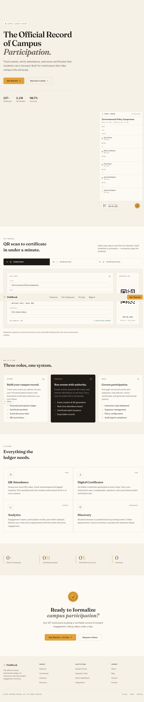

**Screenshot 9.1 — Landing route `/`, acting role none, full-page capture at 1023 pixel viewport width.**

Screenshot 9.1 is a full-page capture, 1023 by 4944 pixels, so it shows the whole scroll length of the landing route rather than one viewport of it. Its viewport width is **1023 pixels, not the 1440 pixels this document's capture convention specifies**, because the image predates that convention and was carried into `docs/srs/assets/` unmodified rather than recaptured; the width is stated as measured from the file header, which is also the width encoded in its file name. Nothing in the image was cropped, recoloured or composited.

**Marketing pages — `/pricing` and `/campuses`.** *Purpose:* state commercial tiers and participating campuses. *Functionality:* static content only; neither screen issues a database read (`src/app/routes/MarketingRoutes.tsx`, `src/app/pricing.tsx`, `src/app/campuses.tsx`). Because their content is authored in the module rather than fetched, **both screens display fixed copy that no database row governs**, which is stated here so that a reader does not mistake the tier table for configurable data.

**Sign-in — `/login`.** *Purpose:* select a role context and establish a session. *Functionality:* email and password sign-in, the Google OAuth entry point, and navigation to sign-up and password recovery (`src/app/routes/LoginRoute.tsx`, `src/lib/auth.ts`). The one-time-code and OAuth mechanics are specified once in section 11.1 and are not restated here.

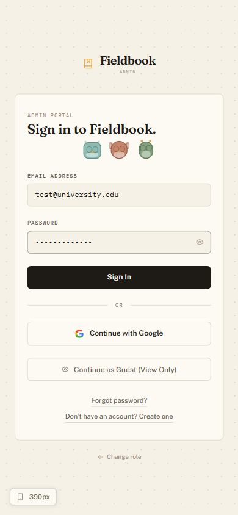

**Screenshot 9.2 — Login route `/login`, acting role none, mobile capture at 390 pixel viewport width.**

Screenshot 9.2 is the mobile rendering of the sign-in screen, 390 by 844 pixels, which is the minimum viewport width section 17 states as the client requirement for camera-based capture. It is included at that width deliberately: the attendance workflow of section 11.4 is a phone workflow, so the sign-in screen that precedes it is the one screen whose narrow-viewport layout carries specification weight. No account data appears in the image, since no session exists at that route.

**Sign-up — `/signup`.** *Purpose:* create an account and its profile row. *Functionality:* collects a display name, email address and password, then verifies a six-digit one-time code; the profile row is written by the trigger on the authentication table rather than by the screen, as section 11.1 states. Field-level rules are in Table 9.2.

**Password recovery — `/forgot`.** *Purpose:* request a recovery link. *Functionality:* submits the email address to the hosted authentication service with a redirect target of `/auth/reset-callback`; the link's expiry is held by that service and is stated as an unverifiable figure in section 11.1, not here.

**Callback screens — `/auth/callback` and `/auth/reset-callback`.** *Purpose:* complete an authentication round trip. *Functionality:* `AuthCallbackRoute` completes the OAuth code exchange and redirects to the role home resolved from the profile row; `ResetCallbackRoute` accepts a new password against the recovery session. Both render a transitional state only and hold no content of their own, which is why neither carries a screenshot row of its own in Table 9.3.

### 9.3 Student screens

**Profile — `/profile`.** *Purpose:* view and edit one's own profile, and request a role change. *Functionality:* edits display name, phone and biography; uploads an avatar to the `avatars` bucket; lists the caller's own role-change requests and submits a new one (`src/app/profile.tsx` — symbol `ProfileScreen`). The screen is reached by **any** signed-in role through `AuthRouteGuard`, not by students alone; it is documented in this subsection because the role-upgrade request of section 11.8 originates here. A pending request suppresses the submission form, which is the interface expression of the one-pending-request rule.

**Student dashboard — `/student/dashboard`.** *Purpose:* orient the signed-in student. *Functionality:* summary counts and entry points to explore, my-events, scanner, certificates and notifications.

**Explore — `/student/explore`.** *Purpose:* browse events open to registration. *Functionality:* lists events readable under the published-event select policy of section 8.16, with active registration counts shown against `capacity` so a full event is visible as full before a registration is attempted.

**Event detail — `/student/explore/:eventId`.** *Purpose:* present one event and offer registration. *Functionality:* renders the event's date, time, venue or location type, capacity and organizer, and triggers the capacity-checked registration function; the refusal path and its row lock are specified in section 11 and the capacity comparison appears as `Figure 10.12`.

**My events — `/student/events`.** *Purpose:* list the student's own registrations and attendance. *Functionality:* reads the caller's own rows in both participation tables and presents each event with its registration status and whether attendance was recorded.

**Scanner — `/student/scanner` and `/student/scanner/:eventId`.** *Purpose:* capture attendance. *Functionality:* a camera stream decoded frame by frame, an image-upload decode path, and a manual event-code entry panel; the payload grammar, the camera constraints and the duplicate outcome are specified in sections 11.4 and 11.5, and the whole interaction appears as `Figure 10.8`. **The parameterised variant renders the identical component**, so the two routes are one screen that differs only in whether an event is preselected.

**Certificates — `/student/certificates`.** *Purpose:* list the student's certificates and obtain a missing one. *Functionality:* reads the caller's own certificate rows, opens each stored PDF by its URL, and — for an attended event whose certificate does not yet exist — calls the generate endpoint through the retrying client of section 11.6. This is **the only caller of the generate endpoint in the repository**.

**Notifications — `/student/notifications`.** *Purpose:* present notifications addressed to the caller. *Functionality:* reads, marks read and deletes the caller's own rows. No client can author a notification, because the notifications table declares no non-admin insert policy; rows arrive only from the three AFTER triggers described in section 8.13.

### 9.4 Organizer screens

**Organizer dashboard — `/organizer/dashboard`.** *Purpose:* orient the organizer across owned events. *Functionality:* counts of owned events by status and entry points to the workspace, QR display, roster, analytics and certificate screens.

**Events workspace — `/organizer/events` and `/organizer/events/create`.** *Purpose:* list owned events and author a new one. *Functionality:* the create form writes a `draft` row with an owned organizer identifier and a generated code, then submits an approval record; the two-step sequence and the status the insert policy forces are specified in section 11.2. Field-level rules for the create form are in Table 9.2.

**QR display — `/organizer/qr`.** *Purpose:* present the event code for students to scan. *Functionality:* renders the code as a QR image encoding the attendance payload, and accepts a photograph of the displayed code into the `qr-photos` bucket under that bucket's 5 MB and image-type limits.

**Attendee roster — `/organizer/attendees` and `/organizer/attendees/:eventId`.** *Purpose:* show who checked in to an owned event. *Functionality:* reads attendance rows under the organizer select policy and resolves attendee display names through the definer-rights function that exists because no organizer select policy on the profile table grants those names directly. **This screen is known to display non-live data.** Section 5.1 records that the rendering module falls back to a hard-coded demonstration array when the database query returns no roster, and that the screen's default event identifier is a demonstration value; the real-data path is substantiated, the exclusive use of real data is not.

**Analytics — `/organizer/analytics`.** *Purpose:* summarise participation for owned events. *Functionality:* aggregates registration and attendance counts over events the caller owns; both participation tables scope their organizer policies through event ownership, so no figure for a non-owned event is reachable.

**Certificate issuance — `/organizer/certificates`.** *Purpose:* present recipients for an owned event and mark issuance. *Functionality:* lists recipients with an issuance state and settles each row to a sent state on action. **This screen is known to display non-live data and to perform no issuance.** Section 12, use case UC-18, records that it operates on a hard-coded recipient list and issues no request to the certificate service, so no PDF and no certificate row results from using it; the gap is carried as a limitation in section 18.

### 9.5 Admin screens

**Admin dashboard — `/admin/dashboard`.** *Purpose:* present platform state and recent activity. *Functionality:* reads the platform activity feed newest first under the admin select policy, and surfaces pending counts for approvals and role requests that the admin UI context holds across screen navigation (`src/app/routes/AdminUiContext.tsx`).

**Approvals queue — `/admin/approvals`.** *Purpose:* review and resolve event approvals. *Functionality:* lists every approval row and resolves one by publishing the event and then updating the approval record; the two writes are separate calls, and the non-atomicity between them is specified in section 11.3 and drawn in `Figure 10.10`. Rejection resolves the approval with a reason and leaves the event at `draft`.

**Users — `/admin/users`.** *Purpose:* administer profiles. *Functionality:* reads every profile under the admin select policy, changes a role directly, and deletes a profile with the cascade effects section 8.2 states.

**Role requests — `/admin/role-requests`.** *Purpose:* resolve role-change requests. *Functionality:* lists requests by status and calls the approve or reject function, each of which updates the request, the profile role and the audit log in one call. Section 14.7 records that no step compares the request's subject with the calling admin, so an admin may resolve a request concerning that same admin; this screen is the interface through which that defect is reachable.

**Templates — `/admin/templates`.** *Purpose:* author certificate templates. *Functionality:* creates and edits template rows and uploads a background image to the `certificate-templates` bucket under that bucket's 10 MB limit and its PNG, JPEG and PDF allow-list. A template carrying no background image yields a 422 at generation time, per Table 13.2.

**Analytics, settings and notifications — `/admin/analytics`, `/admin/settings`, `/admin/notifications`.** *Purpose:* platform-wide reporting, configuration display, and the admin notification feed. *Functionality:* each is a distinct component under the admin guard (`src/app/routes/AdminRoutes.tsx`). These three screens are grouped in one screenshot row, D-28, because Appendix D groups them; they remain three distinct screens in Table 9.1.

### 9.6 Input-field validation grid

Table 9.2 states, per input field, the accepted format or range, the observable rejection and the layer that enforces the rule. Every rule in it is drawn from sections 13.1 and 13.2; nothing is added here. The enforcing-layer column is the column that matters, because a rule enforced only in the client is a convenience that a direct request to the data API can ignore.

**Table 9.2 — Input-field validation grid by screen, with accepted values, rejection behaviour and enforcing layer (Requirement 6.11).**

| Screen | Field | Accepted format or range | Rejection behaviour | Enforcing layer |
|---|---|---|---|---|
| `/signup`, `/login` | One-time sign-in code | A six-digit code | A cause-specific message — expired, rate-limited, malformed, unknown signup, or incorrect; the typed value is retained | Client mapping over the hosted authentication service |
| `/signup` | Email address | Unique platform-wide | Unique-constraint violation on the profile email column | Database |
| `/forgot` | Email address | Any address accepted by the authentication service | No enumeration of unknown addresses | Hosted authentication service |
| `/student/scanner` | Scanned QR payload | `fieldbook:attendance:{EVENT_CODE}`, or a bare event code | Local decode failure, no request issued, value retained | Client (`parseQrValue`) |
| `/student/scanner` | Manually entered event code | An existing event code | Message reporting no matching event; typed value retained | Client, over a database lookup |
| `/student/scanner` | Target event status | Event `status` of `published` or `live` | Capture refused before the insert, with distinct messages for a completed and a not-yet-available event | **Client only** — no database policy |
| `/student/scanner` | Repeat attendance | One row per student per event | SQLSTATE `23505`, mapped to a duplicate outcome rather than an error | Database (`attendance_student_event_unique`) |
| `/student/explore/:eventId` | Registration request | Active registrations below `capacity` | Refusal outcome returned by the function; no row written | Database (`register_for_event`, under a row lock) |
| `/organizer/events/create` | Title | Non-empty text, not null | Not-null violation | Database |
| `/organizer/events/create` | Event code | Unique platform-wide | Unique-constraint violation | Database |
| `/organizer/events/create` | Event date | A date value, not null | Not-null violation | Database |
| `/organizer/events/create` | Capacity | Integer `>= 0` | Check-constraint violation | Database |
| `/organizer/events/create` | Location type | `in-person`, `online`, `hybrid` | Check-constraint violation | Database |
| `/organizer/events/create` | Status on insert | `draft` only, for an organizer caller | Policy refusal by `events_insert_organizer` | Database |
| `/organizer/qr` | QR photograph upload | At most 5 MB; PNG or JPEG | Client refusal, and storage refusal if the client is bypassed | Client plus storage configuration |
| `/profile` | Avatar upload | At most 5 MB; PNG, JPEG, WebP or GIF | Client refusal, and storage refusal if the client is bypassed | Client plus storage configuration |
| `/profile` | Requested role | One of `student`, `organizer`, `admin`, differing from the current role | `role_change_requests_role_differs` violation | Database |
| `/profile` | Second pending role request | At most one pending row per user | Unique-index violation on insert | Database (partial unique index) |
| `/admin/templates` | Background image upload | At most 10 MB; PNG, JPEG or PDF | Client refusal, and storage refusal if the client is bypassed | Client plus storage configuration |
| `/admin/templates` | Template `fields` | A JSON array | `jsonb_typeof(fields) = 'array'` violation | Database |
| `/student/certificates` | Generate-endpoint request body | Four non-blank strings: `studentName`, `eventTitle`, `templateId`, `certificateCode` | HTTP 400 with a per-field message map | Java bean validation |
| `/student/certificates` | Referenced template background | A non-blank background image URL | HTTP 422 with an explanatory message; no PDF, no row | Java service code |

Table 9.2 covers twenty-two field-level rules across nine screens, and three of its rows name the client as the sole enforcing layer: the QR payload shape, the event-status gate on attendance capture, and the upload limits before a storage call. The two identifier fields of the generate request are absent from the table deliberately — `eventId` and `studentId` carry no `@NotBlank` annotation and are nullable, consistent with the nullable foreign keys section 8.6 records.

### 9.7 Screenshot metadata

**Table 9.3 — Screenshot metadata for all thirty documented screens, with capture state and register reference (Requirements 9.1, 9.2, 9.4).**

| Row | Screen | Route | Role required | Data precondition | Viewport | File name | Capture date | Captured | RC |
|---|---|---|---|---|---|---|---|---|---|
| A-01 | Landing page | `/` | none | none | 1023 | `screenshot-A01-landing-1023.png` | Not recorded | Captured | — |
| A-02 | Sign-in, mobile | `/login` | none | none | 390 | `screenshot-A02-login-mobile-390.png` | Not recorded | Captured | — |
| D-01 | Pricing | `/pricing` | none | none | 1440 | Not assigned | Not captured | Not captured | RC-17 |
| D-02 | Campuses | `/campuses` | none | none | 1440 | Not assigned | Not captured | Not captured | RC-17 |
| D-03 | Sign-up | `/signup` | none | none | 1440 | Not assigned | Not captured | Not captured | RC-17 |
| D-04 | Password recovery | `/forgot` | none | none | 1440 | Not assigned | Not captured | Not captured | RC-17 |
| D-05 | Sign-in, desktop | `/login` | none | none | 1440 | Not assigned | Not captured | Not captured | RC-17 |
| D-06 | Profile | `/profile` | any signed-in user | a session with a profile row | 1440 | Not assigned | Not captured | Not captured | RC-17 |
| D-07 | Student dashboard | `/student/dashboard` | student | a session with a profile row | 1440 | Not assigned | Not captured | Not captured | RC-17 |
| D-08 | Explore events | `/student/explore` | student | at least one `published`, `live` or `completed` event | 1440 | Not assigned | Not captured | Not captured | RC-17 |
| D-09 | Event detail | `/student/explore/:eventId` | student | a published event identifier | 1440 | Not assigned | Not captured | Not captured | RC-17 |
| D-10 | My events | `/student/events` | student | at least one registration or attendance row for the account | 1440 | Not assigned | Not captured | Not captured | RC-17 |
| D-11 | Scanner, idle | `/student/scanner` | student | camera permission granted, or the manual-entry panel visible | 1440 | Not assigned | Not captured | Not captured | RC-17 |
| D-12 | Scanner, success state | `/student/scanner` | student | a `published` or `live` event and no existing attendance row for the account | 1440 | Not assigned | Not captured | Not captured | RC-17 |
| D-13 | Scanner, duplicate state | `/student/scanner` | student | an existing attendance row for the same account and event | 1440 | Not assigned | Not captured | Not captured | RC-17 |
| D-14 | Student certificates | `/student/certificates` | student | at least one certificate row for the account | 1440 | Not assigned | Not captured | Not captured | RC-17 |
| D-15 | Student notifications | `/student/notifications` | student | at least one notification row for the account | 1440 | Not assigned | Not captured | Not captured | RC-17 |
| D-16 | Organizer dashboard | `/organizer/dashboard` | organizer | the organizer role plus at least one owned event | 1440 | Not assigned | Not captured | Not captured | RC-17 |
| D-17 | Events workspace | `/organizer/events` | organizer | at least one owned event | 1440 | Not assigned | Not captured | Not captured | RC-17 |
| D-18 | Create event | `/organizer/events/create` | organizer | the organizer role | 1440 | Not assigned | Not captured | Not captured | RC-17 |
| D-19 | Event QR display | `/organizer/qr` | organizer | at least one owned event with a code | 1440 | Not assigned | Not captured | Not captured | RC-17 |
| D-20 | Attendee roster | `/organizer/attendees` | organizer | at least one attendance row for an owned event | 1440 | Not assigned | Not captured | Not captured | RC-17 |
| D-21 | Organizer analytics | `/organizer/analytics` | organizer | at least one owned event with participation rows | 1440 | Not assigned | Not captured | Not captured | RC-17 |
| D-22 | Organizer certificates | `/organizer/certificates` | organizer | the organizer role | 1440 | Not assigned | Not captured | Not captured | RC-17 |
| D-23 | Admin dashboard | `/admin/dashboard` | admin | the admin role plus platform activity rows | 1440 | Not assigned | Not captured | Not captured | RC-17 |
| D-24 | Approvals queue | `/admin/approvals` | admin | at least one pending approval row | 1440 | Not assigned | Not captured | Not captured | RC-17 |
| D-25 | Users | `/admin/users` | admin | at least three profile rows | 1440 | Not assigned | Not captured | Not captured | RC-17 |
| D-26 | Role requests | `/admin/role-requests` | admin | a role-change request in each of pending, approved and rejected | 1440 | Not assigned | Not captured | Not captured | RC-17 |
| D-27 | Certificate templates | `/admin/templates` | admin | at least one template row | 1440 | Not assigned | Not captured | Not captured | RC-17 |
| D-28 | Admin analytics, settings, notifications | `/admin/analytics`, `/admin/settings`, `/admin/notifications` | admin | the admin role | 1440 | Not assigned | Not captured | Not captured | RC-17 |

Table 9.3 carries thirty rows, of which **two are captured and twenty-eight are not**. The two captured rows are the images embedded as Screenshot 9.1 and Screenshot 9.2; their capture date is recorded as not recorded, because the images predate this document and no repository artifact states when they were taken. The viewport column for the twenty-eight uncaptured rows states the width at which each row *is to be* captured under this document's capture convention — 1440 pixels for every row, since Appendix D marks none of them mobile — not a width at which anything was captured. Their file-name column reads `Not assigned` for the same reason: assigning a name before an image exists would leave a name in the document that resolves to nothing. [Requires Confirmation] RC-17

**What must happen for the twenty-eight to be captured.** Four preconditions must hold simultaneously, and none of them holds in the authoring environment of this revision: a running local instance of the application served at `http://localhost:5173`; seeded event, approval, participation and template data sufficient for each row's data precondition; three documentation accounts, one per role, whose credentials never enter this document; and the out-of-band first-admin bootstrap, because the repository provides no path from an empty database to a first admin — section 3.4 states that absence, and it is the reason the organizer and admin rows cannot be reached by the product's own promotion path until an admin exists. The party able to supply all four is the user operating the development environment; the register entry names them.

**No image in this document is synthesised.** The two embedded screenshots are unmodified captures of the running application carried forward from the repository. For the twenty-eight uncaptured screens this section carries no image, no placeholder, no substitute rendering and no unresolved image reference — the rows in Table 9.3 and the single register entry are their entire representation. Fabricating, mocking or reconstructing a screen image is prohibited by this document's authoring rules, and the prohibition is honoured by omission rather than by approximation.

## 10. System Diagrams — the ten diagram families in Appendix C

### 10.1 Diagram conventions

Thirteen figures follow, `Figure 10.1` through `Figure 10.13`, spanning ten diagram families. Each is carried as Mermaid source rather than as an exported image, so the figure and the fact it asserts are edited together and neither can drift from the other.

**Label lexicon.** Every element appearing in more than one figure carries identical label text in every figure and in body prose. The lexicon is fixed here and nowhere varied: `Student`, `Organizer`, `Admin`, `Field Book SPA`, `Supabase Auth`, `Supabase Postgres`, `Supabase Storage`, `Google OAuth`, `Render`, `Vercel`, `certificate-service`, and each database table under the name it is declared with — `profiles`, `events`, `approvals`, `certificate_templates`, `certificates`, `notifications`, `audit_log`, `role_change_requests`, `platform_activity`, `attendance`, `registrations`. A figure that needs to name a module names it by its repository path, which is unambiguous and needs no lexicon entry.

**Planned-element convention.** An element representing a capability classified `Planned` is drawn with a **dashed border** and carries the suffix ` (Planned)` inside its node label. The caption of any figure containing such an element names the element, states its Implementation_Status and states the visual treatment, so a reader who sees the figure without the caption still sees the dashed border and the suffix. Exactly two figures carry a planned element — `Figure 10.4` and `Figure 10.5` — and in both it is certificate verification, for which the route table declares no route.

**Substitution convention.** Mermaid provides no native use-case notation and no native activity notation. Where a mandated family has no Mermaid equivalent, the figure is drawn as a `flowchart` and its caption declares the substitution explicitly. Three figures are substitutions on that basis: `Figure 10.5`, `Figure 10.11` and `Figure 10.12`.

### 10.2 Architecture and context

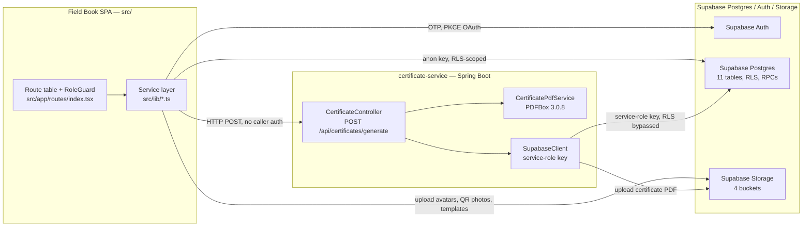

**Figure 10.1 — System architecture: three tiers, their internal parts, and the key each data path uses.**

Figure 10.1 draws the tier decomposition of section 4 with one detail that section states in prose and this figure makes visual: the two paths into `Supabase Postgres` carry different keys, and only one of them is constrained by row-level security. The `Field Book SPA` reaches the database with the anonymous key under policy, while `certificate-service` reaches it with the service-role key and bypasses policy entirely (`src/lib/supabaseClient.ts`, `certificate-service/src/main/java/com/fieldbook/certificateservice/supabase/SupabaseClient.java`). The edge from the service layer to the controller is labelled with the absence of caller authentication because that absence is a property of the interface, not of its implementation.

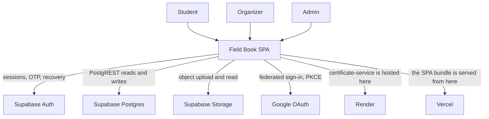

**Figure 10.2 — Context diagram: three human actors and the six external systems the platform depends on.**

Figure 10.2 fixes the system boundary: everything inside `Field Book SPA` is specified by this document, and each of the six external systems is a dependency whose behaviour this document describes but does not govern. The evidence for each labelled system is as follows — `Supabase Auth`, `Supabase Postgres` and `Supabase Storage` are reached through the single configured client (`src/lib/supabaseClient.ts`); `Google OAuth` is reached through the federated sign-in call (`src/lib/auth.ts` — symbol `signInWithGoogle`); `Render` hosts the certificate service (`render.yaml`); `Vercel` serves the built frontend (`vercel.json`). The two hosting edges are drawn from the application rather than to it because the figure records dependency, not request direction, and the prose here rather than the arrowhead states which way traffic flows.

### 10.3 Data flow

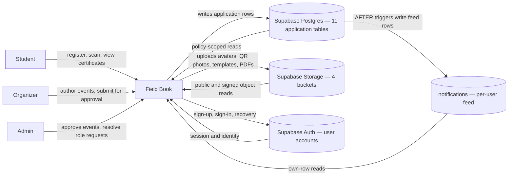

**Figure 10.3 — Data flow level 0: one process, three actors, four data stores.**

Figure 10.3 collapses the whole platform into a single process so that the store boundaries are legible. The `notifications` feed is drawn as a store distinct from the other application tables even though it is one of the eleven, because rows enter it only from database triggers and never from a client write — no non-admin insert policy exists on it, as section 8.7 records. That asymmetry is the figure's one substantive claim, and it is why the arrow into the feed originates at the database rather than at the process.

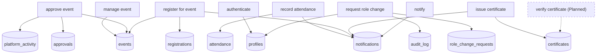

**Figure 10.4 — Data flow level 1: eight implemented processes, one planned process, and their table accesses.**

Figure 10.4 contains one planned element. **`verify certificate (Planned)` represents public certificate verification, whose Implementation_Status is `Planned`; it is drawn with a dashed border, carries the ` (Planned)` suffix in its label, and reaches `certificates` over a dashed edge.** No route in the route table serves it and no repository artifact implements it (`src/app/routes/index.tsx` — symbol `AnimatedRoutes`); section 19 states it as a future enhancement. The eight solid processes each write only the tables their service module touches, so the figure doubles as a coarse check on the traceability matrix: a process with no edge to a table is a process that cannot affect it.

### 10.4 Use cases

```mermaid
flowchart LR
    student["Student"]
    organizer["Organizer"]
    admin["Admin"]

    uc1["UC-1 Sign up with OTP"]
    uc2["UC-2 Sign in with Google"]
    uc3["UC-3 Recover password"]
    uc4["UC-4 Edit profile"]
    uc5["UC-5 Browse published events"]
    uc6["UC-6 View event detail"]
    uc7["UC-7 Register for event"]
    uc8["UC-8 Cancel registration"]
    uc9["UC-9 Capture attendance by QR"]
    uc10["UC-10 Enter attendance code manually"]
    uc11["UC-11 View own certificates"]
    uc12["UC-12 View notifications"]
    uc13["UC-13 Create event draft"]
    uc14["UC-14 Submit event for approval"]
    uc15["UC-15 Display event QR"]
    uc16["UC-16 View attendees"]
    uc17["UC-17 View organizer analytics"]
    uc18["UC-18 Issue certificates for an event"]
    uc19["UC-19 Review event approvals"]
    uc20["UC-20 Manage users"]
    uc21["UC-21 Resolve role-change requests"]
    uc22["UC-22 Manage certificate templates"]
    uc23["UC-23 View platform activity"]
    uc24["UC-24 Request role upgrade"]
    ucv["UC verify certificate (Planned)"]

    student --> uc1
    student --> uc2
    student --> uc3
    student --> uc4
    student --> uc5
    student --> uc6
    student --> uc7
    student --> uc8
    student --> uc9
    student --> uc10
    student --> uc11
    student --> uc12
    student --> uc24
    organizer --> uc4
    organizer --> uc13
    organizer --> uc14
    organizer --> uc15
    organizer --> uc16
    organizer --> uc17
    organizer --> uc18
    admin --> uc4
    admin --> uc19
    admin --> uc20
    admin --> uc21
    admin --> uc22
    admin --> uc23
    student -.-> ucv

    style ucv stroke-dasharray: 5 5
```

**Figure 10.5 — Use cases: twenty-four implemented cases plus one planned verification case, drawn as a flowchart substitution.**

Figure 10.5 is a **declared substitution**: Mermaid provides no use-case notation, so actors and use cases are drawn as flowchart nodes and the association between them as a plain edge. Nothing about ellipses or stick figures should be read into the shapes. The figure carries one planned element — **`UC verify certificate (Planned)`, Implementation_Status `Planned`, drawn with a dashed border, the ` (Planned)` label suffix and a dashed association edge** — and its twenty-four solid cases are exactly the set specified in section 12, so the figure and that section cannot diverge in membership. `UC-4 Edit profile` associates with all three actors because `/profile` sits behind the any-signed-in guard rather than behind a role guard.

### 10.5 Data model

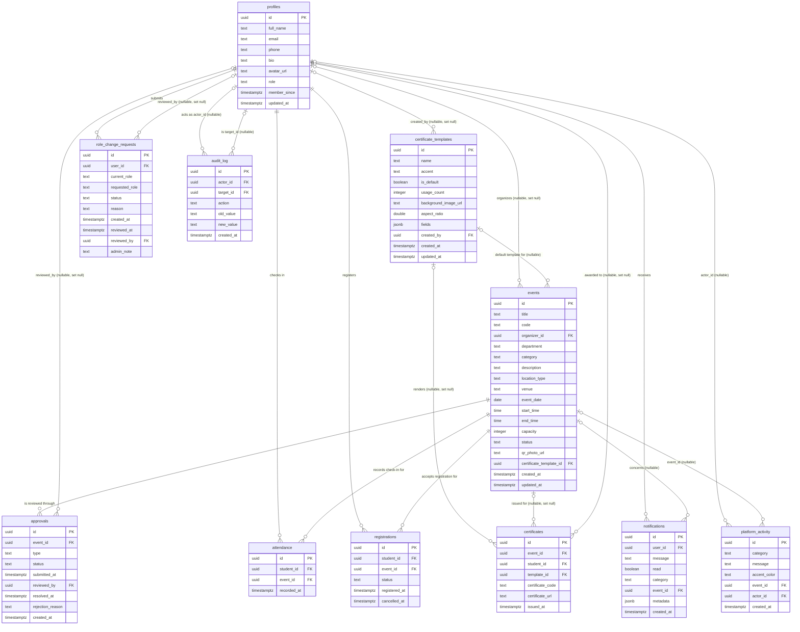

**Figure 10.6 — Entity relationship model: eleven tables and twenty declared foreign-key relationships with cardinality from nullability.**

Figure 10.6 derives every cardinality mechanically: a `not null` foreign key yields mandatory participation on the child side, drawn `||--o{`, and a nullable one yields optional participation, drawn `|o--o{`. No relationship in the figure is inferred; each is a declared foreign key transcribed from the migration set of section 8.1. Three absences are as important as the twenty relationships present. **`attendance` and `registrations` share the same `(student_id, event_id)` shape and neither references the other**, so a registration is not a precondition of a check-in at the schema level. **`certificates` carries no reference to `attendance`**, so nothing in the database ties an issued certificate to a recorded check-in; section 19 carries that link as a future enhancement. Mermaid renders `double` and `jsonb` as opaque type tokens, which is acceptable because the authoritative column types are transcribed in Table 8.4 and Table 8.6.

### 10.6 Classes

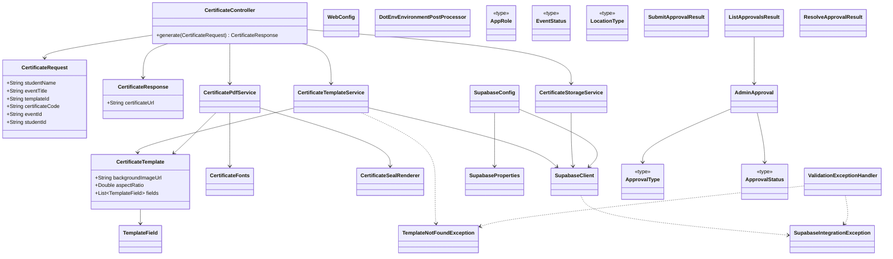

**Figure 10.7 — Class model: certificate-service types and the exported service-layer types, with constructor and DTO dependencies only.**

Figure 10.7 is restricted to types that are declared under `certificate-service/src/main/java/` or exported from `src/lib/`; no type is invented to complete a shape, and no relationship other than a constructor dependency or a DTO usage is drawn. The five types carrying the `<<type>>` annotation are TypeScript union aliases rather than classes — `AppRole` in `src/lib/auth.ts`, `EventStatus` and `LocationType` in `src/lib/events.ts`, `ApprovalType` and `ApprovalStatus` in `src/lib/approvals.ts`. Their union members are `student`, `organizer`, `admin`; `draft`, `published`, `live`, `completed`; `in-person`, `online`, `hybrid`; `new_event`, `recurring`, `capacity_change`, `edit`; and `pending`, `approved`, `rejected` — the same value sets the database check constraints of section 8 declare, which is why a drift between the two layers would be visible as a difference between this figure and Table 8.2. The dashed dependencies are exception paths, which is why `ValidationExceptionHandler` depends on two exception types and on nothing else.

### 10.7 Sequences

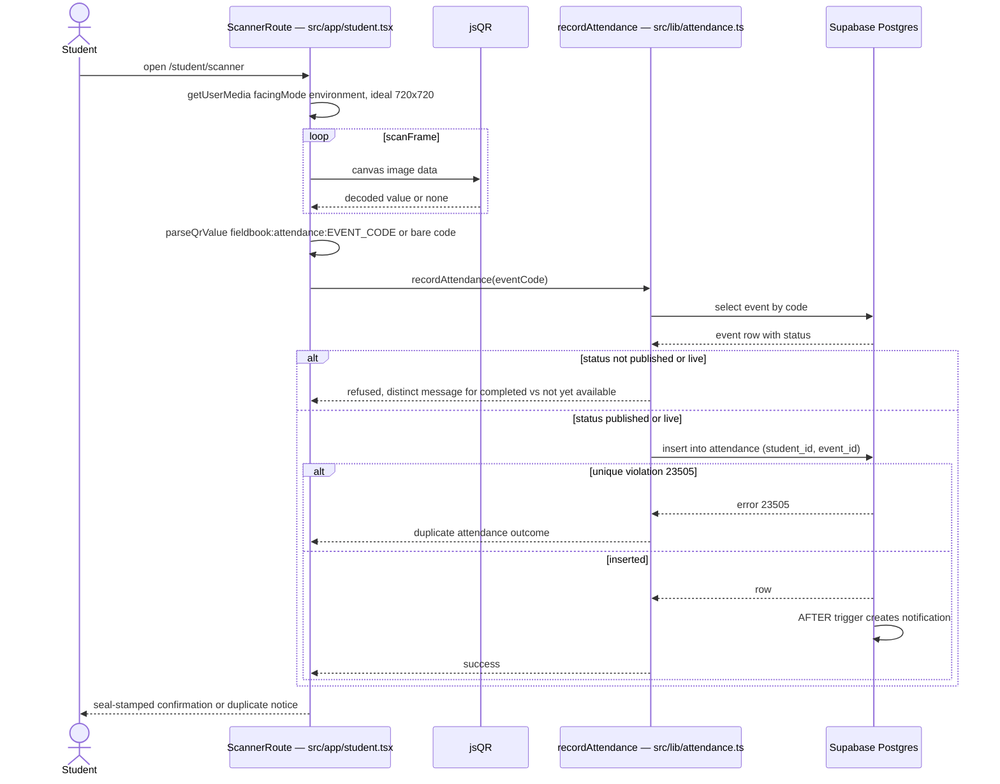

**Figure 10.8 — Sequence: QR attendance capture, from camera frame to insert, with both refusal branches.**

Figure 10.8 shows the two refusals that this workflow can produce and where each is decided. The event-status refusal is decided in the client before any insert is attempted, which is why the figure places it on the client side of the boundary; the duplicate refusal is decided by the database, surfaces as SQLSTATE `23505` and is mapped to an outcome rather than an error, as section 11.5 states. The notification is drawn as a database-internal step because it arrives from an AFTER trigger and no client requests it.

```mermaid
sequenceDiagram
    actor Actor as Student or Organizer
    participant Client as generateCertificateWithRetry — src/lib/certificates.ts
    participant Ctrl as CertificateController
    participant Tpl as CertificateTemplateService
    participant Pdf as CertificatePdfService
    participant Store as Supabase Storage
    participant PG as Supabase Postgres

    Actor->>Client: request certificate
    Client->>Ctrl: POST /api/certificates/generate, 60 s timeout, 1 retry on transient 502
    Ctrl->>Tpl: fetchTemplate(templateId)
    Tpl->>PG: select certificate_templates row, service-role key
    alt template missing
        PG-->>Tpl: no row
        Tpl-->>Ctrl: TemplateNotFoundException
        Ctrl-->>Client: 404 Template not found
    else template found
        PG-->>Tpl: background_image_url, aspect_ratio, fields
        Ctrl->>Ctrl: background_image_url null or blank raises IllegalStateException, 422
        Ctrl->>Store: downloadBytes(background_image_url)
        Ctrl->>Pdf: render(template, background, studentName, eventTitle, certificateCode)
        Pdf-->>Ctrl: pdfBytes
        Ctrl->>Store: uploadCertificate(pdfBytes, certificateCode)
        Store-->>Ctrl: publicUrl
        Ctrl->>PG: insert certificates row
        alt insert fails
            PG-->>Ctrl: error
            Ctrl-->>Client: 502 Supabase integration failure, PDF already stored
        else inserted
            PG->>PG: AFTER trigger creates notification
            Ctrl-->>Client: 200 certificateUrl
        end
    end
    Client-->>Actor: certificate link or error state
```

**Figure 10.9 — Sequence: certificate generation across the client, the service, storage and the database.**

Figure 10.9 traces each of the four error statuses of Table 13.2 to the step that raises it, so a reader diagnosing a failure can locate the boundary it crossed. The upload precedes the row insert, and the figure labels the failure of that insert with the fact that the PDF is already stored — the non-atomicity section 18 records as a limitation. The sixty-second timeout and single retry live on the client edge because they are properties of the caller, not of the endpoint.

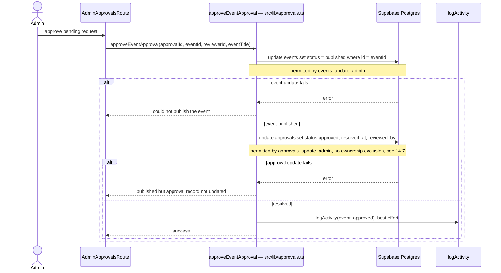

**Figure 10.10 — Sequence: event approval, showing the two independent writes and the state between them.**

Figure 10.10 records a **non-atomicity**: the event update and the approval update are two separate calls to the data API with no wrapping transaction, so a failure occurring after the first and before the second leaves a **published event with a pending approval**, and nothing retries or reverses it. The figure draws that intermediate state as its own branch rather than folding it into a generic error path, because the resulting inconsistency is visible to users on two different screens. The activity write is marked best-effort because its failure does not affect the outcome reported to the admin.

### 10.8 Activities

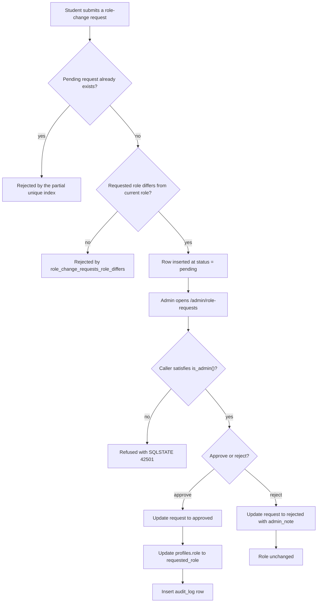

**Figure 10.11 — Activity: role upgrade from submission to resolution, drawn as a flowchart substitution.**

Figure 10.11 is a **declared substitution**: Mermaid has no activity-diagram notation, so activities are rectangles, decisions are diamonds and control flow is a labelled edge. Two decisions carry the figure's substance. The pending-request check is enforced by the partial unique index rather than by a query the application runs first, and the admin gate is the definer-rights function's own `is_admin()` test. **No decision in this figure compares the request's subject with the calling admin**, which is exactly the omission section 14.7 records as a defect; the figure is drawn as the code behaves, not as the intended control would behave.

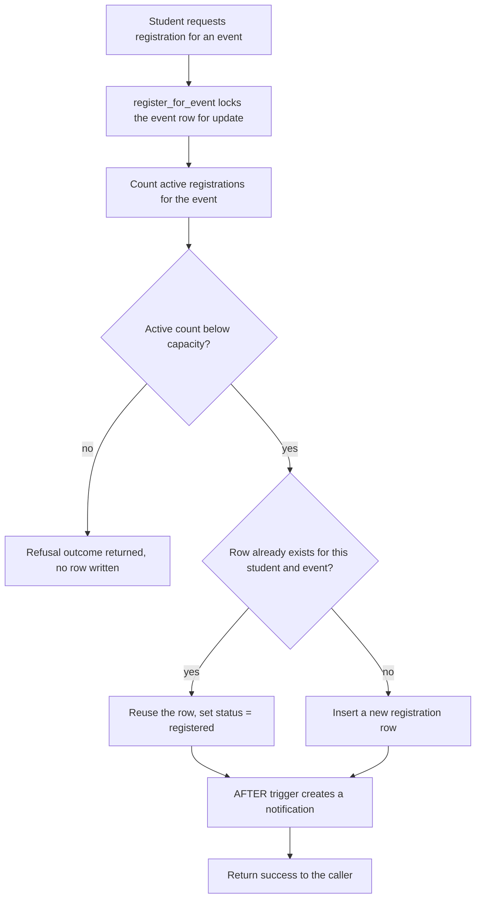

**Figure 10.12 — Activity: capacity-checked registration under a row lock, drawn as a flowchart substitution.**

Figure 10.12 is a **declared substitution** on the same basis as Figure 10.11. The ordering it shows is the guarantee: the event row is locked *before* the active registrations are counted, so two concurrent requests for the last remaining place serialise and the second sees the first's row. The re-registration branch exists because the unique constraint on the student-and-event pair means a cancelled registration is revived rather than duplicated, which is why cancellation is a status flip and not a delete.

### 10.9 Deployment

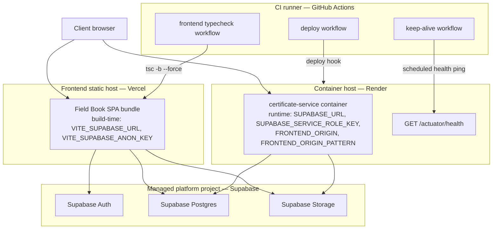

**Figure 10.13 — Deployment: four hosts labelled by role, their services, and environment-variable names only.**

Figure 10.13 names **environment variables and never their values**: the six names shown are declared in `vercel.json`, `render.yaml`, `certificate-service/Dockerfile` and the workflow files under `.github/workflows/`, and no key, URL or credential literal appears in the figure or in this section. Hosts are labelled by role — frontend static host, container host, managed platform project, CI runner — rather than by hostname, deliberately: the production frontend origin is stated inconsistently by two repository files, and section 4.5 carries that disagreement as a register entry, so this figure declines to settle it. The health-ping edge is drawn to the health endpoint rather than to the container because the scheduled workflow calls that path and retains no result, as section 7 records.

## 11. Detailed Workflows — the eight mandated workflows

Each of the eight workflows below states its initiating actor, the trigger that starts it, its ordered steps, its terminal outcome, its failure paths and exactly one Implementation_Status value. A workflow classified `Partially Implemented` names the step that is unsubstantiated and the layer at which the substantiated part is enforced, so a reader can tell a database guarantee from an application convention without leaving the subsection.

**Table 11.1 — Workflow index with initiating actor, trigger, terminal outcome and Implementation_Status (Requirement 5.11).**

| § | Workflow | Initiating actor | Trigger | Terminal outcome | Implementation_Status |
|---|---|---|---|---|---|
| 11.1 | Registration and login | Visitor | Sign-up, sign-in, Google sign-in or password-recovery request | An authenticated session and a `profiles` row | `Implemented` |
| 11.2 | Event creation | Organizer | Event form submitted on the create screen | A `draft` event and a `pending` approval row | `Implemented` |
| 11.3 | Event approval | Admin | Approve action on the admin approvals queue | Event `published` and approval `approved` | `Partially Implemented` |
| 11.4 | QR attendance capture | Student | Scan, image upload or manual code entry | An `attendance` row for the student and event | `Partially Implemented` |
| 11.5 | Duplicate attendance prevention | Student | A second capture for the same event | A duplicate outcome and no second row | `Implemented` |
| 11.6 | Certificate generation | Student | Get-certificate action for an attended event | A stored PDF and a `certificates` row | `Partially Implemented` |
| 11.7 | Certificate verification | — | — | — | `Planned` |
| 11.8 | Role upgrade | Student, then admin | Role-change request submitted, then resolved | Request `approved` and `profiles.role` changed | `Partially Implemented` |

Table 11.1 is the section's map, and its final column is the one to read first: three of the eight workflows carry `Partially Implemented`, one carries `Planned`, and only four are substantiated end to end. The `Planned` row deliberately leaves its actor, trigger and outcome columns empty rather than describing a workflow the repository does not contain.

### 11.1 Registration and login

**Implementation_Status:** `Implemented`

**Initiating actor:** a visitor holding no session. **Trigger:** submission of the sign-up form, the sign-in form, the Google sign-in button or the password-recovery form on the public routes of section 9.2.

Ordered steps of the sign-up path. (1) The client calls `signUpWithProfile`, which creates the authentication user and passes `full_name` and the chosen role as sign-up metadata; **it performs no client-side insert into `profiles`** (`src/lib/auth.ts` — symbol `signUpWithProfile`). (2) The `on_auth_user_created` AFTER INSERT trigger on `auth.users` runs `handle_new_user`, which reads that metadata and creates the `profiles` row server-side, falling back to `student` for any role that is not exactly `student` or `organizer` (`supabase/migrations/20260816140000_profile_creation_trigger.sql`, and Table 8.12). (3) The provider emails a **six-digit code**, and `verifySignupOtp` submits it with `type: "signup"`; a correct code confirms the address and returns an active session, so no separate sign-in call follows. (4) The session is persisted and refreshed by the client library, configured `persistSession: true` and `autoRefreshToken: true` (`src/lib/supabaseClient.ts`).

Ordered steps of the two remaining sign-in paths. Password sign-in is a single call to `signInWithPassword` through `signIn`. Google sign-in calls `signInWithOAuth` with `redirectTo` set to `/auth/callback`, and the client is configured `flowType: "pkce"` with `detectSessionInUrl: true`, so **the authorization code arriving in the query string is exchanged for a session inside the library during initialisation and no `exchangeCodeForSession` call exists anywhere in the application**.

Ordered steps of the password-recovery path. (1) `requestPasswordReset` calls `resetPasswordForEmail` with `redirectTo` of `` `${window.location.origin}/auth/reset-callback` ``. (2) The emailed link carries a code, exchanged for a temporary recovery session when the link opens at that route. (3) `updatePassword` calls `updateUser` with the new password. The validity period of the recovery link is held by the hosted authentication project's own configuration and appears in no repository file, so this document states no duration for it. **[Requires Confirmation] RC-05** — the confirming party is the Supabase project dashboard.

**Terminal outcome:** an authenticated session whose `profiles` row exists and whose role is one the sign-up path was permitted to request. **Failure paths:** an expired code, a rate-limited series of attempts, a malformed entry, an unknown pending sign-up and an incorrect code each produce a distinct message and retain the typed value, because the verification function returns a result rather than throwing (section 13.1); a Google redirect that cannot be initiated — for instance where the provider is not enabled on the project — resolves with an error and no session; a recovery link opened after its validity period yields no recovery session, so the password change cannot proceed.

### 11.2 Event creation

**Implementation_Status:** `Implemented`

**Initiating actor:** an organizer. **Trigger:** submission of the event form at `/organizer/events/create`.

Ordered steps. (1) The client inserts the event row with `status` set to `draft`, at both of the screen's two insert sites (`src/app/organizer.tsx` lines 1110–1113 and 1150–1153). (2) The insert is admitted by `events_insert_organizer`, whose `with check` is `public.is_organizer() and organizer_id = auth.uid() and status = 'draft'`, so **the draft status of a newly created event is a database guarantee and not a client choice** (Table 8.14). (3) On success the client calls `submitEventApproval`, which inserts an `approvals` row with `type: "new_event"` and `status: "pending"` (`src/lib/approvals.ts` lines 24–33). (4) That insert is admitted by `approvals_insert_own_organizer`, which requires the calling organizer to own the referenced event, which is why it is only ever called immediately after the event insert succeeds.

**Terminal outcome:** one `draft` event owned by the caller and one `pending` approval row referencing it. **Failure paths:** an insert attempted with any status other than `draft`, or with an `organizer_id` other than the caller's, is rejected by the policy with no row written; an insert by a student fails the `is_organizer()` term; a duplicate `code` violates `events.code unique`; and an approval insert that fails after a successful event insert leaves a `draft` event with no approval row, which the organizer resolves by resubmitting, since `submitEventApproval` is a separate call rather than part of the same statement.

### 11.3 Event approval

**Implementation_Status:** `Partially Implemented`

**Initiating actor:** an admin. **Trigger:** the approve action on the admin approvals queue at `/admin/approvals`.

Ordered steps. (1) `approveEventApproval` updates `events.status` to `published` for the referenced event **first** (`src/lib/approvals.ts` lines 192–233). (2) It then updates the `approvals` row **second**, setting `status` to `approved` with `resolved_at` and `reviewed_by`. (3) On success it writes a `platform_activity` row through `logActivity`. Both writes are gated by admin-only policies — `events_update_admin` and `approvals_update_admin`, each `using (public.is_admin()) with check (public.is_admin())` — so a non-admin caller updates zero rows and the function surfaces that as an error rather than a silent no-op.

**The two writes are not atomic, and the ordering is a deliberate choice rather than an oversight.** They are two separate PostgREST calls with no wrapping transaction and no `SECURITY DEFINER` function around them, unlike the role-change resolution path of section 11.8. The event is updated first so that a failure of the first write leaves the approval untouched rather than marking an approval approved for an event that was never published. The residual case is the reverse one: **a failure between the two calls leaves a published event whose approval row is still `pending`**, and the function reports exactly that, returning the message `Event was published, but couldn't update the approval record` so the admin can re-resolve. This non-atomicity is recorded as a limitation in section 18.

**Terminal outcome:** the event at `published` and its approval at `approved`, with an activity row recorded. **Failure paths:** the first write failing leaves both rows unchanged; the second write failing leaves the event published and the approval pending; rejection follows `rejectEventApproval`, which updates only the approval row and **leaves the event at `draft` on purpose**, so the organizer keeps the draft, reads the rejection reason, edits and resubmits.

The workflow is classified `Partially Implemented` for a second reason beyond non-atomicity: the approval gate it implements is not the control that decides whether an event can be published. Section 14.6 sets out why — `events_update_own_organizer` places no condition on `status`, so the gate is enforced by application code alone and this workflow is the conventional path rather than the only one.

### 11.4 QR attendance capture

**Implementation_Status:** `Partially Implemented`

**Initiating actor:** a student. **Trigger:** opening the scanner at `/student/scanner`, uploading an image of a code, or typing an event code by hand.

Ordered steps. (1) The scanner requests a camera stream with the constraints `facingMode: "environment"` and `width` and `height` of `{ ideal: 720 }` (`src/app/student.tsx` lines 2292–2295). (2) Each animation frame is drawn to a canvas and the pixel buffer is passed to jsQR. **The two decode paths use different inversion settings and must not be conflated: the live camera loop passes `inversionAttempts: "dontInvert"`, while the image-upload path passes `inversionAttempts: "attemptBoth"`** (`src/app/student.tsx` lines 2353 and 2464). The camera loop is the hot path and runs per frame, so it declines to spend work on inverted candidates; the upload path decodes once and can afford both polarities. (3) The decoded string is parsed by `parseQrValue`, which accepts the payload form `fieldbook:attendance:{EVENT_CODE}` and accepts a bare event code as a fallback, rejecting anything else locally with no network call (`src/app/student.tsx` — symbol `parseQrValue`). (4) Manual entry of the event code is available as a third path and reaches the same parse-and-insert sequence. (5) The event is resolved by `code`, and **capture is refused unless the event's `status` is `published` or `live`**. (6) `recordAttendance` inserts the row, admitted by `attendance_insert_own`, whose `with check` is `student_id = auth.uid()`.

**The event-status gate is enforced in the client only.** No policy on `attendance` conditions an insert on the status of the referenced event: `attendance_insert_own` tests the caller's own identity and nothing else (Table 8.14). A caller issuing a direct PostgREST insert with the anonymous key therefore records attendance at an event still in `draft` or already `completed`. That is the whole of the reason this workflow is `Partially Implemented`: the identity of the attending student is a database guarantee, the eligibility of the event is a client convention.

**Terminal outcome:** one `attendance` row for the student and event, with `recorded_at` defaulted by the database. **Failure paths:** a denied camera permission leaves the upload and manual paths available; a decode that yields no code, or a code matching neither accepted shape, is rejected locally and the entered value is retained; an unknown event code resolves to no event and no insert is attempted; an event outside `published` or `live` is refused by the client; and a repeat capture takes the path of section 11.5.

### 11.5 Duplicate attendance prevention

**Implementation_Status:** `Implemented`

**Initiating actor:** a student. **Trigger:** a second attendance capture for an event the student has already attended, by any of the three capture paths.

Ordered steps. (1) The insert is issued exactly as in section 11.4, with no prior read to check for an existing row. (2) The insert violates `attendance_student_event_unique unique (student_id, event_id)` (Table 8.10). (3) PostgreSQL raises `unique_violation`, and PostgREST returns it with the SQLSTATE code `23505`. (4) `recordAttendance` inspects the error code and, on `23505`, returns `{ status: "duplicate", message: "Attendance already recorded for this event." }` rather than an error result (`src/lib/attendance.ts` lines 30–41).

**This is a database guarantee, not a client check.** No read-then-write sequence stands between the two capture attempts, so no interleaving of concurrent requests can produce two rows; the constraint decides the outcome and the client merely translates it. Reporting the duplicate as its own outcome rather than as a failure is what makes a second scan a harmless action instead of an error the student must interpret.

**Terminal outcome:** exactly one attendance row for the pair, and a duplicate outcome reported to the screen. **Failure paths:** an error carrying any code other than `23505` is returned as an error result with the provider's message, so a genuine failure is not mistaken for a duplicate. There is no update or delete policy on `attendance`, so neither the student nor an organizer can remove a recorded row to force a re-capture; only a service-role holder can.

### 11.6 Certificate generation

**Implementation_Status:** `Partially Implemented`

**Initiating actor:** a student, on a student screen. **Trigger:** the get-certificate action for an event the student attended, handled by `handleGetCertificate` (`src/app/student.tsx` lines 1982–2010).

Ordered steps. (1) The screen refuses the request outright where the event carries no `certificate_template_id`, since the service needs a template to stamp. (2) The client generates the `certificate_code` locally and posts to `POST {CERTIFICATE_SERVICE_URL}/api/certificates/generate` with `studentName`, `eventTitle`, `templateId` and `certificateCode` non-blank and `studentId` set; `eventId` is not sent by this caller, which is consistent with both `certificates.event_id` and the request field being nullable. (3) The request carries **a 60-second timeout enforced by an `AbortController`, and one automatic retry** — `REQUEST_TIMEOUT_MS = 60_000` and `MAX_RETRIES = 1` — sized for the hosting tier's cold starts of 30 to 50 seconds; a transient `502` matching the known clock-skew shape is treated like a network throw so the retry loop covers it (`src/lib/certificates.ts` lines 13–29 and 202–219). (4) The service fetches the template row for `templateId`. (5) It downloads the background image. (6) It stamps `studentName`, `eventTitle` and `certificateCode` at the positions declared in the template's `fields` array. (7) It uploads the finished PDF to the `certificates` bucket. (8) It inserts the `certificates` row — `event_id`, `student_id`, `template_id`, `certificate_code`, `certificate_url` — **under the service-role key, which is the only write path this table has**, since `certificates_insert_admin` is the sole insert policy and no student or organizer insert policy exists. (9) It returns `200` with `{"certificateUrl": ...}` (`certificate-service/src/main/java/com/fieldbook/certificateservice/controller/CertificateController.java` — symbol `generate`).

Two weaknesses in this workflow are stated here as behaviour and analysed as controls in section 14.4. **First, the endpoint authenticates no caller**: it validates the shape of the request body and nothing about the identity, session or role of whoever sent it, while executing with a key that bypasses row-level security. Any caller who can reach the endpoint can therefore cause a certificate to be issued. **Second, the upload precedes the row insert, and the two are not one transaction** — they address two different backends — so a failure of the insert alone leaves a stored PDF whose URL remains valid with no `certificates` row describing it. The service surfaces that as a `502` rather than swallowing it, so the condition is reported, but the orphaned object remains.

**Terminal outcome:** a PDF in the `certificates` bucket and one `certificates` row carrying its URL and a platform-unique `certificate_code`. **Failure paths:** a blank required field yields `400` with a per-field message map; an unknown `templateId` yields `404`; a template whose `background_image_url` is null or blank yields `422`; a failed template fetch, upload or insert yields `502`; a request exceeding 60 seconds is aborted and retried once, and a second failure returns a timeout-specific message; a `certificate_code` collision violates the unique constraint and surfaces as `502`. The full mapping is Table 13.2.

### 11.7 Certificate verification

**Implementation_Status:** `Planned`

No workflow for confirming a certificate's authenticity exists at this revision, and this subsection is written in the future voice for that reason. The route table declares no path serving such a capability: the enumerated leaf routes of `src/app/routes/index.tsx` — symbol `AnimatedRoutes` — contain no verification path among the eight public ones, and the catch-all `*` renders the landing page, so a visitor following a printed certificate reference reaches marketing content rather than a lookup screen. That file is cited as the artifact demonstrating the absence.

Were the capability introduced, a public route would accept a `certificate_code`, a lookup would resolve that code against the `certificates` table, and the outcome shown to an unauthenticated visitor would be the issuing event, the recipient's display name and the issue timestamp. Two schema prerequisites would have to be met first, and neither holds today. A select policy for `anon` on `certificates` would be needed, since **every policy in the catalogue is granted `to authenticated` and nothing is granted to `anon`** (section 8.16); and an integrity value would be needed for the check to mean more than the existence of a row, since `certificates` carries no `sha256_hash` column and no other digest (section 8.6). A database-level link between an attendance record and an issued certificate would also be needed for the outcome to establish participation rather than issuance, and no such link exists.

Version 1.0 of this specification described this capability as available. The repository at the pinned revision contains no route, no policy and no column serving it, so the corresponding legacy identifiers are classified `Planned`, the absence is carried as a limitation in section 18, and the capability is carried as an enhancement in section 19.

### 11.8 Role upgrade

**Implementation_Status:** `Partially Implemented`

**Initiating actor:** a student, then an admin. **Trigger:** submission of a role-change request from the profile screen, then its resolution from `/admin/role-requests`.

Ordered steps of the request. (1) The student inserts a `role_change_requests` row naming their current role and the requested role (`src/lib/roleRequests.ts` — symbol `createRoleChangeRequest`). (2) The insert is admitted by `role_change_requests_insert_own`, which requires the caller's own id, `"current_role" = public.current_profile_role()`, `status = 'pending'`, and both review columns null, so **a request cannot be filed on another user's behalf and cannot arrive pre-resolved** (Table 8.14). (3) `role_change_requests_role_differs` rejects a request naming the role already held. (4) **A second pending request is blocked by the partial unique index `idx_role_change_requests_one_pending_per_user (user_id) where status = 'pending'`**, which permits any number of resolved rows while admitting one pending row per user.

Ordered steps of the resolution. (5) An admin calls the `SECURITY DEFINER` function `approve_role_change_request(p_request_id, p_admin_note)`, granted to `authenticated` (`supabase/migrations/20260817120000_role_change_requests.sql` — symbol `approve_role_change_request`). (6) The function gates on `public.is_admin()`, raising SQLSTATE `42501` otherwise. (7) It selects the request `for update`, raising `P0002` where no such row exists and `22023` where the row is already resolved. (8) In the same call it updates the request to `approved` with `reviewed_at`, `reviewed_by` and `admin_note`, updates `profiles.role` to the requested role, and inserts the `audit_log` row. **All three writes happen inside one function invocation, which is what distinguishes this path from the two-call event approval of section 11.3.** Rejection follows `reject_role_change_request`, which resolves the request and leaves `profiles.role` untouched.

**Terminal outcome:** the request at `approved` or `rejected`, the subject's `profiles.role` changed only on approval, and an audit row recorded. **Failure paths:** a non-admin caller receives `42501`; an unknown request id receives `P0002`; an already-resolved request receives `22023`; a duplicate pending request is rejected by the partial index; and a request whose roles match is rejected by the check constraint.

The workflow is `Partially Implemented` because one guard the intended behaviour requires is absent. **No step compares the request's `user_id` with `auth.uid()`**, so an admin can approve a request concerning that same admin, and `'admin'` is itself an allowed `requested_role`. Section 14.7 states the defect, its intended behaviour and the corrective migration that closes it, together with the second surface on the same theme — the missing ownership exclusion on `approvals_update_admin`.

## 12. Detailed Use Cases — use case specifications with actors, preconditions, main flow, alternate flows

This section carries one use case per actor-visible capability, identified `UC-1` through `UC-24`. The set is fixed: it is the element list of the use-case diagram at `Figure 10.5`, so no use case is added here and none is dropped. Each entry states its primary actor, its preconditions, a numbered main flow, its alternate flows and its postconditions; the workflow sections of section 11 carry the step-level evidence, and each entry cross-references the one that governs it rather than repeating its citations.

**Certificate verification appears as no use case.** No actor-visible capability for confirming a certificate exists at the pinned revision, section 11.7 records the absence, and adding a use case for it here would place a capability in the diagram that the diagram must mark absent.

**Table 12.1 — Use-case index for UC-1 to UC-24 with primary actor and governing workflow (Requirement 5.12).**

| UC | Title | Primary actor | Governing workflow |
|---|---|---|---|
| UC-1 | Sign up with OTP | Visitor | §11.1 |
| UC-2 | Sign in with Google | Visitor | §11.1 |
| UC-3 | Recover password | Visitor | §11.1 |
| UC-4 | Edit profile | Any authenticated user | — |
| UC-5 | Browse published events | Student | — |
| UC-6 | View event detail | Student | — |
| UC-7 | Register for event | Student | — |
| UC-8 | Cancel registration | Student | — |
| UC-9 | Capture attendance by QR | Student | §11.4, §11.5 |
| UC-10 | Enter attendance code manually | Student | §11.4, §11.5 |
| UC-11 | View own certificates | Student | §11.6 |
| UC-12 | View notifications | Student | — |
| UC-13 | Create event draft | Organizer | §11.2 |
| UC-14 | Submit event for approval | Organizer | §11.2 |
| UC-15 | Display event QR | Organizer | §11.4 |
| UC-16 | View attendees | Organizer | — |
| UC-17 | View organizer analytics | Organizer | — |
| UC-18 | Issue certificates for an event | Organizer | §11.6 |
| UC-19 | Review event approvals | Admin | §11.3 |
| UC-20 | Manage users | Admin | — |
| UC-21 | Resolve role-change requests | Admin | §11.8 |
| UC-22 | Manage certificate templates | Admin | §11.6 |
| UC-23 | View platform activity | Admin | — |
| UC-24 | Request role upgrade | Student | §11.8 |

Table 12.1 groups the set by actor: three visitor cases, nine student cases, six organizer cases, five admin cases and one case open to any authenticated user. The governing-workflow column is empty where a capability is a single read or a single guarded write rather than a multi-step workflow, which is why fourteen of the twenty-four resolve against a section 11 subsection and ten do not.

**UC-1 — Sign up with OTP.** *Primary actor:* visitor. *Preconditions:* no session; the email address holds no confirmed account. *Main flow:* (1) the visitor submits name, email, password and a role of `student` or `organizer`; (2) the account is created with that metadata; (3) the `profiles` row is created server-side by the sign-up trigger; (4) the visitor submits the six-digit emailed code; (5) a session is returned. *Alternate flows:* an expired, incorrect, malformed or rate-limited code yields a cause-specific message and the code may be resent; a role outside the two permitted values is coerced to `student` by the trigger. *Postconditions:* a confirmed account, a `profiles` row, an active session. Governed by §11.1.

**UC-2 — Sign in with Google.** *Primary actor:* visitor. *Preconditions:* no session; the Google provider is enabled on the authentication project. *Main flow:* (1) the visitor selects Google sign-in; (2) a full-page redirect reaches Google's account picker; (3) the return lands at `/auth/callback` carrying an authorization code; (4) the client library exchanges it for a session during initialisation. *Alternate flows:* a redirect that cannot be initiated resolves with an error and no session; a first-time Google account reaches the sign-up trigger and receives the default role. *Postconditions:* an active session. Governed by §11.1.

**UC-3 — Recover password.** *Primary actor:* visitor. *Preconditions:* no usable session; an account exists for the address, though the request is answered identically where it does not. *Main flow:* (1) the visitor submits the address at `/forgot`; (2) a recovery email is sent; (3) opening the link at `/auth/reset-callback` yields a temporary recovery session; (4) the visitor submits a new password. *Alternate flows:* a link opened after its validity period yields no recovery session; a rejected new password returns a cause-specific message. *Postconditions:* the password is replaced. Governed by §11.1.

**UC-4 — Edit profile.** *Primary actor:* any authenticated user. *Preconditions:* a session; the `profiles` row exists. *Main flow:* (1) the user opens `/profile`; (2) edits name, phone, bio or avatar; (3) saves, and the update is admitted by `profiles_update_own`. *Alternate flows:* an avatar exceeding 5 MB or outside the bucket's MIME allow-list is refused; **an attempt to change one's own `role` is rejected, because the policy's `with check` requires `role = public.current_profile_role()`** (Table 8.14). *Postconditions:* the row is updated and `updated_at` is refreshed by trigger.

**UC-5 — Browse published events.** *Primary actor:* student. *Preconditions:* a session. *Main flow:* (1) the student opens `/student/explore`; (2) events are read under `events_select_public`, which admits `status in ('published', 'live', 'completed')`; (3) active registration counts are read for capacity display. *Alternate flows:* an unauthenticated caller reads nothing, because that policy is granted `to authenticated` and not to `anon`; an empty result renders an empty state. *Postconditions:* none — the use case is a read.

**UC-6 — View event detail.** *Primary actor:* student. *Preconditions:* a session; the event is published, live or completed. *Main flow:* (1) the student opens `/student/explore/:eventId`; (2) the event row is read; (3) the organizer's display name is read from `organizer_directory`. *Alternate flows:* a `draft` event id returns no row and the screen reports it as unavailable; the view exposes no email, phone or bio for the organizer under any query shape. *Postconditions:* none.

**UC-7 — Register for event.** *Primary actor:* student. *Preconditions:* a session with role `student`; the event is published or live; active registrations are below `capacity`. *Main flow:* (1) the student confirms registration; (2) `register_for_event` locks the event row; (3) it counts active registrations; (4) it inserts or reactivates the caller's registration at `status = 'registered'`. *Alternate flows:* a full event returns a refusal outcome and writes no row; a previously cancelled registration reuses the existing row rather than inserting a second one, because `registrations_student_event_unique` admits one row per pair. *Postconditions:* one active registration and a notification row written by trigger.

**UC-8 — Cancel registration.** *Primary actor:* student. *Preconditions:* a session; an active registration owned by the caller. *Main flow:* (1) the student cancels from `/student/events`; (2) `cancel_registration` sets `status = 'cancelled'` and `cancelled_at`. *Alternate flows:* an already-cancelled registration is a no-op; **no delete path exists, since `registrations` carries no `DELETE` policy**, so history is preserved. *Postconditions:* the row survives at `cancelled` and the event's active count falls by one.

**UC-9 — Capture attendance by QR.** *Primary actor:* student. *Preconditions:* a session; camera permission granted, or an image of the code available; the event is published or live. *Main flow:* (1) the scanner opens with a rear-facing stream; (2) frames are decoded by jsQR; (3) the payload `fieldbook:attendance:{EVENT_CODE}` is parsed; (4) the event is resolved by code; (5) the attendance row is inserted. *Alternate flows:* denied camera permission leaves the upload and manual paths; an unparsable value is rejected locally; a repeat capture takes UC-9's duplicate outcome per §11.5; an event outside `published` or `live` is refused **by the client only**. *Postconditions:* one attendance row and a notification row written by trigger. Governed by §11.4 and §11.5.

**UC-10 — Enter attendance code manually.** *Primary actor:* student. *Preconditions:* as UC-9, without camera or image. *Main flow:* (1) the student types the event code; (2) the same parse accepts a bare code as a fallback; (3) the event is resolved and the row inserted. *Alternate flows:* an unknown code attempts no insert and the typed value is retained; a duplicate yields the duplicate outcome of §11.5. *Postconditions:* as UC-9. Governed by §11.4.

**UC-11 — View own certificates.** *Primary actor:* student. *Preconditions:* a session. *Main flow:* (1) the student opens `/student/certificates`; (2) rows are read under `certificates_select_own_student`, which admits `student_id = auth.uid()`; (3) each row's `certificate_url` opens the stored PDF. *Alternate flows:* an attended event whose certificate has not been generated offers the get-certificate action of §11.6; an event carrying no `certificate_template_id` reports that no template is configured. *Postconditions:* none for the read; the generation path's postconditions are those of §11.6.

**UC-12 — View notifications.** *Primary actor:* student. *Preconditions:* a session. *Main flow:* (1) the student opens `/student/notifications`; (2) rows are read under `notifications_select_own`; (3) opening one marks it read under `notifications_update_own`. *Alternate flows:* a row may be deleted by its owner under `notifications_delete_own`; **no non-admin insert policy exists, so no client can author a notification** — rows arrive only from the three AFTER triggers through `create_notification`. *Postconditions:* the `read` flag is set.

**UC-13 — Create event draft.** *Primary actor:* organizer. *Preconditions:* a session whose role is `organizer`. *Main flow:* (1) the organizer completes the form at `/organizer/events/create`; (2) the row is inserted with `status = 'draft'`, an owned `organizer_id` and a generated `code`. *Alternate flows:* any status other than `draft`, or a foreign `organizer_id`, is rejected by `events_insert_organizer`; a duplicate `code` violates the unique constraint; a negative `capacity` or an out-of-enumeration `location_type` violates a check constraint. *Postconditions:* one owned `draft` event. Governed by §11.2.

**UC-14 — Submit event for approval.** *Primary actor:* organizer. *Preconditions:* an owned event, ordinarily immediately after UC-13. *Main flow:* (1) `submitEventApproval` inserts an `approvals` row of `type = 'new_event'` at `status = 'pending'`; (2) the row appears in the admin queue. *Alternate flows:* a submission for an event the caller does not own is rejected by `approvals_insert_own_organizer`; a failed insert leaves a `draft` event with no approval row and the organizer resubmits. *Postconditions:* one pending approval referencing the event. Governed by §11.2.

**UC-15 — Display event QR.** *Primary actor:* organizer. *Preconditions:* a session whose role is `organizer`; an owned event. *Main flow:* (1) the organizer opens `/organizer/qr`; (2) the code is rendered as a QR image encoding `fieldbook:attendance:{EVENT_CODE}`; (3) students scan it per UC-9. *Alternate flows:* a photograph of the displayed code may be uploaded to the `qr-photos` bucket under the bucket-and-staff policies, subject to a 5 MB limit and a PNG or JPEG type. *Postconditions:* none. Governed by §11.4.

**UC-16 — View attendees.** *Primary actor:* organizer. *Preconditions:* a session whose role is `organizer`; an owned event. *Main flow:* (1) the organizer opens `/organizer/attendees/:eventId`; (2) attendance rows are read under `attendance_select_organizer`; (3) attendee display names are read through the definer-rights function `event_attendees`, **which exists because no organizer select policy on `profiles` grants those names directly**. *Alternate flows:* a non-owned event yields no rows. *Postconditions:* none.

**UC-17 — View organizer analytics.** *Primary actor:* organizer. *Preconditions:* a session whose role is `organizer`. *Main flow:* (1) the organizer opens `/organizer/analytics`; (2) owned events are read under `events_select_own_organizer`; (3) registration and attendance counts are aggregated for those events. *Alternate flows:* an organizer holding no event sees an empty state; counts for events the caller does not own are unreachable, since both participation tables scope their organizer select policies through event ownership. *Postconditions:* none.

**UC-18 — Issue certificates for an event.** *Primary actor:* organizer. *Preconditions:* a session whose role is `organizer`. *Main flow:* (1) the organizer opens `/organizer/certificates`; (2) recipients are listed with an issuance state; (3) recipients are selected and issuance is triggered; (4) the seal state of each row settles to sent. *Alternate flows:* a recipient row may be inspected individually before issuance. **This screen operates on a hard-coded recipient list rather than on live attendance data, and it issues no request to the certificate service — the only caller of the generate endpoint in the repository is the student path of §11.6** (`src/app/organizer.tsx` lines 2736–2739 and 3001–3011). *Postconditions:* the screen's own state changes; no PDF and no `certificates` row result. The gap is carried as a limitation in section 18.

**UC-19 — Review event approvals.** *Primary actor:* admin. *Preconditions:* a session whose role is `admin`; at least one approval row. *Main flow:* (1) the admin opens `/admin/approvals`; (2) every approval is read under `approvals_select_admin`; (3) approval sets `events.status` to `published` and then resolves the approval row; (4) an activity row is written. *Alternate flows:* rejection resolves the approval with a reason and **leaves the event at `draft`**; a failure between the two writes leaves a published event with a pending approval, reported as such; nothing in the policy layer prevents an admin from resolving the approval for an event that same admin owns, per §14.7. *Postconditions:* the approval is resolved and, on approval, the event is published. Governed by §11.3.

**UC-20 — Manage users.** *Primary actor:* admin. *Preconditions:* a session whose role is `admin`. *Main flow:* (1) the admin opens `/admin/users`; (2) every profile is read under `profiles_select_admin`; (3) a role is changed under `profiles_update_admin`. *Alternate flows:* a profile may be deleted under `profiles_delete_admin`, cascading to that user's notifications, attendance, registrations and role-change requests; a non-admin caller reads only their own row. *Postconditions:* the profile is updated or removed.

**UC-21 — Resolve role-change requests.** *Primary actor:* admin. *Preconditions:* a session whose role is `admin`; a pending request. *Main flow:* (1) the admin opens `/admin/role-requests`; (2) requests are read under `role_change_requests_select_admin`; (3) `approve_role_change_request` updates the request, sets `profiles.role` and writes the audit row in one call. *Alternate flows:* `42501` for a non-admin caller, `P0002` for an unknown id, `22023` for an already-resolved request; rejection resolves the request and leaves the role untouched; **an admin may approve a request concerning that same admin, which §14.7 records as a defect**. *Postconditions:* the request is resolved, the role is changed on approval, and one audit row exists. Governed by §11.8.

**UC-22 — Manage certificate templates.** *Primary actor:* admin. *Preconditions:* a session whose role is `admin`. *Main flow:* (1) the admin opens `/admin/templates`; (2) templates are read under `certificate_templates_select_staff`, which admits admins and organizers; (3) a template is created or edited under the admin insert and update policies; (4) a background image is uploaded to `certificate-templates`. *Alternate flows:* a `fields` value that is not a JSON array violates the table's check constraint; a background exceeding 10 MB or outside the PNG, JPEG and PDF allow-list is refused; a template carrying no background yields `422` at generation time. *Postconditions:* the template row and its background are available to the generation path of §11.6.

**UC-23 — View platform activity.** *Primary actor:* admin. *Preconditions:* a session whose role is `admin`. *Main flow:* (1) the admin opens `/admin/dashboard`; (2) `platform_activity` rows are read newest first under `platform_activity_select_admin`; (3) each row renders its category, message and accent colour. *Alternate flows:* the `category` column carries no check constraint, so an unrecognised category renders with its default accent rather than being rejected; a non-admin caller reads nothing. *Postconditions:* none.

**UC-24 — Request role upgrade.** *Primary actor:* student. *Preconditions:* a session; no pending request for the caller; the requested role differs from the current one. *Main flow:* (1) the student submits the requested role and a reason; (2) the row is inserted at `status = 'pending'` with both review columns null. *Alternate flows:* a second pending request is rejected by the partial unique index; a request naming the role already held is rejected by `role_change_requests_role_differs`; **`'admin'` is an allowed `requested_role`**, so an escalation to admin can be requested and its resolution is subject to §14.7. *Postconditions:* one pending request awaiting UC-21. Governed by §11.8.

## 13. Validation and Error Handling — client validation, database constraints, HTTP error contract

### 13.1 Client-side validation

Client-side validation in Field Book is a usability layer, never the control of record. Every rule below states the validated input, the accepted values, the observable rejection, whether the submitted data survives the rejection, and the layer that enforces it.

The **one-time sign-in code** is a six-digit code, and its verification distinguishes rejection causes rather than reporting one undifferentiated failure. `verifySignupOtp` returns a result value carrying a message chosen from the provider's error code, so an expired code, a rate-limited series of attempts, a malformed entry, an unknown pending signup and an incorrect code each produce a different message (`src/lib/auth.ts` — symbol `verifySignupOtp`, and the helper `otpErrorMessage`). The typed code is retained by the calling screen in every rejection case, because the function returns a result value instead of throwing, so the user is not returned to an emptied form.

The **QR payload** accepts the form `fieldbook:attendance:{EVENT_CODE}`; a decoded value carrying only a bare event code is accepted as a fallback, and a value matching neither shape is rejected without a network call (`src/app/student.tsx` — symbol `parseQrValue`). Manual entry of the event code is available as a third path, so a rejected scan discards nothing the user must retype from memory. **Attendance capture is additionally refused unless the event's status is `published` or `live`, and that refusal is enforced only in the client** (`src/app/student.tsx`): no policy on `attendance` conditions an insert on event status, which is why the control is classified `Partially Implemented` rather than `Implemented`.

**Uploads** are constrained before transmission to the size and type each bucket admits — 10 MB and PNG, JPEG or PDF for template backgrounds, 5 MB and PNG or JPEG for QR photos, 5 MB and PNG, JPEG, WebP or GIF for avatars. The client check is a courtesy; the storage layer holds the same limits as bucket configuration, so a bypassed client check produces a storage rejection rather than an oversized object (`supabase/migrations/20260816170000_storage_buckets.sql`, and Table 8.13).

**Table 13.1 — Validation rules by enforcing layer, with rejection behaviour and input retention (Requirement 5.13).**

| Validated input | Accepted values | Observable rejection | Submitted data | Enforcing layer |
|---|---|---|---|---|
| Sign-in one-time code | A six-digit code | A cause-specific message — expired, rate-limited, malformed, unknown signup, or incorrect | Retained | Client message mapping over the hosted authentication service |
| Scanned or entered QR value | `fieldbook:attendance:{EVENT_CODE}`, or a bare event code | Local decode failure, no request issued | Retained | Client (`parseQrValue`) |
| Attendance on a non-published event | Event `status` of `published` or `live` | Capture refused before the insert | Discarded | **Client only** — no database policy |
| Repeat attendance for the same event | One row per student per event | SQLSTATE `23505`, mapped to a duplicate outcome, not an error | Discarded — no second row | Database (`attendance_student_event_unique`) |
| Registration beyond capacity | Active registrations below `capacity` | Refusal outcome returned by the function | Discarded — no row written | Database (`register_for_event`, under a row lock) |
| Event `status` on write | `draft`, `published`, `live`, `completed` | Check-constraint violation | Discarded | Database |
| Event `location_type` on write | `in-person`, `online`, `hybrid` | Check-constraint violation | Discarded | Database |
| Event `capacity` on write | Integer `>= 0` | Check-constraint violation | Discarded | Database |
| Role-change request role pair | Requested role differs from current role | `role_change_requests_role_differs` violation | Discarded | Database |
| Second pending role-change request | At most one pending row per user | Unique-index violation on insert | Discarded | Database (partial unique index) |
| Certificate template `fields` | A JSON array | `jsonb_typeof(fields) = 'array'` violation | Discarded | Database |
| Upload size and type | Per-bucket limit and MIME allow-list | Client refusal, and storage refusal if bypassed | Retained by the file picker | Client plus storage configuration |
| Generate-endpoint request body | Four non-blank string fields | HTTP 400 with a per-field message map | Discarded by the service | Java bean validation |
| Template lacking a background image | A non-blank `background_image_url` | HTTP 422 with an explanatory message | Discarded — no PDF, no row | Java service code |

Table 13.1 makes the enforcement layer of each rule explicit, because that column is what distinguishes a guarantee from a convention. Only the rows naming the database or the storage configuration hold against a caller who bypasses the user interface; the two rows naming the client alone — the QR value shape and the event-status gate on attendance — are conveniences that a direct PostgREST request can ignore.

### 13.2 Database-enforced constraints

The constraints that carry the system's real validation guarantees are catalogued with their tables in sections 8.2 through 8.12, and are gathered here by their validation effect. `events` declares **three check constraints** — `location_type in ('in-person', 'online', 'hybrid')`, `capacity >= 0`, and `status in ('draft', 'published', 'live', 'completed')` — and each rejects a bad write outright rather than coercing it (`supabase/migrations/20260815120000_initial_schema.sql` lines 69–98). Two unique constraints prevent duplicate participation: `attendance_student_event_unique unique (student_id, event_id)` and `registrations_student_event_unique unique (student_id, event_id)`. The partial unique index `idx_role_change_requests_one_pending_per_user (user_id) where (status = 'pending')` limits a user to a single pending request while permitting any number of resolved ones, and the table-level `role_change_requests_role_differs check (requested_role <> "current_role")` rejects a request to change to the role already held. `certificate_templates` carries `check (jsonb_typeof(fields) = 'array')`, which validates the container and not the objects within it, so per-field shape validation happens in the Java tier at read time.

Three unique constraints act as identity guarantees rather than validation rules: `profiles.email`, `events.code` and `certificates.certificate_code` are each unique platform-wide.

### 13.3 HTTP error contract

The certificate service is the only tier that speaks HTTP to the frontend in its own right, and its error surface is closed: four exception types are translated into four status codes by a single handler, and anything else surfaces as the framework default.

**Table 13.2 — HTTP error contract of `POST /api/certificates/generate` as declared by the exception handler (Requirement 2.3).**

| Condition | Status | Response body | Logged at |
|---|---|---|---|
| `MethodArgumentNotValidException` — a blank or missing required field | **400** | `{"error":"Validation failed","fields":{...}}`, one entry per rejected field | not logged |
| `TemplateNotFoundException` — no template row for the supplied `templateId` | **404** | `{"error":"Template not found","message":...}` | not logged |
| `SupabaseIntegrationException` — template fetch, storage upload or row insert failed | **502** | `{"error":"Supabase integration failure",...}` | `error` |
| `IllegalStateException` — the certificate cannot be produced from an otherwise valid request | **422** | `{"error":"Certificate cannot be generated",...}` | `warn` |
| Successful generation | **200** | `{"certificateUrl": ...}` | not logged |

Table 13.2 is drawn from `certificate-service/src/main/java/com/fieldbook/certificateservice/controller/ValidationExceptionHandler.java` lines 25–62, and the mapping is exhaustive for that class. The 422 case has one concrete trigger worth stating, because a status code without a cause is not actionable: **a template whose `background_image_url` is null or blank raises `IllegalStateException` in `CertificateController.generate`**, since the service stamps text onto a background image and has none to stamp onto (`certificate-service/src/main/java/com/fieldbook/certificateservice/controller/CertificateController.java` — symbol `generate`). The distinction between 502 and 422 is therefore a distinction of fault: a 502 says the platform call failed, a 422 says the request was well formed and the referenced data cannot yield a certificate.

The request body itself is validated by bean annotations rather than by hand. `CertificateRequest` declares **four `@NotBlank` fields — `studentName`, `eventTitle`, `templateId` and `certificateCode` — while `eventId` and `studentId` are nullable** (`certificate-service/src/main/java/com/fieldbook/certificateservice/dto/CertificateRequest.java`). The nullability of the two identifier fields is consistent with the schema, where `certificates.event_id` and `certificates.student_id` are themselves nullable, so a generated certificate may legitimately be recorded without either association.

### 13.4 Retained versus discarded input

Two rules govern what survives a rejection, and both are visible in the final column of Table 13.1.

**At the persistence layer, a rejected write persists nothing.** Every database rejection in section 13.2 is a constraint violation raised during the statement, so no partial row, no audit entry and no notification results; the same holds for the certificate service, which returns 400, 404, 422 or 502 without inserting a certificate row. The one qualification is that the generate path performs its storage upload before its row insert, so a failure of the insert alone can leave a stored PDF with no record — recorded as a limitation in section 18 rather than as validation behaviour.

**At the client layer, user-typed input survives a rejection wherever the service function returns an outcome instead of throwing.** The one-time code path and the attendance path both return result values — the latter mapping SQLSTATE `23505` to a duplicate outcome (`src/lib/attendance.ts` — symbol `recordAttendance`) — so the screen re-renders with its state intact and the user is not asked to retype. Where the rejection is a constraint violation surfaced from PostgREST as an error, the outcome is a discarded write and a message; this document states nothing about form-state preservation on those screens, because that behaviour is a property of the individual screen rather than of the service layer.

No expiry duration for the password-recovery link is stated in this section. That value is held by the hosted authentication project rather than by any repository file, so it is stated once, as an unverifiable figure, in section 11.1.

## 14. Security Requirements — authentication, authorization, row-level security, key separation, CORS, audit trail, the two documented defects with their intended behaviour and corrective migrations

### 14.1 Authentication

Authentication is delegated in full to the hosted authentication service; the application holds no credential store, no password hash and no session table of its own. Three sign-in paths exist, and all three terminate in the same artifact: a session held by the client library and presented to PostgREST as a bearer token whose `sub` claim is what `auth.uid()` returns inside every policy.

**Table 14.1 — Authentication paths with their client call, provider flow and session outcome (Requirement 5.14).**

| Path | Client call | Provider flow | Session outcome | Evidence |
|---|---|---|---|---|
| Email and password | `signInWithPassword`, wrapped by `signIn` | Password grant | Session returned to the call | `src/lib/auth.ts` — symbol `signIn` |
| Sign-up confirmation code | `verifyOtp` with `type: "signup"`, wrapped by `verifySignupOtp` | Six-digit emailed code | Address confirmed and session returned, so no separate sign-in follows | `src/lib/auth.ts` — symbol `verifySignupOtp` |
| Google | `signInWithOAuth` with `redirectTo` of `/auth/callback` | OAuth authorization code under PKCE | Code exchanged for a session inside the client library during initialisation | `src/lib/auth.ts` — symbol `signInWithGoogle` |
| Password recovery | `resetPasswordForEmail` with `redirectTo` of `/auth/reset-callback`, then `updateUser` | Emailed code exchanged for a temporary recovery session | Recovery session, sufficient only to replace the password | `src/lib/auth.ts` — symbols `requestPasswordReset` and `updatePassword` |

Table 14.1 lists the recovery path alongside the three sign-in paths because it also produces a session, and a reader auditing session origins needs all four in one place. **The session model is the client library's default, declared explicitly rather than inherited: `flowType: "pkce"`, `detectSessionInUrl: true`, `persistSession: true` and `autoRefreshToken: true`** (`src/lib/supabaseClient.ts`). Two consequences follow. The session is persisted in browser storage and refreshed without user action, so a signed-in browser stays signed in across reloads; and because the code exchange happens inside the library, **no `exchangeCodeForSession` call exists anywhere in the application**, which removes a class of hand-rolled callback-handling error but also means the callback route carries no application-level validation of its own.

Role is not carried in the session as an application claim. It is read from `profiles.role` by `current_profile_role()`, so a role change takes effect on the next policy evaluation rather than on the next sign-in, and a stale client cannot retain a privilege the database has withdrawn.

### 14.2 Authorization model

Authorization is expressed in one place and in one form: row-level security policies on tables, evaluated per statement, using three helper functions to resolve the caller's role. `current_profile_role()` is `SECURITY DEFINER` because it reads `public.profiles` from inside the policies that guard `profiles` and would otherwise recurse; `is_admin()` and `is_organizer()` are **not** definer functions, because they only call `current_profile_role()` and inherit its reach (Table 8.12). All three are `stable`, carry `set search_path = public`, and are granted to `authenticated`.

The model is a policy-per-table, policy-per-operation allow-list. Row-level security is enabled on all eleven application tables, each operation a role may perform is a separate named policy, and PostgreSQL disjoins all applicable permissive policies for a statement — so a capability exists exactly where some policy grants it, and adding a policy can only widen access, never narrow it. Where no policy exists for an operation, that operation is impossible for every non-service-role caller, which is how the append-only behaviour of section 14.8 arises.

**Route guards are not authorization controls, and this document does not present them as such.** `RoleGuard` wraps `/student`, `/organizer` and `/admin`, and `AuthRouteGuard` wraps `/profile` (`src/app/routes/index.tsx` — symbol `AnimatedRoutes`). They decide which component renders in a browser that chose to run the application's own code. They do not stand between a caller and the database: a caller holding the anonymous key and a valid session reaches PostgREST directly, and only the policies decide the outcome. Every security claim in this section therefore rests on a policy, a constraint or a function, never on a guard.

Three definer-rights functions widen access deliberately where no policy could express the requirement: `event_attendees`, because an organizer must read attendee display names and no organizer select policy on `profiles` grants them; `register_for_event`, because a capacity check requires a row lock across a read and a write; and `approve_role_change_request` with `reject_role_change_request`, because resolution must write three tables in one call. Each is a widening, so each is a place where the policy catalogue understates what a caller can reach — which is exactly why the defect of section 14.7 is invisible in Table 8.14.

### 14.3 Row-level security catalogue summary

The catalogue itself is `Table 8.14`, which lists **67 policies** — the 37 declared for the six original tables, plus 30 added by later migrations for `attendance`, `registrations`, `audit_log`, `role_change_requests`, `platform_activity` and `storage.objects`. It is not restated here. Two properties of that table govern everything below and are worth reading twice: **every policy is granted `to authenticated`, and nothing anywhere in the migration set is granted to `anon`**; and the nine `events` policies are quoted there in full precisely so that section 14.6 can argue from their text rather than from their names.

Five absences in the catalogue carry more security weight than most of its entries, and all five are absences rather than declarations, which is why no grep for a policy name finds them. There is no `UPDATE` or `DELETE` policy on `audit_log` or on `attendance`; no `DELETE` policy on `registrations`; no student or organizer `INSERT` policy on `certificates`; and no non-admin `INSERT` policy on `notifications`. Each absence is load-bearing, and each would be silently removed by adding a policy that looked harmless in isolation.

### 14.4 Key privilege boundary

The system holds two keys with different relationships to the authorization model, and the difference between them is the system's principal trust boundary.

**Table 14.2 — Key privilege comparison for the anonymous and service-role keys (Requirement 16.2).**

| Property | Anonymous key (browser) | Service-role key (`certificate-service`) |
|---|---|---|
| Row-level security | Applies to every statement | **Bypassed entirely** |
| `auth.uid()` in policies | Resolves to the signed-in user | Not applicable; no policy is evaluated |
| Reachable tables | Only what some policy grants | Every table, every row |
| Reachable operations | Only operations a policy declares | Every operation, including those no policy declares |
| Constraining control | The 67 policies of Table 8.14 | **None at the database layer** |
| Held by | The browser, publicly | The service process, from its environment |
| Evidence | `src/lib/supabaseClient.ts` | `certificate-service/src/main/java/com/fieldbook/certificateservice/config/SupabaseProperties.java` |

Table 14.2 states the boundary as a comparison because the asymmetry is the point: the anonymous key is safe to publish precisely because policies constrain it, and **no database-level control constrains a service-role holder at all**. The service-role key is not a more privileged user within the model; it is outside the model. Every guarantee this section attributes to a policy is therefore a guarantee about anonymous-key callers only.

That makes the one process holding the service-role key the whole of the control surface, and its single entry point authenticates nobody. **`POST /api/certificates/generate` validates no caller identity, no session and no role.** It validates the shape of its request body — four `@NotBlank` fields — and nothing else, then executes while holding the service-role key (`certificate-service/src/main/java/com/fieldbook/certificateservice/controller/CertificateController.java` — symbol `generate`). Consequently **any caller who reaches the endpoint can cause a certificate to be issued without authenticating**: a row is inserted into `certificates`, a PDF is written to the `certificates` bucket, and the caller receives the URL. The service's own configuration comment records the absence of request authentication as a known state rather than an oversight, describing the origin allow-list as a minimal guardrail and not a substitute for request authentication (`certificate-service/src/main/java/com/fieldbook/certificateservice/config/WebConfig.java` lines 13–36). This document records the same assessment and adds no qualifier that softens it: the endpoint is the only write path `certificates` has, and it is open to whoever can address it.

### 14.5 Cross-origin policy

Cross-origin access to the service is an explicit allow-list rather than a wildcard, assembled at startup (`certificate-service/src/main/java/com/fieldbook/certificateservice/config/WebConfig.java` — symbol `addCorsMappings`). The `/api/**` mapping permits `GET`, `POST` and `OPTIONS`, the headers `Content-Type` and `Authorization`, and `allowCredentials(false)` with a one-hour preflight cache. Its origin set is seeded with the literal `http://localhost:5173`, extended by a comma-separated list from `FRONTEND_ORIGIN`, and — where `FRONTEND_ORIGIN_PATTERN` is set — converted into pattern matching, with the fixed origins re-added as literal patterns, because Spring MVC accepts origins or origin patterns on a mapping but not both. A second mapping permits **all origins for `GET` on `/actuator/**`**, declared for monitoring tools.

Two consequences follow, and neither is theoretical. **A pattern of the form `https://*.vercel.app` admits every origin under that domain, including every preview deployment of every project hosted there, not only this project's** — which is the stated intent, since preview URLs change per pull request, but the admitted set is far wider than the intent. Combined with section 14.4, the browser-side control on an endpoint that authenticates no caller is an allow-list that can be configured to admit a wildcard domain. Cross-origin policy is in any case a browser-enforced control: it constrains a page running in a user's browser and constrains nothing at all about a request issued from a script, a terminal or another server. The `/actuator/**` wildcard is the lower-consequence of the two, since it permits only `GET` on a health surface, but it is a wildcard and is recorded as one.

### 14.6 Defect: event publication gate

**Current behaviour.** `events_update_own_organizer` is declared `using (organizer_id = auth.uid()) with check (organizer_id = auth.uid())`, with **no restriction on the `status` column** (`supabase/migrations/20260816120000_rls_policies.sql` lines 193–197, quoted in Table 8.14). An organizer holding the anonymous key and a session can therefore issue a direct update setting an owned event's `status` to `published`, `live` or `completed`, and the policy admits it. Nothing in the database refuses the write.

**Where the gate actually lives.** The approval gate is enforced by application code alone. `src/lib/approvals.ts` — symbol `approveEventApproval` — never writes `published` outside the admin path, the organizer screens write only `status: "draft"` at creation, and `events_insert_organizer` does pin the insert to `draft` — so the shipped application always publishes through admin approval. That is a convention of the client, not a property of the schema, and a caller who does not run the client is not bound by it.

**Classification: `Partially Implemented`.** What is substantiated is ownership scoping — an organizer can update only events they own, enforced at the database layer. What is not substantiated is that publication requires admin action; that part is enforced at the application-code layer only.

**Intended behaviour.** Only admin approval publishes an event: an organizer may hold an owned event at `draft`, and a transition out of `draft` requires a caller satisfying `is_admin()`.

**Correction.** A **new forward migration**, `supabase/migrations/20260908120000_events_status_publication_gate.sql`. It replaces the policy; **it does not edit any existing migration**, and the filename sorts after the current latest, `20260907120000_events_certificate_template.sql`, so the applied history stays immutable.

```sql
drop policy if exists "events_update_own_organizer" on public.events;

create policy "events_update_own_organizer" on public.events
for update to authenticated
using (organizer_id = auth.uid())
with check (organizer_id = auth.uid() and status = 'draft');
```

**Why a policy and not a trigger.** A policy cannot express "status must not change": an `UPDATE` policy's `using` expression is evaluated against the existing row and its `with check` expression against the new row, neither expression sees both versions, and no `OLD`/`NEW` reference exists inside a policy. Pinning the permitted new-status set is therefore the only policy-shaped form of the rule. A `BEFORE UPDATE` trigger comparing the two versions would express the transition rule directly, and is deliberately not chosen: it would split authorization across two mechanisms, so the policy catalogue would no longer be the single place a reader learns who can write what, and it would fire on every event update including the admin approval path.

**The consequence, stated rather than papered over.** Because `with check` sees only the new row, pinning `status = 'draft'` means an organizer **cannot set `live` or `completed` either, and cannot update any column of an event that has left `draft`** — any such update presents a new row whose status is not `draft`, so the check fails regardless of which column changed. The repository shows no organizer code path that sets `live` or `completed`, and the only writes of `published` are in `src/lib/approvals.ts` under `events_update_admin`, so nothing that ships today regresses. Post-approval editing of an owned event by its organizer would, however, no longer be possible. Whether an organizer is intended to set `live` or `completed` is not decidable from the repository. **[Requires Confirmation] RC-15** — the confirming party is the project's own product decision. If post-approval editing is wanted, the single policy splits into two whose `using` and `with check` pin the permitted target status per lifecycle stage; that variant permits an organizer to move an owned event between `published` and `live`, which trades a narrower edit restriction for a wider status permission.

**The migration is unapplied at this revision.** No corrective migration exists in `supabase/migrations/` at `3cc14af`, so **the intended behaviour above is not described anywhere in this document as implemented**. The requirement identifiers carrying it are classified `Partially Implemented` for the current behaviour and the correction is a specification, not a delivered change. Verification after application must confirm that an owning organizer is refused on `published`, `live` and `completed`; that every non-`status` column of an owned draft remains updatable; that a non-owning organizer is refused as before; that an admin still publishes under `events_update_admin`; and that the end-to-end approval path of section 11.3 still publishes and resolves. A failure of the last check makes the migration itself a defect.

**A documentation defect, distinct from the behavioural one.** The doc comment on `submitEventApproval` states that the `events_insert_organizer` and `events_update_own_organizer` policies "don't allow organizers to set status to anything but `'draft'` themselves" (`src/lib/approvals.ts` lines 19–21). **That is true of the insert policy and false of the update policy.** The comment records the guarantee the design intended as though it were the guarantee the schema delivers, so a maintainer reading it would reasonably conclude that no correction is needed. Section 5.2 records the same discrepancy against the module; it is repeated here because a comment that asserts a control which does not exist is a security finding in its own right, not only a documentation tidiness matter.

### 14.7 Defect: admin self-approval

**Current behaviour.** `approve_role_change_request(p_request_id uuid, p_admin_note text default null)` is `plpgsql`, `SECURITY DEFINER`, carries `set search_path = public`, and is granted to `authenticated`. It gates on `public.is_admin()` raising `42501`, selects the request `for update`, raises `P0002` where no row exists and `22023` where the row is already resolved, then updates the request, sets `profiles.role` to the requested role and inserts the audit row (`supabase/migrations/20260817120000_role_change_requests.sql` — symbol `approve_role_change_request`). **No step compares `v_request.user_id` with `auth.uid()`.** An admin can therefore approve a request concerning that same admin. **`'admin'` is itself an allowed `requested_role`** — the column's check admits `student`, `organizer` and `admin`, and only `role_change_requests_role_differs` constrains the pair — and that is what makes the gap material rather than cosmetic: the function is a self-service path to any role the caller does not already hold, for a caller who already holds admin.

**Classification: `Partially Implemented`.** What is substantiated is that the caller must satisfy `is_admin()` and that the three writes happen in one call. What is not substantiated is that the resolving admin is a different person from the request's subject; nothing checks it.

**Intended behaviour.** An admin must not approve a role-change request concerning that same admin.

**Correction.** A **new forward migration**, `supabase/migrations/20260908130000_role_change_self_approval_guard.sql`. It is a `create or replace function` that reproduces the existing body **verbatim** and inserts exactly one guard — after the `select ... for update` so the message can name a row that exists, and before the already-resolved check so the self-approval error takes precedence over "already resolved". No existing migration is edited.

```sql
  -- inserted after the `select ... for update`, before the resolved check
  if v_request.user_id = auth.uid() then
    raise exception 'An admin cannot approve a role change request about themselves.'
      using errcode = 'P0001';
  end if;
```

The SQLSTATE is chosen to be distinguishable from all three the function already raises — `42501` insufficient privilege, `P0002` no data found, `22023` invalid parameter value — so a caller can tell the four rejections apart. `P0001` is the plpgsql `raise_exception` default and is the design's choice; `P0003` is equally distinguishable and is a one-token substitution if a code that cannot collide with an unrelated bare `raise` is preferred. **A client change is required whichever code is chosen.** `resolveRequestErrorMessage` branches on the SQLSTATE rather than surfacing the function's message text: it handles `42501`, `P0002` and `22023` by name and returns the generic fallback `Something went wrong. Please try again.` for anything else (`src/lib/roleRequests.ts` lines 48–58). A new code would therefore reach an admin as that generic message, so the migration is accompanied by one added `case` in that switch.

**`reject_role_change_request` is deliberately not guarded, and the asymmetry is a decision rather than an omission.** Rejection grants nothing: it resolves the request and leaves `profiles.role` untouched, so an admin rejecting a request about themselves removes a pending row only they could have created, which is self-limiting rather than self-serving. The ability to reject **any** request must also be preserved, since an admin who could not reject a request concerning themselves would leave it pending indefinitely and, under the partial unique index, block that user from filing another. The function is therefore left exactly as declared.

**The second surface, corrected by the same migration.** `approvals_update_admin` is declared `using (public.is_admin()) with check (public.is_admin())` with **no ownership exclusion**, and `events_insert_admin` is `with check (public.is_admin())` with no constraint on `organizer_id` or `status` — so an admin can own an event, and can then resolve the approval record for the event they own. That is the same class of defect as the self-approval gap: a resolution step that does not exclude the resolver from being the subject. The correction replaces the policy with one carrying an ownership exclusion in both expressions, which is coherent here because `event_id` is not the column being changed, so evaluating the same test against the existing and the new row cannot conflict.

```sql
drop policy if exists "approvals_update_admin" on public.approvals;

create policy "approvals_update_admin" on public.approvals
for update to authenticated
using (
  public.is_admin()
  and not exists (
    select 1 from public.events e
    where e.id = approvals.event_id
      and e.organizer_id = auth.uid()
  )
)
with check (
  public.is_admin()
  and not exists (
    select 1 from public.events e
    where e.id = approvals.event_id
      and e.organizer_id = auth.uid()
  )
);
```

**The consequence, stated plainly.** After this change **an admin who owns an event can no longer resolve that event's approval at all** — not approve it, not reject it — so resolving it requires a second admin. On a deployment with a single admin account that blocks the flow outright, and the organizer's event would remain at `draft`. Whether a second admin account exists on the intended deployment is not decidable from the repository. **[Requires Confirmation] RC-16** — the confirming party is the project's own deployment record. The trade is intentional, but it is a trade, and the document states it here rather than leaving it to be discovered after application.

**The migration is unapplied at this revision**, so neither intended behaviour in this subsection is described as implemented anywhere in this document. Verification after application must confirm: a self-referring approval is refused with the new code, with the request still `pending`, the subject's role unchanged and no audit row written; an approval of another user's request still succeeds and still writes all three changes; rejection still succeeds for any request including the caller's own; a non-admin caller still receives `42501`; an unknown id still receives `P0002`; an already-resolved request still receives `22023`; a non-owning admin still resolves an approval; and an owning admin is refused by the policy, surfaced as an error rather than a silent no-op.

**A documentation defect on this surface too.** The inline comment on `role_change_requests_update_admin` asserts that "self-approval is impossible regardless of client code" (`supabase/migrations/20260817120000_role_change_requests.sql` lines 111–113). **That claim is false.** Its reasoning holds for direct table updates — there is indeed no update policy for the requesting user — but the resolution path is not a direct table update: `approve_role_change_request` is `SECURITY DEFINER` and therefore bypasses row-level security entirely, so the absence of a policy for the requesting user constrains nothing about it. The comment reaches the right conclusion about the wrong mechanism, which is the more dangerous form of the error, because a reader auditing the policy catalogue would stop there.

### 14.8 Audit trail

`audit_log` accepts inserts and rejects updates and deletes. **The rejection arises solely from the absence of any `UPDATE` policy and any `DELETE` policy on the table**: no check constraint, no trigger and no privilege revocation enforces append-only behaviour (Table 8.14). The append-only property is therefore a property of what the migration set does *not* declare, and it would be removed by adding an update policy — an action that reviews as widening a permission rather than as removing an integrity guarantee.

`audit_log_insert_admin` is `with check (public.is_admin() and actor_id = auth.uid())`, so an admin can write an audit row only in their own name; one admin cannot attribute an action to another. `audit_log_select_admin` restricts reads to admins. The rows written by `approve_role_change_request` are written by that function under definer rights, which is why role-change resolutions appear in the log even though the policy layer is bypassed for that write.

**A service-role holder can modify or delete audit rows.** Row-level security does not apply to it, so the absence of update and delete policies constrains it not at all, and the log is not tamper-evident against the one key the certificate service holds. There is no digest chain, no append-only storage and no external copy. Within the anonymous-key model the log is append-only; outside it, the log is ordinary data.

### 14.9 Weakness register

**Table 14.3 — Security weakness register with evidence, enforcement layer and confirmation identifiers (Requirement 16.9).**

| ID | Weakness | Evidence | Enforcement layer | RC |
|---|---|---|---|---|
| SEC-1 | `POST /api/certificates/generate` authenticates no caller, no session and no role while holding the service-role key | `CertificateController.java` — symbol `generate`; `WebConfig.java` lines 13–36 | None; body-shape validation only | — |
| SEC-2 | The service-role key is constrained by no database-level control | Table 14.2; `SupabaseProperties.java` | None at the database layer | — |
| SEC-3 | An organizer can publish an owned event by direct update | `events_update_own_organizer` in Table 8.14 | Application code only (`src/lib/approvals.ts`) | RC-15 |
| SEC-4 | An admin can approve a role-change request concerning that same admin, and `'admin'` is an allowed `requested_role` | `20260817120000_role_change_requests.sql` — symbol `approve_role_change_request` | None | — |
| SEC-5 | An admin can resolve the approval for an event that same admin owns | `approvals_update_admin` and `events_insert_admin` in Table 8.14 | None | RC-16 |
| SEC-6 | Attendance capture is gated on event status in the client only | `src/app/student.tsx`; `attendance_insert_own` in Table 8.14 | Client only | — |
| SEC-7 | The cross-origin allow-list admits wildcard domain patterns, and permits all origins for `GET` on `/actuator/**` | `WebConfig.java` — symbol `addCorsMappings` | Browser-enforced only | — |
| SEC-8 | The audit log is append-only solely by policy absence, and is writable by a service-role holder | Table 8.14; absence of `UPDATE` and `DELETE` policies on `audit_log` | Policy absence | — |
| SEC-9 | Two code comments assert controls their implementations do not deliver | `src/lib/approvals.ts` lines 19–21; `20260817120000_role_change_requests.sql` lines 111–113 | Not a control; a false record of one | — |
| SEC-10 | Event publication and approval resolution are two unwrapped writes, so a failure between them leaves a published event with a pending approval | `src/lib/approvals.ts` lines 192–233 | Application code, non-atomic | — |
| SEC-11 | The certificate PDF upload precedes the row insert without a wrapping transaction, so a failed insert leaves a stored PDF with no record | `CertificateController.java` — symbol `generate` | Two backends, non-atomic | — |
| SEC-12 | No certificate integrity value exists, so a stored PDF cannot be checked against its record | Section 8.6; `certificates` carries no digest column | None | — |

Table 14.3 is ordered by the breadth of what each weakness admits rather than by section order, so the two entries that require no authentication at all sit at the top. The enforcement-layer column is the one to act on: six entries name a layer weaker than the guarantee a reader would assume, three name no layer at all, and only `SEC-8` names a mechanism that holds — and holds only against anonymous-key callers. Every entry carrying a corrective migration in section 14.6 or 14.7 remains open at this revision, because neither migration exists.

**Both corrective migrations change live authorization, and neither is created or executed in this pass.** `20260908120000_events_status_publication_gate.sql` replaces a policy governing who can publish an event; `20260908130000_role_change_self_approval_guard.sql` replaces a definer-rights function governing role escalation and a policy governing approval resolution. Each narrows an existing permission, so each can break a working flow — the second demonstrably requires a second admin account to exist. **Both require the user's explicit, recorded and dated confirmation before either file is created or applied**, together with the rollback file each specifies, held unapplied. Until that confirmation is recorded, this document describes both behaviours as current defects, classifies both controls `Partially Implemented`, and states neither intended behaviour in the implemented voice.

## 15. Code Listings — the three tiers, per Appendix E

Twenty-two listings follow, grouped into the three tiers of the architecture described in section 4: seven from the React and TypeScript frontend, eight from the SQL migrations, seven from the Spring Boot service and its build declaration. Every listing is a **verbatim** reproduction of the file named in its caption, read at revision `3cc14af`; the only departures permitted anywhere in this section are marked elisions and marked redactions, and no line is reformatted, reordered, retyped or corrected.

Three conventions govern the listings and are stated once here. **Elision:** where the cited file exceeds 60 lines, the listing reproduces between 10 and 60 lines of it, each internal omission is marked with a single `…` line, and every omitted range is stated in the caption as its first and last line number. A `…` marker is an annotation rather than a reproduced line and is not counted toward the line band; the caption's reproduced range gives the first and last source line the listing shows, so truncation at the head or the tail of a file is visible from the range itself. **Redaction:** a credential literal is replaced by one of the fixed tokens `<SUPABASE_URL>`, `<SUPABASE_ANON_KEY>`, `<SUPABASE_SERVICE_ROLE_KEY>`, `<RENDER_DEPLOY_HOOK_URL>` or `<REDACTED>`, and the substitution is recorded in the caption and in the inventory. No listing in this section required a redaction, because no cited file holds a credential literal — every secret reaches the code through an environment variable or a bound property, which is itself the design fact recorded in sections 4.5 and 14.4. **Exclusion:** `.env.local` at the repository root and `certificate-service/.env.local` are never cited, quoted or reproduced anywhere in this document.

### 15.1 React and TypeScript tier

**Listing 15.1 — `createClient` authentication configuration; `src/lib/supabaseClient.ts` lines 24–42; no omissions; no redactions; implements REQ-6, REQ-3.**

```ts
export const supabase = createClient(url, anonKey, {
  auth: {
    // The auth-js default is flowType: "implicit" (tokens in the URL
    // fragment). PKCE (an auth *code* in the URL query string, exchanged
    // for a session client-side) is what Supabase currently recommends for
    // browser apps doing an OAuth redirect — added here for Google sign-in
    // (see lib/auth.ts signInWithGoogle()). detectSessionInUrl: true means
    // the client detects and exchanges that code for a session on its own
    // during initialization, the moment the page loads at /auth/callback —
    // no manual exchangeCodeForSession() call needed anywhere in this app.
    // persistSession/autoRefreshToken are unchanged from the library
    // defaults; listed explicitly so all four auth options that matter for
    // this flow are visible together in one place.
    flowType: "pkce",
    detectSessionInUrl: true,
    persistSession: true,
    autoRefreshToken: true,
  },
});
```

All four options that govern session behaviour are declared together in this one call. `flowType: "pkce"` selects the authorization-code flow that REQ-3's Google sign-in redirect depends on, `detectSessionInUrl: true` is what completes that exchange without any explicit call at the callback route, and `persistSession: true` with `autoRefreshToken: true` is the whole of REQ-6's cross-restart session persistence — no other module configures either. The two values passed as `url` and `anonKey` are read from environment variables earlier in the same file and appear here only as identifiers, which is why the listing needs no redaction.

**Listing 15.2 — `signUpWithProfile` and `verifySignupOtp`; `src/lib/auth.ts` lines 133–179; omitted range 158–174; no redactions; implements REQ-1, REQ-2, REQ-5.**

```ts
export async function signUpWithProfile(opts: {
  email: string;
  password: string;
  fullName: string;
  role: SignupRole;
}): Promise<SignUpResult> {
  const { email, password, fullName, role } = opts;

  const { data, error } = await supabase.auth.signUp({
    email,
    password,
    options: { data: { full_name: fullName, role } },
  });

  if (error) return { status: "error", message: error.message };

  if (!data.session) {
    // Email confirmation is enabled. The auth.users row (and therefore the
    // profiles row, via the trigger) already exists — the user simply can't
    // sign in until they confirm.
    return { status: "confirmation_required" };
  }

  return { status: "success", role };
}
…
export async function verifySignupOtp(email: string, token: string): Promise<VerifySignupOtpResult> {
  const { error } = await supabase.auth.verifyOtp({ email, token, type: "signup" });
  if (error) return { status: "error", message: otpErrorMessage(error) };
  return { status: "success" };
}
```

The listing substantiates three things at once. REQ-1's account creation passes `full_name` and `role` as signup metadata through `options: { data: { full_name: fullName, role } }` and never inserts into `profiles`, which is what makes REQ-5's trigger the sole profile-creation path; REQ-2's six-digit code is verified by `verifyOtp` with `type: "signup"`; and the branch on `!data.session` returning `confirmation_required` is the code that leaves the live email-confirmation setting undeterminable from the repository, as section 2.6 records. The omitted range holds the result type alias and the documentation comment for the second function.

**Listing 15.3 — `parseQrValue`, the camera constraint block and the frame decode call; `src/app/student.tsx` lines 2239–2364; omitted ranges 2249–2288 and 2303–2351; no redactions; implements REQ-13, REQ-14, REQ-54.**

```tsx
function parseQrValue(raw: string): string | null {
  const trimmed = raw.trim();
  const prefix = "fieldbook:attendance:";
  if (trimmed.startsWith(prefix)) {
    return trimmed.slice(prefix.length).toUpperCase() || null;
  }
  // Treat the raw value itself as a potential code if it looks like one
  if (/^[A-Z0-9-]{4,}$/i.test(trimmed)) return trimmed.toUpperCase();
  return null;
}
…
  const startCamera = useCallback(async () => {
    setCameraError(null);
    try {
      const stream = await navigator.mediaDevices.getUserMedia({
        video: { facingMode: "environment", width: { ideal: 720 }, height: { ideal: 720 } },
      });
      streamRef.current = stream;
      if (videoRef.current) {
        videoRef.current.srcObject = stream;
        await videoRef.current.play();
      }
      setPhase("scanning");
      scanningRef.current = true;
      requestScanFrame();
…
    const imageData = ctx.getImageData(0, 0, canvas.width, canvas.height);
    const qr = jsQR(imageData.data, imageData.width, imageData.height, { inversionAttempts: "dontInvert" });

    if (qr && qr.data) {
      const code = parseQrValue(qr.data);
      if (code) {
        scanningRef.current = false;
        setDetectedCode(code);
        setPhase("detected");
        void processScannedCode(code);
        return;
      }
    }
```

The parser defines REQ-13's payload grammar in two clauses: the prefixed form `fieldbook:attendance:` with the remainder upper-cased, and a bare code accepted when it matches `/^[A-Z0-9-]{4,}$/i`, which is the tolerance REQ-54 records for the manual-entry and image-upload paths. REQ-14's live decode is the second and third regions together — a rear-facing stream requested as `facingMode: "environment"` at an ideal 720 by 720, drawn to a canvas and decoded per frame with `inversionAttempts: "dontInvert"`. The first omitted range holds the screen's state declarations, the second the remainder of the camera error handling and the frame-loop guards.

**Listing 15.4 — `recordAttendance` with its `23505` branch; `src/lib/attendance.ts` lines 17–44; no omissions; no redactions; implements REQ-16, BR-7.**

```ts
/**
 * Records attendance for the given student at the given event.
 *
 * Returns "duplicate" if the student already has an attendance record
 * for this event (the unique constraint on student_id+event_id prevents
 * double-inserts at the DB level). Returns "success" with the recorded
 * timestamp on a fresh insert.
 */
export async function recordAttendance(
  studentId: string,
  eventId: string,
): Promise<RecordAttendanceResult> {
  const { data, error } = await supabase
    .from("attendance")
    .insert({ student_id: studentId, event_id: eventId })
    .select("recorded_at")
    .single();

  if (error) {
    // Postgres unique_violation code = 23505
    if (error.code === "23505") {
      return { status: "duplicate", message: "Attendance already recorded for this event." };
    }
    return { status: "error", message: error.message };
  }

  return { status: "success", recordedAt: data.recorded_at as string };
}
```

This is the client half of BR-7: the function attempts the insert unconditionally and reads the outcome, translating `error.code === "23505"` — Postgres `unique_violation` — into a `duplicate` status rather than an error. The uniqueness itself is not asserted here but by the constraint reproduced in Listing 15.11, so REQ-16 holds even against a caller that bypasses this module entirely.

**Listing 15.5 — `generateCertificateWithRetry` with its timeout and retry constants; `src/lib/certificates.ts` lines 13–230; omitted ranges 19–172 and 177–198; no redactions; implements REQ-49, REQ-50.**

```ts
/** Timeout for each certificate-service request (ms). Generous to handle
 *  Render free-tier cold starts which can take 30–50 s. */
const REQUEST_TIMEOUT_MS = 60_000;

/** Number of automatic retries on network failure (cold-start resilience). */
const MAX_RETRIES = 1;
…
export async function generateCertificateWithRetry(
  params: GenerateCertificateParams,
  onWaking?: (message: string) => void,
): Promise<GenerateCertificateResult> {
…
  let lastError: unknown;

  for (let attempt = 0; attempt <= MAX_RETRIES; attempt++) {
    try {
      const response = await fetchWithTimeout(url, fetchOptions, REQUEST_TIMEOUT_MS);
      return await handleResponse(response, attempt < MAX_RETRIES);
    } catch (err) {
      lastError = err;

      if (attempt < MAX_RETRIES) {
        // Notify caller the service is waking up
        onWaking?.(
          "Waking up the certificate service, please wait…",
        );
        // Brief pause before retry to let the service finish cold-starting
        await sleep(3000);
        continue;
      }
    }
  }

  const isTimeout =
    lastError instanceof DOMException && lastError.name === "AbortError";
  return {
    status: "error",
    message: isTimeout
      ? "The certificate service took too long to respond. It may still be starting up — please try again in a moment."
      : "Couldn't reach the certificate service. Make sure it's running locally (mvn spring-boot:run in certificate-service/) and reachable at " +
        CERTIFICATE_SERVICE_URL +
        ".",
  };
}
```

REQ-50's two figures are declarations rather than prose: `REQUEST_TIMEOUT_MS = 60_000` bounds each attempt and `MAX_RETRIES = 1` bounds the loop to exactly one retry, with a three-second pause and a `onWaking` callback in between so the waking state described in section 11.6 has something to render. The terminal branch distinguishes an aborted request — `lastError.name === "AbortError"` — from an unreachable host, which is why REQ-49's failure surface reports two different messages. The first omitted range holds the retry predicate, the code generator and `fetchWithTimeout`; the second holds the request body assembly.

**Listing 15.6 — the route table with its three `RoleGuard` layout routes and catch-all; `src/app/routes/index.tsx` lines 59–107; no omissions; no redactions; implements REQ-57.**

```tsx
        <Routes location={location} key={location.pathname}>
          <Route path="/" element={<LandingRoute />} />
          <Route path="/pricing" element={<PricingRoute />} />
          <Route path="/campuses" element={<CampusesRoute />} />
          <Route path="/signup" element={<SignupRoute />} />
          <Route path="/forgot" element={<ForgotRoute />} />
          <Route path="/login" element={<LoginRoute />} />
          <Route path="/auth/callback" element={<AuthCallbackRoute />} />
          <Route path="/auth/reset-callback" element={<ResetCallbackRoute />} />

          <Route element={<AuthRouteGuard />}>
            <Route path="/profile" element={<ProfileRoute />} />
          </Route>

          <Route path="/student" element={<RoleGuard allow="student" />}>
            <Route path="dashboard" element={<StudentDashboardRoute />} />
            <Route path="explore" element={<ExploreRoute />} />
            <Route path="explore/:eventId" element={<EventDetailRoute />} />
            <Route path="events" element={<MyEventsRoute />} />
            <Route path="scanner" element={<ScannerRoute />} />
            <Route path="scanner/:eventId" element={<ScannerRoute />} />
            <Route path="certificates" element={<CertificatesRoute />} />
            <Route path="notifications" element={<StudentNotificationsRoute />} />
          </Route>

          <Route path="/organizer" element={<RoleGuard allow="org" />}>
            <Route path="dashboard" element={<OrganizerDashboardRoute />} />
            <Route path="events" element={<EventsWorkspaceRoute />} />
            <Route path="events/create" element={<EventsWorkspaceCreateRoute />} />
            <Route path="qr" element={<OrgQRRoute />} />
            <Route path="attendees" element={<OrgAttendeesRoute />} />
            <Route path="attendees/:eventId" element={<OrgAttendeesRoute />} />
            <Route path="analytics" element={<OrgAnalyticsRoute />} />
            <Route path="certificates" element={<OrgCertificatesRoute />} />
          </Route>

          <Route path="/admin" element={<RoleGuard allow="admin" />}>
            <Route path="dashboard" element={<AdminDashboardRoute />} />
            <Route path="approvals" element={<AdminApprovalsRoute />} />
            <Route path="users" element={<AdminUsersRoute />} />
            <Route path="role-requests" element={<AdminRoleRequestsRoute />} />
            <Route path="templates" element={<AdminTemplatesRoute />} />
            <Route path="analytics" element={<AdminAnalyticsRoute />} />
            <Route path="settings" element={<AdminSettingsRoute />} />
            <Route path="notifications" element={<AdminNotificationsRoute />} />
          </Route>

          <Route path="*" element={<LandingRoute />} />
        </Routes>
```

This block is the whole of REQ-57's route surface and the sole authority for the route paths quoted throughout sections 9 and 21. Role scoping is structural rather than per-route: the three layout routes `<RoleGuard allow="student" />`, `allow="org"` and `allow="admin"` wrap their children, `<AuthRouteGuard />` wraps `/profile` for any signed-in role, and the terminal `<Route path="*" element={<LandingRoute />} />` renders the landing page for every unmatched path rather than a not-found screen. Note that the organizer guard is spelled `allow="org"` while its path segment is `/organizer`, which section 3.3 records.

**Listing 15.7 — the `register_for_event` and `cancel_registration` RPC calls; `src/lib/registrations.ts` lines 30–71; omitted range 56–62; no redactions; implements REQ-35, REQ-36, REQ-37, BR-10, BR-16.**

```ts
/**
 * Registers the signed-in student for an event via the capacity-safe
 * register_for_event RPC. The RPC is idempotent (registering when already
 * registered is a no-op success) and reactivates a previously-cancelled
 * row. Maps the RPC's `event_full` error to a distinct "full" status so the
 * UI can show a specific message.
 */
export async function registerForEvent(eventId: string): Promise<RegisterResult> {
  const { error } = await supabase.rpc("register_for_event", { p_event_id: eventId });

  if (error) {
    const msg = error.message ?? "";
    if (msg.includes("event_full")) {
      return { status: "full", message: "This event is full. No spots remaining." };
    }
    if (msg.includes("event_not_found")) {
      return { status: "error", message: "This event could not be found." };
    }
    if (msg.includes("not_authenticated")) {
      return { status: "error", message: "You must be signed in to register." };
    }
    return { status: "error", message: msg || "Couldn't register for this event." };
  }

  return { status: "success" };
}
…
/**
 * Cancels the signed-in student's registration for an event (status flip to
 * 'cancelled'). No-op if there is no active registration.
 */
export async function cancelRegistration(eventId: string): Promise<CancelRegistrationResult> {
  const { error } = await supabase.rpc("cancel_registration", { p_event_id: eventId });
  if (error) return { status: "error", message: error.message };
  return { status: "success" };
}
```

Neither function writes to `registrations` directly: both call a definer-rights function by name, so REQ-35's registration and REQ-37's cancellation are database operations with a thin client mapping over them. The three error strings the client matches — `event_full`, `event_not_found` and `not_authenticated` — are raised by the function reproduced in Listing 15.12, which is where BR-10's capacity refusal and BR-16's single-row reuse are actually enforced.

### 15.2 SQL and Supabase tier

**Listing 15.8 — the `profiles` and `events` table definitions with their CHECK constraints; `supabase/migrations/20260815120000_initial_schema.sql` lines 41–98; omitted range 56–68; no redactions; implements REQ-7, BR-13, BR-14.**

```sql
create table public.profiles (
  id           uuid primary key references auth.users(id) on delete cascade,
  full_name    text not null,
  email        text not null unique,
  phone        text,
  bio          text,
  avatar_url   text,
  -- Exact role strings confirmed in src/app/admin/shell.tsx and profile.tsx
  -- are capitalized ("Student"/"Organizer"/"Admin"). Stored lowercase here
  -- per Postgres/Supabase convention — the app's presentation layer is
  -- expected to capitalize for display. See note below.
  role         text not null check (role in ('student', 'organizer', 'admin')),
  member_since timestamptz not null default now(),
  updated_at   timestamptz not null default now()
);
…
create table public.events (
  id            uuid primary key default gen_random_uuid(),
  title         text not null,
  -- Human-readable event code, e.g. "ENV-POL-2024" (src/app/student.tsx
  -- EventItem.code). Not in the migration guide's column list, but the
  -- frontend keys certificates and QR generation off of it.
  code          text not null unique,
  organizer_id  uuid references public.profiles(id) on delete set null,
  department    text,
  category      text,
  description   text,
  location_type text not null default 'in-person'
                  check (location_type in ('in-person', 'online', 'hybrid')),
  venue         text,
  event_date    date not null,
  start_time    time,
  end_time      time,
  capacity      integer not null default 0 check (capacity >= 0),
  -- OrgEvent.status values, lowercased: Draft/Published/Live/Completed.
  status        text not null default 'draft'
                  check (status in ('draft', 'published', 'live', 'completed')),
  -- Named in docs/MIGRATION_GUIDE.md Step 6 (events.qr_photo_url) even
  -- though no such field exists in the current frontend types — the QR is
  -- currently generated client-side from `code`. Column included so the
  -- storage step described in the guide has somewhere to write to; may end
  -- up unused if that flow isn't built as described.
  qr_photo_url  text,
  created_at    timestamptz not null default now(),
  updated_at    timestamptz not null default now()
);
```

REQ-7's draft default is a column default, `status text not null default 'draft'`, paired with a CHECK admitting exactly the four values section 8.3 enumerates; the status *transition* rule is a separate matter and is the subject of section 14.6. BR-13 and BR-14 are the two `unique` markers visible here — `code text not null unique` on events and `email text not null unique` on profiles — and `capacity integer not null default 0 check (capacity >= 0)` is the column the capacity logic of Listing 15.12 reads. The omitted range holds the index declarations and table comments that sit between the two statements.

**Listing 15.9 — the three role helper functions and the nine `events` policies; `supabase/migrations/20260816120000_rls_policies.sql` lines 76–214; omitted ranges 103–161, 165–166, 170–171, 175–178, 186–187, 191–192, 197–198, 203–206 and 210–211; no redactions; implements REQ-10, REQ-11, BR-3, REQ-58.**

```sql
create or replace function public.current_profile_role()
returns text
language sql
stable
security definer
set search_path = public
as $$
  select role from public.profiles where id = auth.uid();
$$;

create or replace function public.is_admin()
returns boolean
language sql
stable
set search_path = public
as $$
  select public.current_profile_role() = 'admin';
$$;

create or replace function public.is_organizer()
returns boolean
language sql
stable
set search_path = public
as $$
  select public.current_profile_role() = 'organizer';
$$;
…
create policy "events_select_public" on public.events
for select to authenticated
using (status in ('published', 'live', 'completed'));
…
create policy "events_select_own_organizer" on public.events
for select to authenticated
using (organizer_id = auth.uid());
…
create policy "events_select_admin" on public.events
for select to authenticated
using (public.is_admin());
…
create policy "events_insert_organizer" on public.events
for insert to authenticated
with check (
  public.is_organizer()
  and organizer_id = auth.uid()
  and status = 'draft'
);
…
create policy "events_insert_admin" on public.events
for insert to authenticated
with check (public.is_admin());
…
create policy "events_update_own_organizer" on public.events
for update to authenticated
using (organizer_id = auth.uid())
with check (organizer_id = auth.uid());
…
create policy "events_update_admin" on public.events
for update to authenticated
using (public.is_admin())
with check (public.is_admin());
…
create policy "events_delete_own_draft" on public.events
for delete to authenticated
using (organizer_id = auth.uid() and status = 'draft');
…
create policy "events_delete_admin" on public.events
for delete to authenticated
using (public.is_admin());
```

The three helpers are the vocabulary the rest of the catalogue in section 14.3 is written in: `current_profile_role()` reads the caller's role under definer rights so a policy on `profiles` cannot recurse, and `is_admin()` and `is_organizer()` are thin `stable` wrappers over it. REQ-11's catalogue visibility is `events_select_public`, whose `using (status in ('published', 'live', 'completed'))` excludes drafts from every authenticated reader, while an organizer sees their own drafts only through the separate `events_select_own_organizer` grant. REQ-10 and BR-3 are the pair this listing shows to be incompletely enforced: creation is pinned to `status = 'draft'` by `events_insert_organizer`, but `events_update_own_organizer` carries `with check (organizer_id = auth.uid())` and no status clause, so REQ-58 stands at `Partially Implemented` for the reason section 14.6 states. The omitted ranges hold the six `profiles` policies and the per-policy comments.

**Listing 15.10 — `handle_new_user` and the `on_auth_user_created` trigger; `supabase/migrations/20260816140000_profile_creation_trigger.sql` lines 26–61; omitted range 53–58; no redactions; implements REQ-5, REQ-48.**

```sql
create or replace function public.handle_new_user()
returns trigger
language plpgsql
security definer
set search_path = public
as $$
declare
  requested_role text := new.raw_user_meta_data ->> 'role';
  safe_role text;
begin
  safe_role := case
    when requested_role in ('student', 'organizer') then requested_role
    else 'student'
  end;

  insert into public.profiles (id, full_name, email, role)
  values (
    new.id,
    coalesce(new.raw_user_meta_data ->> 'full_name', new.email),
    new.email,
    safe_role
  )
  on conflict (id) do nothing;

  return new;
end;
$$;
…
create trigger on_auth_user_created
  after insert on auth.users
  for each row execute function public.handle_new_user();
```

REQ-5 is satisfied at the database layer and nowhere else: the trigger fires `after insert on auth.users`, so a profile exists whether or not a session was issued, which is precisely the case Listing 15.2's `confirmation_required` branch leaves open. The function re-validates the requested role itself — anything other than `'student'` or `'organizer'` collapses to `'student'` through the `case` expression — so a caller cannot self-assign `'admin'` by placing it in signup metadata, and `on conflict (id) do nothing` makes a repeat fire harmless. The omitted range holds the comment explaining that conflict clause.

**Listing 15.11 — the `attendance` table, its unique constraint and its four policies; `supabase/migrations/20260819120000_attendance.sql` lines 6–54; no omissions; no redactions; implements REQ-16, BR-7, REQ-15.**

```sql
create table public.attendance (
  id          uuid primary key default gen_random_uuid(),
  student_id  uuid not null references public.profiles(id) on delete cascade,
  event_id    uuid not null references public.events(id) on delete cascade,
  recorded_at timestamptz not null default now(),

  -- One attendance record per student per event
  constraint attendance_student_event_unique unique (student_id, event_id)
);

create index idx_attendance_student on public.attendance (student_id);
create index idx_attendance_event on public.attendance (event_id);

comment on table public.attendance is
  'Records student attendance at events. One row per student+event. Distinct from registration.';

-- RLS
alter table public.attendance enable row level security;

-- Students can insert their own attendance
create policy attendance_insert_own on public.attendance
  for insert to authenticated
  with check (student_id = auth.uid());

-- Students can read their own attendance records
create policy attendance_select_own on public.attendance
  for select to authenticated
  using (student_id = auth.uid());

-- Organizers and admins can read attendance for events they manage or all events
create policy attendance_select_organizer on public.attendance
  for select to authenticated
  using (
    exists (
      select 1 from public.events e
      where e.id = event_id
        and e.organizer_id = auth.uid()
    )
  );

create policy attendance_select_admin on public.attendance
  for select to authenticated
  using (
    exists (
      select 1 from public.profiles p
      where p.id = auth.uid()
        and p.role = 'admin'
    )
  );
```

`constraint attendance_student_event_unique unique (student_id, event_id)` is the single object that makes REQ-16 and BR-7 hold regardless of client behaviour, and it is the constraint whose violation Listing 15.4 catches as `23505`. The insert policy scopes a write to the caller — `with check (student_id = auth.uid())` — so a student cannot record attendance for someone else, but note what is absent: **no policy and no constraint here references `events.status`**, which is why REQ-15's event-status gate is classified as application-enforced in section 8.11.

**Listing 15.12 — `register_for_event` with its `for update` row lock; `supabase/migrations/20260820120000_registrations.sql` lines 114–173; no omissions; no redactions; implements REQ-36, BR-10.**

```sql
create or replace function public.register_for_event(p_event_id uuid)
returns public.registrations
language plpgsql
security definer
set search_path = public
as $$
declare
  v_uid      uuid := auth.uid();
  v_capacity int;
  v_active   int;
  v_row      public.registrations;
begin
  if v_uid is null then
    raise exception 'not_authenticated';
  end if;

  -- Lock the event row for the duration of the transaction so concurrent
  -- registrations for this event cannot interleave between the count and
  -- the insert.
  select capacity into v_capacity
    from public.events
    where id = p_event_id
    for update;

  if not found then
    raise exception 'event_not_found';
  end if;

  -- If the caller already has an active registration, return it as-is
  -- (idempotent — no double counting, no error).
  select * into v_row
    from public.registrations
    where student_id = v_uid and event_id = p_event_id;

  if found and v_row.status = 'registered' then
    return v_row;
  end if;

  -- Count only active registrations toward capacity. capacity = 0 is treated
  -- as "no limit" here to match how the events table defaults capacity (0)
  -- for events created without an explicit cap.
  if v_capacity is not null and v_capacity > 0 then
    select count(*) into v_active
      from public.registrations
      where event_id = p_event_id and status = 'registered';

    if v_active >= v_capacity then
      raise exception 'event_full';
    end if;
  end if;

  insert into public.registrations (student_id, event_id, status, registered_at, cancelled_at)
    values (v_uid, p_event_id, 'registered', now(), null)
  on conflict (student_id, event_id) do update
    set status = 'registered', registered_at = now(), cancelled_at = null
  returning * into v_row;

  return v_row;
end;
$$;
```

REQ-36's safety property is the `for update` clause on the capacity read: the event row is locked for the transaction, so the count and the insert cannot interleave with a concurrent registration for the same event, and BR-10's refusal — `raise exception 'event_full'` — cannot be raced past. Two behaviours are worth reading off the body rather than inferring: a `capacity` of zero is treated as no limit, and `on conflict (student_id, event_id) do update` reactivates a cancelled row instead of inserting a second one, which is BR-16's single-row rule.

**Listing 15.13 — the pending-request partial unique index and `approve_role_change_request`; `supabase/migrations/20260817120000_role_change_requests.sql` lines 72–182; omitted range 75–134; no redactions; implements REQ-24, REQ-25, REQ-27, REQ-59, BR-8.**

```sql
create unique index idx_role_change_requests_one_pending_per_user
  on public.role_change_requests (user_id)
  where (status = 'pending');
…
create or replace function public.approve_role_change_request(
  p_request_id uuid,
  p_admin_note text default null
)
returns public.role_change_requests
language plpgsql
security definer
set search_path = public
as $$
declare
  v_request public.role_change_requests;
begin
  if not public.is_admin() then
    raise exception 'Only admins can approve role change requests.' using errcode = '42501';
  end if;

  select * into v_request
  from public.role_change_requests
  where id = p_request_id
  for update;

  if v_request is null then
    raise exception 'Role change request not found.' using errcode = 'P0002';
  end if;

  if v_request.status <> 'pending' then
    raise exception 'This request has already been resolved.' using errcode = '22023';
  end if;

  update public.role_change_requests
  set status = 'approved',
      reviewed_at = now(),
      reviewed_by = auth.uid(),
      admin_note = p_admin_note
  where id = p_request_id
  returning * into v_request;

  update public.profiles
  set role = v_request.requested_role
  where id = v_request.user_id;

  insert into public.audit_log (actor_id, target_id, action, old_value, new_value)
  values (auth.uid(), v_request.user_id, 'role_change_request_approved',
          v_request."current_role", v_request.requested_role);

  return v_request;
end;
$$;
```

REQ-24 and BR-8 are the partial index: unique on `user_id` but only `where (status = 'pending')`, so resolved requests accumulate freely while a second concurrent pending request is refused. REQ-25's resolution is the three writes this function performs in one transaction — request row, profile role, audit row — behind three guards that raise `42501` for a non-admin, `P0002` for a missing request and `22023` for an already-resolved one. This listing is also the evidence for the defect: **the body compares no identity, so nothing prevents an admin resolving a request whose `user_id` is that same admin**, which holds REQ-27 and REQ-59 at `Partially Implemented` under section 14.7. The omitted range holds the table comment, the insert and select policies and the reject function's preamble.

**Listing 15.14 — `create_notification` and the certificate AFTER trigger; `supabase/migrations/20260821120000_notifications_events.sql` lines 123–279; omitted range 155–258; no redactions; implements REQ-39, REQ-40, REQ-41.**

```sql
create or replace function public.create_notification(
  p_user_id  uuid,
  p_category text,
  p_message  text,
  p_event_id uuid    default null,
  p_metadata jsonb   default null
)
returns void
language plpgsql
security definer
set search_path = public
as $$
begin
  -- Ignore calls with no target user (e.g. a certificates row whose
  -- student_id is null — student_id is nullable on that table).
  if p_user_id is null then
    return;
  end if;

  insert into public.notifications (user_id, category, message, event_id, metadata)
  values (p_user_id, p_category, p_message, p_event_id, p_metadata)
  on conflict (user_id, category, event_id)
    where event_id is not null
      and category in (
        'certificate_issued',
        'registration_confirmed',
        'registration_cancelled',
        'attendance_confirmed'
      )
  do nothing;
end;
$$;
…
create or replace function public.notify_on_certificate()
returns trigger
language plpgsql
security definer
set search_path = public
as $$
begin
  perform public.create_notification(
    new.student_id,
    'certificate_issued',
    'Certificate issued.',
    new.event_id,
    jsonb_build_object('code', new.certificate_code)
  );
  return null;
end;
$$;

create trigger trg_notify_on_certificate
  after insert on public.certificates
  for each row execute function public.notify_on_certificate();
```

REQ-39's generation is server-side by construction: `trg_notify_on_certificate` fires `after insert on public.certificates`, so a notification follows an issued certificate even though the inserting actor is the certificate service rather than a browser. REQ-40's categorisation and linkage are the `p_category`, `p_event_id` and `p_metadata` parameters, carried here as `'certificate_issued'` with `jsonb_build_object('code', new.certificate_code)`, and REQ-41's deduplication is the `on conflict (user_id, category, event_id) … do nothing` clause scoped by the partial-index predicate to the four repeatable categories. The omitted range holds the registration and attendance notification functions and their triggers.

**Listing 15.15 — `event_attendees` with its in-body authorization check; `supabase/migrations/20260822120000_event_attendees_rpc.sql` lines 35–96; omitted range 79–80; no redactions; implements REQ-12, REQ-43.**

```sql
create or replace function public.event_attendees(p_event_id uuid)
returns table (
  student_id         uuid,
  full_name          text,
  registered         boolean,
  checked_in         boolean,
  checked_in_at      timestamptz,
  certificate_issued boolean
)
language sql
stable
security definer
set search_path = public
as $$
  with authorized as (
    -- Zero rows (hence zero output) unless the caller owns the event.
    select e.id
      from public.events e
      where e.id = p_event_id
        and e.organizer_id = auth.uid()
  ),
  participants as (
    select r.student_id
      from public.registrations r
      where r.event_id = p_event_id and r.status = 'registered'
    union
    select a.student_id
      from public.attendance a
      where a.event_id = p_event_id
    union
    select c.student_id
      from public.certificates c
      where c.event_id = p_event_id and c.student_id is not null
  )
  select
    p.id                                        as student_id,
    p.full_name                                 as full_name,
    (reg.student_id is not null)                as registered,
    (att.student_id is not null)                as checked_in,
    att.recorded_at                             as checked_in_at,
    coalesce(cert.has_cert, false)              as certificate_issued
  from authorized
  join participants        pp   on true
  join public.profiles     p    on p.id = pp.student_id
…
  left join public.registrations reg
    on reg.event_id = p_event_id and reg.student_id = pp.student_id and reg.status = 'registered'
  left join public.attendance att
    on att.event_id = p_event_id and att.student_id = pp.student_id
  -- certificates has no per-(student,event) unique constraint, so collapse
  -- to a single existence flag to avoid multiplying the row per certificate.
  left join (
    select c.student_id, true as has_cert
      from public.certificates c
      where c.event_id = p_event_id and c.student_id is not null
      group by c.student_id
  ) cert on cert.student_id = pp.student_id
  order by (att.recorded_at is null), att.recorded_at asc, p.full_name asc;
$$;

grant execute on function public.event_attendees(uuid) to authenticated;
```

REQ-43 exists because a definer-rights function is needed to read `profiles.full_name` for students the caller cannot otherwise select, and REQ-12's scoping is then re-imposed inside the body rather than by a policy: the `authorized` CTE yields the event row only where `e.organizer_id = auth.uid()`, and `join authorized` makes the whole result empty for any other caller. The join is written `join participants pp on true` against that single-row-or-empty CTE, which is the mechanism worth naming, since `grant execute … to authenticated` means every signed-in role may call the function. Note the consequence recorded in section 14.3: an admin who does not own the event receives zero rows. The omitted range holds a two-line comment about join cardinality.

### 15.3 Spring Boot, Java and PDFBox tier

**Listing 15.16 — the `generate` handler with its `IllegalStateException` guard; `certificate-service/src/main/java/com/fieldbook/certificateservice/controller/CertificateController.java` lines 69–95; no omissions; no redactions; implements REQ-49, REQ-19.**

```java
    @PostMapping("/generate")
    public ResponseEntity<CertificateResponse> generate(@Valid @RequestBody CertificateRequest request)
            throws IOException {

        CertificateTemplate template = templateService.fetchTemplate(request.templateId());

        if (template.getBackgroundImageUrl() == null || template.getBackgroundImageUrl().isBlank()) {
            throw new IllegalStateException(
                    "Template " + request.templateId() + " has no background_image_url set.");
        }

        byte[] background = supabase.downloadBytes(template.getBackgroundImageUrl());
        byte[] pdfBytes = pdfService.render(
                template, background,
                request.studentName(), request.eventTitle(), request.certificateCode()
        );

        String publicUrl = storageService.uploadCertificate(pdfBytes, request.certificateCode());

        supabase.insertCertificateRecord(
                request.eventId(), request.studentId(), request.templateId(),
                request.certificateCode(), publicUrl
        );

        return ResponseEntity.ok(new CertificateResponse(publicUrl));
    }
}
```

The handler is the whole of REQ-49's server side and its ordering is the fact section 11.6 depends on: fetch the template, render, upload, then insert the database row, so the two-write path that open item `TBD-8` records is visible here as `uploadCertificate` followed by `insertCertificateRecord` with no transaction spanning them. REQ-19's template binding is `templateService.fetchTemplate(request.templateId())`, and the guard that raises `IllegalStateException` when `getBackgroundImageUrl()` is null or blank is what produces the 422 response of section 13.3. Note also what is absent: **the method validates no caller identity, session or role**, which section 14.4 records as the exposure.

**Listing 15.17 — the `CertificateRequest` record with its four `@NotBlank` constraints; `certificate-service/src/main/java/com/fieldbook/certificateservice/dto/CertificateRequest.java` lines 22–39; no omissions; no redactions; implements REQ-49.**

```java
public record CertificateRequest(
        @NotBlank(message = "studentName is required")
        String studentName,

        @NotBlank(message = "eventTitle is required")
        String eventTitle,

        @NotBlank(message = "templateId is required")
        String templateId,

        @NotBlank(message = "certificateCode is required")
        String certificateCode,

        String eventId,

        String studentId
) {
}
```

Four of the six components carry `@NotBlank` and two do not, which is the exact division the validation grid of section 13.1 reproduces: `studentName`, `eventTitle`, `templateId` and `certificateCode` are required, while `eventId` and `studentId` are nullable because the corresponding columns on `public.certificates` accept null. Each annotation supplies its own message — `message = "studentName is required"` — and those strings are the values that appear in the `fields` object of the 400 response.

**Listing 15.18 — the four `@ExceptionHandler` methods; `certificate-service/src/main/java/com/fieldbook/certificateservice/controller/ValidationExceptionHandler.java` lines 25–61; no omissions; no redactions; implements the section 13.3 error contract and REQ-49.**

```java
    @ExceptionHandler(MethodArgumentNotValidException.class)
    public ResponseEntity<Map<String, Object>> handleValidation(MethodArgumentNotValidException ex) {
        Map<String, String> fieldErrors = new LinkedHashMap<>();
        ex.getBindingResult().getFieldErrors().forEach(error ->
                fieldErrors.put(error.getField(), error.getDefaultMessage()));

        Map<String, Object> body = new LinkedHashMap<>();
        body.put("error", "Validation failed");
        body.put("fields", fieldErrors);
        return ResponseEntity.status(HttpStatus.BAD_REQUEST).body(body);
    }

    @ExceptionHandler(TemplateNotFoundException.class)
    public ResponseEntity<Map<String, Object>> handleTemplateNotFound(TemplateNotFoundException ex) {
        Map<String, Object> body = new LinkedHashMap<>();
        body.put("error", "Template not found");
        body.put("message", ex.getMessage());
        return ResponseEntity.status(HttpStatus.NOT_FOUND).body(body);
    }

    @ExceptionHandler(SupabaseIntegrationException.class)
    public ResponseEntity<Map<String, Object>> handleSupabase(SupabaseIntegrationException ex) {
        log.error("Supabase integration failure", ex);
        Map<String, Object> body = new LinkedHashMap<>();
        body.put("error", "Supabase integration failure");
        body.put("message", ex.getMessage());
        return ResponseEntity.status(HttpStatus.BAD_GATEWAY).body(body);
    }

    @ExceptionHandler(IllegalStateException.class)
    public ResponseEntity<Map<String, Object>> handleIllegalState(IllegalStateException ex) {
        log.warn("Illegal state while generating certificate: {}", ex.getMessage());
        Map<String, Object> body = new LinkedHashMap<>();
        body.put("error", "Certificate cannot be generated");
        body.put("message", ex.getMessage());
        return ResponseEntity.status(HttpStatus.UNPROCESSABLE_ENTITY).body(body);
    }
```

The four handlers are the complete mapping tabulated in section 13.3, and the table there is a reading of this class rather than an independent specification: `BAD_REQUEST` with a `fields` object, `NOT_FOUND` for a missing template, `BAD_GATEWAY` for any Supabase failure, and `UNPROCESSABLE_ENTITY` for the template-not-renderable state raised in Listing 15.16. Every body is a `LinkedHashMap`, so key order in the JSON response is the insertion order shown, and only the 400 case carries `fields` — the other three carry `error` and `message`.

**Listing 15.19 — the CORS registration and its two origin properties; `certificate-service/src/main/java/com/fieldbook/certificateservice/config/WebConfig.java` lines 39–88; no omissions; no redactions; implements REQ-52.**

```java
    private static final String LOCAL_DEV_ORIGIN = "http://localhost:5173";

    /**
     * Comma-separated list of additional allowed origins, e.g.
     * {@code https://field-book.vercel.app} or
     * {@code https://field-book.vercel.app,https://orgs.social}.
     * Empty by default — only local dev is allowed until this is set.
     */
    @Value("${cors.frontend-origin:}")
    private String frontendOriginProperty;

    /**
     * Comma-separated origin patterns that support wildcards in subdomains,
     * e.g. {@code https://*.vercel.app}. This allows Vercel preview
     * deployments (field-book-*.vercel.app) to reach the service without
     * adding each preview URL manually.
     */
    @Value("${cors.frontend-origin-pattern:}")
    private String frontendOriginPatternProperty;

    @Override
    public void addCorsMappings(CorsRegistry registry) {
        var mapping = registry.addMapping("/api/**")
                .allowedMethods("GET", "POST", "OPTIONS")
                .allowedHeaders("Content-Type", "Authorization")
                .allowCredentials(false)
                .maxAge(3600);

        // Also allow the actuator health endpoint for monitoring tools
        registry.addMapping("/actuator/**")
                .allowedOrigins("*")
                .allowedMethods("GET")
                .maxAge(3600);

        String[] origins = allowedOrigins();
        String[] patterns = allowedOriginPatterns();

        // Spring MVC requires either allowedOrigins OR allowedOriginPatterns,
        // not both on the same mapping. If we have patterns, use patterns and
        // add all fixed origins as literal patterns too.
        if (patterns.length > 0) {
            List<String> allPatterns = new ArrayList<>(List.of(patterns));
            for (String o : origins) {
                allPatterns.add(o); // exact origins work as patterns too
            }
            mapping.allowedOriginPatterns(allPatterns.toArray(new String[0]));
        } else {
            mapping.allowedOrigins(origins);
        }
    }
```

REQ-52's allow-list is seeded with `LOCAL_DEV_ORIGIN` and extended from two bound properties: `${cors.frontend-origin:}` and `${cors.frontend-origin-pattern:}`, which `certificate-service/src/main/resources/application.properties` line 14 supplies from the deployment environment variables `FRONTEND_ORIGIN` and `FRONTEND_ORIGIN_PATTERN`. Both default to empty, and the branch on `patterns.length > 0` converts the fixed origins into literal patterns when a wildcard pattern is present, because Spring MVC accepts origins or origin patterns on one mapping but not both. The second registration is the one section 14.5 flags: `registry.addMapping("/actuator/**")` with `.allowedOrigins("*")` admits every origin for `GET`.

**Listing 15.20 — field stamping and the percentage-to-point mapping; `certificate-service/src/main/java/com/fieldbook/certificateservice/service/CertificatePdfService.java` lines 105–175; omitted range 120–139; no redactions; implements REQ-19, REQ-20, REQ-53.**

```java
                // Draw the template's background image edge-to-edge.
                content.drawImage(background, 0, 0, pageWidth, pageHeight);

                float scale = pageWidth / FRONTEND_CANVAS_WIDTH;

                if (template.getFields() != null) {
                    for (TemplateField field : template.getFields()) {
                        if (field == null || !field.isEnabled() || field.getId() == null) continue;

                        String text = fieldValues.get(field.getId());
                        if (text == null || text.isBlank()) continue; // only stamp the three we care about

                        stampField(content, fonts, field, text, pageWidth, pageHeight, scale);
                    }
                }
…
    private void stampField(PDPageContentStream content, CertificateFonts fonts, TemplateField field,
                            String text, float pageWidth, float pageHeight, float scale) throws IOException {
        PDFont font = fonts.get(CertificateFonts.roleFor(field.getFontFamily()));
        float fontSize = resolveFontSize(field.getSize()) * scale;

        float centerX = clampPercent(field.getX()) / 100f * pageWidth;
        // y percentage is measured from the top in the frontend, PDF origin is bottom-left.
        float centerY = pageHeight - (clampPercent(field.getY()) / 100f * pageHeight);

        float textWidth = font.getStringWidth(text) / 1000f * fontSize;
        float ascent = font.getFontDescriptor().getAscent() / 1000f * fontSize;
        float descent = font.getFontDescriptor().getDescent() / 1000f * fontSize; // negative

        // Center-anchor: subtract half the width horizontally, and offset vertically so the
        // visual center of the glyph box lines up with centerY.
        float x = centerX - textWidth / 2f;
        float y = centerY - (ascent + descent) / 2f;

        // Ink token (#1E1B16) — all text in the design system, not pure black.
        content.setNonStrokingColor(0x1E / 255f, 0x1B / 255f, 0x16 / 255f);
        content.beginText();
        content.setFont(font, fontSize);
        content.newLineAtOffset(x, y);
        content.showText(text);
        content.endText();
    }

    private static float clampPercent(double v) {
        if (Double.isNaN(v)) return 50f;
        return (float) Math.max(0.0, Math.min(100.0, v));
    }

    private static float resolveFontSize(String size) {
        String s = size == null ? "md" : size.toLowerCase();
        return FRONTEND_FONT_SIZES.getOrDefault(s, FRONTEND_FONT_SIZES.get("md"));
    }
```

REQ-19 is enforced by iteration rather than by hard-coded placement: only fields the template declares and marks enabled are considered, and only those whose id matches one of the three supplied values is stamped. The coordinate mapping is the part section 8.5 refers to — a field's `x` and `y` are percentages, converted by `clampPercent(field.getX()) / 100f * pageWidth`, with the vertical axis inverted because the editor measures from the top and PDF space originates bottom-left, and both are clamped into 0–100 with a NaN falling back to `50f`. REQ-53's fidelity is the pairing of a resolved `PDFont` with the ink token written as `0x1E / 255f, 0x1B / 255f, 0x16 / 255f`. The omitted range holds the seal placement and the surrounding exception handling.

**Listing 15.21 — the template fetch and the certificate row insert; `certificate-service/src/main/java/com/fieldbook/certificateservice/supabase/SupabaseClient.java` lines 57–207; omitted range 81–175; no redactions; implements REQ-21, REQ-22.**

```java
    public CertificateTemplate fetchTemplate(String templateId) {
        requireConfigured();

        String url = props.getUrl()
                + "/rest/v1/"
                + props.getTemplatesTable()
                + "?id=eq." + URLEncoder.encode(templateId, StandardCharsets.UTF_8)
                + "&select=id,background_image_url,aspect_ratio,fields"
                + "&limit=1";

        List<CertificateTemplate> rows;
        try {
            rows = restClient.get()
                    .uri(url)
                    .header("apikey", props.getServiceKey())
                    .header(HttpHeaders.AUTHORIZATION, "Bearer " + props.getServiceKey())
                    .header(HttpHeaders.ACCEPT, MediaType.APPLICATION_JSON_VALUE)
                    .retrieve()
                    .onStatus(HttpStatusCode::isError, (req, res) -> {
                        throw new SupabaseIntegrationException(
                                "PostgREST returned " + res.getStatusCode() + " when fetching template "
                                        + templateId + ": " + readBody(res.getBody()));
                    })
                    .body(new ParameterizedTypeReference<List<CertificateTemplate>>() {});
…
    public void insertCertificateRecord(String eventId, String studentId, String templateId,
                                        String certificateCode, String certificateUrl) {
        requireConfigured();

        String url = props.getUrl() + "/rest/v1/certificates";

        Map<String, Object> row = new LinkedHashMap<>();
        row.put("event_id", blankToNull(eventId));
        row.put("student_id", blankToNull(studentId));
        row.put("template_id", blankToNull(templateId));
        row.put("certificate_code", certificateCode);
        row.put("certificate_url", certificateUrl);

        try {
            restClient.post()
                    .uri(url)
                    .header("apikey", props.getServiceKey())
                    .header(HttpHeaders.AUTHORIZATION, "Bearer " + props.getServiceKey())
                    .header(HttpHeaders.CONTENT_TYPE, MediaType.APPLICATION_JSON_VALUE)
                    .header(HttpHeaders.ACCEPT, MediaType.APPLICATION_JSON_VALUE)
                    // Minimal return avoids pulling the row back over the wire —
                    // the caller already has everything it needs (certificateUrl).
                    .header("Prefer", "return=minimal")
                    .body(row)
                    .retrieve()
                    .onStatus(HttpStatusCode::isError, (req, res) -> {
                        throw new SupabaseIntegrationException(
                                "PostgREST returned " + res.getStatusCode()
                                        + " when inserting certificate row for code "
                                        + certificateCode + ": " + readBody(res.getBody()));
                    })
                    .toBodilessEntity();
```

Both calls reach Supabase over PostgREST and both authenticate the same way, by sending the service key as the `apikey` header and again as a bearer token; the key is read through `props.getServiceKey()` and appears nowhere in the source as a literal, which is why this listing needed no redaction. REQ-21's database record is the `insertCertificateRecord` body, where `row.put("certificate_url", certificateUrl)` binds the stored object to the row, and `Prefer: return=minimal` keeps the response bodiless. REQ-22 is the privilege consequence rather than a check in this code: because the client holds the service key, its insert bypasses the admin-only insert policy on `public.certificates`, as section 14.4 states. The omitted range holds `downloadBytes`, `uploadToBucket` and the error paths between the two methods.

**Listing 15.22 — the build declaration: parent, Java version, PDFBox and the test starter; `certificate-service/pom.xml` lines 7–53; omitted ranges 13–19 and 24–41; no redactions; implements REQ-49, REQ-51 and the version facts of section 17.**

```xml
    <parent>
        <groupId>org.springframework.boot</groupId>
        <artifactId>spring-boot-starter-parent</artifactId>
        <version>4.1.0</version>
        <relativePath/> <!-- lookup parent from repository -->
    </parent>
…
    <properties>
        <java.version>17</java.version>
        <pdfbox.version>3.0.8</pdfbox.version>
    </properties>
…
        <!-- Apache PDFBox for PDF generation / stamping -->
        <dependency>
            <groupId>org.apache.pdfbox</groupId>
            <artifactId>pdfbox</artifactId>
            <version>${pdfbox.version}</version>
        </dependency>

        <dependency>
            <groupId>org.springframework.boot</groupId>
            <artifactId>spring-boot-starter-test</artifactId>
            <scope>test</scope>
        </dependency>
```

This listing carries the four version facts `Table 17.2` tabulates, and it is the evidence for the correction recorded there: the declared parent is `spring-boot-starter-parent` version **4.1.0**, not the Spring Boot 3 generation stated in version 1.0 of this specification, and the repository governs. `<java.version>17</java.version>` and `pdfbox.version` 3.0.8 are the other two, and the fourth is the presence of `spring-boot-starter-test` at `<scope>test</scope>`, which is the declared JUnit capability section 16.2 records — a declared capability, not an executed one. The omitted ranges hold the module coordinates and the web, actuator and validation starters.

The inventory below is the single place the reproduction parameters of all twenty-two listings can be checked at once. The revision column repeats one value by design: every listing was read at the same pinned commit, so a reader re-deriving any line range checks out that commit and no other.

**Table 15.1 — Listing inventory: tier, source path, reproduced range, omitted ranges, redactions and requirements (Requirement 10.4).**

| # | Tier | Path | Reproduced range | Omitted ranges | Redactions applied | Requirements | Revision |
|---|---|---|---|---|---|---|---|
| 15.1 | React/TS | `src/lib/supabaseClient.ts` | 24–42 | None | None | REQ-6, REQ-3 | `3cc14af` |
| 15.2 | React/TS | `src/lib/auth.ts` | 133–179 | 158–174 | None | REQ-1, REQ-2, REQ-5 | `3cc14af` |
| 15.3 | React/TS | `src/app/student.tsx` | 2239–2364 | 2249–2288, 2303–2351 | None | REQ-13, REQ-14, REQ-54 | `3cc14af` |
| 15.4 | React/TS | `src/lib/attendance.ts` | 17–44 | None | None | REQ-16, BR-7 | `3cc14af` |
| 15.5 | React/TS | `src/lib/certificates.ts` | 13–230 | 19–172, 177–198 | None | REQ-49, REQ-50 | `3cc14af` |
| 15.6 | React/TS | `src/app/routes/index.tsx` | 59–107 | None | None | REQ-57 | `3cc14af` |
| 15.7 | React/TS | `src/lib/registrations.ts` | 30–71 | 56–62 | None | REQ-35, REQ-36, REQ-37, BR-10, BR-16 | `3cc14af` |
| 15.8 | SQL | `supabase/migrations/20260815120000_initial_schema.sql` | 41–98 | 56–68 | None | REQ-7, BR-13, BR-14 | `3cc14af` |
| 15.9 | SQL | `supabase/migrations/20260816120000_rls_policies.sql` | 76–214 | 103–161, 165–166, 170–171, 175–178, 186–187, 191–192, 197–198, 203–206, 210–211 | None | REQ-10, REQ-11, BR-3, REQ-58 | `3cc14af` |
| 15.10 | SQL | `supabase/migrations/20260816140000_profile_creation_trigger.sql` | 26–61 | 53–58 | None | REQ-5, REQ-48 | `3cc14af` |
| 15.11 | SQL | `supabase/migrations/20260819120000_attendance.sql` | 6–54 | None | None | REQ-16, BR-7, REQ-15 | `3cc14af` |
| 15.12 | SQL | `supabase/migrations/20260820120000_registrations.sql` | 114–173 | None | None | REQ-36, BR-10 | `3cc14af` |
| 15.13 | SQL | `supabase/migrations/20260817120000_role_change_requests.sql` | 72–182 | 75–134 | None | REQ-24, REQ-25, REQ-27, REQ-59, BR-8 | `3cc14af` |
| 15.14 | SQL | `supabase/migrations/20260821120000_notifications_events.sql` | 123–279 | 155–258 | None | REQ-39, REQ-40, REQ-41 | `3cc14af` |
| 15.15 | SQL | `supabase/migrations/20260822120000_event_attendees_rpc.sql` | 35–96 | 79–80 | None | REQ-12, REQ-43 | `3cc14af` |
| 15.16 | Java | `certificate-service/src/main/java/com/fieldbook/certificateservice/controller/CertificateController.java` | 69–95 | None | None | REQ-49, REQ-19 | `3cc14af` |
| 15.17 | Java | `certificate-service/src/main/java/com/fieldbook/certificateservice/dto/CertificateRequest.java` | 22–39 | None | None | REQ-49 | `3cc14af` |
| 15.18 | Java | `certificate-service/src/main/java/com/fieldbook/certificateservice/controller/ValidationExceptionHandler.java` | 25–61 | None | None | REQ-49 (section 13.3 contract) | `3cc14af` |
| 15.19 | Java | `certificate-service/src/main/java/com/fieldbook/certificateservice/config/WebConfig.java` | 39–88 | None | None | REQ-52 | `3cc14af` |
| 15.20 | Java | `certificate-service/src/main/java/com/fieldbook/certificateservice/service/CertificatePdfService.java` | 105–175 | 120–139 | None | REQ-19, REQ-20, REQ-53 | `3cc14af` |
| 15.21 | Java | `certificate-service/src/main/java/com/fieldbook/certificateservice/supabase/SupabaseClient.java` | 57–207 | 81–175 | None | REQ-21, REQ-22 | `3cc14af` |
| 15.22 | Java | `certificate-service/pom.xml` | 7–53 | 13–19, 24–41 | None | REQ-49, REQ-51 (`Table 17.2` versions) | `3cc14af` |

Two properties of this table are worth stating explicitly, because both are checkable. The redaction column reads `None` on every row: no cited file contains a credential literal, since the frontend reads its two values from `import.meta.env`, the service binds its two from properties, and the deploy hook is held by the continuous-integration secret store — so nothing in this section required substitution, and the excluded environment files are cited nowhere in this document. **`certificate-service/pom.xml` appears under the Java tier heading although it is not a Java source file**, a deliberate departure from the appendix grouping recorded here rather than silently: it is the file that declares the tier's language level and dependency set, and pairing it with the `Dockerfile` as one entry would have left the tier at six listings.

## 16. Testing Requirements — strategy, existing gates, test-case tables

### 16.1 Strategy

This section specifies test **intent**. It states what would be verified, under what preconditions, by what steps, and what result would settle each question — and it stops there. No case below has been run, and section 16.4 restates that boundary as a condition on every row of `Table 16.2`.

The strategy follows the layering of section 4, because that is where the enforcement actually sits. Where a rule is enforced by a database object — a constraint, a partial unique index, a policy, a definer-rights function — the case exercises it through the data-access path a real client uses and reads the resulting state back from the affected rows, since a client-side check can be bypassed and a database check cannot. Where a rule is enforced only by the HTTP contract of `certificate-service`, the case posts a request and inspects the status code and body against the mapping of section 13.3. Where a rule is enforced only by application code, the case says so, and the requirement it covers is one this document already classifies `Partially Implemented`.

Three consequences of the repository's shape constrain the strategy and are stated rather than worked around. First, there is no automated frontend runner to host a case, so every case is written as a manual procedure a reader can follow without additional tooling (section 16.2, `TBD-6`). Second, three cases describe behaviour that does not exist yet: `TC-15`, `TC-16` and `TC-17` verify the intended behaviour after the two corrective migrations of sections 14.6 and 14.7, and **those migrations are not created or applied in this revision, so those three cases are unexecutable as written** — their execution is gated on the user's explicit, recorded and dated confirmation, as section 14.9 states. Third, current defective behaviour is documented as its own case rather than left out: `TC-14` records what the system does today and `TC-15` what it is intended to do, and the pair is kept separate so neither statement borrows credibility from the other. The same pairing applies to `TC-16` and `TC-17`, which address the two distinct surfaces of the self-approval defect — the role-change function's missing identity comparison and the missing ownership exclusion on event-approval resolution.

### 16.2 Existing gates

The repository declares three testing-relevant capabilities and omits a fourth. Each is stated below as a declaration, with **no outcome attached**: this document does not report whether any gate has run, passed or failed, only that the declaration exists.

**Table 16.1 — Declared and absent testing capabilities, stated as capabilities without execution outcomes (Requirement 12.5).**

| Capability | Status of declaration | Where declared | What it covers |
|---|---|---|---|
| `npm run typecheck`, running `tsc -b --force` | Available | `package.json` | Whole-project TypeScript type checking across the composite project references |
| Continuous-integration type-check gate | Available | `.github/workflows/frontend-typecheck.yml` | Runs `npm ci` then `npm run typecheck` on pushes to `main` and on pull requests touching `src/**`, `package.json`, `package-lock.json`, `tsconfig*.json` or `vite.config.ts`, plus manual dispatch |
| JUnit support for `certificate-service` | Available | `certificate-service/pom.xml`, `spring-boot-starter-test` at `<scope>test</scope>` (Listing 15.22) | A declared test scope and framework for the Java module |
| Automated frontend test runner | **Absent** | `package.json` declares no `vitest`, no `jest`, no `playwright` and no `testing-library` package, and no `test` script | Nothing; there is no runner in which a frontend test could execute |

Two clarifications keep the first two rows from being read as more than they are. The type-check gate is a **compilation** gate: `tsc -b --force` establishes that the project's types are consistent, which catches shape errors and nothing about runtime behaviour, so it substantiates none of the cases in `Table 16.2`. The third row is likewise a declaration of scope and dependency only — `spring-boot-starter-test` makes JUnit available to the Maven build, and this document neither reports a Java test count nor asserts that any Java test exists.

The fourth row is the one that shapes this whole section, and it is carried as an open item rather than treated as an oversight: **`TBD-6` — no automated frontend test runner is declared**, at `Planned`, with `package.json` as its evidence (section 6.7, `Table 17.2`). Its consequence is precise: every case in `Table 16.2` is a manual procedure because there is nowhere to automate it, and section 18 carries the same absence as a limitation on this document's verifiability.

### 16.3 Test cases

`Table 16.2` fixes seventeen cases, `TC-01` through `TC-17`. Each carries one objective, at least one precondition, between two and ten numbered steps, exactly one expected result, at least one requirement identifier that resolves to a row of `Table 6.2`, and an `Execution_Status`. **Every `Execution_Status` value is the literal `Not executed`.** These identifiers are the ones the traceability matrix of section 21 resolves against, so the set is fixed here and no case is added or renumbered elsewhere in the document.

**Table 16.2 — Test_Case_Table: seventeen test cases with objectives, preconditions, steps, expected results, requirement coverage and Execution_Status (Requirements 12.1, 12.2, 12.3).**

| Identifier | Objective | Preconditions | Steps | Expected result | Requirements covered | Execution_Status |
|---|---|---|---|---|---|---|
| TC-01 | Verify that six-digit email-code signup creates the corresponding profile row. Confirms that profile creation is driven by the database trigger rather than by a client insert. | No account exists for the address used; the project permits email signup | 1. Submit the signup form with a full name, address, password and role · 2. Receive the six-digit code by email · 3. Enter the code in the verification form · 4. Read the `public.profiles` row for the new user | A `profiles` row exists carrying the submitted `full_name` and `email` with role `student` | REQ-1, REQ-2, REQ-5, REQ-48 | `Not executed` |
| TC-02 | Verify that Google sign-in completes through the authorization-code flow and lands on the role home. Confirms that the session is established without an explicit code-exchange call. | The Google provider is enabled on the project; a profile exists for the signing-in identity | 1. Choose Google sign-in from the login screen · 2. Complete the provider consent screen · 3. Observe the return to `/auth/callback` · 4. Read the client session state | A session exists and `/auth/callback` redirects to the role home for the signed-in role | REQ-3, REQ-6 | `Not executed` |
| TC-03 | Verify that a second attendance record for the same student and event is refused. Confirms that the refusal originates in the database rather than in the client. | The signed-in student already holds one `attendance` row for the target event; the event code is known | 1. Open `/student/scanner` · 2. Enter the event code through the manual-entry path · 3. Submit · 4. Read the `attendance` rows for that student and event | The insert violates `attendance_student_event_unique`, PostgreSQL returns `23505`, the duplicate state renders, and exactly one row remains | REQ-16, BR-7, REQ-54 | `Not executed` |
| TC-04 | Verify that a client-side insert into `certificates` is refused for a student caller. Confirms that certificate issuance is reachable only through the backend service. | Signed in as a student; the anonymous key is in use | 1. Attempt an insert into `public.certificates` through the data API · 2. Observe the response · 3. Read the `certificates` rows for that student | The insert is denied by row-level security, since the only insert policy on the table is admin-scoped, and no row is created | REQ-22 | `Not executed` |
| TC-05 | Verify that a user may hold at most one pending role-change request. Confirms enforcement by the partial unique index rather than by the submitting screen. | One pending `role_change_requests` row exists for the signed-in user | 1. Submit a second role-change request naming a different role · 2. Observe the response · 3. Count the pending rows for that user | The insert violates `idx_role_change_requests_one_pending_per_user` and exactly one pending row remains | REQ-24, BR-8 | `Not executed` |
| TC-06 | Verify that a role-change request naming the role already held is refused. Confirms the CHECK constraint governs regardless of what the form permits. | Signed in with a known current role | 1. Submit a request whose `requested_role` equals the caller's `current_role` · 2. Observe the response | The insert is rejected by `role_change_requests_role_differs` and no row is created | BR-9 | `Not executed` |
| TC-07 | Verify that registration is refused once active registrations reach capacity. Confirms the refusal is raised inside the locking function. | An event with `capacity = n` and exactly n rows at `status = 'registered'`; signed in as an additional student | 1. Call the registration action for that event · 2. Observe the error surfaced · 3. Count the active registration rows for the event | The function raises `event_full`, the client renders the full state, and the active registration count remains n | REQ-36, BR-10 | `Not executed` |
| TC-08 | Verify that cancellation flips the registration status rather than deleting the row. Confirms that registration history survives a cancellation. | The signed-in student holds a row at `status = 'registered'` for the event | 1. Invoke the cancellation action · 2. Read the `registrations` row for that student and event | The row persists with `status = 'cancelled'` and a non-null `cancelled_at` | REQ-37, BR-16 | `Not executed` |
| TC-09 | Verify the 400 mapping for a request that omits a required field. Confirms that the field-level messages come from the request record's constraints. | The certificate service is reachable | 1. POST `/api/certificates/generate` with `certificateCode` omitted · 2. Observe the status code and body | Status 400 with a body of the form `{"error":"Validation failed","fields":{…}}` naming the omitted field | REQ-49 | `Not executed` |
| TC-10 | Verify the 404 mapping for an unknown template identifier. Confirms that a missing template is distinguished from other upstream failures. | The certificate service is reachable; the identifier used matches no `certificate_templates` row | 1. POST a valid request naming that `templateId` · 2. Observe the status code and body | Status 404 with a body of the form `{"error":"Template not found",…}` | REQ-49, REQ-19 | `Not executed` |
| TC-11 | Verify the 422 mapping for a template that cannot be rendered. Confirms that an unrenderable template is reported as a semantic failure rather than a server error. | A `certificate_templates` row exists whose `background_image_url` is null or blank | 1. POST a valid request naming that template · 2. Observe the status code and body | Status 422 with a body of the form `{"error":"Certificate cannot be generated",…}` | REQ-19, REQ-49 | `Not executed` |
| TC-12 | Verify the 502 mapping when the data platform is unreachable or the record insert fails. Confirms the non-atomic two-write path is observable. | The certificate service is reachable but its upstream data API is unreachable, or the certificate row insert fails | 1. POST an otherwise valid generate request · 2. Observe the status code and body · 3. Check the storage bucket for the object · 4. Read the `certificates` rows for that code | Status 502 with a body of the form `{"error":"Supabase integration failure",…}`, with the uploaded PDF possibly present in storage and no matching database row | REQ-49, TBD-8 | `Not executed` |
| TC-13 | Verify that the audit log rejects updates and deletes while accepting inserts. Confirms the append-only property arises from absent policies rather than from a constraint or trigger. | At least one `audit_log` row exists; signed in as an admin | 1. Attempt an update of that row · 2. Attempt a delete of that row · 3. Read the row back | Both statements are denied and the row is unchanged, the denial arising from the absence of any update policy and any delete policy on the table | REQ-32, BR-6 | `Not executed` |
| TC-14 | Record the organizer self-publish behaviour as it stands before Migration A. Exists to document present behaviour as a passing-by-defect observation, not to endorse it. | Signed in as an organizer who owns an event at `status = 'draft'`; Migration A unapplied | 1. Update that owned row setting `status` to `'published'` · 2. Read the row back | The update succeeds and the row reads `status = 'published'`, which is the defect section 14.6 documents | REQ-58, BR-11 | `Not executed` |
| TC-15 | Verify the intended publication gate once Migration A is applied. Confirms that the narrowing blocks the status change without blocking ordinary edits. | Migration A applied under recorded confirmation; an organizer-owned `draft` event; an admin account available | 1. As the organizer, set the owned event to `'published'` · 2. As the organizer, update `title` on the owned `draft` · 3. As the admin, set the event to `'published'` · 4. Read the row after each step | Step 1 is refused with a permission error while steps 2 and 3 succeed, leaving the row published by admin action only | REQ-58 | `Not executed` |
| TC-16 | Verify the self-approval guard on role-change resolution once Migration B is applied. Confirms that a refusal leaves request, profile role and audit log untouched. | Migration B applied under recorded confirmation; a pending request whose `user_id` is the calling admin; a second pending request belonging to another user | 1. Call `approve_role_change_request` on the caller's own request · 2. Read the request row, the target profile role and the audit log · 3. Call the same function on the other user's request · 4. Read the same three objects again | Step 1 is refused with an error code distinct from `42501`, `P0002` and `22023` and all three objects are unchanged, while step 3 approves and updates both the role and the audit log | REQ-59, BR-15, REQ-27 | `Not executed` |
| TC-17 | Verify the ownership exclusion on event-approval resolution once Migration B is applied. Confirms that an admin cannot resolve an approval concerning an event that admin owns. | Migration B applied under recorded confirmation; an admin who owns an event carrying a pending approval; a second admin account | 1. As the owning admin, resolve that approval · 2. Read the approval row · 3. As the second admin, resolve the same approval · 4. Read the approval row again | Step 1 is refused with the approval row unchanged, and step 3 resolves it | REQ-60, BR-15 | `Not executed` |

Three readings of the table need stating so it is not over-interpreted. `TC-14` and `TC-15` describe the same object and disagree, deliberately: the first is the behaviour of the repository as delivered, the second is the behaviour intended after the corrective migration, and they are separate rows because collapsing them would either hide the defect or claim a correction that has not been made. `TC-16` and `TC-17` stand in the same relation to section 14.7, and they are two rows rather than one because the defect has two independent surfaces — a definer-rights function that compares no identity, and an approval policy carrying no ownership exclusion. **`TC-15`, `TC-16` and `TC-17` are unexecutable as long as the corrective migrations remain uncreated, and creating them is itself gated on the user's recorded, dated confirmation**, so their `Not executed` status is a structural fact rather than a scheduling one.

### 16.4 Reporting note

This document reports test **intent** only. It reports no execution result of any kind: no case in `Table 16.2` has been run by the author, no pass, no failure, no pass rate, no defect count and no code-coverage figure appears anywhere in this document, and none is derivable from it. The gates of section 16.2 are stated as declared capabilities, not as gates that have run.

Every `Execution_Status` value in `Table 16.2` reads `Not executed` and holds **as of the document version date given on the title page**, for the repository at revision `3cc14af`. A later execution does not retroactively change these cells; it produces a separate record, and this table is superseded only by a revision of this document that states its own version date. Where the traceability matrix of section 21 cites a `TC-<n>` identifier, it cites the intent specified here and asserts nothing about whether that intent has been exercised.

## 17. Hardware and Software Requirements

The client requirement is set by one feature rather than by the application as a whole: attendance capture reads a camera stream, so the minimum client is whatever can satisfy that request. Everything else the frontend does runs within an ordinary modern browser.

**Table 17.1 — Minimum client hardware and browser capabilities, derived from the capture path and the repository's own mobile screenshot (Requirement 5.17).**

| Requirement | Minimum | Why it is the minimum |
|---|---|---|
| Camera | A rear-facing camera that satisfies a `facingMode: "environment"` constraint | The scanner requests the environment-facing camera explicitly; a device with only a user-facing camera cannot satisfy the constraint as written (`src/app/student.tsx` lines 2290–2296) |
| Camera resolution | A stream that can honour `width` and `height` of `ideal: 720` | Both dimensions are requested as `ideal: 720`, so a lower-resolution stream is accepted but decodes a smaller code less reliably (`src/app/student.tsx` line 2293) |
| Viewport width | 390 CSS pixels | The narrowest width the repository evidences, being the capture width of its own mobile screenshot `fieldbook-login-mobile-390.png` |
| Browser API | `getUserMedia` | The scanner has no non-camera path other than manual code entry (`src/app/student.tsx` — symbol `parseQrValue`) |
| Browser language level | ES2020 modules | The application is shipped as an ES module bundle by Vite 6 (`package.json`) |
| Network | HTTPS reachability of the Supabase project and the certificate service | Every read and write is a direct HTTPS call; there is no offline path (`src/lib/supabaseClient.ts`) |

Table 17.1 states a floor, not a recommendation. The 390-pixel figure is not a design breakpoint chosen for this document; it is the width at which the repository's own mobile capture was taken, and it is quoted here rather than a rounder number because a rounder number would be unsubstantiated. A device meeting the camera rows but not the viewport row still runs the application, since layout degradation is not a functional failure; a device failing the `getUserMedia` row loses attendance capture and retains every other capability, because manual code entry remains available.

**Table 17.2 — Runtime, build and container versions exactly as declared in the repository (Requirement 5.17).**

| Component | Declared version | Declared in |
|---|---|---|
| `vite` | 6.3.5, and pinned again as a package-manager override | `package.json` |
| `typescript` | `^7.0.2` | `package.json` |
| `tailwindcss` and `@tailwindcss/vite` | 4.1.12 | `package.json` |
| `react`, `react-dom` | 18.3.1, declared as optional peer dependencies | `package.json` |
| `react-router` | 7.13.0 | `package.json` |
| `@supabase/supabase-js` | 2.112.3 | `package.json` |
| `jsqr` | `^1.4.0` | `package.json` |
| `motion` | 12.23.24 | `package.json` |
| Build command | `tsc -b --force && vite build`; type check alone is `tsc -b --force` | `package.json` |
| `spring-boot-starter-parent` | **4.1.0** | `certificate-service/pom.xml` |
| `java.version` property | 17 | `certificate-service/pom.xml` |
| Apache PDFBox | 3.0.8 | `certificate-service/pom.xml` |
| Container build stage | `maven:3.9-eclipse-temurin-17`, resolving dependencies from the POM before copying sources, then `mvn -B -DskipTests package` | `certificate-service/Dockerfile` |
| Container runtime stage | `eclipse-temurin:17-jre-alpine`, running as a created non-root user | `certificate-service/Dockerfile` |
| Container port | `EXPOSE 8081`, documentation only; the process binds the platform-supplied port with a local default of 8081 | `certificate-service/Dockerfile` |
| Container JVM flags | `-XX:+UseContainerSupport`, `-XX:MaxRAMPercentage=75.0`, `-Xverify:none` | `certificate-service/Dockerfile` |

Table 17.2 transcribes declarations rather than resolved dependency trees, so a version carrying a caret range is reproduced with its caret; the installed version at any moment is whatever the lockfile resolved and is not stated here. The container rows are folded into this table rather than presented as a code listing, because a Dockerfile is not a Java source file and section 15 reserves its Java-tier listings for files under `certificate-service/src/main/java/`. Both container stages pin Java 17, which agrees with the `java.version` property rather than merely coexisting with it.

One correction belongs in this section rather than in an appendix alone. **The `certificate-service` module builds against `spring-boot-starter-parent` version 4.1.0. Version 1.0 of this specification stated Spring Boot 3; the declared parent version is 4.1.0, and the repository governs** (`certificate-service/pom.xml`). The correction is not cosmetic: the major version determines the baseline Jakarta and Spring Framework generation the module compiles against, so a reader provisioning a build environment from the earlier figure would provision the wrong one.

## 18. Limitations

<!-- authored in pass 3 -->

## 19. Future Enhancements

<!-- authored in pass 3 -->

## 20. Conclusion

<!-- authored in pass 3 -->

## 21. Requirement Traceability Matrix

<!-- authored in pass 3 -->

## Appendix RC — Requires-Confirmation register

<!-- authored in pass 4 -->
